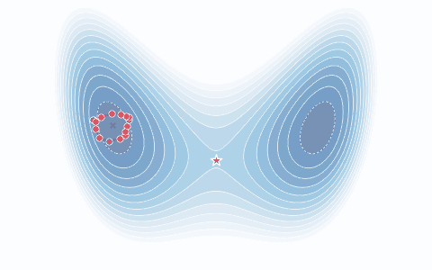

# PyRPMD

[English manual](docs/index.md) · [中文](README.zh-CN.md) ·
[Examples](docs/manual/examples.md) · [Contributing](CONTRIBUTING.md)

PyRPMD runs ring-polymer molecular dynamics from TOML or Python inputs: reaction
rates, direct scattering, free energies, equilibrium PIMD, transport and spectra.
C++17/OpenMP kernels and a NumPy reference implementation share explicit units,
checkpoint restart and calculation diagnostics.

## Install

Use Python 3.11+ and a C++17 compiler:

```bash
git clone https://github.com/chen-yu-hao/PyRPMD.git
cd PyRPMD
python -m pip install .
pyrpmd info
```

For the NumPy implementation use `PYRPMD_NO_NATIVE=1 python -m pip install .`.
MPI, GPU and external potential adapters are optional; see the
[installation guide](docs/manual/installation.md). The next 0.2.x binary release
is being prepared; this README does not assume an unpublished wheel is on PyPI.

## First run

```bash
pyrpmd init first-run
pyrpmd validate first-run/quickstart.inp --check-pes
pyrpmd run first-run/quickstart.inp --output first-run/run
pyrpmd analyze first-run/run
```

The starter computes the centroid free energy of a harmonic oscillator in a few
seconds. Its exact answer is $F(x)=\tfrac12 kx^2$, and the
[Quickstart](docs/manual/quickstart.md) shows how to compare: the result agrees to
about 0.1 $k_BT$. The tutorials below do the same for the other tasks. Resume a
saved run with `pyrpmd resume first-run/run`.



The figure illustrates the ring-polymer representation; it is a schematic,
not a computed result from the starter.

## Stable workflow entry points

| Task | Observable and starting point |
| --- | --- |
| `pimd` | Equilibrium energies — [finite-P harmonic tutorial](examples/tutorials/harmonic_pimd/README.md) |
| `fes` | Umbrella and frozen WT-MetaD free energies — [double-well tutorial](examples/tutorials/double_well_metad/README.md) |
| `rate` | Gas-phase PMF and recrossing rate — [rate examples](examples/rate/) |
| `drpmd` | Thermal single-surface collision outcomes — [direct-scattering guide](examples/drpmd/README.md) |
| `site_rate` | Basin-normalized escape — [periodic barrier tutorial](examples/tutorials/periodic_site_rate/README.md) |
| `diffusion` | Physical centroid transport — [free diffusion tutorial](examples/tutorials/free_diffusion/README.md) |
| `spectroscopy` | RPMD/TRPMD relative spectra — [harmonic IR tutorial](examples/tutorials/harmonic_spectroscopy/README.md) |

The [stability registry and policy](docs/development/stability.md) define these
scopes and label beta/research methods. Software stability and a calculation's
convergence are separate: use [How to converge a result](docs/convergence.md)
and the diagnostics saved with each run. Tutorial inputs state their analytic
reference and acceptance criteria; measured results belong to their run artifacts.

## Cite

Cite the exact release or Git commit using [CITATION.cff](CITATION.cff), together
with the method and PES papers used in your calculation. The
[method reference catalog](docs/manual/references.md) and [BibTeX](docs/references.bib)
provide those sources. PyRPMD has no software DOI assigned in this checkout.

[Changelog](CHANGELOG.md) · [Development and validation history](docs/development/stability.md#developer-and-validation-records) ·
[License](LICENSE) · [Third-party notices](THIRD_PARTY_NOTICES.md)
