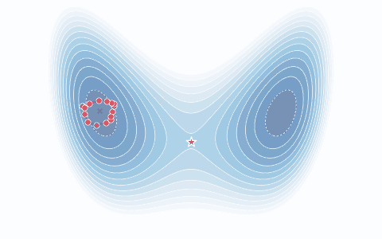

# PyRPMD

[中文手册](docs/zh/index.md) · [English](README.md) ·
[示例](docs/zh/manual/examples.md) · [参与开发](CONTRIBUTING.md)

PyRPMD 通过 TOML 或 Python 输入执行环聚合物动力学，包括反应速率、直接散射、
自由能、平衡 PIMD、输运与光谱。C++17/OpenMP 内核和 NumPy 参考实现提供明确的
单位、checkpoint 续算以及计算诊断。

## 安装

使用已有 Python 3.11+ 环境与 C++17 编译器：

```bash
git clone https://github.com/chen-yu-hao/PyRPMD.git
cd PyRPMD
python -m pip install .
pyrpmd info
```

NumPy 路径使用 `PYRPMD_NO_NATIVE=1 python -m pip install .`。
MPI、GPU 与外部势能接口按需安装，见[安装手册](docs/zh/manual/installation.md)。
后续 0.2.x 二进制发布正在准备；这里不把尚未发布的 wheel 当成已在 PyPI 上架。

## 第一次运行

```bash
pyrpmd init first-run
pyrpmd validate first-run/quickstart.inp --check-pes
pyrpmd run first-run/quickstart.inp --output first-run/run
pyrpmd analyze first-run/run
```

starter 在几秒内算出谐振子的质心自由能，其精确解为 $F(x)=\tfrac12 kx^2$；
[快速入门](docs/zh/manual/quickstart.md)给出了对比方法，结果与精确解相差约 0.1 $k_BT$。
下面的教程对其他任务做同样的对照。
使用 `pyrpmd resume first-run/run` 可恢复已有计算。



这是环聚合物表示的示意图，不是 starter 的计算结果。

## 稳定工作流入口

| task | 计算内容与入口 |
| --- | --- |
| `pimd` | 平衡能量：[有限珠数谐振子教程](examples/tutorials/harmonic_pimd/README.md) |
| `fes` | 伞抽样与冻结 WT-MetaD 自由能：[双势阱教程](examples/tutorials/double_well_metad/README.md) |
| `rate` | 气相 PMF 与 recrossing 速率：[速率示例](examples/rate/) |
| `drpmd` | 热单势能面直接碰撞：[散射指南](examples/drpmd/README.md) |
| `site_rate` | 单位点逃逸：[周期势垒教程](examples/tutorials/periodic_site_rate/README.md) |
| `diffusion` | 物理质心输运：[自由扩散教程](examples/tutorials/free_diffusion/README.md) |
| `spectroscopy` | RPMD/TRPMD 相对光谱：[谐振 IR 教程](examples/tutorials/harmonic_spectroscopy/README.md) |

[稳定级别与兼容政策](docs/development/stability.md)列出适用范围及 beta/research 方法。
软件稳定与单个计算的科学收敛分别判断；参考[如何使结果收敛](docs/convergence.md)
及运行产物中的诊断。教程说明解析参考和验收标准，实测结果以对应计算产物为准。

## 引用

按 [CITATION.cff](CITATION.cff) 引用软件的确切版本或 Git commit，并引用实际使用的
方法与势能论文；见[方法出处](docs/manual/references.md)及 [BibTeX](docs/references.bib)。
当前 checkout 未分配软件 DOI。

[更新记录](CHANGELOG.md) · [开发与验证历史](docs/development/stability.md#developer-and-validation-records) ·
[许可证](LICENSE) · [第三方声明](THIRD_PARTY_NOTICES.md)
