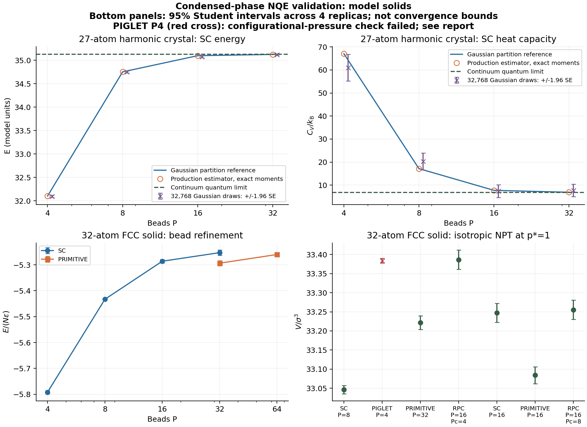

# Executed model-solid validation

All energies below are total-cell values in reduced units.
All 76 raw observation CSVs are public in [this PR's results directory](https://github.com/chen-yu-hao/PyRPMD/tree/codex/condensed-phase-nqe-20261102/benchmarks/condensed_phase/results), alongside the summaries and provenance sidecars. The accompanying review archive remains available. Summary filenames and SHA256 checksums identify the same CSVs in both locations. Python source distributions omit the raw CSVs to control package size.
Intervals are 95% Student intervals across four independent trajectories; they do not include bead, timestep, cell-size or model error.

## Fixed-volume FCC solid

| Method | P | dt | E, 95% interval | Pressure, 95% interval |
| --- | ---: | ---: | ---: | ---: |
| PRIMITIVE | 32 | 0.04 | -169.400916 [-169.721953, -169.079880] | 2.882732 [2.856099, 2.909365] |
| PRIMITIVE | 64 | 0.04 | -168.327307 [-168.487893, -168.166722] | 2.960757 [2.949001, 2.972513] |
| SC | 4 | 0.04 | -185.336093 [-185.527522, -185.144665] | 1.783040 [1.760286, 1.805794] |
| SC | 8 | 0.04 | -173.855884 [-173.955696, -173.756073] | 2.606477 [2.589787, 2.623168] |
| SC | 8 | 0.02 | -173.866615 [-174.188042, -173.545188] | 2.605754 [2.572381, 2.639128] |
| SC | 16 | 0.04 | -169.157941 [-169.386720, -168.929162] | 2.913798 [2.894459, 2.933138] |
| SC | 32 | 0.04 | -168.098312 [-168.434060, -167.762563] | 2.975796 [2.948488, 3.003104] |

The SC P=16 to P=32 total-energy shift is 1.059629 [0.611886, 1.507373]; the primitive P=32 to P=64 shift is 1.073609 [0.750474, 1.396743]. Both remain material relative to sampling error.

The SC P=32 minus primitive P=64 energy difference is 0.228996 [-0.090581, 0.548573]. Its interval includes zero, but overlap between finite-P calculations does not establish the infinite-P limit. These results demonstrate refinement and quantify its remaining uncertainty.

## Isotropic NPT FCC solid (external p=1)

The pressure column uses the canonical expected centroid kinetic term. Under PIGLET it must be read alongside the separate actual-piston-pressure diagnostic.

RPC energy and pressure are observables of the contracted Hamiltonian. No full-P physical-energy or virial correction is applied to the contracted samples.

| Method | P | dt | Piston tau | Volume, 95% interval | E, 95% interval | Configurational-CV pressure, 95% interval |
| --- | ---: | ---: | ---: | ---: | ---: | ---: |
| SC | 8 | 0.04 | 5.0 | 33.046256 [33.035510, 33.057002] | -174.984642 [-175.237027, -174.732257] | 1.003859 [0.990944, 1.016773] |
| SC | 8 | 0.02 | 5.0 | 33.035537 [33.025295, 33.045779] | -175.107799 [-175.278221, -174.937377] | 1.004617 [0.995479, 1.013756] |
| PIGLET | 4 | 0.04 | 5.0 | 33.384131 [33.377966, 33.390296] | -171.635150 [-171.811926, -171.458374] | 0.976337 [0.967061, 0.985612] |
| PRIMITIVE | 32 | 0.04 | 10.0 | 33.221562 [33.203603, 33.239521] | -171.312202 [-171.496645, -171.127759] | 0.996263 [0.985673, 1.006854] |
| RPC Pc=4 | 16 | 0.04 | 5.0 | 33.386668 [33.361239, 33.412096] | -161.268997 [-161.568231, -160.969763] | 1.004308 [0.990263, 1.018354] |
| SC | 16 | 0.04 | 5.0 | 33.247699 [33.222849, 33.272549] | -170.856798 [-171.185788, -170.527809] | 1.007824 [0.993987, 1.021660] |
| PRIMITIVE | 16 | 0.04 | 5.0 | 33.083859 [33.061932, 33.105787] | -173.822698 [-174.096612, -173.548783] | 1.005573 [0.990702, 1.020444] |
| RPC Pc=8 | 16 | 0.04 | 5.0 | 33.255287 [33.230022, 33.280552] | -167.239186 [-167.530528, -166.947845] | 1.006094 [0.991642, 1.020545] |

At matched P=16, the RPC Pc=4 minus full-ring energy difference is 12.553701 [12.514621, 12.592780]; Pc=8 reduces it to 6.583511 [6.554997, 6.612026]. The virial implements the contracted action correctly, while this repulsive/attractive splitting remains strongly unconverged at both contraction levels.

SC P=16 minus primitive P=32 NPT energy differs by 0.455403 [0.066504, 0.844303]. This compares two finite-P approximations with distinct piston times; it does not establish a converged equation of state.

The SC timestep comparisons retain equal step counts, so dt=0.02 has half the physical burn-in and production duration of dt=0.04. The targeted PIGLET diagnostic below separately holds physical duration fixed.

## Sampled SC heat capacities

These canonical fluctuation estimates use independent trajectory estimates for their intervals. Refined-protocol Cv/Cp remains statistically unresolved at these lengths; a negative lower confidence bound is uncertainty, not a negative physical heat capacity. Correlation and finite-length bias require longer production sampling. Deterministic harmonic Gaussian moments provide the separate Cv estimator-correctness check; the NPT volume quadrature supplies the finite-P Cp reference.

| Ensemble | P | dt | Quantity | Estimate, 95% interval |
| --- | ---: | ---: | --- | ---: |
| NVT | 4 | 0.04 | Cv/kB | 121.060153 [51.050793, 191.069513] |
| NVT | 8 | 0.04 | Cv/kB | 70.467876 [-38.005166, 178.940918] |
| NVT | 8 | 0.02 | Cv/kB | 99.143645 [85.654065, 112.633226] |
| NPT | 8 | 0.04 | Cp/kB | 65.075753 [36.288322, 93.863184] |
| NPT | 8 | 0.02 | Cp/kB | 48.796582 [-13.485202, 111.078367] |
| NVT | 16 | 0.04 | Cv/kB | 29.696943 [-12.603995, 71.997881] |
| NVT | 32 | 0.04 | Cv/kB | 12.955606 [-33.519681, 59.430893] |
| NPT | 16 | 0.04 | Cp/kB | 70.934167 [18.768007, 123.100327] |

## PIGLET pressure transferability check: failed for this P=4 fit

The added diagnostic retains the original seeds and uses equal physical equilibration time 120 and production time 480 at both timesteps. It does not replace the main campaign.

The canonical centroid bath covariance is a required input condition, not evidence that the coupled anharmonic system has canonical centroid momenta. Here R=beta*sum(|mean_bead(p)|^2/m)/(3N) exceeds one.

| dt | Configurational-CV pressure | Actual piston pressure | Centroid kinetic ratio R | Volume-weighted piston balance |
| ---: | ---: | ---: | ---: | ---: |
| 0.04 | 0.976337 [0.967061, 0.985612] | 1.001598 [0.988569, 1.014628] | 1.131762 [1.110476, 1.153048] | -0.097895 [-0.540328, 0.344538] |
| 0.02 | 0.977579 [0.972115, 0.983043] | 1.002602 [0.993735, 1.011468] | 1.130435 [1.110216, 1.150654] | -0.112216 [-0.436871, 0.212439] |

Every interval in this table is a 95% Student interval across four independent trajectories. The exact per-frame pressure difference is [sum(|pbar|^2/m)-3N/beta]/(3V). The feedback stationarity balance is V*(p_feedback-p_ext)+1/beta, whose target is zero; it does not enforce an unbiased physical equation of state.

Both timesteps fail the canonical-substituted pressure and centroid kinetic target. The algebraic discrepancy is resolved, while its physical origin and a transferable parameterization remain unresolved. Harmonic calibration accuracy therefore does not establish anharmonic PIGLET-NPT accuracy.

Full diagnostics, source identities and raw-file hashes: [piglet_pressure_diagnostic.json](piglet_pressure_diagnostic.json); derived volume-weighted balances: [comparisons.json](comparisons.json).

## Retained failures and execution history

The primitive P=32 NPT reference with piston tau=5 failed during equilibration: its step-38 cell proposal crossed the LJ model's cell-side > cutoff validity bound. It contributed no production frames. The replacement used tau=10 with the same four seeds, timestep, bead count and run lengths. [Failure replay and source identity](rejected_protocol.json).

A separate source-identity guard interrupted two trajectories after report-only source line shifts confused live-function source lookup; a third scheduled trajectory had not yet started. Completed CSVs were retained under exact hash checks; the three missing trajectories used unchanged protocols after switching to name-based AST lookup. [Execution record](execution_interruption.json).

## Pairwise comparison details

Differences and drift diagnostics are retained in [comparisons.json](comparisons.json).
The original seed set was retained in all comparisons. The additional SC16/32 and matched-P RPC cases quantify observed bead/contraction uncertainty; no trajectories were selected by outcome.

The SC P=8, dt=0.04 NPT energy second-half minus first-half shift is 0.150251 [0.056407, 0.244095]. This is a retained pointwise drift diagnostic, not proof of stationarity for other cases or an independently corrected estimate.



Gaussian sample markers are shifted horizontally by 4% for visibility; the simulations use the bead counts stated in the table. [PDF figure](validation.pdf).

## Reanalyzing the public observations

Use a checkout of [PR #75's branch](https://github.com/chen-yu-hao/PyRPMD/tree/codex/condensed-phase-nqe-20261102), which contains all 76 CSVs under benchmarks/condensed_phase/results together with their summaries and sidecars. From the repository root:

```bash
export OMP_NUM_THREADS=1 OPENBLAS_NUM_THREADS=1 PYTHONPATH=src
NQE_RESULTS=benchmarks/condensed_phase/results
python benchmarks/condensed_phase/analyze_results.py "$NQE_RESULTS"
python benchmarks/condensed_phase/plot_validation.py "$NQE_RESULTS"
```

This uses the committed summaries and raw series without running dynamics. The scientific guide gives complete commands to regenerate the trajectories.

The accompanying review archive is another way to obtain the observations. For a Python source-distribution checkout, which omits raw CSVs, extract just those files at the repository root; the archive paths start with benchmarks/condensed_phase/results, with no additional enclosing directory:

```bash
unzip /path/to/PyRPMD-condensed-phase-validation-20261102.zip 'benchmarks/condensed_phase/results/*.csv'
```

Then run the same analysis commands above. The Git repository includes the public raw observations; the sdist exclusion only controls the Python package's size.

See [the scientific guide](../../../docs/condensed-phase-nqe.md) for models, equations, parameter provenance and scope.
