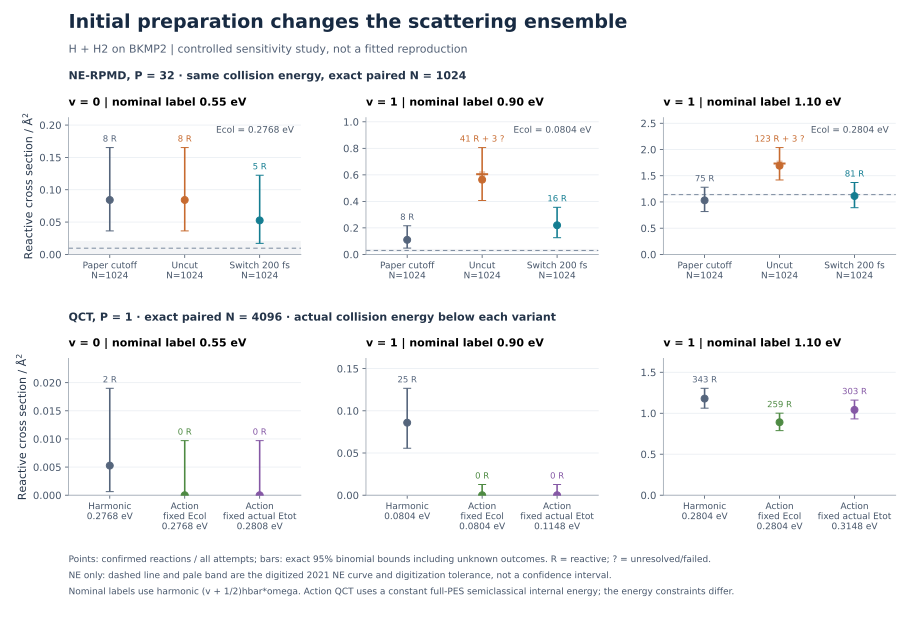
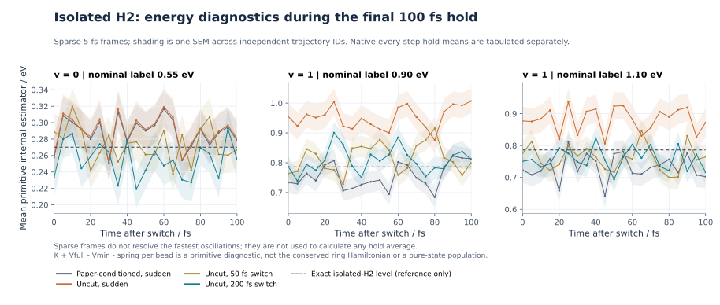

# H + H2: initial-state preparation sensitivity

These are completed BKMP2 calculations, not a fitted correction to the paper.
The [protocol](../STATE_PREPARATION_STUDY.md) documents sampling, energy definitions,
source checks and reproduction commands. The smooth NE preparation remains experimental.

## Completed calculation

- 30,720 new collision attempts: 836 reactive, 29,878 nonreactive, 6 unresolved, 0 failed.
- 6,144 independent isolated-H2 preparations: all completed, 0 failed.
- NE comparisons use the exact 1,024-ID subset of the previous calculation; QCT comparisons
  use the same 4,096 IDs. The original full 4,096-sample NE estimates are separate CSV rows.
- All collision steps and isolated preparation steps use native propagation. Collisions use
  dt=0.02 fs, a 250 fs initial limit and continuation of the same phase point up to 1,000 fs.
- The 200 fs switched collisions launch immediately after the ramp. Only the independent
  audits append a 100 fs hold; their time means are not instantaneous collision launch energies.

## Cross sections

All entries are in Angstrom^2. The total-energy column is the original harmonic label.
Square brackets in the uncut NE column are identification bounds from the unresolved outcomes,
not sampling confidence intervals. Full 95% binomial envelopes are in the CSV.

| v | Nominal label / eV | Paper-conditioned NE, N=1024 | Uncut NE, N=1024 | Uncut + 200 fs, N=1024 | Harmonic QCT, N=4096 | Action QCT, fixed Ecol | Action QCT, fixed actual Etot |
|---|---:|---:|---:|---:|---:|---:|---:|
| 0 | 0.55 | 0.084193 | 0.084193 | 0.052621 | 0.005262 | 0 | 0 |
| 1 | 0.90 | 0.109967 | [0.563581, 0.604818] | 0.219934 | 0.085912 | 0 | 0 |
| 1 | 1.10 | 1.030940 | [1.690742, 1.731979] | 1.113415 | 1.178708 | 0.890045 | 1.041249 |

Zero observations give two-sided 95% Clopper-Pearson upper bounds of 0.009701 Angstrom^2
for v=0/0.55 and 0.012671 Angstrom^2 for v=1/0.90; they do not establish a zero true cross section.
The original full NE estimates for these points are 0.055252, 0.137459 and 0.945028 Angstrom^2.

Removing the paper's centroid cutoff increases the two v=1 estimates. Adding the 200 fs ramp
to those uncut ensembles reduces reactivity, but this does not establish a correct pure-state
ensemble or complete the literature reproduction. At v=1/0.90 the switched cross section
is still 0.219934 Angstrom^2, compared with the digitized 2021 NE reference of about 0.029688.
The reference is approximate and its digitization tolerance is not a statistical confidence interval.

At fixed collision energy, full-PES action QCT changes the v=1/0.90 reaction count from 25/4096
to 0/4096 and the v=1/1.10 count from 343/4096 to 259/4096. The corresponding paired differences
are -0.085912 (conservative 95% CI [-0.132912, -0.037081]) and -0.288663
([-0.450379, -0.126282]) Angstrom^2. Retuning the latter to fixed actual total energy increases
Ecol from 0.280402 to 0.314822 eV and gives 303 reactions. This is a distinct energy constraint.

Every paired contrast retains all IDs, including unknown outcomes. The interval uses simultaneous
97.5% intervals for gained/lost reactivity, giving at least 95% coverage per contrast; there is no
family-wise adjustment across the twelve contrasts. Removing the cutoff can redraw the whole
initial state on rejected IDs, so that contrast is not coordinate-identical.

## Isolated-diatom diagnostics

Primitive internal means use the native integral at every 0.02 fs step, followed by an average
over independent trajectory means. Values below are eV, mean +/- one SEM, N=512 per cell.

| v / nominal label | Paper-conditioned sudden | Uncut sudden | 50 fs ramp | 200 fs ramp |
|---|---:|---:|---:|---:|
| 0 / 0.55 | 0.276492 +/- 0.005937 | 0.278223 +/- 0.006318 | 0.264096 +/- 0.005037 | 0.263950 +/- 0.005030 |
| 1 / 0.90 | 0.766782 +/- 0.015803 | 0.959016 +/- 0.029373 | 0.815351 +/- 0.016107 | 0.815303 +/- 0.016138 |
| 1 / 1.10 | 0.734268 +/- 0.017145 | 0.883549 +/- 0.026921 | 0.759867 +/- 0.016567 | 0.759690 +/- 0.016583 |

The primitive quantity K + Vfull - Vmin - spring per bead is neither the conserved H/P nor a
state population. Paired differences of the 200 fs and 50 fs finite-window hold means are small
(absolute mean difference below 0.00018 eV here); that does not establish adiabatic state preservation.

The maximum work-balance residual and maximum native hold drift are both 1.989277 meV.
Nevertheless, rare uncut excited-state preparations reach final centroid bonds of 32.27194 and
29.02692 bohr. Numerical completion and small drift do not prove bound-state stability.
The six unresolved collision endpoints are retained with their original labels and conservative
bounds; their large, outward-moving three-fragment geometries are diagnostic only.

## Files and validation

- `preparation_cross_sections.csv`: all estimates, energy conventions, counts, bounds and sample sizes.
- `preparation_paired_comparisons.csv`: matched-ID changes and conservative intervals.
- `audit_hold_statistics.csv`: primary native 100 fs hold statistics only.
- `audit_paired_time_means.csv`: matched-ID changes of native hold means, with SEM across trajectories.
- `preparation_numerics.csv`: work-balance residuals, hold drift and observed geometry extrema.
- `internal_energy_references.csv`: harmonic, leading-order EBK and independent quantum reference energies.
- `unresolved_endpoint_diagnostics.json`: original labels, endpoint distances/velocities and launch diagnostics.
- `provenance.json`: exact code revision, all analysis input hashes and targeted validation result.

Validation: **77 tests and 45 subtests passed** in the recorded environment. The separate
checkpoint-clock fix accepts accumulated floating-point roundoff at one million steps while
rejecting a full-step clock error; it does not change the propagation equations.

Exact follow-up calculation and analysis sources:
[ bddb98103e98ec6f5cbd6ed1f84dd126e33d82b3 ](https://github.com/chen-yu-hao/PyRPMD/tree/bddb98103e98ec6f5cbd6ed1f84dd126e33d82b3).
Historical baseline source archive:
[0860a079950e09e1e97c001acd23a436ce273ec1](https://github.com/chen-yu-hao/PyRPMD/tree/0860a079950e09e1e97c001acd23a436ce273ec1).

The checked raw archive contains all new ledgers and the six complete baseline cases required
for reanalysis, plus the full analysis JSON/CSV, figures and Chinese PDF. The archive builder
excludes publisher PDFs, third-party PES source/binaries, pilot runs and repository source copies.

Primary literature: [Marjollet & Welsch 2020](https://doi.org/10.1063/5.0004179),
[Marjollet & Welsch 2021](https://doi.org/10.1002/qua.26447),
[Marjollet, Inhester & Welsch 2022](https://doi.org/10.1063/5.0076216).
