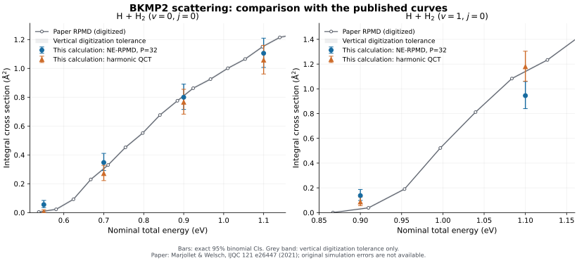

# BKMP2 reproduction results — 2026-10-31

The full protocol and commands are in [STATE_SELECTED_REPRODUCTION.md](../STATE_SELECTED_REPRODUCTION.md).
This is a finite-sample comparison with Marjollet & Welsch, [IJQC 121 e26447](https://doi.org/10.1002/qua.26447), not a claim of full reproduction.

## Main NE-RPMD results

Each main point uses P=32 and N=4096. Areas below are in Angstrom squared.
The main-disk cutoffs are 3.5 bohr (v=0) and 4.0 bohr (v=1); outer annuli are reported separately.

| v | Nominal total energy / eV | Reactive / N | This calculation | Exact binomial 95% CI | Paper curve, interpolated |
|---:|---:|---:|---:|---:|---:|
| 0 | 0.55 | 21/4096 | 0.0553 | [0.0342, 0.0843] | 0.0096 |
| 0 | 0.70 | 132/4096 | 0.3473 | [0.2913, 0.4106] | 0.3050 |
| 0 | 0.90 | 304/4096 | 0.7998 | [0.7153, 0.8910] | 0.8104 |
| 0 | 1.10 | 420/4096 | 1.1050 | [1.0067, 1.2095] | 1.1545 |
| 1 | 0.90 | 40/4096 | 0.1375 | [0.0983, 0.1868] | 0.0297 |
| 1 | 1.10 | 275/4096 | 0.9450 | [0.8398, 1.0590] | 1.1403 |

Paper values are digitized/interpolated, not an original author table. Image-reading tolerances are separate from trajectory confidence intervals; author MC uncertainty and interpolation-model error are not quantified.

## Findings and limits

- The three above-threshold v=0 points overlap the paper curve within the present statistical precision. The v=0 threshold point and both v=1 points retain discrepancies.
- At v=1, nominal total energy 0.90 eV, P64 gives 0.1512 Angstrom squared (11/1024), consistent with the elevated P32 estimate. P64 does not remove this discrepancy in the sampled runs.
- Halving dt from 0.02 to 0.01 fs changes no outcome labels in the two paired 256-trajectory checks and reduces the median observed Hamiltonian drift to about one quarter.
- Interpreting the entrance distance radially changes 8/256 reactivity labels at v=1, 1.10 eV (17 to 19 reactions), while the paired v=0 subset is unchanged. This remains a preparation/flight convention sensitivity.
- The v=1, 0.90 eV outer annulus contains 1/1024 reactive trajectories at b=4.3082 bohr. The disk and annulus estimates sum to 0.1452 Angstrom squared through b=5 bohr. Larger b is not tested; bmax=4 is not fully converged.
- The initial-state audit quantifies conditioning and harmonic-to-BKMP2 energy shifts. The v=1, 1.10 eV initial primitive mean is about 0.0625 eV below its nominal harmonic label; this is not a pure-state preparation.
- No propagated collision is unresolved or numerically failed. Main runs contain 237,190,790 native integration steps and zero Python integration steps.

## Included records

- `paper_comparison.csv`: six pointwise comparisons, including both kinds of uncertainty.
- `all_case_results.csv`: all 28 cases, including the separate pilots and sensitivities.
- `paired_sensitivity_results.csv`: comparisons using exactly the common trajectory IDs.
- `stratified_cross_sections.csv`: area-weighted disk-plus-annulus estimates and conservative intervals.
- `initial_audit.json`: complete zero-propagation energy audit and analytical conditioning expectations.
- `h2_reference.csv`: independently converged BKMP2 j=0 radial vibrational levels.
- `literature_reference/`: digitized points, interpolation inputs and source/calibration provenance.
- `provenance.json`: actual PES build, source hashes and calculation conventions.

The raw per-trajectory ledgers are delivered in the companion results archive. They are not large per-step coordinate files; each trajectory can be regenerated from its configuration and RNG identity.
Exact-source replay applies to formal and sensitivity runs. The six separate pilots recorded an older draft driver hash whose exact source was not retained; they are not pooled into any formal estimate.
Third-party BKMP2 source/binaries and publisher PDF/images are not redistributed here. Use the pinned build script and the linked original publication.

Exact formal/sensitivity source: [`0860a079`](https://github.com/chen-yu-hao/PyRPMD/tree/0860a079950e09e1e97c001acd23a436ce273ec1). Current driver hardening does not change this calculation matrix; both archived and current hashes are recorded.
