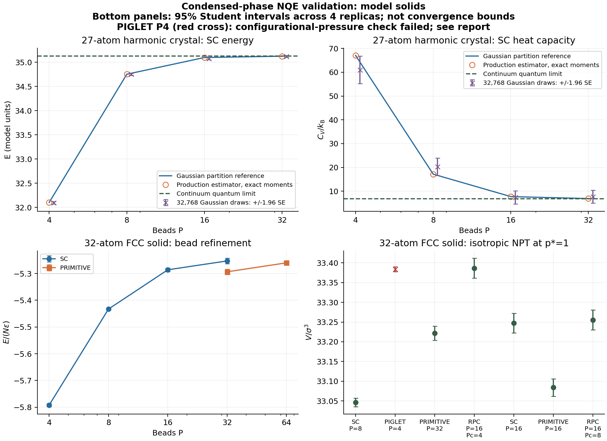

# Condensed-phase nuclear quantum effects

PyRPMD provides Suzuki–Chin (SC) energy, heat-capacity and pressure estimators,
isotropic SC-NPT sampling, calibrated PIGLET with an isotropic BZP piston, and
the strain derivative of the ring-polymer contracted (RPC) Hamiltonian. The
validation below uses a coupled harmonic crystal and an anharmonic FCC
Lennard-Jones solid. It is a finite-size model-solid validation, not a claim
about liquid water or an experimentally fitted material equation of state.

## Observable and ensemble contracts

| Route | Implemented observable or ensemble | Scientific boundary |
| --- | --- | --- |
| SC NVT | Total, potential and kinetic energy; canonical constant-volume heat capacity | Even P; temperature-independent physical PES; all Cartesian degrees of freedom sampled |
| SC NPT | Isotropic BZP; SC pressure and constant-pressure heat capacity | Full 3D PBC, all atoms mobile, physical PES cell derivative; no rigid-bond/fixed-atom virial |
| PIGLET NPT | Explicit per-mode GLE matrices with a canonical centroid bath target and BZP piston | Matrices must match beta and P and carry provenance; the supplied P=4 fit fails the anharmonic pressure check below |
| RPC virial | Exact strain derivative of the stated contracted Hamiltonian | A contracted-Hamiltonian quantity; its convergence to the full physical model requires a Pc refinement |

SC and PIGLET are used to estimate static quantum equilibrium observables;
PIGLET does not sample a canonical ring-polymer measure. The SC sampling
potential is not a Born–Oppenheimer PES for real-time RPMD. Combining SC with
a PIGLET bath is not supported. A physical configurational virial includes explicit cell
dependence, has units of energy, and excludes kinetic and ring-spring terms.
It is not replaced by an unqualified Cartesian `q dot F` in periodic systems.

### SC energy and heat capacity

Write the sum-beads sampling potential as

$$
U_{SC}=\sum_j\left[w_jV(q_j)+c_jG(q_j)\right],\qquad
G=\sum_i |F_i|^2/m_i,\qquad c_j=w_jd_j\beta^2/P^2.
$$

The weights are 2/3 and 4/3 on alternating beads; the corresponding `d` values
are alpha/6 and (1-alpha)/12. `SuzukiChinPotential` accepts general alpha in
[0,1]. The input workflow uses alpha=0 so its separate even-bead operator
observables have their stated meaning. All indices in the Python API are
zero based.

For `delta=q-q.mean(axis=0)`, the thermodynamic centroid-virial estimators are

$$
E=\frac{3N}{2\beta}+\frac{1}{P}\left[
\sum_j(w_jV_j+3c_jG_j)-\frac12\sum_j\delta_j\cdot F_{SC,j}\right],
$$

$$
V_{TD}=\frac1P\sum_j(w_jV_j+2c_jG_j),\qquad K_{TD}=E-V_{TD}.
$$

These are derivatives of the SC partition function. Averaging `Usc/P`, or
using fictitious bead momenta as physical kinetic energy, gives a different
quantity. For alpha=0, the API also supplies `operator_*` energy estimates
using even beads, with distinct field names. See Kapil, Behler and Ceriotti,
[JCP 145, 234103 (2016), Appendix C](https://doi.org/10.1063/1.4971438).

The heat capacity uses a scaled-coordinate derivative:

$$
a(x)=\frac{x}{P}U_{SC}\left(\bar q+\sqrt{x/\beta}\delta;x\right),\qquad
\frac{C_V}{k_B}=\frac{3N}{2}+\beta^2\left[\mathrm{Var}(E)-\langle a''(\beta)\rangle\right].
$$

The force-square coefficient is recomputed at the shifted inverse temperature;
holding it fixed loses the required explicit temperature derivative. Symmetric
differences at relative steps `h` and `h/2` expose the numerical sensitivity;
the `h/2` result supplies the curvature. For NPT, replace `Var(E)` by
`Var(E+p_external*V)` to obtain **Cp**. The curvature is still evaluated at
fixed cell for each saved configuration. See
[Kapil et al., JCTC 15, 3237 (2019)](https://doi.org/10.1021/acs.jctc.8b01297),
[supporting information, S1 and S3](https://pstorage-acs-6854636.s3.amazonaws.com/15023264/ct8b01297_si_001.pdf).

```python
from pyrpmd.pimd_methods import SuzukiChinPotential
from pyrpmd.suzuki_chin import suzuki_chin_thermodynamics

sc = SuzukiChinPotential(physical, masses, beta, nbeads, alpha=0.0)
series = sc.estimators_batch(paths, volumes=volume)  # one fixed cell
report = suzuki_chin_thermodynamics(series, beta, block_size=100)

# For an NPT trajectory: restore the matching cell before each scalar call.
rows = []
for q, cell in zip(saved_positions, saved_cells):
    sc.set_cell(cell)
    rows.append(sc.estimators(q, volume=abs(np.linalg.det(cell))))
report_npt = suzuki_chin_thermodynamics(
    rows, beta, volumes=saved_volumes, pressure_au=external_pressure,
    block_size=100,
)
```

`volumes=` does not change a provider's cell. The batched estimator is for
configurations at the same cell; use the scalar route for changing cells.
Block jackknife errors require blocks longer than the slow correlations.
The report deliberately leaves `physical_converged=false`; a finite series
does not establish bead, timestep, cell-size or sampling convergence.

### SC pressure and NPT

SC requires the strain derivative of its action, including the force-square
term. With `W=-dV/dstrain`, the effective virial is

$$
W_{SC,j}=w_jW_j+2c_j\left[
\sum_iF_i\otimes F_i/m_i-D_{F/m}W_j\right].
$$

The directional derivative uses the same mass-weighted, bead-normalized
finite displacement as the SC force. A missing physical virial fails clearly.
The low-noise pressure estimator replaces fictitious centroid kinetic energy
by its canonical expectation:

$$
p=\frac{3N/\beta+\mathrm{Tr}\sum_jW_{SC,j}/P-
\sum_j\delta_j\cdot F_{SC,j}/P}{3V}.
$$

The BZP dynamical piston uses the corresponding instantaneous centroid kinetic
term. It scales centroids and the cell while retaining internal bead offsets;
the normalization correction for the unconstrained COM and `dV` measure is
retained. See [Ceriotti, More and Manolopoulos, CPC 185, 1019 (2014)](https://doi.org/10.1016/j.cpc.2013.10.027).

Use the external BZP/Dynamics composition for SC so the correct SC estimators
are available, or the restartable `path_integral` input workflow. Raw primitive
`NativeEnsemble` observation columns do not implement SC thermodynamics.

```python
from pyrpmd.barostat import BZPBarostat
from pyrpmd.dynamics import Dynamics, State

piston = BZPBarostat(sc, system, beta, nbeads, external_pressure, tau_au)
dynamics = Dynamics(sc, masses, beta, nbeads, dt,
                    barostat=piston, thermostat="pile-l",
                    cell=system.cell, pbc=system.pbc)
state = State(initial_ring, dynamics.sample_momenta())
dynamics.step(state)
observation = sc.estimators(state.q, volume=piston.volume)
```

### PIGLET NPT

PIGLET controls the quantum fluctuations using specifically fitted per-mode
GLE matrices; an identity covariance thermostat is not a PIGLET calibration.
The implementation requires matching `beta`, `beads`, and a nonempty
`provenance`. NPT additionally requires a canonical centroid bath target: unit
physical momentum variance and zero physical/auxiliary covariances. Its piston is coupled
to a bath at the canonical target temperature. This bath condition is necessary
for the supported composition; it does not establish a canonical steady state
of the coupled anharmonic PIGLET system. Unsupported pressure geometries and
TRPMD-NPT remain rejected.
See [Ceriotti and Manolopoulos, PRL 109, 100604 (2012)](https://doi.org/10.1103/PhysRevLett.109.100604).

The benchmark includes numerical matrices from the
[official i-PI CP2K NPT example](https://github.com/i-pi/i-pi/blob/main/examples/clients/cp2k/npt_piglet/input.xml).
Their immutable Git blob is `87d27b7d1f3c42c3ad5a241dced2e359d932b30f`.
The original set has P=4, T=750 K, and nine variables per mode. The stored
dimensionless covariance is the original Kelvin matrix divided by P*T=3000 K.
To preserve the dimensionless frequency response at another temperature,
`A_target=A_source*beta_source/beta_target`; no parameter fitting is performed
in this repository. All 324 A and 324 C entries were compared with that source.

[The independent harmonic reference](../benchmarks/condensed_phase/piglet_reference.py)
solves the continuous coordinate/momentum/auxiliary Lyapunov equation without
the production thermostat or integrator. On beta*omega values
0.5, 1, 2, 4, 8, 12 and 20, the largest absolute relative error of potential and
centroid-virial kinetic energy is **0.3486%**. This checks units and the
harmonic fit. The anharmonic solid/NPT comparison remains a separate test.

Do not use PIGLET energy or enthalpy fluctuations to report the SC canonical
Cv/Cp formula. Fitting selected moments does not establish the full canonical
correlation structure needed by that fluctuation estimator.

### RPC virial

For an explicit additive decomposition,

$$
U_{RPC}=\sum_jV_f(q_j)+\frac{P}{P_c}\sum_kV_s((Tq)_k),
$$

the homogeneous strain derivative is
`sum(W_fast)+(P/Pc)*sum(W_slow_contracted)`. The coordinate contraction
commutes with affine strain. The pressure also requires the matching
centroid-offset force correction; its slow component may be computed using
contracted coordinates/forces, or the lifted full-ring forces.

Per-bead arrays of contracted energy and virial are a uniform distribution
of an aggregate quantity. They are not independent physical bead observables.
`SplitPotential.set_cell` forwards to both physical components; missing
component virials propagate as unavailable. `DifferencePotential` subtracts
physical virials consistently. See [Markland and Manolopoulos, JCP 129,
024105 (2008)](https://doi.org/10.1063/1.2953308) and [RPC/MTS](rpc-mts.md).

## Reproducing the model-solid validation

The checked-in driver, models, matrix data, figures and summaries are under
[benchmarks/condensed_phase](https://github.com/chen-yu-hao/PyRPMD/tree/codex/condensed-phase-nqe-20261102/benchmarks/condensed_phase).
All **76 raw observation CSVs** are public in this PR's
[results directory](https://github.com/chen-yu-hao/PyRPMD/tree/codex/condensed-phase-nqe-20261102/benchmarks/condensed_phase/results),
alongside their summaries and provenance sidecars. The accompanying review
archive remains available, and the driver can regenerate the observations.
Summary filenames and checksums identify the same CSVs in the repository and
archive. Python source distributions built with `setup.py sdist` omit the raw
CSVs to control package size; obtain them from the Git repository or the
accompanying archive when reanalyzing an sdist checkout. All model parameters,
seeds, bead counts and timesteps are explicit. The LJ potential requires a
C++ compiler and builds its local callback into the output folder.

```bash
export OMP_NUM_THREADS=1 OPENBLAS_NUM_THREADS=1 PYTHONPATH=src
python benchmarks/condensed_phase/validate.py --case harmonic \
  --samples 32768 --replicas 4 --burn 4000 --steps 16000 --stride 20 \
  --output /tmp/condensed-phase-validation
python benchmarks/condensed_phase/validate.py --case lj \
  --replicas 4 --burn 3000 --steps 12000 --stride 20 --jobs 4 \
  --output /tmp/condensed-phase-validation
python benchmarks/condensed_phase/piglet_reference.py \
  --output /tmp/condensed-phase-validation/piglet_harmonic_reference.json
python benchmarks/condensed_phase/piglet_pressure_diagnostic.py \
  --jobs 4 --output /tmp/condensed-phase-validation
python benchmarks/condensed_phase/seal_results.py /tmp/condensed-phase-validation
python benchmarks/condensed_phase/analyze_results.py /tmp/condensed-phase-validation
python benchmarks/condensed_phase/plot_validation.py /tmp/condensed-phase-validation
```

`--resume` accepts completed LJ CSVs only when their protocol, numerical model,
core source/binary identities and data checksum agree with their sidecars.
Missing metadata or changed code fails instead of reusing an unrelated file.
The initial dataset has explicit retrospective provenance where the metadata
feature was added after execution started; it is not represented as a
before-execution source snapshot. Later refinement trajectories capture their
numerical-source identity before propagation and verify it again afterward.

Quick mechanics example:

```bash
python examples/path_integral/piglet_npt.py --output /tmp/piglet-solid --steps 1000
```

### Coupled harmonic crystal: independent exact reference

The 27-atom model has a periodic nearest-neighbour coupling graph, three
Cartesian components per atom and a weak pin at each fractional lattice site.
Its stiffness varies as `(V/V0)^(-2*gamma)` with gamma=1.5, and a quadratic
elastic energy controls volume. The pin removes translation zero modes and
defines an unbounded Gaussian integral about each labelled site. This is an
analytic model crystal; the per-site pin is not an atom-exchange-periodic
interatomic potential. The anharmonic LJ test supplies that separate case.

The independent reference diagonalizes the spatial stiffness, constructs each
bead precision matrix, and differentiates its log determinant. An additional
check reconstructs the **production** estimator's quadratic coefficients by
basis probes and evaluates their Gaussian Wick moments exactly. It therefore
tests the actual estimator implementation without Monte Carlo uncertainty.

At beta=8, N=27, V=729, the continuum reference is E=35.12819304,
Cv/kB=6.82029673 and p=0.07228023260 in the model's units.

| SC beads | Finite-P energy | Finite-P Cv/kB | Finite-P pressure |
| ---: | ---: | ---: | ---: |
| 4 | 32.10277687 | 67.07694584 | 0.06605509644 |
| 8 | 34.75370054 | 17.14822868 | 0.07150967189 |
| 16 | 35.09899022 | 7.71850749 | 0.07222014449 |
| 32 | 35.12625520 | 6.88170348 | 0.07227624527 |

The deterministic production moments reproduce energy and pressure to roughly
1e-12; the largest Cv difference is below 8e-6 kB with the stated finite
difference. Energy errors decrease by factors about 12.8 and 15.1 on doubling
8→16→32 beads, approaching fourth-order behaviour. The deliberately coarse
P=4 heat capacity also shows why bead convergence must be checked for the
observable itself.

The driver also draws 32,768 independent Gaussian paths at each P and reports
the sampled estimator/error. The heat-capacity fluctuation is much noisier
than the energy mean; these sampled values are retained even where a
pointwise interval misses its exact target. They are not used to replace the
deterministic correctness check.

SC-NPT is compared with a one-dimensional volume quadrature of the independent
finite-P partition function. Its reference Cp is
`mean(Cv_at_fixed_V)+beta^2*Var(E_at_fixed_V+p_ext*V)`. Four independent seeds
and two timesteps test the dynamical sampling in addition to the fixed-cell
estimator formula.

| SC-NPT timestep | Mean volume, 95% interval | Mean E, 95% interval | Cp/kB, 95% interval |
| ---: | ---: | ---: | ---: |
| 0.04 | 728.105 [727.268, 728.943] | 34.978 [34.888, 35.068] | 23.20 [8.91, 37.49] |
| 0.02 | 728.502 [727.509, 729.495] | 35.014 [34.903, 35.125] | 23.65 [-19.93, 67.24] |
| Finite-P reference | 727.756419 | 34.897711 | 18.124487 |

The dt=0.02 energy interval narrowly misses the exact finite-P target. It is
retained as a pointwise interval miss, rather than calling every sampled
observable compatible. Sampled Cp is statistically unresolved at this length;
its negative lower confidence limit is uncertainty, not a negative physical
heat capacity claim. The two timesteps use the same number of steps, so
halving dt also halves the physical equilibration/production duration.
Deterministic Gaussian moments establish estimator correctness; these finite
trajectories separately assess the pressure sampler and its sampling precision.

### Anharmonic FCC solid: physical periodic virials

The second model is a 32-atom FCC solid with epsilon=sigma=hbar=1, mass=100,
beta=5 and initial density=1. The dimensionless quantum parameter
`hbar/(sigma*sqrt(mass*epsilon))` is 0.1. A quintic switch
from 2.0 to 2.5 sigma makes the LJ potential twice differentiable. Every
periodic image within cutoff is included; a minimum-image half-box shortcut
would be invalid for this small supercell. The full interaction is the exact
sum of the switched repulsive and attractive components used by RPC.

The comparisons use four seeds, 3,000 equilibration steps, 12,000 production
steps and a sampling interval of 20. Means and 95% Student intervals are
computed from the **four independent trajectory means**, rather than treating
600 correlated saved frames as 600 independent replicas. Raw series also
support block estimates and first-half/second-half drift checks. Centroid RMS
displacement is measured after removing a common translation for the
diagnostic only; no COM constraint is applied to propagation or pressure.

The protocol includes primitive P=32/64, SC P=4/8/16/32, timestep refinements,
SC-NPT, PIGLET-NPT with the published calibration, and P=16/Pc=4/8 RPC-NPT. A separate full P=16 NPT
reference isolates contraction error from bead discretization. Coarse SC P=4
and P=8 are retained to expose substantial bead error at this quantum state
point; a successfully completed trajectory is not called bead converged.

The primitive P=32 NPT attempt at piston tau=5 failed during equilibration:
the step-38 cell proposal crossed the model's requirement that each box side
exceed the 2.5-sigma cutoff. It contributed no production frames. The reference
was repeated with tau=10, retaining all four original seeds and all other
parameters. This failure and its replay are retained in
[rejected_protocol.json](../benchmarks/condensed_phase/results/rejected_protocol.json).
All other LJ NPT protocols use tau=5. The SC16/32 and matched-P RPC references
were added to resolve observed bead/contraction uncertainty; Pc=8 was added
after the Pc=4 bias was observed. These additions retain the original seed
set and do not replace any earlier results. A separate provenance-guard
interruption and identical-protocol recovery are recorded in
[execution_interruption.json](../benchmarks/condensed_phase/results/execution_interruption.json).

At fixed volume, the SC total energies at P=8, 16 and 32 are respectively
-173.85588, -169.15794 and -168.09831 epsilon. The primitive P=32 and P=64
values are -169.40092 and -168.32731. The paired SC32-minus-primitive64
difference is 0.22900 [-0.09058, 0.54857] epsilon, while the SC16→32
and primitive32→64 shifts are 1.05963 [0.61189, 1.50737] and
1.07361 [0.75047, 1.39674] epsilon. These resolved refinements show substantial
remaining bead dependence. Agreement of the largest-P approaches within a
sampling interval does not establish an infinite-P result.

At matched full P=16 under NPT, the RPC Pc=4-minus-full energy difference is
12.55370 [12.51462, 12.59278] epsilon; Pc=8 reduces it to
6.58351 [6.55500, 6.61203] epsilon. Their volume differences are
0.30281 [0.29640, 0.30922] and 0.17143 [0.16770, 0.17516] sigma cubed.
Both contraction levels remain strongly biased for this particular
repulsive/attractive decomposition. These are observables of the contracted
Hamiltonian without an additional full-P physical correction. An exact
contracted virial is therefore not evidence that this aggressive contraction
is a converged approximation to the full model.

SC16-NPT and primitive32-NPT give volumes 33.24770 and 33.22156 sigma cubed,
but their energy difference, 0.45540 [0.06650, 0.84430] epsilon, remains
resolved. This is a comparison of two finite-P approaches with different
piston times; a converged equation of state is not asserted. The SC8 dt=0.04
NPT energy also has a positive pointwise second-half-minus-first-half shift
of 0.15025 [0.05641, 0.24410] epsilon. Full drift diagnostics are retained.
The LJ SC timestep comparisons use equal step counts and therefore different
physical durations. Sampled LJ heat capacities are tabulated in the executed
report, with broad intervals at the refined bead counts. The deterministic
crystal checks independently test the Cv estimator; the NPT volume quadrature
separately supplies the finite-P Cp reference.

### PIGLET: the anharmonic pressure check fails for this calibration

The original PIGLET-NPT trajectories showed a pressure discrepancy. A focused
diagnostic retained both the actual BZP feedback pressure and the pressure
obtained by replacing centroid kinetic energy with its canonical expectation.
It used the same four seeds at dt=0.04 and dt=0.02, with **equal physical**
equilibration time 120 and production time 480. The original campaign is
retained separately.

Define the centroid kinetic ratio and the exact difference as

$$
R=\frac{\beta}{3N}\sum_i\frac{|\bar p_i|^2}{m_i},\qquad
p_{\mathrm{feedback}}-p_{\mathrm{CV},T}
=\frac{\sum_i|\bar p_i|^2/m_i-3N/\beta}{3V}.
$$

| dt | Pressure using canonical kinetic expectation, 95% interval | Actual feedback pressure, 95% interval | Centroid kinetic ratio R, 95% interval |
| ---: | ---: | ---: | ---: |
| 0.04 | 0.97634 [0.96706, 0.98561] | 1.00160 [0.98857, 1.01463] | 1.13176 [1.11048, 1.15305] |
| 0.02 | 0.97758 [0.97212, 0.98304] | 1.00260 [0.99374, 1.01147] | 1.13044 [1.11022, 1.15065] |

The canonical centroid kinetic target is one and the pressure target is one.
Both timesteps fail the kinetic-ratio and canonical-substituted pressure
checks. The per-frame pressure identity holds to about 1e-15, locating the
algebraic discrepancy in the kinetic substitution. Halving the timestep at
equal physical duration does not remove the observed discrepancy.

For the piston, the stationary balance is
`mean(V*(p_feedback-p_external)+1/beta)=0`; it is not simply a constraint on
the unweighted mean pressure. Its measured four-seed 95% intervals are
[-0.5403, 0.3445] at dt=0.04 and [-0.4369, 0.2124] at dt=0.02, compatible
with zero. Pressure feedback can therefore be mechanically consistent while
the substituted physical observable is biased under this sampled measure.

This is a **failed anharmonic pressure/transferability validation** for the
published P=4 fit at this state point. The canonical centroid bath condition
is necessary for the supported coupling and does not prove that the coupled
anharmonic system has canonical centroid momenta. The data do not isolate
the microscopic cause among noncanonical energy transfer, finite-bead
approximation and remaining equilibration/sampling effects. No parameters
were refitted, and this implementation is not presented as production-accurate
PIGLET-NPT for arbitrary anharmonic materials. The harmonic Lyapunov check
and deterministic implementation tests establish their narrower claims.

Detailed executed values and confidence intervals are in
[the harmonic summary](../benchmarks/condensed_phase/results/harmonic_summary.json),
[the LJ summary](../benchmarks/condensed_phase/results/lj_summary.json), and
[the independent PIGLET calibration check](../benchmarks/condensed_phase/results/piglet_harmonic_reference.json).
The [executed-results report](https://github.com/chen-yu-hao/PyRPMD/blob/codex/condensed-phase-nqe-20261102/benchmarks/condensed_phase/results/RESULTS.md)
contains all LJ protocol means and intervals. The
[paired comparisons](../benchmarks/condensed_phase/results/comparisons.json)
retain bead/contraction differences, half-trajectory drift and the
volume-weighted pressure balances; the
[PIGLET diagnostic](../benchmarks/condensed_phase/results/piglet_pressure_diagnostic.json)
records both pressure definitions, source identities and raw-file hashes.
The [integrity manifest](../benchmarks/condensed_phase/results/integrity_manifest.json)
links these summaries to the public raw CSVs and their accompanying archive, and the
[software validation record](../benchmarks/condensed_phase/results/software_validation.json)
states the executed regression and source-package checks.



[PDF figure](../benchmarks/condensed_phase/results/validation.pdf). The lower
panels show 95% Student intervals across four independent trajectories;
these are sampling intervals, not bounds on bead, timestep or model error.
The red PIGLET point is retained despite its failed pressure check.

## Remaining physical scope

The validation addresses estimator derivatives, finite-P thermodynamics,
isotropic pressure coupling, restart mechanics and representative model-solid
sampling. It does not establish thermodynamic-limit results, liquid-water
structure, real-material accuracy, arbitrary PIGLET transferability,
anisotropic SC/PIGLET barostats, exchange/winding paths, or real-time spectra.
Increase cell size and trajectory length and refine P, Pc and timestep for a
specific production material. Preserve the distinction between sampling
precision and the numerical/model approximations in each comparison.

## 中文要点

SC 的总能量、热容和压力由高阶作用量求导得到，不能把修改后的采样势能
直接当作物理能量。NVT 输出 Cv，NPT 使用焓涨落输出 Cp；PIGLET 的非正则
采样不能直接套用该热容涨落公式。RPC virial 是收缩哈密顿量的准确应变导数，
仍需通过 Pc 收敛检验它对全势的近似误差。本次代表性体系包括 27 原子的
耦合谐振晶体和 32 原子的周期性非谐 FCC Lennard-Jones 固体；不声称已完成
液态水或真实材料的热力学极限验证。

这组 P=4 PIGLET 参数通过了独立谐振频率响应核验，但在非谐固体中的压力
检验失败：质心动能比约 1.13，使用正则动能期望的压力约 0.977，而外压
目标为 1；相同物理时长下减半时间步仍未消除偏差。保留该失败结果，不能
据此宣称 PIGLET-NPT 已达到任意材料的生产精度。SC 热容的确定性高阶估计量
核验通过，有限轨迹的 Cp 置信区间仍宽，采样精度与实现正确性分别报告。

## Generating and importing GLE/PIGLET parameters

`pyrpmd.gle_parameters` generates new parameters from harmonic equations or
imports user-supplied gle4md raw matrix files. It ships no third-party matrix
table. The historical model-solid benchmark above continues to use its
separately documented published parameter set; the generators here are a new,
independent route.

```python
from pyrpmd.gle_parameters import generate_optimal_gle, generate_piglet
from pyrpmd.engine import PropagationPlan

# Angular frequencies and inverse temperature are in atomic units.
canonical = generate_optimal_gle((0.1, 10.0), naux=2)
quantum = generate_piglet(
    (0.5 / 8, 12 / 8), beta=8.0, beads=4,
    naux=2, grid_size=32, max_nfev=600, tolerance=0.01,
)
plan = PropagationPlan(thermostat={"mode": "piglet", "gle": quantum})

# A spectroscopic band can instead be given explicitly:
canonical_cm = generate_optimal_gle(
    (100.0, 4000.0), frequency_unit="cm^-1", naux=2,
)
```

The returned mappings contain `A`, `C`, `provenance`, and
`parameter_metadata`; PIGLET also includes `beta` and `beads`. `A` is a drift
rate in inverse atomic time. `C` is the free-bath mass-scaled covariance
divided by the ring-polymer temperature `P/beta`. Consequently a canonical
bath has `C=I`, not `C=kBT*I`. The diffusion is

$$
D=AC+CA^T=BB^T.
$$

The generators enforce stable drift, positive covariance and positive
diffusion. PIGLET deliberately uses noncanonical internal-mode covariances;
requiring canonical fluctuation--dissipation there would recover ordinary
PIMD. Its centroid remains canonical. For a harmonic oscillator this gives

$$
\langle K_{cv}\rangle=\langle V\rangle+
\frac{1}{2\beta}-\frac{\omega^2}{2}\langle\bar q^2\rangle
=\langle V\rangle,
\qquad V_{exact}=K_{exact}=\frac{\omega}{4}\coth\frac{\beta\omega}{2}.
$$

These are the constraints of [Ceriotti and Manolopoulos, PRL 109, 100604
(2012)](https://doi.org/10.1103/PhysRevLett.109.100604). The numerical fit uses
one shared internal-mode bath, positive diagonal damping plus antisymmetric
couplings, and positive diagonal diffusion. It solves the full harmonic
coordinate/momentum/auxiliary Lyapunov equations on a logarithmic frequency
grid. The final parameters are checked on a denser grid with an independent
Lyapunov solver. The maximum relative energy residual must satisfy
`tolerance`, and the optimizer must report success. Failed fits raise an error
with the residual; they do not substitute a preset or retry with hidden random
initial conditions. Very slow internal-mode auxiliary relaxation is also
guarded against: the fixed fit controls target a full harmonic decay rate
of `0.3/beta`, require at least `0.27/beta` on the validation grid, and bound
two explicitly defined initial-covariance transients after `12.5*beta`.
These implementation choices and all diagnostics are part of the parameter
record. This check covers internal harmonic modes; a low-frequency centroid
or an anharmonic system can need substantially longer equilibration.

For canonical optimal sampling, `naux=0` selects an analytic white-noise
subset. Its potential-energy correlation time is

$$
\tau_V(\omega)=\frac{1}{2\gamma}+\frac{\gamma}{2\omega^2},
\qquad \gamma=\sqrt{\omega_{min}\omega_{max}}.
$$

This gamma maximizes the worst harmonic sampling efficiency
`kappa=1/(omega*tau_V)` over the interval among scalar Langevin baths. With
`naux=1`, `2`, or `3`, the generator fits a colored canonical bath by minimizing
the squared `log(omega*tau_V)` residual. This is a local optimization in the
documented matrix family, not a certified global optimum. The equations and
sampling objective follow [Ceriotti, Bussi and Parrinello, JCTC 6, 1170
(2010)](https://doi.org/10.1021/ct900563s). These efficiency residuals describe
mixing, not a bias in the canonical distribution.

### Importing gle4md raw output

```python
from pyrpmd.gle_parameters import load_gle4md

# beta and beads are read from unambiguous T/P headers, or supplied explicitly.
imported = load_gle4md(
    "piglet.raw", mode="piglet", unit_convention="gle4md",
)

# Headerless files require explicit units; no unit is guessed.
canonical_import = load_gle4md(
    "bath.a", covariance_path="bath.c",
    drift_unit="ps^-1", covariance_unit="dimensionless",
)
```

The reader supports the official `# A MATRIX: (picoseconds^-1)` and
`# C MATRIX: (K)` sections, `# Matrix for normal mode: 0` blocks, separate A/C
files, Fortran `D` exponents, and original comment metadata. It preserves
content SHA-256 values and records every conversion. Kelvin covariance is
divided by `P*T`, and energy covariance is multiplied by `beta/P`. For
canonical GLE an absent C explicitly means identity; PIGLET requires C.
Contradictory units, temperature/bead metadata, duplicate/missing blocks,
nonfinite entries and invalid covariance/diffusion are rejected.

`unit_convention="physical"`, the default, uses the existing PyRPMD physical
constants. The explicit `"gle4md"` option decodes the website's historical
rounded energy/time conversion factors, which matter for its original
eV/Hartree exports. It restores the exporter’s ps/K values and converts them
to this library's atomic units. The choice, factors and source constants are
recorded; the reader never silently rescales C to make a centroid test pass.
The grammar and historical conventions are documented in the official
[raw exporter](https://github.com/lab-cosmo/gle4md/blob/gh-pages/ingen/out_raw.html)
and [unit converter](https://github.com/lab-cosmo/gle4md/blob/gh-pages/ingen/ingen.js).

Normal-mode matrices default to PyRPMD's real ordering: centroid, cosine/sine
pairs, then Nyquist for even P. Use `mode_order="fourier"` only for a file
explicitly indexed `0,1,...,P-1`; the importer records the permutation.
Drift units are inverse time and do not gain an extra `2*pi`. Spectroscopic
frequency inputs use `omega=E/hbar`; physical frequency inputs in Hz/THz are
converted from cycles to angular frequency. Hz/THz are rejected as ambiguous
drift-matrix units.

### Identity, restart and validation scope

Both `Dynamics` and `NativeEnsemble` accept the resolved mappings. Direct
Python propagation plans and the native JSON/TOML driver also accept
`{"gle": {"generator": "optimal-sampling", "frequency_range": [0.1, 10.0]}}`
inside a thermostat mapping with `"mode": "gle"`, or a `"file"` declaration
inside `gle`. The PIGLET declaration uses `"generator": "piglet"` and explicit
`beta`/`beads`. Native input file paths are resolved against the input's base
directory. Legacy `task=pimd` and other workflow readers should receive the
already resolved mapping returned by the functions above.

Frequency bands, targets, all residuals, solver choices/versions, parameter
bounds and import provenance enter run identity for the new format.
`NativeEnsemble.run()` and native CLI summaries expose the resolved
`gle_parameters`. Old explicit A/C inputs retain their previous identity and
checkpoint schema. Auxiliary variables and RNG use the existing atomic
checkpoint implementation. Save the resolved mapping as JSON alongside the
checkpoint: recomputing a fit with another SciPy version need not reproduce
the same matrix bytes or scientific identity.

`fit_converged=true` certifies only the declared numerical fit. Generated and
imported metadata retain `physical_converged=false`. The small-P harmonic
checks exercise both potential and **centroid-virial** kinetic energy, not
fictitious bead-momentum energy. Reproduce them, including timestep refinement,
with `examples/path_integral/gle_parameter_validation.py`. Harmonic agreement
does not establish transferability to anharmonic systems, correct NPT
pressure, heat-capacity fluctuations, or physical real-time dynamics. Check
equilibration, statistical precision, bead count and timestep for the actual
system; no published liquid-water convergence claim is inferred from these
generated baths.
