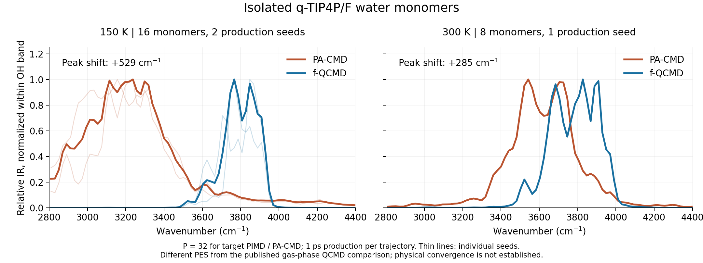

# Fast quasi-centroid molecular dynamics

`method="f-qcmd"` runs classical spectroscopy trajectories on a
temperature-specific effective potential fitted to quasi-centroid
distributions. The available model uses equivalent, nonperiodic bent
triatomic molecules and separable intramolecular bond/angle corrections.
The implementation supplies the complete unconstrained-PIMD, iterative
Boltzmann inversion (IBI), and one-bead production route, together with
quasi-centroid geometry utilities and a separate conditional ring sampler.

This is a research implementation with explicit limits. A completed fit or
trajectory reports `converged=false` and `physical_converged=false`.
Adiabatic QCMD and hybrid CMD (`h-cmd`) remain unsupported and are rejected;
the existing PA-CMD and quadratic f-CMD implementations retain their behavior.
This page describes the current f-QCMD addition; the older spectroscopy and
method-coverage pages describe the earlier release boundary.

## Method and approximation

The CMD curvature problem arises when Cartesian bead averaging shortens a
bond whose beads spread around a curved angular coordinate. A molecular
quasi-centroid instead averages the internal coordinates first. For a
triatomic with central atom 0 and terminal atoms 1 and 2, define

$$
\bar r_1=\frac{1}{P}\sum_{b=1}^{P}|q_{1b}-q_{0b}|,\qquad
\bar r_2=\frac{1}{P}\sum_{b=1}^{P}|q_{2b}-q_{0b}|,\qquad
\bar\theta=\frac{1}{P}\sum_{b=1}^{P}\theta_b.
$$

In general, these differ from the internal coordinates of the Cartesian
centroid. The QCMD construction and the associated spectral curvature issue
are discussed by [Trenins, Willatt and Althorpe (2019)](https://doi.org/10.1063/1.5100587).

The fast method of [Fletcher et al. (2021)](https://doi.org/10.1063/5.0076704)
uses **ordinary unconstrained PIMD** to obtain target distributions of these
internal quasi-centroids, then IBI to obtain an effective classical potential.
It does not fit raw holonomic constraint forces. PyRPMD follows that
distribution-matching route with

$$
V_{\mathrm{eff}}(Q)=V_{\mathrm{base}}(Q)
+\sum_m\left[\Delta V_r(r_{1m})+\Delta V_r(r_{2m})
+\Delta V_\theta(\theta_m)\right].
$$

Both terminal bonds and all molecules share the same bond correction; all
angles share the same angle correction. Chemical equivalence is a modelling
assumption, with matching terminal/molecular masses and element ordering
checked where a `System` is available. Matching these marginal distributions
does not establish the correct joint distribution, cross-coordinate coupling,
or real-time quantum dynamics. Intermolecular quantum corrections are absent.

For coordinate $s$ on a common histogram grid, the undamped IBI update is

$$
\Delta V_{n+1}(s)=\Delta V_n(s)
+\beta^{-1}\log\frac{p_n(s)}{p_{\mathrm{target}}(s)}.
$$

The radial $r^2$ or angular $\sin\theta$ volume factor cancels in the ratio
when target and model distributions use the same coordinate and measure.
This permits the use of consistently normalized raw histogram probabilities.
It does **not** justify treating $-\beta^{-1}\log p(s)$ itself as the physical
bond or angle potential. The fitted tables are corrections added once to the
original PES; passing an already fitted centroid/quasi-centroid PMF is rejected.

## Supported systems and explicit failures

| Feature | Current behavior |
| --- | --- |
| Molecular topology | Explicit zero-based `(central, terminal1, terminal2)` indices; disjoint bent triatomics covering every atom in an f-QCMD model |
| Pooling | One shared correction for both terminal bonds and all molecules; equivalent masses required; the workflow also checks element ordering |
| Temperature | The fitted inverse temperature must match production; changing temperature requires a new fit |
| Production bead count | Exactly one, with physical masses; the effective potential must not be quantized again |
| Boundaries | No periodic boundary conditions and no cell, including a cell supplied with all PBC flags false |
| Constraints | No fixed atoms, bond constraints, or base PES that requires bond constraints |
| Geometry | Zero-length bonds, linear angles and degenerate orientations for Cartesian reconstruction raise clear errors |
| Production backend | Serial NumPy reference dynamics; required native execution and unsupported parallel layouts are rejected |
| Model support | Fixed, finite bond and angle grids; out-of-grid sampling or propagation raises an error |
| General molecules, mixtures and surfaces | Not represented by this correction model; no partial f-QCMD/f-CMD partition is implemented |
| Adiabatic QCMD and h-CMD | `method="qcmd"` and `method="h-cmd"` are rejected |

An underlying physical PES may contain interactions between the permitted
triatomics, but this fit only changes their intramolecular terms. The supplied
validation example uses noninteracting gas-phase monomers. No claim of
validated liquid-water IR follows from the availability of the API.

## Train and run the bundled monomer example

Run these commands from an installed repository checkout. The example needs
NumPy and SciPy, already required by PyRPMD; it does not need OpenMM, a quantum
chemistry package, or a machine-learning potential.

```bash
OMP_NUM_THREADS=1 OPENBLAS_NUM_THREADS=1 python examples/qcmd/validate_monomer.py \
  --stage fit --copies 1 --temperature 150 --output runs/qcmd-monomer

pyrpmd validate examples/qcmd/f-qcmd.inp --check-pes
OMP_NUM_THREADS=1 OPENBLAS_NUM_THREADS=1 pyrpmd run examples/qcmd/f-qcmd.inp \
  --output runs/spectroscopy-f-qcmd
pyrpmd resume runs/spectroscopy-f-qcmd
pyrpmd analyze runs/spectroscopy-f-qcmd --recompute
```

The first command writes `runs/qcmd-monomer/qcmd-model.npz`, a resumable
`fit-checkpoint.npz`, and `report-fit.json`. Repeating the **same** fitting
command resumes the saved phase and RNG. Its numerical settings are examples,
not established convergence settings. The bundled input is a **single**
monomer: `--copies 1` is necessary here. The diagnostic script's default of
eight copies produces a model for eight explicitly indexed monomers, which
cannot be silently transferred to this one-monomer input.

`examples/qcmd/f-qcmd.inp` contains the following production choices, in
addition to the system, physical PES and property-model tables:

```toml
task = "spectroscopy"
temperature = "150 K"
beads = 1

[dynamics]
integrator = "normal-mode-bab"
timestep = "0.1 fs"

[sampling]
equilibration_steps = 5000
production_steps = 10000
sample_interval = 1
replicas = 4
gamma_centroid = "0.413413734 fs^-1"

[spectroscopy]
method = "f-qcmd"
qcmd_model_file = "../../runs/qcmd-monomer/qcmd-model.npz"
spectra = ["ir"]
window = "hann"
normalize = false
```

Paths in an input file are resolved relative to that file, not the shell's
working directory. Keep `[potential]` as the **original physical PES** used
for training: the workflow loads and applies the saved correction. It checks
the model temperature, atom indices/masses, base-potential identity and
initial grid support before production. `target_frequency` is a PA-CMD
option and must not be supplied for f-QCMD; production has no internal ring
modes and no centroid thermostat.

The ordinary spectroscopy outputs are under
`runs/spectroscopy-f-qcmd/results/`: `summary.json`,
`spectroscopy-traces.npz` and `ir-spectrum.npz`. Per-replica checkpoints are
under `checkpoints/`. The summary embeds the fitted model's full provenance
and records the direct quasi-centroid property approximation. Offline
reanalysis reads saved traces and preserves this original provenance; it
does not require the PES, property provider or fitted model to remain
loadable. Changing spectral processing is allowed, while changing the saved
trajectory physics is rejected.

## Fit from Python

`pyrpmd.qcmd.fit_fqcmd` is the public fitting entry point; its implementation
is in `pyrpmd.qcmd_fit`. All Python arguments use atomic units: bohr, hartree,
electron masses and atomic time, with angles in radians. For example, the
following constructs a model compatible with the bundled single-monomer
input when executed from the repository root:

```python
from pathlib import Path
import numpy as np

from examples.qcmd.water_monomer import (
    MONOMER_MASSES, QTIP4PFMonomers, geometry,
)
from pyrpmd.constants import FS_TO_AU, KB_AU
from pyrpmd.qcmd import fit_fqcmd, qcmd_base_identity
from pyrpmd.system import System

temperature = 150.0
beta = 1.0 / (KB_AU * temperature)
system = System(("O", "H", "H"), MONOMER_MASSES, geometry())
source = Path("examples/qcmd/water_monomer.py").resolve()
potential_spec = {"provider": "python", "factory": str(source) + ":build"}
identity = qcmd_base_identity(potential_spec, system)

model = fit_fqcmd(
    QTIP4PFMonomers(), system.masses, beta,
    np.repeat(system.geometry[None], 32, axis=0), [(0, 1, 2)],
    grids=(np.linspace(1.3, 2.5, 121), np.linspace(1.05, 2.75, 101)),
    dt=0.1 * FS_TO_AU,
    equilibration_steps=10000, sampling_steps=40000, sample_interval=5,
    iterations=5, ibi_equilibration_steps=4000, ibi_sampling_steps=20000,
    gamma_centroid=0.01, damping=0.5, regularization=0.01, smoothing=1.0,
    seed=1707, base_identity=identity,
    checkpoint="runs/qcmd-python/fit-checkpoint.npz",
)
model.save("runs/qcmd-python/qcmd-model.npz")
```

Point `qcmd_model_file` to the resulting file before using this alternative
output directory. `fit_fqcmd` borrows the supplied potential and does not
close it; the caller retains ownership of external engine resources.

The fitter first equilibrates and samples the original PES using normal-mode
BAOAB with PILE-L. At each sampling stride it accumulates histograms of the
bead-mean internal coordinates. It reconstructs a quasi-centroid geometry to
start one-bead classical sampling, draws physical-temperature momenta, and
alternates classical equilibration/sampling with IBI updates. `ibi_dt`
optionally sets a separate classical fitting timestep; when omitted it
equals `dt`. The workflow performs `iterations` updates **plus a final
classical validation cycle**. Diagnostics numbered zero describe the
uncorrected baseline; the final diagnostic describes the returned model,
not a correction that has just been updated without resampling.

### Grids, interpolation and regularization

Each grid is a one-dimensional, uniformly spaced vector of **edges**, with at
least four bins. Bond edges must be positive; angle edges must lie strictly
inside $(0,\pi)$. The model stores a correction value at each bin centre.
It constructs a clamped cubic spline through those centres and two endpoint
knots. Each endpoint takes its nearest centre's value, and the derivative at
both outer endpoints is zero. This defines the half-bin behavior; it is not
an extrapolation rule. The energy and its derivative come from the same
spline, giving conservative Cartesian forces through analytic internal
coordinate derivatives.

Target or classical histogram overflow raises an exception instead of
discarding counts. During one-bead dynamics, any geometry outside the fitted
domain also raises. Widening a grid changes the scientific calculation and
requires a new fit/checkpoint location. Endpoint support, empty bins and
spline-induced forces need inspection even when no exception occurs.

Let $p_i$ be counts normalized to sum to one. `smoothing` is a Gaussian
standard deviation in **bins**, applied with reflection boundaries and
cutoff four standard deviations; the result is renormalized. With
`regularization=epsilon`, the probability used in the logarithm is

$$
p_i^{\mathrm{reg}}=(1-\epsilon)p_i^{\mathrm{smooth}}
+\frac{\epsilon}{N_{\mathrm{bins}}},\qquad 0\le\epsilon<1.
$$

This is a probability-mass prior, so its strength does not depend on differing
target and classical sample counts. A zero prior is allowed, but any zero
probability remaining after smoothing causes an explicit error. `damping`
multiplies the IBI increment and must lie in $(0,1]$. Each updated correction
has its target-weighted constant offset removed; this energy gauge does not
change the forces. All these choices enter the fit identity.

`model.diagnostics` records the raw, smoothed and regularized total-variation
distances separately, along with the raw CDF discrepancy, all counts, empty
bins, edge probabilities and correction amplitudes. Smoothing or a large
prior can hide disagreement visible in the raw counts. Use raw residuals,
independent held-out trajectories and sampling uncertainties when deciding
whether to trust a fit. Histogram sample count is not an effective count of
independent samples; the latter remains explicitly unspecified.

### Model and checkpoint identity

`QCMDModel.save` and `QCMDModel.load` use the integrity-checked
`PyRPMD.fqcmd-model.v1` NPZ container. The model records its temperature,
masses, molecular topology, training bead count, fixed grids, corrections,
interpolation/domain conventions, target counts, fit settings and diagnostic
history. The model is immutable through its public attributes; construct a
new model to change the science.

The base identity is produced by
`qcmd_base_identity(potential_spec, system)`. It includes the PES specification,
explicitly referenced local source/model contents, symbols, masses, charge
and multiplicity. It deliberately excludes initial coordinates and production
seeds so that a model can be used for independent trajectories of the same
system. It is not a dependency lock: transitive imports, environment versions
and remote services must also be pinned. Potential-specification paths are
part of the recorded identity; moving source files may require rebuilding
the corresponding provenance rather than merely renaming a model file.

Fitting checkpoints additionally include the initial-ring fingerprint,
phase and iteration, integration clocks, positions, momenta, histogram
accumulators, corrections, diagnostics and the complete propagation
operator/RNG state. The file is atomically replaced. Resume checks all
scientific settings before propagation; it does not restart equilibration,
redraw saved momenta or duplicate histogram samples. Checkpoint location and
write interval do not change the fit's scientific identity. Changing a
sample count, grid, temperature, seed, timestep or IBI option requires a
separate fit instead of repurposing an old checkpoint.

Spectroscopy uses its existing atomic per-replica checkpoint format with
the physical state, RNG, phase clock and trace prefix. The fitted model file's
content hash joins the production identity, so a model replaced in place
cannot silently continue an old trajectory. Completed output remains a
numerical completion result; it does not set either convergence flag true.

## Geometry utilities

`TriatomicCoordinates` is available from `pyrpmd.qcmd_geometry`:

```python
from pyrpmd.qcmd_geometry import TriatomicCoordinates

coords = TriatomicCoordinates([(0, 1, 2)], natoms=3)
ring = np.repeat(system.geometry[None], 8, axis=0)
internal = coords.values(ring)                  # [bead, molecule, 3]
mean_internal = coords.mean_values(ring)        # [molecule, 3]
quasicentroid = coords.quasicentroids(ring, system.masses)  # [atom, 3]
```

The order of internal components is `(r1, r2, theta)`. `values` also accepts
an arbitrary batch of geometries. `mean_values` and `quasicentroids` accept
`[frame,bead,atom,3]` and preserve the frame axis. `forces(q, derivatives)`
returns the negative Cartesian gradient associated with supplied
`dV/d(r1,r2,theta)` values of shape `[batch,molecule,3]`, without bead scaling.

Reconstruction creates the target bond lengths and angle, puts the molecular
COM at the bead-averaged molecular COM, and finds the proper rotation that
minimizes the mass-weighted distance to the Cartesian centroid. This is the
weighted Eckart/Kabsch orientation. Internal coordinates are invariant under
global translation/rotation; reconstructed positions and forces transform
with the original geometry. A degenerate Cartesian centroid does not define
a unique orientation and is rejected.

The geometry utility permits a subset of disjoint triatomics, retaining
ordinary centroids for unselected atoms. The **fitting/model workflow requires
complete atom coverage**. A partial geometry selection does not implement
the h-CMD partition or authorize a mixed effective potential.

## Separate constrained ring sampler

`ConstrainedQuasiCentroidSampler` in `pyrpmd.qcmd_constraints` samples the
conditional imaginary-time configuration distribution of **one isolated,
nonperiodic, translation-invariant bent triatomic**. It is a research
building block, separate from the unconstrained PIMD used by `fit_fqcmd`.
It has no physical-time dynamics and produces no quasi-centroid mean-force
estimator. Full Eckart-constrained adiabatic QCMD is not implemented.

Using the single-monomer `system`, `beta` and `identity` from the Python
example above:

```python
from pyrpmd.qcmd_constraints import ConstrainedQuasiCentroidSampler

conditional = ConstrainedQuasiCentroidSampler(
    QTIP4PFMonomers(), system.masses, beta,
    np.repeat(system.geometry[None], 8, axis=0),
    molecule=(0, 1, 2),
    bond_step=0.025, angle_step=0.02,
    rotation_step=0.05, center_step=0.025,
    seed=17, potential_identity=identity,
)
rings = conditional.sample(200, interval=10)
conditional.save_checkpoint("runs/qcmd-conditional/checkpoint.npz")
# On a newly constructed sampler with the same initial ring, seed and settings:
# conditional.load_checkpoint("runs/qcmd-conditional/checkpoint.npz")
```

`target=(r1,r2,theta)` can be supplied explicitly; otherwise it is the initial
ring's mean. The initial ring must satisfy the requested target. Bond widths
and COM widths are in bohr, angular and rotation widths in radians.
`bond_step` can be one scalar or two separate bond widths. The number of
proposals passed to `sample` must be divisible by `interval`; the initial
configuration is excluded from returned samples. Those short sample counts
only illustrate the interface and do not equilibrate or validate a distribution.

The sampler fixes the bead means of both bond lengths, the angle and the
molecular COM. It retains each bead's orientational freedom and the COM
internal ring modes. Symmetric proposals change a pair of internal-coordinate
or COM values by equal and opposite displacements, or rotate one bead with
a proposal symmetric with respect to the SO(3) Haar measure. Only the one
or two changed beads need new physical PES evaluations. The complete ring
spring energy remains in the acceptance probability.

In the sum-bead Hamiltonian convention, $\omega_P=P/\beta$ and

$$
U_{\mathrm{spring}}=\frac{1}{2}\omega_P^2
\sum_{b,a}m_a|q_{a,b}-q_{a,b+1}|^2.
$$

The conditional configurational weight with respect to internal coordinates,
Haar rotations and bead COM coordinates is proportional to

$$
\exp\left[-\frac{\beta}{P}
\left(\sum_b V(q_b)+U_{\mathrm{spring}}\right)\right]
\prod_b r_{1b}^{2}r_{2b}^{2}\sin\theta_b,
$$

with the specified mean constraints imposed. The coordinate volume Jacobian
is included explicitly. Eliminating the linear mean constraints contributes
only a constant factor that cancels in Metropolis ratios. This construction
must not be confused with averaging uncorrected Cartesian RATTLE multipliers
or omitting a mass-metric correction from a different constrained measure.

Zero proposal widths explicitly freeze additional coordinates and are recorded
in metadata. For ordinary conditional sampling, keep every unconstrained
coordinate mobile and assess acceptance, equilibration, autocorrelation and
independent seeds. The checkpoint contains internal coordinates, orientations,
COM values, Cartesian positions, cached energies, action, proposal counters,
the target and complete RNG state. PES failures roll back the attempted
step and RNG; rejected valid proposals consume RNG without changing the ring.
The caller supplies a SHA-256 potential identity covering parameters and
source/model contents. A base PES with required bond constraints, an active
cell/PBC, or an explicit declaration that it is not translation invariant is
rejected. A seed must be a nonnegative integer or a NumPy `Generator`.
The scientific identity includes the initial ring and the generator's initial
state in addition to all proposal settings and the target. Reconstruct the
sampler with that same ring and seed/generator starting state before loading
its checkpoint; changing the seed is not a continuation. Checkpoint loading
validates these identities and the constraints before replacing the in-memory
state with the saved state and RNG.

## Monomer spectral comparison and convergence protocol

The bundled analytic PES implements the intramolecular q-TIP4P/F terms and
virtual-site dipole using the published equations and parameters of
[Habershon, Markland and Manolopoulos (2009)](https://doi.org/10.1063/1.3167790).
Intermolecular electrostatics and Lennard-Jones interactions are absent.
Several copies in one run are independent monomers, not a liquid simulation.

To generate a matched diagnostic comparison, use a separate directory:

```bash
OMP_NUM_THREADS=1 OPENBLAS_NUM_THREADS=1 python examples/qcmd/validate_monomer.py \
  --stage all --temperature 150 --beads 32 --copies 8 \
  --output runs/qcmd-monomer-comparison-150
```

The script writes `report-all.json`, the fitted model and fitting checkpoint,
`pa-cmd-trace.npz`, `f-qcmd-trace.npz`, and both `*-spectrum.npz` files. The
report records each method's peak, per-monomer peaks, FFT bin spacing, elapsed
time, thread environment, fitting residuals and limitations. Stage-specific
commands `--stage cmd`, `--stage fit` and `--stage f-qcmd` are also available;
they write separate `report-<stage>.json` files. Reuse exactly the same
scientific arguments when resuming a stage. Change the output directory for
parameter sweeps.

The diagnostic measures the largest actual FFT-bin intensity in the declared
2800--4400 cm$^{-1}$ OH band of a Hann-windowed relative IR spectrum. It reports
the signed difference `f_qcmd_minus_pa_cmd_cm1` when both methods are run
together. Independent monomer spectra are averaged without intermolecular
dipole cross terms. This peak rule is fixed in the script; it is not a fitted
line position or a statistical confidence interval. Finite observation time,
window broadening and neighboring modes limit its resolution.

The gas-phase calculations in the 2019 QCMD paper use the
Partridge--Schwenke PES, whereas this example uses q-TIP4P/F intramolecular
terms. Compare the sign and scale of a shift only with that difference stated.
A blue shift relative to finite-separation PA-CMD is consistent with correcting
the curvature mechanism, but it is not by itself a reproduction of the
published gas-phase frequencies, an exact-CMD reference, or agreement with
experimental water spectra. The published 2021 f-QCMD gas-phase comparison
also does not turn this example into a liquid-water validation.

### Recorded diagnostic: 2026-11-02

The checked-in [numerical record](validation/t07-qcmd/monomer-metrics.json)
contains the actual commands, settings, per-monomer peaks, source hashes,
timings and limitations. The [band spectra CSV](validation/t07-qcmd/monomer-spectra.csv)
retains the unnormalized relative intensities used in the comparison.
The following numbers are measured FFT-bin peaks, in cm$^{-1}$:

| Temperature | Production master seed / ensemble | PA-CMD | f-QCMD | f-QCMD minus PA-CMD |
| --- | --- | ---: | ---: | ---: |
| 150 K | 1707, eight monomers | 3155.7 | 3847.9 | +692.2 |
| 150 K | 2707, eight monomers | 3237.1 | 3766.4 | +529.3 |
| 150 K | Equal-weight spectra from both seeds, sixteen monomers | 3237.1 | 3766.4 | +529.3 |
| 300 K | 1707, eight monomers | 3542.5 | 3827.5 | +285.0 |



All trajectories used 0.5 ps equilibration and 1 ps production. Target PIMD
and PA-CMD used 32 beads; PA-CMD used an internal target frequency of
14000 cm$^{-1}$, friction scale 1 and 0.025 fs steps, while f-QCMD used one
bead and 0.1 fs steps. The 150 K second seed reused the **same fitted model**;
it tests production variability, not fitting uncertainty. Its substantial
peak variation is a reason to retain the unconverged status. The pooled
150 K OH-band intensity-weighted mean frequencies were 3255.6 and
3794.0 cm$^{-1}$, a shift of +538.4 cm$^{-1}$.

These measurements support a blue shift of several hundred cm$^{-1}$,
with a larger effect at lower temperature, consistent with the qualitative
gas-phase curvature mechanism in the 2019 paper. They do not establish a
quantitative reproduction on that paper's different PES. A 1 ps record has
an inverse-duration frequency scale of approximately 33.36 cm$^{-1}$; the
20.36 cm$^{-1}$ zero-padded FFT spacing is not an independent resolution
or error estimate.

Each temperature's fit used 10000 target equilibration steps and 40000
target sampling steps, followed by five updates plus a final validation
cycle, each with 4000 equilibration and 20000 classical sampling steps.
The target and fitting timestep was 0.1 fs. Bond raw total variation fell
from 0.31636 to 0.01578 at 150 K and from 0.23375 to 0.01154 at 300 K.
Final angle raw total variations were 0.02711 and 0.01292. These diagnostics
do not supply an effective sample size or a physical error bar. Complete
model and fit records accompany the numerical summary in
`docs/validation/t07-qcmd/`.

The measurements ran on a shared Linux x86_64 environment with nine visible
logical CPUs; the physical CPU model was not exposed. Each process used
`OMP_NUM_THREADS=1`, `OPENBLAS_NUM_THREADS=1`, and a one-thread BLAS limit.
Fitting took 309.4 s and 307.3 s for 150 K and 300 K, respectively, with the
two training processes running concurrently. On the final source, the
eight-monomer 1.5 ps PA-CMD trajectories took 69.3 s and 67.7 s, versus
20.3 s and 20.9 s for f-QCMD. The corresponding same-physical-duration wall
time ratios were about 3.4 and 3.2. **This includes different timesteps and
excludes fitting cost**: f-QCMD's Python step itself was not faster
(roughly 1.36--1.40 ms versus 1.13--1.15 ms). Shared-host timings are
descriptive, not dedicated-hardware performance benchmarks.

Before assigning physical significance, vary the following independently:

| Source of uncertainty | Required check |
| --- | --- |
| Imaginary-time discretization | Increase target PIMD beads at each temperature and compare internal distributions and spectral shifts |
| Target and IBI sampling | Increase equilibration and sampling lengths; use independent seeds and assess correlation times |
| Effective-potential fit | Vary grid widths/resolution, smoothing, prior, damping and iteration count; inspect raw residuals, edge populations and held-out distributions |
| Integration | Reduce both PIMD/fitting and production timesteps; check one-bead energy stability and the resulting spectrum |
| PA-CMD comparison | Converge its target internal frequency, internal thermostat scale and smaller associated timestep |
| Spectral estimation | Lengthen production, inspect window and frequency resolution, and compare independent spectra rather than only one maximum |
| Approximate observables | Assess the ordinary geometry-dependent dipole/polarizability against the required conditional property surface |
| Scientific scope | Keep potential, temperature, molecular composition, isotope masses and the compared phase explicit |

For f-QCMD the production property model is evaluated directly on the effective
one-bead geometry. Conditional quasi-centroid property fitting is not supplied.
This introduces an additional observable approximation; conservative forces,
good histogram residuals and passing unit tests do not eliminate it. Relative
spectral intensities also retain the ordinary spectroscopy workflow's missing
absolute electromagnetic and experimental optical prefactors.

Independent implementation checks cover finite-difference forces and virials,
translation/rotation geometry, the one-bead limit, a conditional-measure
quadrature reference, checkpoint interruption/resume, and rejection of
incompatible science. These are numerical correctness checks, distinct from
the parameter sweeps above.

## h-CMD and remaining work

The h-CMD method combines f-QCMD and f-CMD treatments for different molecular
parts of a heterogeneous system; see
[Limbu et al. (2025)](https://doi.org/10.1063/5.0248115) and
[DL_POLY Quantum 2.1](https://arxiv.org/abs/2412.17216).
PyRPMD's current f-QCMD model requires complete equivalent-triatomic coverage
and provides no mixed partition, cross-partition fitting or intermolecular
correction. `method="h-cmd"` remains an explicit error. General molecular
topologies, periodic systems, full constrained adiabatic QCMD, conditional
property training and physically converged condensed-phase benchmarks remain
separate research/engineering tasks.

## References

- G. Trenins, M. J. Willatt and S. C. Althorpe, “Path-integral dynamics of water
  using curvilinear centroids,” *J. Chem. Phys.* **151**, 054109 (2019),
  [doi:10.1063/1.5100587](https://doi.org/10.1063/1.5100587);
  [author preprint](https://arxiv.org/abs/1907.03096).
- T. Fletcher, A. Zhu, J. E. Lawrence and D. E. Manolopoulos, “Fast quasi-centroid
  molecular dynamics,” *J. Chem. Phys.* **155**, 231101 (2021),
  [doi:10.1063/5.0076704](https://doi.org/10.1063/5.0076704);
  [author preprint](https://arxiv.org/abs/2111.11572).
- S. Habershon, T. E. Markland and D. E. Manolopoulos, “Competing quantum effects
  in the dynamics of a flexible water model,” *J. Chem. Phys.* **131**, 024501
  (2009), [doi:10.1063/1.3167790](https://doi.org/10.1063/1.3167790).
- D. K. Limbu, N. London, M. O. Faruque and M. R. Momeni, “h-CMD: An efficient
  hybrid fast centroid and quasi-centroid molecular dynamics method for the
  simulation of vibrational spectra,” *J. Chem. Phys.* **162**, 014111 (2025),
  [doi:10.1063/5.0248115](https://doi.org/10.1063/5.0248115).
- N. London, D. K. Limbu, M. O. Faruque, F. A. Shakib and M. R. Momeni,
  “DL_POLY Quantum 2.1: A Suite of Real-Time Path Integral Methods for the
  Simulation of Dynamical Properties and Vibrational Spectra,”
  *J. Phys. Chem. A* (2025),
  [doi:10.1021/acs.jpca.4c08644](https://doi.org/10.1021/acs.jpca.4c08644);
  [arXiv:2412.17216](https://arxiv.org/abs/2412.17216).
