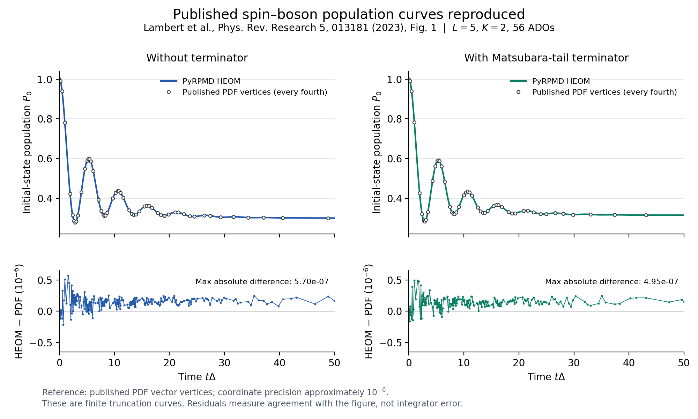

# Direct electronic-structure data and nonadiabatic rates

PyRPMD can propagate local adiabatic electronic data without constructing a
global diabatic potential. The new APIs are `AdiabaticPythonPotential`,
`QDNRPMDDynamics`, `AdiabaticRPSHDynamics`, and two-state `MASHDynamics`.
The separate `pyrpmd nonadiabatic-rate` command connects the existing signed
thermal NRPMD sampler to its analytical population-flux estimator.

An executable direct-data example runs all three dynamics methods against an
analytical provider:

```bash
python examples/nonadiabatic/adiabatic_on_the_fly.py --method qd-nrpmd --beads 4
python examples/nonadiabatic/adiabatic_on_the_fly.py --method rpsh
python examples/nonadiabatic/adiabatic_on_the_fly.py --method mash
```

## Electronic-structure provider contract

An external program or Python quantum-chemistry calculation supplies a callback
with the following interface:

```python
from pyrpmd.adiabatic import AdiabaticPythonPotential, AdiabaticResult

class ElectronicStructure:
    def evaluate(self, q, *, previous_q=None, previous_context=None):
        # Run your electronic-structure program at each geometry in q.
        # previous_context may contain its previous wavefunction objects.
        energies, gradients, nacs, overlaps, wavefunctions = calculate(
            q, previous_q, previous_context
        )
        return AdiabaticResult(
            energies, gradients, nacs, overlaps, context=wavefunctions
        )

provider = AdiabaticPythonPotential(ElectronicStructure())
```

`calculate` is the user's electronic-structure bridge, not a bundled solver.
The interface makes an actual calculation at each requested geometry. It does
not reconstruct a molecular PES from prerecorded populations, silently compute
NACs by finite differences, or claim that a particular quantum-chemistry package
has been validated. A process-local opaque context lets the bridge reuse its
wavefunctions without the dynamics engine inspecting them.

| Quantity | Shape | Definition and default units |
| --- | --- | --- |
| `q`, `previous_q` | `[B,N,3]` | Nuclear coordinates, bohr |
| `energies` | `[B,S]` | Adiabatic energies, hartree |
| `gradients` | `[B,S,N,3]` | Positive energy gradients, hartree/bohr |
| `couplings` | `[B,S,S,N,3]` | Derivative couplings (d_{ij}=\langle i|\nabla j\rangle), bohr⁻¹ |
| `overlaps` | `[B,S,S]` | (O_{ij}=\langle i(q_\mathrm{old})|j(q_\mathrm{new})\rangle), dimensionless |
| `status` | `[B]` | Optional nonnegative integers; any nonzero frame fails |
| `context` | Arbitrary | Previous wavefunction handle or provider-owned context |

The first call has no previous geometry/context and needs no overlap. A later
overlap must connect precisely the supplied previous frame to the returned
frame. Provider calls for the ring beads and centroid are distinct; do not infer
the previous frame from a global “last evaluation” variable. This matters for
parallel trajectories and for a ring with more than one bead.

`units={"length": "angstrom", "energy": "eV"}` converts both current and previous
coordinates, energies, gradients and inverse-length NACs consistently. Energies
and gradients are real; NACs must be anti-Hermitian in their electronic indices.
Result arrays are detached from provider buffers and stored read-only. Failed
calculations, nonfinite values and malformed arrays raise before state commit.
The provider remains responsible for its own external side effects.

Overlap transport uses (c_\mathrm{new}=O^\dagger c_\mathrm{old}). A polar
decomposition removes roundoff-sized loss of orthogonality; the default rejects
singular-value deviations larger than `overlap_tolerance=1e-6`. Increasing that
tolerance is an explicit retained-subspace approximation. Significant norm loss
usually calls for a smaller timestep or more electronic states.

If overlaps are unavailable, `continuous_gauge=True` explicitly permits a
second-order endpoint NAC connection approximation. The provider must then keep
electronic phases consistent. The default refuses this approximation without
the declaration. Genuine overlaps correctly transport independent sign changes;
the tests exercise such sign changes during a trajectory.

## QD-NRPMD

```python
from pyrpmd.adiabatic import QDNRPMDDynamics
from pyrpmd.dynamics import State

dynamics = QDNRPMDDynamics(
    provider, masses, beta, nbeads, dt, nstates, native=False
)
state = dynamics.initialize(State(q, p), initial_state=0, seed=13)
for _ in range(steps):
    dynamics.step(state)
    populations = dynamics.populations(state)
```

The mapping variables are stored in each bead's current adiabatic basis. Each
step applies a half MInt flow, a free-ring flow, overlap transport, and a second
half MInt flow. The force matrix in that local basis includes

\[
G_{ii}=\nabla E_i,\qquad G_{ij}=(E_j-E_i)d_{ij}\quad(i\ne j).
\]

Dropping the off-diagonal terms would give the wrong mapping force even though
the energy matrix is diagonal. For a complete electronic subspace and exact
overlaps, changing bases at the free-ring endpoints is algebraically equivalent
to the existing fixed-diabatic MInt integrator. Tests compare coordinates,
momenta, transformed mapping amplitudes and Hamiltonians for 60 steps and obtain
agreement at floating-point precision. Other tests compare the reconstructed
operator gradients against independent finite differences.

This is a local-basis implementation of focused-state NRPMD. Its populations are
signed MMST estimators and are never clipped. They refer to the instantaneous
adiabatic labels. It does not prepare an SEO thermal ensemble, and arbitrary
focused-state trajectories do not define a thermal rate. The local-basis
construction follows the quasi-diabatic propagation idea of
[Mandal, Yamijala and Huo, JCTC (2018)](https://doi.org/10.1021/acs.jctc.7b01178)
and [Zhou, Mandal and Huo, JPCL (2019)](https://doi.org/10.1021/acs.jpclett.9b02747).

## Direct adiabatic RPSH

`AdiabaticRPSHDynamics` uses energy-ordered surfaces, beadwise adiabatic nuclear
forces, and centroid electronic amplitudes. A phase-aligned overlap logarithm
provides average time-derivative couplings; energies are interpolated during
electronic substeps. Outgoing fewest-switches probabilities are integrated from
the population currents. A probability sum exceeding one fails transactionally
and requests a smaller timestep.

```python
from pyrpmd.adiabatic import AdiabaticRPSHDynamics

dynamics = AdiabaticRPSHDynamics(
    provider, masses, beta, nbeads, dt, nstates,
    seed=7, electronic_substeps=8, native=False,
    frustrated_hops="reverse",
)
state = dynamics.initialize(State(q, p), active_surface=0)
dynamics.step(state)
print(state.active_surface, dynamics.populations(state), dynamics.last_hop)
```

Hops shift every bead momentum by the same vector along the centroid NAC,
leaving internal ring momenta unchanged. The gap used for rescaling is the mean
bead energy gap, so the complete sum-bead Hamiltonian is conserved at the hop.
The `keep` and `reverse` frustrated-hop policies are explicit.

This implementation requires real NACs and nondegenerate, increasing-energy
surface labels. It rejects complex-SOC momentum rescaling and exact degeneracies
instead of choosing an arbitrary real direction. It has no implicit decoherence
correction. Saved electronic frames must match the nuclear coordinates; manually
changing q requires reinitialization. The QC basis context is process local and
is not a portable restart format.

## Two-state MASH

```python
from pyrpmd.mash import MASHDynamics

dynamics = MASHDynamics(provider, masses, beta, nbeads, dt, native=False)
state = dynamics.initialize(State(q, p), active_surface=0, seed=19)
dynamics.step(state)
```

MASH chooses the active surface from the spin hemisphere, equivalently the
larger of the two electronic amplitude populations. No random number is used
to decide a hop. Pure initial populations sample the corresponding hemisphere
with density proportional to (|S_z|). Accepted hops rescale along the NAC.
Frustrated hops reflect the nuclear NAC component and (S_z), preserving the
transverse spin components. `populations(state)` returns surface indicators;
the continuous coefficients remain available as `state.coefficients`.

These choices follow
[Mannouch and Richardson, JCP 158, 104111 (2023)](https://doi.org/10.1063/5.0139734).
The implementation switches at the end of a finite step. It rejects multiple
resolved hemisphere crossings within one step, and the timestep must converge
both the electronic motion and crossing dynamics. It does not implement the
reversible/event-localized algorithms of
[Geuther, Asnaashari and Richardson, JCTC 21, 2179 (2025)](https://doi.org/10.1021/acs.jctc.4c01684).

The [independent event comparison](https://github.com/chen-yu-hao/PyRPMD/blob/codex/tier2-review-fixes-20261101/docs/validation/pr63-independent-review/nonadiabatic_ml_report.md)
quantifies this limitation with constant adiabatic energies, a constant NAC,
and an analytically located single crossing. Across six timestep refinements,
the switched nuclear coordinate has **first-order error**, even though its
energy is conserved to the reported precision at every timestep. The error is
exactly the displacement caused by delaying the hop to the step endpoint.
The separate electronic propagator converges at second order on a prescribed
smooth nuclear path; that result does not establish second-order accuracy of
the complete trajectory across a hop. Production studies must therefore check
timestep dependence of populations and crossing observables directly.

`P=1` is the primary two-state implementation. `P>1` uses an explicitly
experimental centroid extension with ring-energy-conserving rescaling; it is
not advertised as a validated implementation of a particular published
RP-MASH formulation. Multistate and complex-SOC MASH are not included.

## Thermal electronic-rate CLI

```bash
pyrpmd nonadiabatic-rate examples/nonadiabatic/thermal_rate.inp \
    --output runs/thermal-nonadiabatic
```

The command reads TOML/`.inp`, JSON, or a trusted Python file whose `build()`
returns a mapping. Its small schema is independent of the existing gas-phase
rate input; all numeric physical quantities use atomic units. The example has
explicit masses, q, beta, bead/state counts, a `diabatic_python` factory, sampler
settings, propagation settings and reactant/product electronic-state indices.
Relative factory files resolve against the input's directory.

The workflow samples the absolute SEO-projected thermal distribution, retains
each parent's sign and electronic projector weight, and propagates the existing
scalar/traceless `ThermalNRPMDDynamics`. It evaluates the analytical derivative
of the electronic population correlation and divides signed numerator sums by
the signed reactant normalization. It does not fit an exponential to an
arbitrary excited-state trajectory.

Outputs include:

- `thermal-parents.npz`: every q/p and mapping sample, sign, initial electronic
  population estimator and sample index, with integrity checks.
- `population-rate.npz`: time, per-parent signed rate numerators, reactant
  weights, signs and population correlations.
- `results/summary.json`: sign and normalization checks, optional explicitly
  selected plateau diagnostics, and conditional block uncertainty.
- `manifest.json`: resolved input, provider-file digest, physics fingerprint
  and completion status.

Use `rate.plateau_start`, `rate.plateau_stop` and `rate.block_size` only when the
propagation interval and parent-correlation assumptions have been examined.
An unresolved sign or normalization leaves the rate unavailable. A candidate
plateau is distinct from a converged chemical rate; `formal_rate_s_inv` remains
null and `physical_converged` remains false. Repeat independent chains and check
time, bead count, timestep, state definitions and block-size sensitivity.

This rate workflow uses the established real-diabatic SEO thermal implementation
described in [the thermal NRPMD guide](https://github.com/chen-yu-hao/PyRPMD/blob/main/docs/thermal-nrpmd.md). A thermal on-the-fly
QD ensemble, multistate MASH and portable QC wavefunction restart remain future
work. The bundled example is an executable model smoke check, not a molecular
rate benchmark.

## PySCF SA-CASSCF molecular bridge

The concrete callback `pyrpmd.potentials.pyscf_multistate.PySCFMultistatePotential`
implements the generic electronic-structure boundary above. It runs actual
PySCF calculations at the requested geometries and provides state energies,
state-specific analytic gradients, analytic NACs, and many-electron overlaps.
Install the optional dependency with `python -m pip install '.[pyscf]'`.
PySCF 2.14.0 is the validated version; the bridge requires the SA-CASSCF NAC
module and rejects an unsupported major API version explicitly.

```python
import numpy as np
from pyrpmd.adiabatic import AdiabaticPythonPotential, ElectronicFrame
from pyrpmd.potentials.pyscf_multistate import PySCFMultistatePotential

qc = PySCFMultistatePotential(
    ["Li", "H"], basis="sto-3g", ncas=2, nelecas=2, nstates=2,
    state_order="energy",
)
provider = AdiabaticPythonPotential(qc)
q = np.array([[[0., 0., 0.], [2.83458919, 0., 0.]]])  # bohr
previous = ElectronicFrame(q, provider.evaluate(q))
q_next = q.copy()
q_next[0, 1, 0] += 1e-4
current = provider.evaluate(q_next, previous=previous)
print(current.energies, current.overlaps)
print(provider.to_dict())
provider.close()
```

The initial implementation deliberately has one supported electronic model:
real, all-electron, equal-weight singlet SA-CASSCF, without molecular symmetry,
with spherical Gaussian basis functions. `ncas` and `nelecas` specify the active
space; remaining electrons occupy doubly occupied inactive orbitals. It checks
the singlet dimension and measured spin expectation values. Nonzero spin,
unequal state weights, TDDFT, SOC, ECPs, density fitting, frozen orbital options,
and GPU execution are not alternative implementations behind this API.

### Units, state labels and derivative convention

Coordinates are bohr, energies include nuclear repulsion in hartree, and
gradients are **positive** derivatives in hartree/bohr. NACs satisfy
`couplings[i,j] = <i|grad j>` in inverse bohr. No bead scaling occurs. This is an
adiabatic callback, not a scalar `PESResult` provider. Non-atomic unit
conversions on the `AdiabaticPythonPotential` wrapper are rejected for this
atomic-unit bridge; explicit atomic-unit choices remain valid.

`state_order="energy"` returns increasing-energy states and is the appropriate
choice for `AdiabaticRPSHDynamics`. `state_order="overlap"` instead solves a
maximum-absolute-overlap assignment to follow state character; this option is
intended for QD-NRPMD and can return energies out of order. Both modes align
real state phases using the explicitly supplied previous context. Energies
and gradients follow the state permutation. Both NAC indices and the new
overlap columns also receive the corresponding phase signs. A vanishing
matched overlap or a retained-state energy gap below
`gap_tolerance` is a failure, not an arbitrary choice of a degenerate basis.

The bridge uses full NACs, including the atomic-orbital/CSF derivative term.
It does not apply electron translation factors: those omit a term and would
not equal derivatives of the physical overlaps used for propagation here.
Consequently no claim of ETF-corrected total electronic-plus-nuclear momentum
conservation is made. The sign and electronic index convention are fixed by
centered overlap differences, not by comparing only NAC magnitudes. In the
validated PySCF 2.14.0 implementation, the bridge requests
`-kernel(state=(j,i), use_etfs=False)` for `i < j`, and sets the reverse NAC
to its negative. The NAC module's docstring describes the opposite index
order to its actual response calculation. Reversing the requested pair also
avoids the upstream `get_wfn_response` offset condition for a zero first
state index. The executable signed finite-difference regressions, including
all pairs of a three-state example, protect this convention.
See the [PySCF NAC implementation](https://pyscf.org/_modules/pyscf/nac/sacasscf.html)
and [SA-CASSCF analytic-coupling derivation](https://doi.org/10.1021/acs.jctc.6b00384).

For adjacent geometries the overlap includes Gaussian AO overlap, molecular
orbitals, inactive orbitals, and all active-space CI determinants. In particular,
with the core/active MO overlap blocks $S_{cc},S_{ca},S_{ac},S_{aa}$, it uses

\[
S_\mathrm{eff}=S_{aa}-S_{ac}S_{cc}^{-1}S_{ca},\qquad
O_{ij}=\det(S_{cc})^2
\langle C_i^\mathrm{old}|C_j^\mathrm{new}\rangle_{S_\mathrm{eff}}.
\]

The Schur complement retains core-active mixing; simply multiplying a core
determinant by an unmodified active-space overlap is insufficient. Determinant
overlap matrices are reused across all state pairs. A poorly conditioned core
block or an overlap allocation exceeding `max_memory_mb` fails explicitly.
Returned overlaps are not forced to be unitary. The dynamics engine retains
its existing singular-value leakage check and explicit `overlap_tolerance`.

### Cache, failures and reproducibility

The bounded exact-geometry cache stores independent RHF/SA-CASSCF solutions.
It has no implicit last-frame state or history-dependent orbital warm start.
Two trajectories, the bead batch, and the centroid can interleave calls while
their explicitly supplied contexts retain their own phases and state labels.
`cache_size=0` disables caching; `cache_info()` reports hits, misses, solves and
evictions. A repeated geometry reuses its electronic calculation, but its
overlap is always formed against the caller's actual previous frame.

`export_context(context)` and `import_context(snapshot)` preserve the complete
electronic history as a versioned, checksummed JSON-compatible snapshot. This
includes float64 MO/CI data, geometry, state order and phase signs. Restoring
into a fresh provider checks scientific identity, AO-metric orthonormality,
CI normalization, spin, gaps and NAC antisymmetry; it does not rerun the old
electronic calculation or populate a global last-frame cache. A context
snapshot alone is not a dynamics checkpoint. An application must also preserve
nuclear variables, electronic amplitudes, active surface, clock and RNG state,
and write the complete checkpoint atomically. The molecular example does not
introduce a portable dynamics checkpoint or CLI resume path.

SCF, CASSCF/FCI, each state gradient response, and each NAC response must all
converge. Successful earlier stages cannot mask a failed response calculation.
`AdiabaticResult.messages` optionally contains one string per batch frame,
and the adapter includes status codes and messages in its exception. The
appended field preserves the old positional location of `context`.

| `PySCFStatus` | Meaning |
| --- | --- |
| `0 SUCCESS` | Electronic calculation and requested tracking succeeded |
| `1 SCF_NOT_CONVERGED` | RHF did not converge |
| `2 CASSCF_NOT_CONVERGED` | SA-CASSCF or a CI root did not converge |
| `3 RESPONSE_NOT_CONVERGED` | State gradient or NAC response did not converge |
| `4 DEGENERATE_STATES` | Retained gap is below the declared threshold |
| `5 STATE_TRACKING_FAILED` | Overlap, phase assignment or overlap memory guard failed |
| `6 ELECTRONIC_STRUCTURE_ERROR` | Other electronic-structure failure or invalid output |
| `7 SPIN_CONTAMINATION` | Computed roots do not satisfy the singlet requirement |

Input/context shape and identity mistakes raise immediately. Physical solver
failures produce frame statuses; the standard adapter rejects any failed batch
before dynamics commit. No failed electronic calculation becomes a zero-force
trajectory. The bridge never changes precision, device, or global thread
counts. Set OpenMP and BLAS limits before starting Python when desired.

`qc.to_dict()` includes the basis, active space, roots, all solver and tracking
tolerances, fixed approximations, and numerical library versions. The wrapper's
`to_dict()` additionally includes its unit and continuous-gauge choices. Existing
anonymous callbacks keep their previous metadata; they must opt into a complete
`to_dict()` identity before an application can fingerprint them. The examples
also fingerprint initial conditions, masses, timestep, seed and propagation
settings. No existing CLI schema or checkpoint identity is changed.

### Short molecular RPSH example

```bash
OMP_NUM_THREADS=1 OPENBLAS_NUM_THREADS=1 python \
    examples/nonadiabatic/pyscf_lih_rpsh.py --steps 40 --dt 1
```

The example starts LiH at 1.5 angstrom, uses two equal-weight singlet
STO-3G/CAS(2,2) states, and propagates an initially excited state with direct
adiabatic RPSH. It reports the complete numerical configuration, fingerprint,
energy and population histories, state labels, overlap leakage, cache counters,
and measured wall time. The default has one bead and is intended to finish
within a few CPU minutes. `--beads` exercises the ring-polymer interface, but
the initial collapsed beads are not a thermal ensemble. A short trajectory is
an infrastructure and energy-drift check, not a converged photochemical yield.
`physical_converged` therefore remains false.

The guarded molecular tests compare signed NACs against centered derivatives
of independently evaluated wavefunction overlaps, state gradients against
energy differences, and LiH data against the OpenMolcas reference embedded in
[PySCF's own SA-CASSCF tests](https://github.com/pyscf/pyscf/blob/v2.14.0/pyscf/nac/test/test_sacasscf.py).
They also check intentional electronic sign changes, state permutations,
interleaved histories, failure handling, and energy drift under timestep
refinement. Optional PySCF tests use `pytest.importorskip`.

## HEOM spin-boson quantum reference

`pyrpmd.analysis.heom.SpinBosonHEOM` adds an independent open-system reference
using only NumPy and SciPy. It treats a two-state system coupled to a continuum
Drude-Lorentz harmonic bath, so the bath is not restricted to the one nuclear
coordinate of the existing Fourier-grid reference. It is a deterministic
finite-hierarchy calculation, not a trajectory approximation.

Its exact conventions, in atomic units, are

\[
H_S=\tfrac12(\epsilon\sigma_z+\Delta\sigma_x),\quad
Q=s\sigma_z,\quad
J(\omega)=\frac{2\lambda\gamma\omega}{\omega^2+\gamma^2},
\]

\[
C(t)=\int_0^\infty\frac{J(\omega)}{\pi}
\left[\coth(\beta\omega/2)\cos(\omega t)-i\sin(\omega t)\right]d\omega.
\]

Here `epsilon`, `delta`, `reorganization_energy`, `cutoff`, `beta`, and
`coupling_scale` correspond to $\epsilon,\Delta,\lambda,\gamma,\beta,s$.
The default $s=1$ means $Q=\sigma_z$, not $\sigma_z/2$. Changing $s$ changes
the interaction and is part of the scientific identity. Here
$\lambda=\int_0^\infty J(\omega)/(\pi\omega)\,d\omega$; the reorganization
energy between the two displaced electronic surfaces is $4s^2\lambda$.
For the existing
`DiscreteSpinBoson` model the corresponding electronic parameters are
`bias=epsilon/2` and `tunnelling=delta/2`. With $s=1$, its discrete bath has
$J(\omega)=\frac{\pi}{2}\sum_k c_k^2/(m_k\omega_k)
\,\delta(\omega-\omega_k)$. Matching a continuum HEOM reference also requires
converging that discretization and using the same initial bath preparation.

```python
import numpy as np
from pyrpmd.analysis.heom import SpinBosonHEOM

solver = SpinBosonHEOM(
    epsilon=0.4, delta=1., reorganization_energy=0.1,
    cutoff=1., beta=1., max_depth=6, matsubara_terms=4,
    terminator=True,
)
result = solver.propagate(np.diag([1., 0.]), np.linspace(0., 8., 81))
print(result.populations)
print(result.max_trace_error, result.min_density_eigenvalue)
print(result.physical_converged)  # False; convergence requires a separate scan.
continued = solver.propagate(result.final_state, np.linspace(8., 10., 21))
```

### Hierarchy, bath truncation and continuation

The retained bath correlation is $C_K(t)=\sum_{k=0}^K c_k e^{-\nu_k t}$, with

\[
\nu_0=\gamma,\quad
c_0=\lambda\gamma[\cot(\beta\gamma/2)-i],\qquad
\nu_k=2\pi k/\beta,\quad
c_k=\frac{4\lambda\gamma\nu_k}{\beta(\nu_k^2-\gamma^2)}\quad(k\ge1).
\]

`matsubara_terms=K` counts thermal poles in addition to the Drude pole.
`max_depth=L` retains auxiliary density operators (ADOs) with
$\sum_k n_k\le L$ and imposes a zero boundary beyond that layer. A nonzero
interaction therefore has $\binom{L+K+1}{K+1}$ ADOs. Scaled ADOs and a CSR
sparse generator avoid a dense hierarchy matrix. `expm_multiply` propagates the
constant generator, without introducing a finite integration timestep;
floating-point exponential-action error still exists. Observation times do
not truncate bath memory, and only reduced density histories plus the final
full hierarchy are retained in memory.

Large observation intervals are divided into exact exponential actions with a
bounded shifted-generator norm. This uses the semigroup property, not an
integration approximation, and avoids SciPy's randomized norm-estimation
branch. It does not consume NumPy's global RNG. Splitting a run at an existing
observation time and restoring every ADO in an identically configured solver
is checked for bitwise equality; changing the observation grid can change
floating-point roundoff.

`terminator=True` explicitly approximates the omitted Matsubara tail with
$-r_K[Q,[Q,\rho_{\mathbf n}]]$ on every ADO, where
$r_K=2\lambda/(\beta\gamma)-\sum_{k=0}^K\operatorname{Re}(c_k/\nu_k)$.
This tail approximation does not remove the need to converge hierarchy depth.
It requires omitted thermal poles faster than the Drude pole and nonnegative
residue. Coincident Drude/Matsubara poles, zero temperature, nonfinite inputs,
and a hierarchy exceeding `max_ados` fail explicitly; the implementation
never silently reduces the requested hierarchy.

A density-matrix input means a **factorized free thermal bath** with all higher
ADOs initially zero. It does not mean a bath equilibrated on an occupied
electronic surface or an interacting thermal state. `HEOMState` contains all
scaled ADOs, their time, and the solver's scientific fingerprint; continuation
checks the entire hierarchy size and identity. Resuming from a reduced density
alone would reset bath memory. This API does not add a file checkpoint format
or RNG; the propagation is deterministic. Existing PyRPMD checkpoint readers
are unchanged.

Returned density matrices are never normalized, clipped, projected to positive
matrices, or symmetrized after propagation. Trace error, Hermiticity error and
the minimum density eigenvalue are diagnostics. Passing these checks alone
does not establish layer or Matsubara convergence. Every result keeps
`physical_converged=False`, including a successfully propagated finite hierarchy.

### Independent validation and convergence scans

```bash
OMP_NUM_THREADS=1 OPENBLAS_NUM_THREADS=1 python \
    examples/nonadiabatic/heom_spin_boson.py
```

The example reports separate hierarchy-depth and Matsubara-cutoff scans for
nontrivial population dynamics, with explicit parameters, trace/Hermiticity
diagnostics and pairwise curve differences. Tighten both cutoffs for the
temperature, coupling and time window of a particular benchmark. Low
temperatures and strong coupling can be much more expensive than this small
CPU demonstration.

Independent unit-test references include isolated analytic Rabi oscillations,
the exact Gaussian pure-dephasing influence function obtained by spectral
quadrature at nonzero bath coupling, and optional QuTiP HEOM population curves
with and without the tail terminator. QuTiP is only an optional comparator;
the implementation itself imports no QuTiP code. Full-ADO continuation and
identity mismatches are also tested. The formulation follows
[Tanimura, JCP 153, 020901 (2020)](https://doi.org/10.1063/5.0011599); the
independent comparator is described by
[Lambert et al., Physical Review Research 5, 013181 (2023)](https://doi.org/10.1103/PhysRevResearch.5.013181).

## Recorded T13 numerical checks (2026-11-02)

The recorded environment was an AMD EPYC 9V74 virtual machine exposing nine
vCPUs, with `OMP_NUM_THREADS=1` and `OPENBLAS_NUM_THREADS=1`. Versions were
Python 3.12.14, NumPy 2.3.5, SciPy 1.18.1, PySCF 2.14.0 and QuTiP 5.3.1.
Other validation tasks shared the host; wall times below are representative
measurements, not isolated throughput or speedup claims. Raw configurations,
curves and independent numerical checks are in
`docs/validation/t13-nonadiabatic-2026-11-02/`.

| Independent comparison | Maximum absolute discrepancy |
| --- | ---: |
| LiH signed NAC versus centered overlap derivative, displacement $2\times10^{-4}$ bohr | $5.13\times10^{-8}$ bohr$^{-1}$ |
| LiH state gradient versus centered energy derivative | $2.64\times10^{-9}$ hartree/bohr |
| Core/active Schur overlap versus explicit full occupied Slater determinants | $1.22\times10^{-17}$ |
| All three-state H2 NAC pairs versus overlap derivatives | $2.13\times10^{-9}$ bohr$^{-1}$ |
| Isolated HEOM Rabi population versus analytic solution | $1.33\times10^{-15}$ |
| HEOM density versus QuTiP, without / with tail terminator | $7.87\times10^{-11}$ / $1.16\times10^{-10}$ |

The final 40-step LiH example took **48.0 s** for 41 electronic solves,
including initialization. The time interval was 40 atomic units
($0.967554$ fs), and the maximum energy drift was
$1.0277\times10^{-8}$ hartree. The maximum overlap singular-value deviation
was $1.9689\times10^{-7}$, below the default $10^{-6}$ tolerance. There were
no hops in this short trajectory. A separate fixed-duration 12-au check gave
maximum energy drifts $8.1477\times10^{-9}$ and $2.0426\times10^{-9}$ hartree
at steps 2 and 1 au, respectively (ratio 0.25069).

The HEOM population scan used $\epsilon=0.4$, $\Delta=1$, $\lambda=0.15$,
$\gamma=1$, $\beta=1$, $Q=\sigma_z$, the tail terminator, a factorized free
thermal bath, initial $\rho=|0\rangle\langle0|$, and 101 observations on
$t\in[0,10]$. The comparison is the largest **finite** calculation $(L,K)=(8,6)$.

| Depth $L$ at $K=6$ | ADOs | Maximum population difference from $L=8$ | Wall seconds |
| ---: | ---: | ---: | ---: |
| 2 | 36 | $1.4080\times10^{-2}$ | 0.347 |
| 4 | 330 | $5.1988\times10^{-4}$ | 0.672 |
| 6 | 1716 | $1.1434\times10^{-5}$ | 3.236 |
| 8 | 6435 | 0 (comparison) | 14.280 |

| Thermal poles $K$ at $L=8$ | ADOs | Maximum population difference from $K=6$ |
| ---: | ---: | ---: |
| 0 | 9 | $3.5891\times10^{-3}$ |
| 1 | 45 | $6.0138\times10^{-4}$ |
| 2 | 165 | $2.0965\times10^{-4}$ |
| 4 | 1287 | $4.1025\times10^{-5}$ |
| 6 | 6435 | 0 (comparison) |

The largest calculation ended at $P_0(10)=0.4153584631$, with maximum trace
error $2.74\times10^{-14}$. The independent continuum pure-dephasing check
at $(L,K)=(8,4)$ had coherence error $1.0100\times10^{-4}$; its spectral
quadrature high-frequency-tail bound was $2.39\times10^{-8}$. These figures
separate bath truncation from quadrature accuracy. No finite comparison in
this table sets `physical_converged=True`.

### Direct reproduction of a published population curve

The literature comparison uses **Figure 1 of Lambert et al., Physical Review
Research 5, 013181 (2023)**, [DOI 10.1103/PhysRevResearch.5.013181](https://doi.org/10.1103/PhysRevResearch.5.013181).
The [paper's Eqs. 13–15 and figure caption](https://arxiv.org/html/2010.10806v3)
give $\Delta=1$, $\epsilon=0.5$, $\lambda=0.1$, $\gamma=0.5$,
$\beta=2$, and $Q=\sigma_z$. The author notebook linked by the paper
specifies $L=5$, $K=2$, initial $\rho=|0\rangle\langle0|$, a factorized
free thermal bath, and $t\Delta\in[0,50]$.

The reference points were extracted from the **actual PDF vector paths**,
using labeled axis ticks for affine coordinate calibration. They are not a
newly computed QuTiP curve or pixel-digitized points. The checked-in evidence
records the source PDF and notebook hashes, extraction coordinates, reference
vertices, solver fingerprints, and results at $L=3,5,7,9$.

| Published $L=5,K=2$ curve | Reference vertices | ADOs | Maximum population difference | RMS difference | Wall seconds |
| --- | ---: | ---: | ---: | ---: | ---: |
| Without tail terminator (blue) | 218 | 56 | $5.6964\times10^{-7}$ | $1.7348\times10^{-7}$ | 0.851 |
| With tail terminator (green) | 204 | 56 | $4.9537\times10^{-7}$ | $1.6703\times10^{-7}$ | 0.601 |

These discrepancies are within approximately $10^{-6}$ precision of the
rounded PDF coordinates; they do not measure the solver's numerical error.
The comparison reproduces the paper's **finite truncation**. Increasing
$L=5$ to $L=9$ changes the two populations by up to $1.5000\times10^{-4}$
and $1.3720\times10^{-4}$, respectively. Matching the published curves
therefore does not establish full hierarchy or Matsubara convergence.

To repeat the comparison using the bundled reference points, without QuTiP,
PyMuPDF, or downloading the paper:

```bash
OMP_NUM_THREADS=1 OPENBLAS_NUM_THREADS=1 python \
    docs/validation/t13-nonadiabatic-2026-11-02/validate_lambert_figure1.py
```

The validator optionally accepts `--pdf PATH` to repeat the hash-checked
vector extraction with PyMuPDF. Its default leaves the recorded evidence
unchanged; `--output-dir PATH` saves a fresh report and curves.


