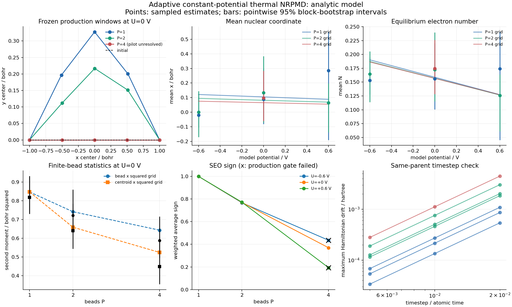

# Multichain adaptive constant-potential NRPMD study

This directory records the initial nine-case calculation at model potentials
`U = -0.6, 0, +0.6 V` and bead counts `P = 1, 2, 4`. It contains **69,120 saved
production configurations**, source-chain uncertainty calculations, an
independent equilibrium reference at matching finite bead counts, and short
paired timestep checks. **Seven of nine production cases pass the configured
reweighting gates.** The retained failures and reference discrepancies are
part of the result.

The calculation exercises an analytic two-state Hamiltonian with common
Born–Oppenheimer charging. It does not establish a converged quantum ensemble,
a converged reaction path, a chemical rate, or a calibrated electrode response.
All result records retain `physical_converged=false` and `rate_constant=null`.
The [implementation guide](../../manual/adaptive-nrpmd.md) describes the API,
estimator conventions, scientific scope, and underlying literature.



[SVG figure](figures/study-comparison.svg) · [Complete summary](summary.json) ·
[Numeric comparison](comparison.csv) · [Reference calculations](reference.json)

## Model and computation budget

For one particle at `(x,y,z)`, the bare matrix is a common potential
`a = 0.3(x²−1)² + 2[y−0.6(1−x²)]² + 0.4z²` plus the two-state matrix with
diagonal entries `±(0.04+0.10x)` and off-diagonal coupling
`0.08 exp(−0.3x²)`. The charging energy is
`E_charge = [N−(0.3x+0.08y)]²/2.4`. The reservoir convention is
`mu(U) = 0.1 − U*EV_TO_AU` in hartree. Its interior optimum and Legendre
transform are therefore

```text
N*(x,y;mu) = 0.3*x + 0.08*y + 1.2*mu
Omega_charge(x,y;mu) = -mu*(0.3*x + 0.08*y) - 0.6*mu**2
V_mu = V_bare + Omega_charge*I
```

The model reference string is `analytic-model-reference; no SHE/RHE
calibration`. `N` is the continuous electron-number variable of this analytic
charging model. Its optimum is evaluated independently at each nuclear bead.
The common identity shift changes nuclear forces while leaving fixed-geometry
electronic gaps and couplings unchanged. This is BO polarization, with no
state-dependent Faradaic exchange or shared-N grand-canonical sampling.

The exact configuration is in [plan.json](plan.json). Length, energy, mass and
time use atomic units; the voltage input is in volts.

| Setting | Value used |
|---|---|
| Inverse temperature; nuclear mass | beta = 3 hartree⁻¹; mass = 1.5 electron masses |
| Parameter grid | 3 voltages × 3 bead counts = 9 cases |
| Initial path | Five centers from `(−1,0)` to `(1,0)`; fixed endpoints |
| Centroid umbrella stiffness | 5 hartree/bohr² in each x/y direction |
| Pilot adaptation | At most 3 rounds; 96 saved samples per window/round |
| Pilot burn-in and stride | 96 sweeps; save every 2 sweeps |
| Production | 3 independent chains × 5 frozen windows × 512 samples per case |
| Production burn-in and stride | 256 sweeps per stream; save every 2 sweeps |
| Saved production configurations | 7,680 per case; 69,120 across the grid |
| Production Monte Carlo sweeps | 19,200 per case; 172,800 across the grid, including burn-in |
| Bootstrap | 64 source-chain/block resamples, refitting MBAR on every draw |
| Block length | Ceiling of twice each stream's statistical-inefficiency diagnostic, capped at the stream length |
| Production gates | MBAR convergence, connected overlap at threshold 0.01, mean sign ≥ 0.1, positive ESS diagnostic ≥ 20 |
| Dynamics when production is available | 16 complete parents; dt = 0.02, 0.01, 0.005; final time = 2 atomic units |
| Random seed | 20261101, with separate streams for pilot, production, bootstrap and parents |

Production uses fresh random streams and burn-in on each frozen path. Pilot
configurations do not enter the production estimator. The integrated path
driver's small preliminary production block is also discarded. Monte Carlo
sweeps and adaptation rounds have no interpretation as physical time.

## Estimators and independent reference

Each restrained chain samples the absolute SEO thermal measure. Positive MBAR
weights remove the fixed umbrella biases, and physical expectations use the
signed ratio `sum(w*s*A)/sum(w*s)`. Electronic observables use the initial SEO
projector estimator. Full nuclear and mapping states, signs and source-stream
identities are retained, including for cases whose production estimate is
unavailable.

Uncertainty resamples independent chains within each umbrella and circular
blocks within the selected original chain, then refits MBAR. An interval
requires all requested bootstrap draws to resolve reweighting and signed
normalization, at least two independent chains, at least 32 replicates, and at
least eight complete blocks in every source stream. The saved block lengths
range from 6 to 46 configurations; the minimum number of complete blocks ranges
from 11 to 32 across cases. Confidence intervals are **pointwise 95% percentile
intervals conditional on the frozen path and selected block lengths**.

The deterministic reference integrates out the mapping variables analytically.
For `tau=beta/P`, it evaluates the coordinate quadrature of the ordered product
of electronic matrices `B_i=exp(−tau*V_mu(r_i))`, with the exact free-particle
kernel between adjacent beads. Its transfer matrix is
`T[i,a,j,b]=sqrt(w_i*w_j)*K_free(r_i,r_j;tau)*B_i[a,b]`, so the finite-bead
partition is `Tr(T**P)`. The matrices at different coordinates need not commute.
Diabatic projectors retain their position before the matrix product, matching
the SEO estimator.

The reference reports both bead second moments and centroid second moments.
For example, `mean_j(x_j²)` differs from `(mean_j x_j)²`; the latter includes
all imaginary-time correlations. Its trace formula is
`<xbar*ybar> = sum_k Tr(X*T**k*Y*T**(P-k))/(P*Z_P)`.
The state-independent harmonic z coordinate cancels from normalized
xy/electronic expectations. The reference partition includes the xy kinetic
normalization and electronic trace, and excludes the separable z partition and
auxiliary sampling momenta.

The reference implementation passed **25 targeted tests**: explicit enumeration
of noncommuting matrix paths at P=1,2,3,4; analytical finite-bead harmonic
moments and partitions; uncoupled unequal harmonic surfaces; a constant coupled
electronic Hamiltonian; energy-shift invariance; and invalid-input rejection.
This verifies the finite-bead quadrature implementation separately from the
Metropolis sampler and MBAR analysis.

## Production and path diagnostics

The following numbers come from [summary.json](summary.json) and the linked
case reports. `ESS+` is the correlation-adjusted positive-weight diagnostic;
`ESSsigned = ESS+ × mean_sign²` is a separate signed diagnostic. Neither is a
count of verified independent samples. The production threshold applies to
`ESS+`, explaining why the U=0/P4 case passes with `ESSsigned < 20`.

| Case report | U / V | P | Mean sign | ESS+ | ESSsigned | Production | Path stopping reason |
|---|---:|---:|---:|---:|---:|---|---|
| [Um0_6_P1](Um0_6_P1/report.json) | −0.6 | 1 | 1.000000 | 357.45 | 357.45 | Available | Adaptation budget exhausted |
| [Um0_6_P2](Um0_6_P2/report.json) | −0.6 | 2 | 0.767232 | 241.46 | 142.13 | Available | Adaptation budget exhausted |
| [Um0_6_P4](Um0_6_P4/report.json) | −0.6 | 4 | 0.435648 | 13.80 | 2.62 | Unavailable: ESS | Unresolved pilot sign |
| [Up0_0_P1](Up0_0_P1/report.json) | 0 | 1 | 1.000000 | 304.78 | 304.78 | Available | Adaptation budget exhausted |
| [Up0_0_P2](Up0_0_P2/report.json) | 0 | 2 | 0.769941 | 232.23 | 137.67 | Available | Adaptation budget exhausted |
| [Up0_0_P4](Up0_0_P4/report.json) | 0 | 4 | 0.369633 | 141.02 | 19.27 | Available | Unresolved pilot sign |
| [Up0_6_P1](Up0_6_P1/report.json) | +0.6 | 1 | 1.000000 | 29.05 | 29.05 | Available | Adaptation budget exhausted |
| [Up0_6_P2](Up0_6_P2/report.json) | +0.6 | 2 | 0.772256 | 401.02 | 239.16 | Available | Adaptation budget exhausted |
| [Up0_6_P4](Up0_6_P4/report.json) | +0.6 | 4 | 0.193379 | 15.88 | 0.59 | Unavailable: ESS | Unresolved pilot sign |

All three P4 pilots stopped before the first center update, leaving the
initial straight path for production. The other six cases exhausted their
three-round adaptation budget. None of these stopping reasons establishes a
converged path. All nine production overlap graphs are connected and their
MBAR solves meet the residual criterion; the two unavailable cases fail the
configured target effective-sample threshold.

The U=−0.6/P4 bootstrap happened to produce 64 finite valid draws, but its
failed production gate still suppresses its estimates and intervals in the
comparison. U=+0.6/P4 additionally has only 56 valid bootstrap draws out of 64,
so its bootstrap intervals are also unavailable. Failed draws are not removed
to manufacture confidence intervals.

## Selected U=0 expectations

The table gives sampled estimates, their actual source-chain bootstrap 95%
intervals, and the largest-domain deterministic reference at the **same P**.
Coordinate second moments are in bohr²; populations and model electron numbers
are dimensionless. All 108 observable comparisons, including standard errors,
are in [comparison.csv](comparison.csv).

| P | Observable | Sampled estimate | Pointwise 95% interval | Finite-P reference |
|---:|---|---:|---|---:|
| 1 | Bead x² | 0.818981 | [0.730631, 0.932255] | 0.847618 |
| 1 | Centroid x² | 0.818981 | [0.730631, 0.932255] | 0.847618 |
| 1 | Bead y² | 0.198528 | [0.165029, 0.237818] | 0.243242 |
| 1 | Population 0 | 0.436763 | [0.381427, 0.493493] | 0.430317 |
| 1 | Electron number N | 0.156132 | [0.100714, 0.220298] | 0.158838 |
| 2 | Bead x² | 0.722820 | [0.633038, 0.860114] | 0.742045 |
| 2 | Centroid x² | 0.640663 | [0.543807, 0.784382] | 0.659146 |
| 2 | Bead y² | 0.245007 | [0.214736, 0.274561] | 0.293154 |
| 2 | Population 0 | 0.420408 | [0.348745, 0.468612] | 0.432697 |
| 2 | Electron number N | 0.172411 | [0.114999, 0.239562] | 0.156970 |
| 4 | Bead x² | 0.587602 | [0.495209, 0.716721] | 0.643326 |
| 4 | Centroid x² | 0.449041 | [0.354511, 0.580832] | 0.524356 |
| 4 | Bead y² | 0.360693 | [0.225659, 0.471532] | 0.326842 |
| 4 | Population 0 | 0.479606 | [0.387881, 0.586449] | 0.434416 |
| 4 | Electron number N | 0.174575 | [0.128518, 0.226231] | 0.156747 |

Across the seven available cases, **75 of 84 pointwise intervals contain their
matching reference**. The nine misses are U=−0.6/P1 for y, bead/centroid x² and
bead/centroid y², and U=0/P1 and U=0/P2 for bead/centroid y². The count contains
strongly dependent and, at P1, duplicate observables. It is a descriptive check,
not an empirical coverage calibration or a simultaneous confidence statement.
The y² discrepancies are retained rather than interpreted as successful
equilibrium convergence.

## Coordinate and bead discretization

Every voltage/bead case has four deterministic coordinate calculations in
`reference.json["convergence"]["cases"]`:

| Calculation | Grid | x interval / bohr | y interval / bohr |
|---|---|---|---|
| Coarse | 31×31 | [−2.5, 2.5] | [−2, 2.5] |
| Finer spacing | 41×41 | [−2.5, 2.5] | [−2, 2.5] |
| First larger domain | 49×51 | [−3, 3] | [−2.5625, 3.0625] |
| Further y extension | 49×61 | [−3, 3] | [−3.125, 3.625] |

The last three share spacings `dx=0.125`, `dy=0.1125` bohr. The comparison uses
`preferred_records`, the last row of this table, for all nine cases. The
largest observed absolute change among the coordinate second moments is
2.34318×10⁻⁵ bohr² on refining the original grid, 1.05018×10⁻³ bohr² on the first
domain enlargement, and 5.22809×10⁻⁵ bohr² on the final y extension. Original-box
truncation is therefore more significant than the initial spacing difference.
The final marginal weight on the outermost grid layer is at most 2.38610×10⁻⁸.
These changes and boundary masses are sensitivity diagnostics, with no claim
of rigorous error bounds or an exact infinite-domain result.

Additional U=0 references isolate bead dependence on the common 31×31 grid
and original coordinate domain:

| P | Bead x² / bohr² | Centroid x² / bohr² | Population 0 |
|---:|---:|---:|---:|
| 4 | 0.642269 | 0.523270 | 0.434429 |
| 8 | 0.586607 | 0.453159 | 0.435328 |
| 16 | 0.565807 | 0.427515 | 0.435657 |

The P4 entry here is the coarse-grid value; the sampled-versus-reference table
uses the larger domain. P8→P16 still changes bead x² by −0.020800 bohr² and
centroid x² by −0.025644 bohr². The P1/P2/P4 study does not establish bead
convergence. The P8/P16 calculations were not independently repeated on the
larger boxes and are reported as finite-grid bead-sensitivity checks.

## Tail, nodal and uncertainty limitations

Positive umbrella weights can be concentrated on rarely visited coordinates.
In the U=−0.6/P4 source, the single largest weight carries 7.09% of total MBAR
weight. In U=+0.6/P4, the two largest weights carry 12.44%, and both associated
SEO signs are negative. These are observed reasons to improve sampling and
umbrella coverage; connected window overlap alone does not establish adequate
coverage of the unbiased target's tails.

The electronic projector estimator contains ratios with SEO factors in their
denominators. Near nodal surfaces those ratios can become large. Finite sampled
values, a resolved mean sign, or a finite bootstrap standard error do not
establish finite estimator variance or Gaussian asymptotics. The signed ESS
diagnostic is not an electronic-population error bar.

The present bootstrap has only three independent chains per window and 64
draws. It cannot recover unsampled tails, establish equilibration, account for
all long correlation times beyond the chosen blocks, or quantify uncertainty
in a different learned path. Every chain is conditioned on the same selected
frozen path within its case. Passing the gate and interval overlap therefore
remain numerical diagnostics, not a certification of physical convergence.

## Constant-potential and timestep checks

The maximum chemical-potential stationarity residual over all saved production
beads is 1.87351×10⁻¹⁵ hartree. This checks the analytic charging solve at its
interior optimum; it does not calibrate a physical electrode reference.

Each available case resamples 16 complete parents, retaining nuclear and
mapping coordinates/momenta and initial SEO signs. The same parents are
propagated without umbrella forces at three timesteps to the same final time.
The maximum absolute propagation-Hamiltonian drift at U=0 is:

| P | dt=0.02 | dt=0.01 | dt=0.005 |
|---:|---:|---:|---:|
| 1 | 8.60985×10⁻⁴ | 2.15214×10⁻⁴ | 5.38015×10⁻⁵ |
| 2 | 2.02295×10⁻³ | 5.05373×10⁻⁴ | 1.26320×10⁻⁴ |
| 4 | 4.46478×10⁻³ | 1.11611×10⁻³ | 2.79024×10⁻⁴ |

Drifts are in hartree for the sum-bead propagation Hamiltonian. Halving the
timestep reduces these short-trajectory drifts by approximately four. This
checks numerical integration for these parents and this duration. It does not
validate the approximate NRPMD real-time dynamics against exact quantum
evolution or establish a rate plateau. No dynamics are launched for the two
unavailable production cases.

## Saved data and provenance

The compact indices are [plan.json](plan.json), [summary.json](summary.json),
[reference.json](reference.json), [comparison.json](comparison.json), and
[comparison.csv](comparison.csv). Each case directory linked in the diagnostics
table contains `report.json` and `source.npz`; seven also contain `dynamics.npz`.
There are nine source arrays and seven dynamics arrays, totaling 22,536,810
bytes. For example, [U0/P4 source data](Up0_0_P4/source.npz) and
[U0/P4 dynamics](Up0_0_P4/dynamics.npz) retain the arrays behind that row.

`source.npz` stores full nuclear and mapping phase space, SEO signs/projectors,
centroid CVs, observables, positive weights, centers, chain/window IDs and sample
indices. `dynamics.npz` stores the paired trajectories, observables, energies
and source-parent ancestry. Original source streams are the uncertainty units;
resampled parents are not treated as new independent equilibrium samples.

`plan.json["source_identity"]` records all relevant source-file SHA256 hashes.
Its combined identity is
`3a2ba3ffe563bd20494ad106c041acdf400e11248f0ef7211ff44f0e435f56ca`.
Each case report records SHA256 hashes for its NPZ files. The comparison records
the summary/reference hashes and every case-report hash, and checks matching
model-source hashes, point identity, beta, mass and reservoir chemical potential
before comparing estimates. Reference model hashes were checked against the
same model sources recorded in the study reports.

| Saved input | SHA256 |
|---|---|
| `plan.json` | `769af8046c8bb8a69a35e7401f315378b47d166d4265ed7d067d595e19e24672` |
| `summary.json` | `99afedd75dd790882b3c16174487a244d97622ed6887d3787a5715a50b83fd1a` |
| `reference.json` | `b7aa70b3346fcc7ab02a4f3cec6278c9e9357dee2df60ed5a39763127461bc0f` |

The recorded environment used Python 3.12.14, NumPy 2.5.4, SciPy 1.17.0,
Matplotlib 3.10.8 and pytest 9.2.0. BLAS/OpenMP thread counts were restricted to
one per process; three worker processes ran the study. Timings, archive
metadata and floating-point reductions need not reproduce byte-for-byte on a
different platform. Hashes identify these saved artifacts.

## Reproduce in a fresh output directory

Run from the repository root after installing the checkout. Plotting needs the
`analysis` extra, and the test command needs the `test` extra. The full
deterministic reference uses dense matrices; its default estimated
working-memory guard is 2 GiB per calculation.

```bash
python -m pip install -e '.[analysis,test]'
export OPENBLAS_NUM_THREADS=1
export OMP_NUM_THREADS=1

python examples/electrochemistry/adaptive_nrpmd_study.py --preset full --plan
python examples/electrochemistry/adaptive_nrpmd_study.py \
  --preset full --workers 3 --output runs/adaptive-study
python examples/electrochemistry/adaptive_nrpmd_reference.py \
  --convergence --output runs/adaptive-study/reference.json
python examples/electrochemistry/analyze_adaptive_nrpmd_study.py \
  runs/adaptive-study --reference runs/adaptive-study/reference.json --plot
python -m pytest tests/test_adaptive_nrpmd_reference.py -q
```

`--resume` reuses completed study cases only when the saved configuration,
source identity and artifact hashes match. It does not resume a case midway
through sampling. The reference and analyzer are deterministic calculations
apart from platform-dependent numerical reductions; the analyzer does not
rerun dynamics or sampling.

## Separate higher-budget follow-up

A higher-budget follow-up is complete in
[adaptive-nrpmd-refinement-2026-11-01](../adaptive-nrpmd-refinement-2026-11-01/),
with its own [plan](../adaptive-nrpmd-refinement-2026-11-01/plan.json) and
[runner](../adaptive-nrpmd-refinement-2026-11-01/run_refinement.py). It is kept
separate so the initial failure cases, uncertainty misses, source data and
configuration above remain reviewable. Both originally unavailable P4 endpoint
voltages pass the unchanged production gates at the larger budget; their
positive effective-sample diagnostics are 323.79 and 1089.61. The
[follow-up report](../adaptive-nrpmd-refinement-2026-11-01/README.md) contains
the actual estimates and intervals. The stages reuse the original seed and
are not pooled or treated as independent experiments.
