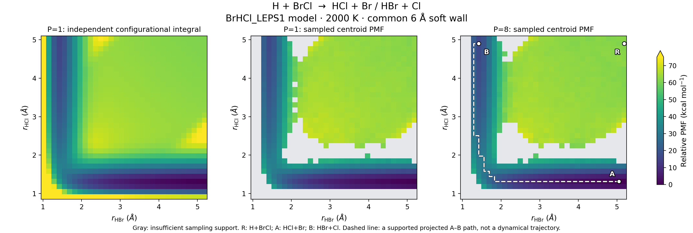
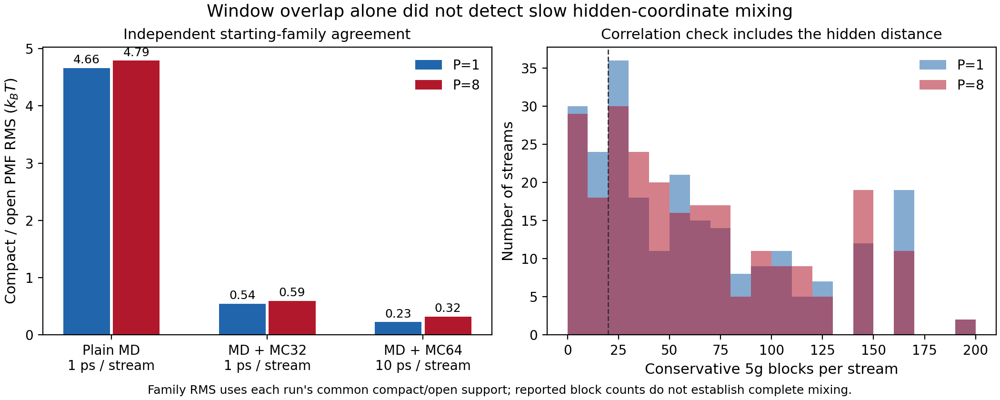
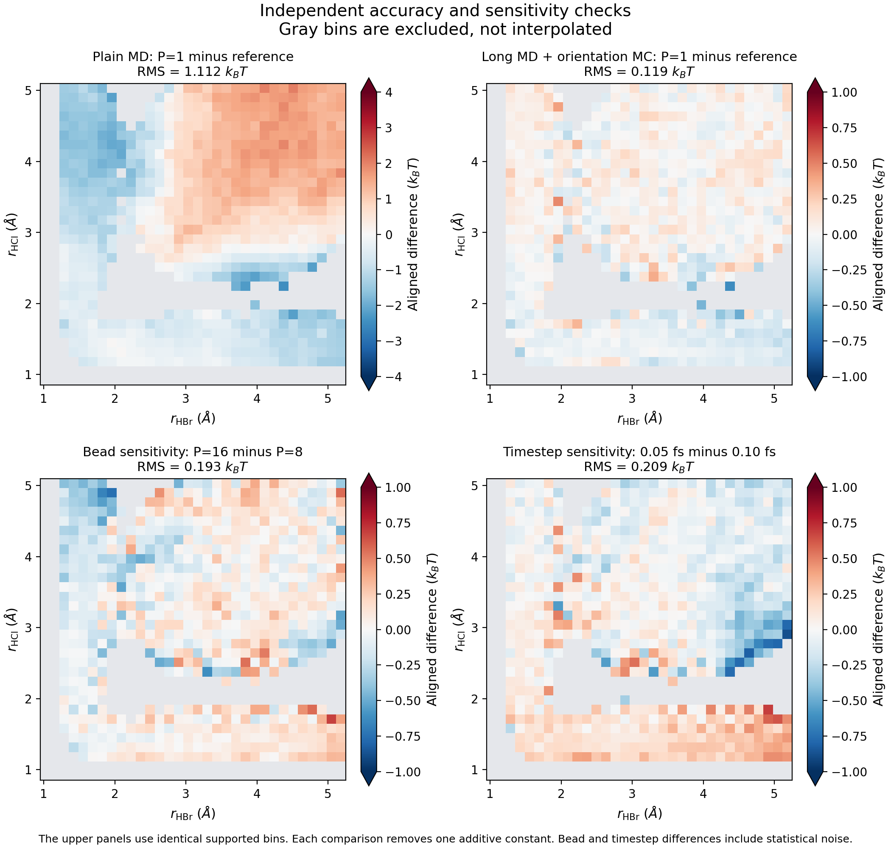
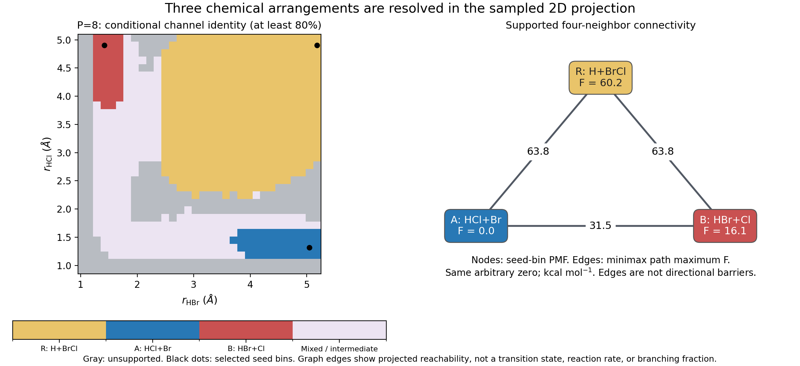

# H + BrCl 多通道 PMF：实际计算与独立验证

日期：2026-10-30。

**已完成 H + BrCl → HCl + Br / HBr + Cl 的二维 PMF 实算。** 在本次明确规定的
BrHCl_LEPS1 模型、2000 K 和有限共同软墙下，P=1 的采样 PMF 与独立构型积分相比，
771 个有支持网格上的对齐 RMS 为 **0.121638 kBT，约 0.483 kcal/mol**。
P=8 中三个化学排列均可分辨，在有采样支持的四邻居网格中相互可达。

这是一项历史半经验反应模型上的计算方法回归。模型、统计精度、二维投影和真实反应
动力学的适用范围分别说明如下；`physical_converged` 保持为 `false`。

完整数值见 [comparisons.json](evidence/comparisons.json)，可复现程序与命令见
[BrHCl benchmark](../../../benchmarks/brhcl/README.md)。



灰格没有达到当前采样支持门槛，未插值补齐。参考积分覆盖完整分析矩形。
色标在 75 kcal/mol 饱和，向上三角表示更高数值；参考全域最高 PMF 约为 291 kcal/mol。
右图虚线只显示一条 A–B 投影网格路径，不能解释为实际反应轨迹。

## 1. 为什么选择这个反应

H + BrCl 的两个不同产物通道 HCl + Br、HBr + Cl 有原始反应动力学文献：
Polanyi 与 Skrlac，*Chemical Physics* **23**, 167–194 (1977)，
[doi:10.1016/0301-0104(77)89001-0](https://doi.org/10.1016/0301-0104(77)89001-0)。
三个原子还能让经典二维 PMF 用第三个距离的独立积分直接核验。

本次使用 ChemPotPy 中固定版本的
[BrHCl_LEPS1.f](https://github.com/shuyinan/chempotpy/blob/4716d22e87ae01770cad9ec995c4a02a8e479296/chempotpy/BrHCl/BrHCl_LEPS1.f)，
全部参数在源码内，具有解析梯度，不依赖额外训练权重。源 commit 为
`4716d22e87ae01770cad9ec995c4a02a8e479296`，SHA256 为
`55df493416823e16ea26309b474353381e36b982aea95dcc4aaf39097ba02f5e`。
来源、参数、单位及相关论文详见 [SOURCE.md](../../../benchmarks/brhcl/SOURCE.md)。

LEPS 参数来自历史研究，原始 Sato 参数工作主要涉及 Br + HCl 氢转移。
这些出处没有证明本模型能定量预测现代实验中的 H + BrCl 分支比。
当前模型是单个电子势能面，未加入 Br/Cl 精细结构及多面非绝热动力学。

## 2. 实际计算设置

原子顺序固定为 Br、H、Cl，同位素为 79、1、35，电子多重度为 2。
两个 umbrella 坐标均为**质心之间的距离**：

$$
x=|\bar q_{\mathrm{Br}}-\bar q_{\mathrm H}|,\qquad
y=|\bar q_{\mathrm H}-\bar q_{\mathrm{Cl}}|.
$$

第三距离 $z=|\bar q_{\mathrm{Br}}-\bar q_{\mathrm{Cl}}|$ 和夹角用于通道识别及相关性诊断。
每个网格中心使用 compact、open 两种不同横向初态，并由独立派生随机流采样。

| 共同设置 | 值 |
| --- | --- |
| 温度 | 2000 K；kBT ≈ 3.9744 kcal/mol |
| umbrella 中心 | x：1.15–4.95 Å；y：1.00–4.80 Å；11×11 个窗口 |
| 初态与流数 | 每窗 2 种起始族，共 242 条流 |
| umbrella 刚度 | 每轴 80 kcal mol⁻¹ Å⁻²，能量含 1/2 因子 |
| 共同软墙 | 每珠的全部 3 对原子；半径 6 Å，刚度 20 kcal mol⁻¹ Å⁻² |
| 分析网格 | 32×32；x 为 0.95–5.25 Å，y 为 0.85–5.10 Å |
| 支持门槛 | raw count ≥20，重要性权重 ESS ≥20；不填补缺失网格 |
| MD / 热浴 | 原生 Cayley-BCB；每 10 fs 完整 Andersen 动量刷新 |
| 长扫描的取向 MC | 每次刷新前 64 个 Haar 旋转候选 |
| seed | 20261030；再按窗口与起始族派生 |

网格的权重 ESS 未作时间相关修正；达到 20 的门槛不等于拥有 20 个独立构型。
时间相关性另外通过每流的 g 和 bootstrap 块诊断报告。

最终四组计算均热化 2 ps，每条流均保留 1000 个生产构型：

| 运行 | P | 步长 / fs | 每流生产 / ps | 保存间隔 / fs | 总保存帧 | 有支持格 |
| --- | ---: | ---: | ---: | ---: | ---: | ---: |
| P1 主运行 | 1 | 0.10 | 10 | 10 | 242,000 | 771/1024 |
| P8 主运行 | 8 | 0.10 | 10 | 10 | 242,000 | 774/1024 |
| P16 敏感性检查 | 16 | 0.10 | 5 | 5 | 242,000 | 780/1024 |
| P8 半步长检查 | 8 | 0.05 | 5 | 5 | 242,000 | 781/1024 |

共同墙在去除 umbrella 后仍保留。坐标密度、有限分析矩形和该墙共同定义了这里报告的
平衡目标，不具有自动的无限体积或标准态解释。加入 MC 后，fs/ps 表示 MD 段的计算工作量，
保存序列不再是可用于散射分支统计的真实时间轨迹。

## 3. 势能面与原生实现的独立核验

所有测试都使用实际构建的 BrHCl PES。详细记录见
[pes-verification.json](evidence/pes-verification.json)、
[native-smoke.json](evidence/native-smoke.json) 和
[sampling-verification.json](evidence/sampling-verification.json)。

| 核验 | 实测结果 |
| --- | --- |
| 40 个非共线构型，独立 NumPy LEPS 公式与原始 Fortran | 最大能量差 4.44×10⁻¹⁶ hartree |
| 解析 Cartesian 力与中央有限差分 | 最大差 1.80×10⁻¹⁰ hartree/bohr |
| 径向导数有限差分 | 最大差 4.99×10⁻¹² hartree/bohr |
| 平移/旋转后的能量与力 | 误差分别 ≤3.55×10⁻¹⁵ hartree、6.66×10⁻¹⁵ hartree/bohr |
| 批量 / 逐帧接口 | 能量与力逐项一致 |
| 共同墙的力有限差分 | 最大差 9.13×10⁻¹² hartree/bohr |
| 4-bead、25 步、双 CV 非对角偏置的 Python / native 对照 | q、p、CV 差均为 0；能量差 ≤2.22×10⁻¹⁶ hartree |
| MC 对 P1/P8/P16 的两 CV 与 spring 不变量 | CV 漂移 ≤5.33×10⁻¹⁵ bohr；spring 平方范数漂移 ≤9.33×10⁻¹⁷ bohr² |

源模型保留原有舍入常数，包括 sqrt(2)=1.41421356。其名义零能点有约 3×10⁻¹⁰ hartree
的舍入残差；适配器没有为了通过测试改写源势能。无墙渐近势能与有限温度的坐标密度 PMF
是不同量，不能把二者的数值差直接解释为 PMF 误差。

## 4. 实际发现的采样问题及改进

仅做二维 umbrella MD 时，所有窗口的 MBAR overlap 已经连通，但两种横向初始族仍给出
明显不同的 PMF。第三个键长在单个窗口内长时间停留，说明 overlap 连通无法排除隐藏自由度
尚未充分混合。

| 方案 | P1 两初态 PMF RMS / kBT | P8 两初态 PMF RMS / kBT |
| --- | ---: | ---: |
| 普通 MD，0.5 ps 热化 + 1 ps 生产 | 4.660 | 4.788 |
| 加 MC32，生产仍为 1 ps | 0.544 | 0.594 |
| MC64，2 ps 热化 + 10 ps 生产 | 0.226 | 0.321 |

表中每项使用对应运行中两族共同有支持的网格，各自先消除一个任意自由能常数。
这些数值不是跨所有运行同一网格集合上的置信区间。



改进的 MC 子核将整条 Cl ring 绕 H 的质心作同一个 Haar-uniform SO(3) 旋转。
这保留两质心 CV、所有 ring springs 及 umbrella 能量。接受率为

$$
\alpha=\min\left(1,\exp\left[-\frac{\beta}{P}
\sum_b\Delta(V_b+W_b)\right]\right).
$$

Haar 测度已经含正确取向权重，不额外乘 sinθ。批量候选逐次相对于最新接受状态判断，
没有挑选最低能构型。MC 后刷新全部动量。详细平衡成立的是这个 MC 子核；整个 MD+MC
采样仍受有限时间步和有限采样的影响。

同时扩展 `reconstruct_fes(correlation_observables=...)`：对每流采用
$g=\max(g_x,g_y,g_z,g_{\cos\theta})$ 来选择 bootstrap 块。
**原始样本数、MBAR 方程和点权重完全不变**；慢隐藏坐标只会改变相关性诊断与误差估计。
[独立 AR(1) 回归](evidence/fes-extra-correlation-verification.json) 验证了块长增大而
点 F、weights、density、overlap 逐项不变。

## 5. P1 独立积分与数值精度

三原子体系去掉整体平移并积分整体转动后，三距构型测度正比于 $xyz\,dx\,dy\,dz$。
因此经典二维密度独立计算为

$$
\widetilde\rho(x,y)=xy\int_{\max(|x-y|,r_{\min})}^{x+y}
z\exp[-\beta(V(x,y,z)+W(x,y,z))]\,dz,
\qquad r_{\min}=0.2\ \mathrm{bohr}.
$$

积分使用与适配器相同的已声明有效域，并进一步对每个 x/y bin 的面积平均密度。
这包含第三距离的熵及有限 bin 效应；没有用势能最低值或 bin 中心切片代替 PMF。

32×32 的 **1024 个 bin 全部达到 0.01 kBT 的相邻积分阶数比较判据**，共进行
15,728,640 次原生 PES 评估，最大阶数差为 0.009880 kBT。
另外将 8×8 网格收紧到 10⁻⁵ kBT：默认积分与严格结果的对齐 RMS 为 0.000230 kBT，
最大差为 0.000805 kBT。阶数比较是数值误差估计，不是数学上的严格误差上界。
完整身份与积分诊断见 [reference32.json](evidence/reference32.json)。

| P1 采样与独立积分比较 | 支持格 | 对齐 RMS / kBT | 绝对误差 p90 / kBT | 最大绝对误差 / kBT |
| --- | ---: | ---: | ---: | ---: |
| 普通 MD、1 ps | 839 | 1.275517 | 1.831342 | 4.680303 |
| MC32、1 ps | 777 | 0.386100 | 0.613536 | 1.224432 |
| MC64、10 ps | 771 | **0.121638** | **0.190873** | **0.623394** |

为排除支持区域变化带来的比较偏差，另在完全相同的 **761 个格子**上比较普通 MD 与
长 MC 采样：RMS 从 **1.112331 降至 0.118838 kBT**。该改进在相同网格上仍然成立。
最大单格误差并未消失，整体 RMS 也不保证每个通道自由能差都达到同样精度。



上排使用完全相同的支持格，左右色标范围不同并各自标明。所有 RMS 都是在共同有限支持上
扣除差值均值后计算的等权网格 RMS，不是按平衡概率加权的误差。

## 6. 珠子数、时间步与误差条

| 比较 | 共同支持格 | 对齐 RMS / kBT |
| --- | ---: | ---: |
| P8 与 P1 主运行 | 761 | 0.146881 |
| P16 与 P8 | 762 | 0.193360 |
| P8 的 0.05 fs 与 0.10 fs | 767 | 0.208663 |

步长减半后，记录的最大 10 fs MD 块内能量偏差从 0.026957 降到 0.006330 kBT；
该指标已经除以珠子数，并且不把合法的 MC 跳变或热浴刷新计为积分器漂移。
它支持时间步检查的方向，但不替代平衡分布验证。

P16 和半步长运行各只有 5 ps 生产；上述差异含采样噪声。P8 与 P1 的差异也小于或接近
这些敏感性差异的尺度，因此不能据此声称已精确解析量子修正或证明 bead 数收敛。
尚未进行多个总 seed、不同共同墙半径及更长生产的系统收敛研究。

P1、P8 主运行各完成 20 次全局有效 bootstrap 重拟合。块长为 ceil(5g)，最大允许为
半条流，二者状态均为 **limited_blocks**：最慢流分别只有约 2.19、2.00 个块，P8 有 1 条流
触发半流上限。中位每流有效样本数约为 255、252，最小值约为 10.94、6.71。
P1、P8 分别有 54/242、47/242 条流少于 20 个保守块。

P8 的 774 个支持格中，744 格在全部 20 draws 中有效，另 30 格只有 12–19 个有效值。
有限 SE 因而只是当前数据的诊断，不提供已经稳定的置信区间。
核心 SE 采用固定参考 bin，跨运行 RMS 则采用均值 gauge 对齐，不能直接比较两者大小来
宣称收敛。通道条件占比、seed 选择、路径及跨运行 RMS 尚无联合 bootstrap 区间。

## 7. 不同通道怎样连接

通道标签同时检查三个质心距离。只有一种分子键满足成键阈值、另外两对达到断键阈值时，
才赋予对应化学排列；其余保留为 mixed/intermediate。
节点取对应通道条件占比至少 80% 的有支持格中的最低 PMF 格，属于有限分析域的
**代表 seed bin**，不自动等于一个局域稳态极小值。完整阈值见 benchmark 文档与各 summary。



P8 的三个代表点为：

| 标记 | 化学排列 | x / Å | y / Å | 相对 PMF / kcal mol⁻¹ |
| --- | --- | ---: | ---: | ---: |
| R | H + BrCl | 5.183 | 4.901 | 60.192 |
| A | HCl + Br | 5.048 | 1.315 | 0.000 |
| B | HBr + Cl | 1.420 | 4.901 | 16.140 |

三个 seed 的条件通道占比在当前数据中均为 1。它们位于离解通道的有限网格边缘附近，
节点高度依赖当前坐标密度、温度和共同墙。不能把 16.140 kcal/mol 直接代入分支比公式。

在完全不跨越缺失格的四邻居图上，寻找使最高 PMF 最小的路径：

| 通道对 | 有支持路径 | 路径最高 PMF / kcal mol⁻¹ | 从前一端 seed 上升 | 从后一端 seed 上升 |
| --- | --- | ---: | ---: | ---: |
| R ↔ A | 有 | 63.760 | **3.568** | 63.760 |
| R ↔ B | 有 | 63.760 | **3.568** | 47.620 |
| A ↔ B | 有 | 31.453 | 31.453 | **15.313** |

图中边上 63.8、31.5 是**同一自由能零点下的路径最高 F**，不是方向性活化自由能。
二维图中，A 位于较小 y 的水平低自由能区，B 位于较小 x 的竖直低自由能区；二者通过
两距离都较短的中间区域连接。R 位于两距离都较长、BrCl 保持成键的区域。

Minimax 路径可能不唯一、共用走廊或经过其他通道。原始 R–A 的一条最小瓶颈路径就经过
7 个 B 归属格，所以不能把三角图读成三条独立的基本反应边。我们进一步屏蔽每对比较以外
的第三种已解析通道区域（条件占比 ≥80%），三对仍保持连接，且各瓶颈值不变。
这说明当前二维支持图中的连接不必依赖经过第三种已分类通道；仍不证明存在对应的
全维动力学分支或唯一过渡态。

P1 独立积分也确认三对 seed 的网格可达性。使用 P1 采样支持 mask 与使用全部积分收敛格，
得到相同的 minimax 瓶颈：入口连接为 63.324，A–B 为 31.582 kcal/mol。
这些参考值使用 P1 选出的 seed；P8 的 seed 与目标分布不同，不作直接的同状态误差比较。

通道距离阈值整体缩放 ±5% 时，P8 选出的三个 seed 均不变；对全部保存的有偏帧，标签一致率
约为 93.2%–94.3%。这只是标签与 seed 敏感性检查，不是路径势垒对阈值已收敛的证明。

## 8. 代码改进、恢复与最终回归

此次新增固定来源的 PES 构建/适配器、实际双 CV native 扫描、Haar 取向 MC、P1 积分及缓存、
三距通道判别、严格 checkpoint 检查与报告程序。公共 FES 接口新增隐藏观测量的相关性输入。

另修复 `CABIPotential.evaluate` 中逐帧读取 `messages.raw` 导致整块 buffer 反复复制的问题。
相同 4096-frame 真实 PES batch 的三次测量中位耗时由 0.572389 s 降为 0.008947 s，
该批量 API 局部约快 64 倍；能量、力与消息语义保持。**这不是整体扫描 64 倍加速。**
测量见 [before](evidence/cabi-batch-before.json) / [after](evidence/cabi-batch-after.json)。

原始采样基于 core `6fde29d2039c01921f00393bf17830b939af131b`。工作期间 main 更新至
`3dc82c399a7701d19d636ee78b43f2e8ba7659f9`，本分支已整合该更新并重编原生扩展。
新旧 checkpoint 读取及小规模 PMF/SE 对照均逐位一致。
随后在新内核上完整复算 P1、P8、P16 各一条原计划流，共 310,000 个 native steps、3000 帧：
q/p、CV、质心、RNG、时钟、MC 计数和全部诊断逐字节一致，连 checkpoint 文件 SHA256 都相同。
详见 [integration-verification.json](evidence/integration-verification.json)。

最终完整 pytest 结果：**1573 passed、12 skipped、153 subtests passed**，无失败，
见 [pytest-full.txt](evidence/pytest-full.txt) 与 [JUnit](evidence/pytest-full.xml)。
其中 BrHCl 的 153 个测试和附加相关性接口的 18 个测试全部执行通过。
12 个跳过项属于未安装的可选 ASE/PyTorch 或未配置的真实 EAM 势能，不涉及此次 BrHCl 测试。

新增的 [GitHub Actions 工作流](../../../.github/workflows/real-brhcl.yml) 在运行测试前构建
实际 BrHCl 势能面，防止这些可选 PES 回归因未构建而全部跳过。这里的通过数量来自本地
最终执行日志，不代表尚未核验的远端 Actions 状态。

## 9. 复现与证据文件

从仓库根目录构建 PES，并按 [benchmark README](../../../benchmarks/brhcl/README.md)
中的四组参数运行。核心命令示例：

```bash
python benchmarks/brhcl/build_pes.py
OPENBLAS_NUM_THREADS=1 OMP_NUM_THREADS=1 \
python benchmarks/brhcl/scan.py run --profile pilot --beads 1 \
  --equilibration-fs 2000 --production-fs 10000 --save-interval-fs 10 \
  --orientation-mc-trials 64 --workers 4 \
  --output runs/brhcl-validation-20261030/p1-final

python benchmarks/brhcl/reference.py \
  --run runs/brhcl-validation-20261030/p1-final \
  --output runs/brhcl-validation-20261030/reference32.npz
OPENBLAS_NUM_THREADS=1 OMP_NUM_THREADS=1 \
python benchmarks/brhcl/scan.py analyze --bootstrap 20 \
  --output runs/brhcl-validation-20261030/p1-final \
  --reference-cache runs/brhcl-validation-20261030/reference32.npz

# 完成其余运行后，重建本报告的数字证据和图；图所需的所有点数据也已归档。
python benchmarks/brhcl/report.py \
  --runs runs/brhcl-validation-20261030 \
  --output docs/validation/brhcl-multichannel-2026-10-30
```

报告程序还需要保留的普通 MD 与短 MC 对照运行，命名和参数见各
`evidence/*-plan.json`；普通 MD 使用 `--orientation-mc-trials 0`。
积分缓存拒绝覆盖已有输出，并核对源、PES 二进制、温度、墙、有效域和每一条 bin edge。
不同构建或科学目标应选择新路径并重新积分，不能绕过身份校验。

本目录保存 plans、模型身份、全部二维 FES/支持 mask/SE/通道条件占比、bootstrap 诊断、
独立积分数组和图片数据。原始流由固定 seed、严格恢复规则和给定模型构建重建，未把
逐帧原始轨迹或第三方 Fortran 源码打包进版本库。

导出图：[PMF PDF](figures/brhcl-2d-pmf.pdf)、[通道 PDF](figures/brhcl-channels.pdf)、
[精度检查 PDF](figures/brhcl-validation.pdf)。
