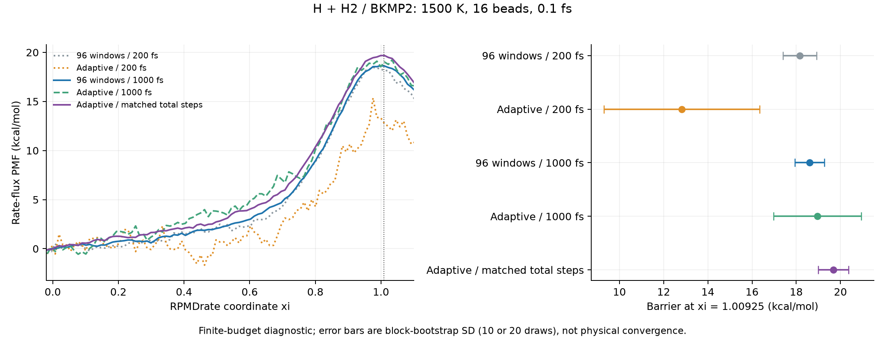

# H + H₂：自适应 umbrella、固定 96 窗与 metadynamics 检查

本次检查发现，默认短生产预算可能比通过 ESS 检查所需的 pilot 还短；
通过 pilot 不代表最终 PMF 已有足够统计。固定 96 窗也不能解决每条轨迹的
有效样本不足。另一个独立问题是，无约束 RPMDrate ξ 不适合在整个气相
构型空间进行 metadynamics 探索，它在反应区外可以出现极点。

基础版本为 `347facf`，修改实现为 `9fe9b50`。本报告保存有限预算的数值
诊断，所有结果保持 `converged=false`，没有计算或宣称收敛的反应速率。

## 实现检查与调整

- Umbrella 的物理偏置 W 进入环聚合物 Hamiltonian 时乘 P；MBAR 去偏
  使用 βW。rate 的 pilot 与 production 都保留 flux metric，pilot 与生产
  使用不同随机流，pilot 不进入最终 PMF。未发现这里存在珠子数因子错误。
- Metadynamics 的 hill 高度是物理能量，WT 衰减为
  `exp(-beta*V/(gamma-1))`；一步内两次力评估使用同一历史，成功完成该步
  后才沉积。有限差分、周期 Gaussian、沉积前后故障与精确恢复测试通过。
- 新任务的自适应默认上限由 4 轮/64 窗改为 **8 轮/128 窗**；只有 ESS
  不足才增加 pilot 长度，单纯插窗不加倍。新增 `max_pilot_steps`，默认
  `16 * pilot_steps`，达到上限仍无进展时明确停止。
- `resume --adaptive-max-rounds/--adaptive-max-windows/--adaptive-max-pilot-steps`
  可提高耗尽的 pilot 预算。原 manifest、已完成 checkpoint、目标和随机种子
  保持不变，扩展记录写入带校验的 plan；冻结后的窗口不能重新适应。
  旧 plan 保留其已保存的默认参数和调度规则。
- 未显式指定生产长度的 adaptive/metadynamics 任务默认 **1000 fs**，
  原先为 200 fs；显式设置继续生效。生产 ESS、是否达到目标、最后 pilot
  和生产长度分别报告，生产不足或短于 pilot 时明确提示。
- Metadynamics 使用可增长数值数组保存 hill 中心/高度，消除每次力计算
  重建整个历史数组的开销，仍执行完整 Gaussian 求和。公开历史为独立
  snapshot，通过 `deposit`/`truncate_hills` 修改，避免外部修改导致缓存失效。
- Metadynamics 汇总增加每个副本和共同网格覆盖率、网格内样本比例、CV
  极值及沉积高度，明确提示 `analysis.ranges` 不施加约束。

## H₃ 对照条件与结果

BKMP2 源码按仓库固定 SHA256 构建，并通过作者能量参考值和解析力检查。
使用 1500 K、16 珠子、0.1 fs Cayley、两个独立副本、Andersen 间隔 50 步、
每 10 步保存一次样本。固定 96 窗均匀覆盖 ξ=-0.05…1.10；自适应从 6 窗
开始。βK=400，入口参考 ξ=0，固定分割面 ξ*=1.00925，两条等价交换路径
均包含在反应坐标中。各 PMF 使用相同 `rate_flux` 测度和 120-bin 网格。

| 方案 | 最终窗数 | 每流平衡/生产 | 总积分步数，含 pilot | 生产样本数 | 单流 ESS 最小/中位 | 势垒 ± bootstrap SD，kcal/mol |
| --- | ---: | --- | ---: | ---: | --- | --- |
| 固定 96，短预算 | 96 | 100/200 fs | 576,000 | 38,400 | 4.11 / 14.33 | 18.17 ± 0.76 |
| 自适应，短预算 | 11 | 100/200 fs | 254,000 | 4,400 | 6.17 / 13.66 | 12.82 ± 3.52 |
| 固定 96，长预算 | 96 | 300/1000 fs | 2,496,000 | 192,000 | 13.70 / 58.65 | 18.61 ± 0.67 |
| 自适应，相同每窗长度 | 10 | 300/1000 fs | 408,000 | 20,000 | 30.98 / 65.89 | 18.95 ± 1.98 |
| 自适应，相同总步数 | 10 | 300/11440 fs | 2,496,000 | 228,800 | 428.77 / 599.23 | 19.68 ± 0.69 |

短预算自适应需要三轮 pilot（1000、2000、4000 步）才通过目标，最后生产
却只有 2000 步。其低 ESS 和大误差支持增加生产预算，而非仅增加窗口。
“相同每窗长度”的自适应运行使用的总步数只有固定窗的约 16%，不能据此
要求相同精度。

等总步数的自适应 pilot 用 148,000 步，冻结后生产及平衡用 2,348,000 步，
恰好与固定 96 窗的 2,496,000 步相等。该组中，两者势垒差 1.07 kcal/mol，
ξ=0…1.00925 共同区间 PMF 的 RMS 差为 0.84 kcal/mol；势垒统计误差相近。
这说明应把减少窗口所省的预算用于延长生产，不能把冻结窗数少视为已经
达到固定 96 窗的统计精度。



[PDF 图](h3-comparison.pdf)。短预算用了 10 次 block-bootstrap，其他组用了
20 次，所有请求的 draw 均成功。这些次数只适合实现诊断，误差不包括
未热化、未探索慢模、CV/分割面选择、珠子数、时间步长等系统误差。
这里没有独立种子系列、长时间极限或 recrossing 收敛研究；1000 fs 与等步数
自适应组共享生产随机流的前缀。固定 96 窗本身也不是精确真值。

## Metadynamics 的真实 H₃ 诊断

使用相同 T/P/dt、300 fs 平衡和 1000 fs 生产，σ=0.03、初始 hill 高度
0.2 kBT、pace=100、γ=10，两个副本各沉积 100 个 hill。该计算保持当前
metadynamics 支持的 `cv_density`，与上面的 `rate_flux` 不同，不能直接
比较势垒数值或替代 RPMD 速率的 PMF。

第一条轨迹的 ξ 范围为 **−940.37…907.79**，第二条为 −0.564…0.805。
在请求的分析区间 [-0.15, 1.25] 内，两条流的样本比例分别为 0% 和 69.3%，
共同支持为 0%，最终聚合 FES 全部 mask。该结果明确不能使用。
应先确定合适的非奇异 CV 与物理约束，再讨论延长时间、hill 宽度/高度和
副本一致性；增加 hill 高度不能修复 ξ 的极点。当前工作流没有内置墙选项，
`analysis.ranges` 只选择输出网格，不限制轨迹运动。

缓存优化前后，这两条 H₃ 轨迹的 q、p、样本、采样偏置、hill 历史与 RNG
逐值相同。完整求和的二维 kernel 微基准（200 次调用、5 次重复、单线程
CPU 时间中位数）在 100/1000/5000 个 hill 时分别约加速 **1.84×/6.52×/10.64×**。
这衡量历史偏置 kernel，不是整个 PES/工作流的加速比。

## 验证与复现

- 全量回归：1570 passed、13 skipped、153 subtests passed。
- 最后补充的定向回归：52 passed、4 subtests passed，包括默认长度、预算
  扩展后逐值恢复、禁止降低目标/预算、cap 失败、生产诊断、缓存回滚和覆盖率。
- 构建真实 BKMP2 后的相关测试：28 passed，补跑了全量测试中因默认路径
  尚无 BKMP2 而跳过的 10 项。其余可选 EAM/Torch 未启用。
- 4-rank MPI FES/rate G2 B2 与精确恢复通过；wheel、Sphinx HTML 和
  singlehtml（warnings-as-errors）构建通过。

证据、曲线、配置、checkpoint SHA256 和日志保存在 [evidence/](evidence/)。
原始采样数组没有加入 Git；可用 runner 重建。数值对照的 wall time 来自
同一工作区的运行，部分作业并行，不能据此比较严格的整流程速度。

```bash
python benchmarks/h3/build_pes.py
export OMP_NUM_THREADS=1 OPENBLAS_NUM_THREADS=1
python benchmarks/h3/enhanced_sampling.py --method fixed96 --profile short --output runs/audit/fixed96-short --bootstrap 10
python benchmarks/h3/enhanced_sampling.py --method adaptive --profile short --output runs/audit/adaptive-short --bootstrap 10
python benchmarks/h3/enhanced_sampling.py --method fixed96 --output runs/audit/fixed96 --bootstrap 20
python benchmarks/h3/enhanced_sampling.py --method adaptive --output runs/audit/adaptive --bootstrap 20
python benchmarks/h3/enhanced_sampling.py --method adaptive --production-steps 114400 --output runs/audit/adaptive-matched --bootstrap 20
python benchmarks/h3/enhanced_sampling.py --method metadynamics --output runs/audit/meta-diagnostic
python docs/validation/enhanced-sampling-2026-10-31/benchmark_hills.py
python docs/validation/enhanced-sampling-2026-10-31/render.py
```

114400 步的等预算值适用于本报告 seed=721062、两轮 pilot 后冻结 10 窗的
情况；换种子或参数后必须按实际 pilot 消耗和冻结窗数重新计算。实际 H₃
任务建议以本报告的显式平衡/生产设置开始，增加独立重复并检查 PMF/误差；
默认生产上调不会自动解决热化、CV 或全局探索的问题。
