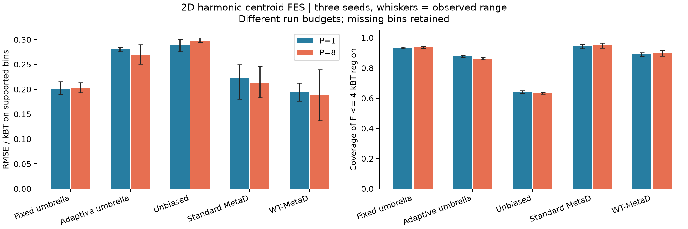
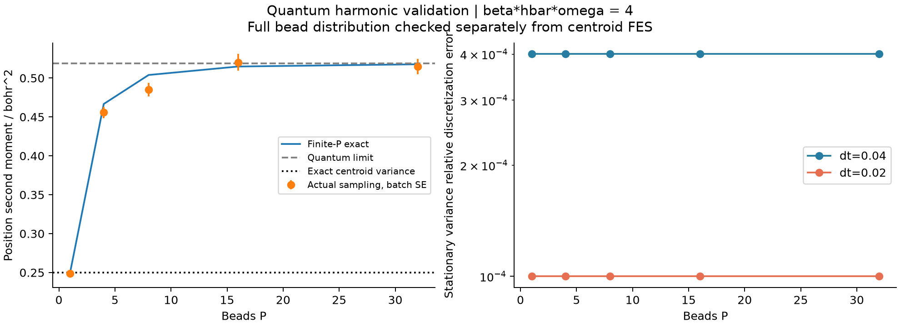
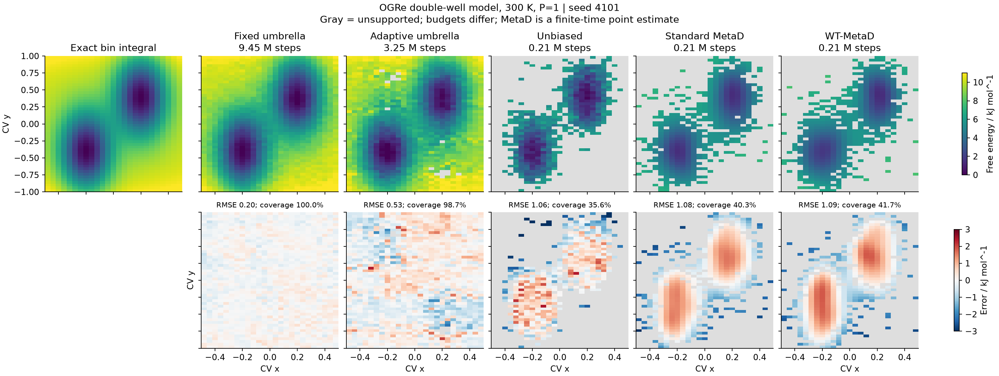
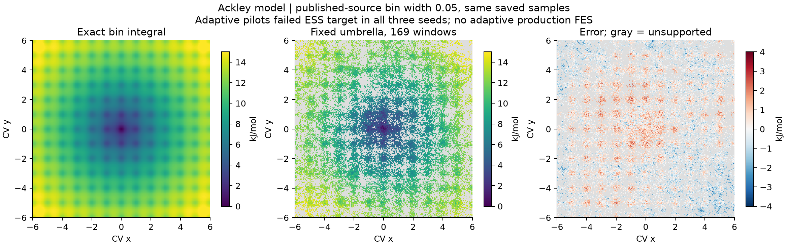

# 二维自由能面、不同采样方法与 RPMD 的计算核验

日期：2026-10-30。程序基线：`6fde29d2039c01921f00393bf17830b939af131b`。

后续实现修复、恒温设置诊断和相同预算复测见[优化报告](../fes-optimization-2026-10-30/README.md)。
本页保留修复前的历史证据。数据、测试结果与 `evidence/manifest.json` 中的源码指纹
均对应当时的 `6fde29d` 工作区，不代表后来基于 `main` 的 PR 集成验证；
最新集成结果在优化报告中单独记录。

**结论：本次没有发现已覆盖路径的偏置珠子数缩放、MBAR 求解或谐振子 RPMD
动力学错误。二维非谐面的完整采样仍是限制；不能据此宣称自适应伞或
metadynamics 已对任意二维自由能面收敛。Ackley 论文精度尚未复现。**

完成 54 个 FES 算例，另保留 3 个未满足 ESS 判据而停止的自适应算例。
这些 FES 工作共执行 103,529,000 个积分步，包括平衡、试采样与生产；
另有量子谐振子采样及无偏动力学验证。未将不同预算的计算作为等成本效率排名。
新增内容是可复现基准和证据，没有为了使结果好看而修改生产采样器。

## 测试与审查

| 检查 | 本次实际结果 |
| --- | --- |
| 相关测试子集 | 90 passed，10 subtests passed |
| 全套现有测试 | 1016 passed，13 skipped，153 subtests passed；无失败，128.60 s |
| 外部模型接口 | C 能量与独立 Python 公式差 ≤2.17×10⁻¹⁹ Hartree；有限差分力误差 <10⁻¹² a.u. |
| 实际 P=8 谐振子，20,000 样本 | 与 PyMBAR 窗口无量纲自由能差 ≤2.34×10⁻¹³；权重差 ≤2.15×10⁻¹⁷ |
| 实际二维双阱，90,000 样本 | 与 PyMBAR 自由能差 ≤1.45×10⁻¹²；权重差 ≤9.23×10⁻¹⁶ |
| 量子平衡分布 | P=1/4/8/16/32；实际传播映射的平衡珠子方差误差从 0.040016% 降到 0.010001%（步长减半） |
| 无偏 RPMD 相关函数 | 三种积分器，P=1/8/32；最大误差相对 C(0) 从 0.121784% 降到 0.030435%，约四倍改善 |

跳过项为未构建的真实 BKMP2（10 项）、未配置的真实 EAM（1 项）、未安装
PyTorch（2 项）。本环境没有 GNU Fortran，因此没有把历史 H₃ 结果算作本次重新运行的证据。
103 条 warnings 是 ASE 与 NumPy 的 shape 弃用提示，不是测试失败。

审查重点包括 `H_P` 中的 `P*W` 偏置、`β/P` 采样温度、完整 CV Jacobian、
well-tempered 沉积指数中的物理偏置、独立生产种子、checkpoint/HILLS 一致性、
未采样区域 mask 和断连保护。相关测试与实际采样共同提供证据，不能替代隐藏慢自由度的混合检验。

## 论文与对照范围

主要参考是 [Borgmans 等的 OGRe 论文，JCTC 2023](https://doi.org/10.1021/acs.jctc.3c01028)。
其二维双阱与 Ackley 模型及原始误差表来自
[作者存档的固定提交](https://github.com/SanderBorgmans/SupportingInformation/tree/e7511c7dd48be80230c3cc4afc660696584712b1/2023_TBD_OGRe)。
本次按论文的势函数与 300 K 做经典 P=1 计算。采样器、刚度策略、时间步长、
数据量和重建方法不完全相同，因此是模型与准确性对照，不是 OGRe 算法的逐项复现。

PyRPMD 自适应策略保持刚度不变，依赖重叠连通和有效样本数；OGRe 还考察
窗口限制、分布一致性等并可调整刚度。达到前者判据不等价于通过后者判据。
Ackley 额外在比较区外 `|CV|>8` 使用统一四次墙，令目标分布可归一化；
`[-6,6]²` 区内的势与局部自由能差不变。

## 二维量子谐振子

使用单位质量、`V=(x²+y²+z²)/2`、β=4、Δt=0.04 a.u.。
这是量子参数 βℏω=4 的解析测试，质心 FES 对任何珠子数都精确已知。
下表是 P=8 的三个独立种子平均；误差只在受支持格子上计算。
区域是 `F-F_min≤4 kBT`，24×24 分箱。

| 方法 | RMSE / kBT（种子范围） | 区域覆盖率 | 每算例总积分步 |
| --- | ---: | ---: | ---: |
| 固定伞 | 0.2023（0.1937–0.2132） | 93.6% | 225,000 |
| 自适应伞 | 0.2683（0.2509–0.2897） | 86.2% | 252,000 |
| 近无偏对照 | 0.2977（0.2944–0.3036） | 63.3% | 61,000 |
| Standard MetaD | 0.2120（0.1832–0.2456） | 95.1% | 61,000 |
| WT-MetaD | 0.1885（0.1369–0.2393） | 90.1% | 61,000 |

自适应从 9 个中心增到 17 个。P=1 的结果同量级，详见 JSON/CSV。
MetaD 是平滑的点偏置估计，而伞方法是有限分箱密度；这两类误差定义已分别匹配参考。

仅检查质心面无法确认量子展宽，因此另检查珠子二阶矩：P=32 的实际值
0.51471（批次 SE 0.00973），有限 P 精确值 0.51770，P→∞ 精确值 0.51866；
质心精确值仍为 0.25。有限随机样本误差与离散误差分开报告。
离散 Lyapunov 检查独立构建实际 40 步传播映射，验证整个珠子协方差的二阶矩，
而不是用生成采样数据的公式作自我对照。

无偏动力学采用 [Craig 与 Manolopoulos，JCP 2004](https://doi.org/10.1063/1.1777575)
的谐振子精确极限，参考 `C̃qq(t)=cos(t)/4`，区间 0–20 a.u.，无恒温器、无偏置。
以线性平衡响应精确计算相关函数，避免 Monte Carlo 噪声掩盖积分器误差。
这些结果不验证非谐反应的 RPMD 速率。

## 论文二维双阱

范围 `[-0.5,0.5]×[-1,1]`，初步分析宽度 0.04，25×50 bins。
固定伞 45 个中心；自适应初始 15 个、最终 15–16 个中心，刚度 200 kJ mol⁻¹ CV⁻²。
三个独立种子都保留。生产长度分 40,000 和 200,000 步/窗口。

| 配置 | 平均 RMSE / kJ mol⁻¹ | 平均覆盖率 | 平均总积分步 |
| --- | ---: | ---: | ---: |
| 固定伞，40,000 步/窗 | 0.4679 | 100% | 2,250,000 |
| 自适应伞，40,000 步/窗 | 0.9750 | 80.8% | 935,667 |
| 固定伞，200,000 步/窗 | 0.1999 | 100% | 9,450,000 |
| 自适应伞，200,000 步/窗 | 0.4958 | 98.5% | 3,389,000 |
| 近无偏，200,000 步 | 0.9935 | 35.0% | 210,000 |
| Standard MetaD，200,000 步 | 1.1078 | 40.5% | 210,000 |
| WT-MetaD，200,000 步 | 1.1222 | 41.3% | 210,000 |

MetaD 参数 σ=(0.07,0.14)、初始高度 0.1 kJ/mol、每 200 步沉积，WT 的 γ=5。
本预算下其整面尚未收敛；不能从表中推出等成本下哪种方法更优。
相同种子的长轨迹包含短轨迹前缀，不将两种长度视作独立样本。

重分箱到作者公开脚本的 0.02 宽度后，不重新求解或采样，固定长轨迹的
bin 积分 RMSE 为 0.3525 kJ/mol、覆盖率 100%；自适应为 0.6900 kJ/mol、覆盖率 85.0%。
这说明报告较粗网格的 98.5% 覆盖率不能替代指定分辨率的完整覆盖。
重分箱前已逐项核验保存的流顺序、原始计数与 MBAR 概率质量一致。

## Ackley 与论文数值

从作者原始数值表核得，图 12 所用参数族在三层时的 RMSE 是
**0.2902429086 kJ/mol，1,250 次不同窗口模拟，NaN bins=0**。
原始记录的 `non_converged` 标志仍为 1，已原样保留，不能把图中误差值解释为所有自适应判据均已满足。
同参数族四层记录为 0.1476724136 kJ/mol、3,264 次模拟，也保留相同标志。

PyRPMD 固定伞使用 169 窗口、每窗口 40,000 步生产，共 338,000 个保存样本。
在 0.1 宽度网格上，三个种子的平均 bin 积分 RMSE 是 1.0244 kJ/mol，覆盖率 99.2%。
按公开脚本的 **0.05 宽度** 重分箱，并按作者的“点势、最小值归零”方式比较后：

| 记录 | RMSE / kJ mol⁻¹ | 支持情况 |
| --- | ---: | --- |
| 论文图 12 原始条目 | 0.29024 | 原始条目 NaN bins=0 |
| 本次固定伞，3 种子平均 | 0.94533（0.88398–1.04036） | 只覆盖 51.0%，要求每 bin 至少 5 个样本 |
| 本次自适应伞，3 种子 | 无生产 FES | 5 轮后 ESS 不达标，正确停止 |

两者采样规模、偏置优化、直方图支持规则及 WHAM/MBAR 分析不同；即使匹配公开的
网格宽度与归零方式，也不能称为严格同条件比较。**本次没有达到论文准确性和覆盖率。**
细网格按 bin 积分参考计算的误差反而降为 0.8686 kJ/mol，这是受支持区域改变的结果，
不是更细分辨率提升了采样。必须连同约一半区域缺失一起理解。

自适应每个种子已执行 8,085,000 个 pilot 积分步，重叠图连通，但最后最差 ESS
分别为 8.335、9.267、8.965，低于目标 30。三次均 `production_started=false`，
没有 FES 被补齐或标为成功。较大刚度、自适应刚度或更有效的局部热化需要新实验，
不能仅降低 ESS 门槛来宣称问题已解决。

## 证据与下一步

算法审查和以上误差支持当前覆盖范围内的数值实现；主要未解决的是非谐二维面的
采样效率、目标分辨率覆盖和隐藏自由度混合。建议下一轮把区域覆盖、独立流一致性、
分布形状及窗口刚度调整加入自适应设计，并在等总积分预算下重新比较。
未检验非谐量子质心 FES、真实分子反应速率、低温隧穿或材料扩散的论文数值。

- [汇总数据](evidence/summary.json)、[逐方法 CSV](evidence/method-summary.csv)、[运行与来源清单](evidence/manifest.json)。
- [实际全套测试日志](evidence/full-tests.log)、[JUnit](evidence/full-tests.xml)、[相关子集](evidence/baseline.log)。
- [论文原始条目摘录](evidence/paper-summary.json)、[模型源码来源及校验](evidence/source-provenance.json)。
- [量子平衡检查](evidence/harmonic-quantum.json)、[动力学检查](evidence/harmonic-dynamics.json)、[独立求解器](evidence/pymbar-checks.json)。
- [运行脚本与完整复现步骤](../../../benchmarks/fes_methods/README.md)。

全部大型原始数据、checkpoint 和 HILLS 保存在本次工作区
`/workspace/work/rpmd-fes-review/{harmonic,ogre}`。Git 仅归档摘要、图和测试日志。
原始工作区路径仅用于溯源，不是可下载地址。[完整验证与优化证据 ZIP（22 MB）](https://drive.google.com/file/d/1ek7EqkyLH4ES1XT7Kd1Gu_fZOu76wdwG/view)
另含 PDF 和逐案例紧凑结果，仍不包含全部大型采样 checkpoint。
图中误差条为三个种子的观察范围，量子采样图单独注明批次 SE；不将其当作经过覆盖率验证的区间。
