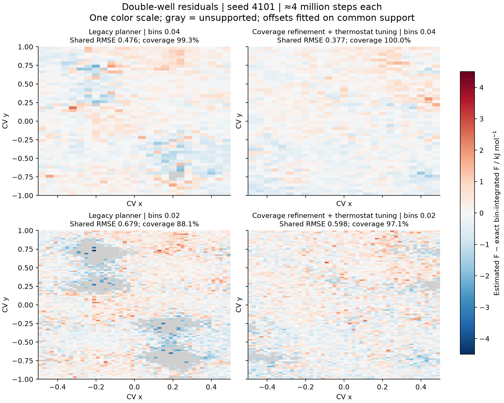
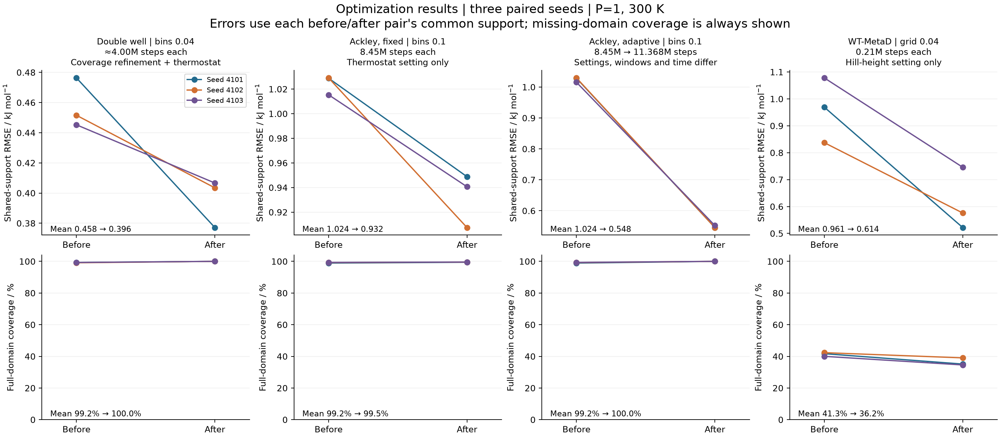

# 二维 FES：误差诊断、实现修复和优化复测

日期：2026-10-30。基线 commit：`6fde29d2039c01921f00393bf17830b939af131b`。
本报告接续[第一轮论文与程序核验](../fes-methods-2026-10-30/README.md)。

本页实验数据及 1054 项通过的测试结果均来自上述基线派生的优化工作区。
提交 PR 时，改动已移植到更新的 `main`：`3dc82c399a7701d19d636ee78b43f2e8ba7659f9`，
并保留其原生传播、MBAR 内存优化和 surface bootstrap 保护。
**移植前的实验与轨迹等价记录是历史证据，不能替代当前 PR 的集成验证。**
当前集成结果单独记录于 [integration.json](evidence/integration.json)。

本仓库保留聚合结果、参数、两张关键 PNG 与小型日志，其文件校验见
[manifest.json](evidence/manifest.json)。完整逐案例结果及 PDF 见
[证据 ZIP（22 MB）](https://drive.google.com/file/d/1ek7EqkyLH4ES1XT7Kd1Gu_fZOu76wdwG/view)。
[archive-manifest.json](evidence/archive-manifest.json) 原样保留该 ZIP 的归档清单：
其中源码指纹对应当时的优化工作区，`cases/` 等条目的哈希对应完整 ZIP，
不是当前仓库的文件清单或当前集成源码的指纹。

**结论：采样设置和实现局限都有影响。未发现 MBAR、RPMD 珠子缩放或 WT 偏置公式错误；
已修复空间覆盖缺少检查、ESS 漏看振幅慢混合及 MetaD 重复构造历史数组的问题。
误差和覆盖已有可重复改善，但尚未达到 OGRe 论文的 Ackley 细网格准确性。**

## 实现改动

1. 自适应伞增加显式的区域覆盖目标。旧算法仅在重叠图断连时插窗，图连通后仍可能
   存在二维采样孔洞。新算法按声明网格检查相关性修正的局部 MBAR 有效样本数，
   在薄弱格中心补窗；达到窗口上限后可继续延长 pilot，未达判据则不启动生产。
2. ESS 同时检查 CV 与中心化 CV 平方；周期坐标检查一、二次谐波。
   这可以捕捉快速振荡但振幅松弛缓慢的情况。相同诊断用于生产 FES/PMF 的
   有效样本数和 bootstrap 分块；不改变 MBAR 权重或自由能点估计。
3. MetaD 缓存高斯丘中心和高度数组，仅在沉积、恢复和截断时更新；只求能量时跳过梯度。
   故障回滚会同步失效缓存。`hills` 返回独立快照，修改快照不改变正在运行的偏置；
   使用 `deposit()`、`truncate_history()` 更新，或用修改后的历史构造新偏置做分析。

覆盖检查默认关闭，需要用户声明目标范围；不会猜测未指定的自由能面区域。
局部 ESS 是 `(Σw)²/Σ(g_stream w²)`，不是包含 MBAR 偏移不确定度的置信区间。
所有新先导仍与生产使用独立种子，先导数据不进入最终 FES。
旧冻结计划保留已保存的决定，并明确标记 Legacy 判据；须用新输出目录重验新判据。

## 双阱：相同积分预算对照

采用 OGRe 公开的二维双阱、300 K、P=1，区域 `[-0.5,0.5]×[-1,1]`。
三个种子 4101/4102/4103；每例总预算约 4,000,000 步，包含所有平衡、先导及生产。
新旧实际步数相差不超过 600 步。旧工作流直接从上述 git commit 加载，
不是用新停止规则模拟旧算法。新配置同时启用覆盖修复与恒温调参，因此下表衡量整体方案。

| 统计量，三种子平均 | 旧实现与设置 | 修复及调参后 |
| --- | ---: | ---: |
| 0.04 分箱 RMSE / kJ mol⁻¹ | 0.45769 | 0.39533 |
| 0.04 分箱覆盖率 | 99.23% | 100.00% |
| 0.02 分箱 RMSE / kJ mol⁻¹ | 0.64808 | 0.61927 |
| 0.02 分箱覆盖率 | 87.97% | 96.77% |
| 最终窗口数 | 15 / 15 / 16 | 28 / 31 / 32 |

RMSE 与独立 bin 积分参考比较，零点按支持区平均残差对齐；每格至少 5 个原始保存样本。
细网格覆盖率明显提高，因此两侧误差涉及的区域不同；相同支持区重新对齐的逐种子结果
另保存在 `evidence/optimization-summary.json`，不能只看被 mask 后的误差。
共同支持区平均 RMSE：0.04 网格为 0.45769→0.39572，0.02 网格为
0.64354→0.61354 kJ/mol。0.04 网格误差下降约 13.5%；对细网格的主要改善是填补缺采区域。



新设置保持 `dt=0.1 fs`、伞刚度 `200 kJ mol⁻¹ CV⁻²`，Andersen 间隔从 100 调到 50 步。
覆盖参数为 `[4,8]`、局部 ESS ≥5、覆盖目标 95%、最多 45 窗，全局窗口 ESS 门槛仍为 30。
先用 40k 步/窗探索计划，再依据实际先导成本分配约 4m 总预算；长短计算共享同种子前缀，
不视作额外独立重复。所有探索配置均留存，没有用解析势来选择插窗位置。

## Ackley：恒温设置、成功停止与分辨率限制

49 窗口的控制实验发现，旧 `dt=0.1 fs`、每 100 步重采样动量，碰撞过频。
保持每窗 80k 步，改为 500 步后，三种子最低联合一、二阶矩 ESS 从 11.1–13.9
提高到 44.5–64.4。改到 1000 步虽坐标 ESS 更高，振幅 ESS 却仅 19.0–26.9；
因此未采用更稀的碰撞来制造“收敛”。

| 完整 FES 配置，三种子平均 | 总积分步/例 | 0.1 分箱 RMSE | 0.1 覆盖率 |
| --- | ---: | ---: | ---: |
| 原固定伞，169 窗 | 8.450m | 1.0244 | 99.16% |
| 固定伞，仅碰撞间隔 100→500 | 8.450m | 0.9331 | 99.50% |
| 新自适应与优化设置，49 窗 | 11.368m | 0.5484 | 100.00% |

误差单位为 kJ/mol。最后一行预算、步长和窗口布局均不同，不能作为等成本效率提升的证据。
它采用 `dt=0.5 fs`、每 100 步碰撞（50 fs）、20k pilot+2k 平衡、200k 生产/窗，
覆盖网格 `[6,6]`；三种子都在首轮通过，最低联合 ESS 为 77.74/105.18/72.75。
先导成本从旧失败算例的 8.085m 降至 1.078m 步；没有降低 ESS=30 门槛。
代表性 6 窗×3 种子的等物理时间实验比较了 0.1 和 0.5 fs 步长，矩误差相近，
支持此模型的设置选择，不将 0.5 fs 推广为任意分子或珠子数的默认值。

在论文脚本的 **0.05 分箱**上，新自适应平均 bin 积分 RMSE 为 **0.7282 kJ/mol**，
仅覆盖 **72.24%**；按点势、最小值归零得到 **0.8044 kJ/mol**。
[OGRe 论文](https://doi.org/10.1021/acs.jctc.3c01028)图 12 对应公开原始记录为
0.29024 kJ/mol、1250 次不同窗口模拟、NaN bins=0，同时原记录保留 `non_converged=1`。
采样器、预算、支持规则与 WHAM/MBAR 分析并不一致；**仍未复现论文细网格精度与覆盖率**。

## MetaD：精度与性能分别评估

旧双阱 WT-MetaD 的偏置仍在填充阶段；把后半程偏置平均反而增大误差，因此没有添加
会掩盖未收敛问题的默认平均。保持 200k 生产步、`dt=0.1 fs` 和碰撞间隔 100 步，
只将初始丘高从 0.1 调到 0.4 kJ/mol，三种子在前后共同支持区的 RMSE 从
**0.9613 降至 0.6144 kJ/mol（约 36.1%）**。
但各自覆盖率从 **41.33% 降到 36.24%**：这说明已访问区域的偏置形状改善，
不是完整自由能面收敛。丘宽、丘高与采样时间仍须按模型检查。
将 Ackley 的碰撞设置直接叠加到此 MetaD 算例反而变差，负结果同样保留。

缓存优化单独验证了数学等价性：二维 50 个测试点的能量和梯度逐位相同；
P=4 的标准/WT 两种完整短轨迹各 6200 步，最终 q/p、600 条采样、100 个丘、RNG 及恢复状态均逐位相同。
用进程 CPU 时间测 1000 次力评估，在 100/1000/5000 个丘时约加速 **3.58/7.33/10.11 倍**。
这是偏置力核的微基准，不是整条模拟的总加速倍数。



## 验证和复现

优化工作区全套（移植前历史结果）：**1054 passed、13 skipped、153 subtests passed，96.67 s**，无失败。
13 个跳过项仍为未构建真实 BKMP2（10）、未配置真实 EAM（1）、未安装 PyTorch（2）；
103 条 warnings 为 ASE/NumPy 的 shape 弃用提示。相关回归覆盖实际慢振幅流、
常数派生观测量、周期边界、覆盖缺口、预算失败保护、缓存失效和精确恢复。
历史 bootstrap 缓存回归显式固定其原相关性策略并保留原参考数值，新二阶矩策略
另用弱阻尼流检查，不是把旧断言改成当前输出。

全部 18 个新伞采样算例已用归档优化源码重分析生产诊断，**自由能、概率质量、原始计数和
mask 均逐位不变**，没有新增传播；详见 `evidence/diagnostic-refresh.json`。
完整 ZIP 保留原始运行源码指纹及刷新后的生产 summary；此等价结论不涵盖后来 `main` 的变更。

所有非谐模型对照为 P=1，以便与论文的经典势能参考比较；不能把量子非谐质心自由能
等同于裸势能。P>1 仍由前次谐振子解析核验、全套回归及本次 MetaD 轨迹等价检查覆盖。
本次没有新的非谐分子 RPMD 反应速率复现结论。

基准脚本位于 `benchmarks/fes_methods/`：

```bash
export OPENBLAS_NUM_THREADS=1 OMP_NUM_THREADS=1
python benchmarks/fes_methods/ogre_benchmark.py build --output /tmp/ogre
python benchmarks/fes_methods/optimization.py --model double_well --method adaptive \
  --seed 4101 --label coverage-tuned --output /tmp/optimized/production \
  --library /tmp/ogre/build/double_well.so --override <配置JSON路径>
python -m pytest -q
```

本仓库的 `evidence/configs/` 包含四组优化参数，聚合 JSON/CSV 保存各案例指标。
完整 ZIP 中报告目录下的 `evidence/cases/` 保存逐案例配置、源码指纹和数值数组；
这些逐案例文件未加入 Git。JSON 中的原工作区路径仅用于历史溯源，不是下载地址。
`budget_comparison.py` 使用已完成的先导探索成本做相同预算对照；其 `--baseline-data`
指向首轮完整数据目录，`--output` 指向新轮目录。
`settings_scan.py`、`summarize_settings.py` 和 `optimization_report.py` 生成控制实验及图表。
完整采样 checkpoint 保留在工作目录；证据 ZIP 包含紧凑结果、图表和移植前修复补丁，
不包含全部大轨迹。当前 PR 的实际代码变更以 Git 提交为准。
