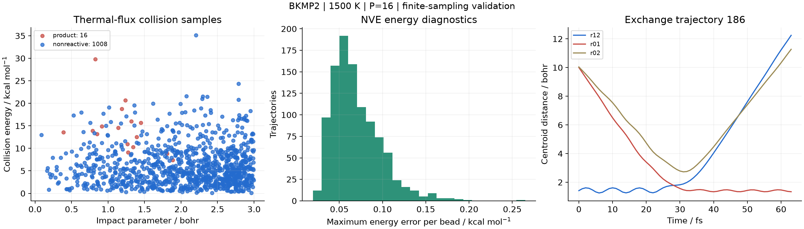
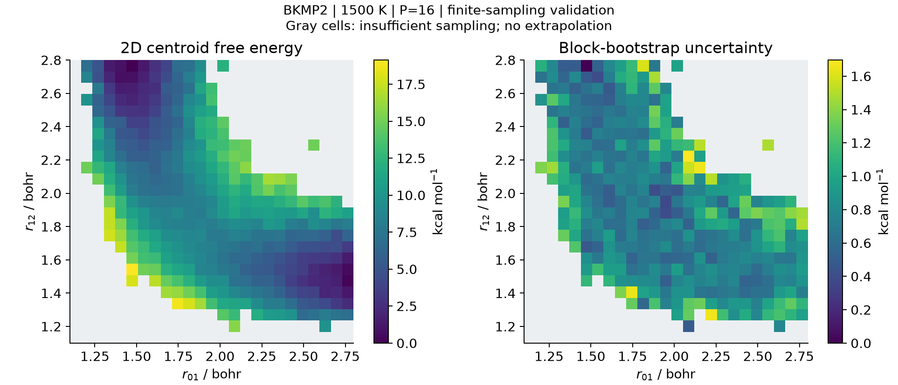
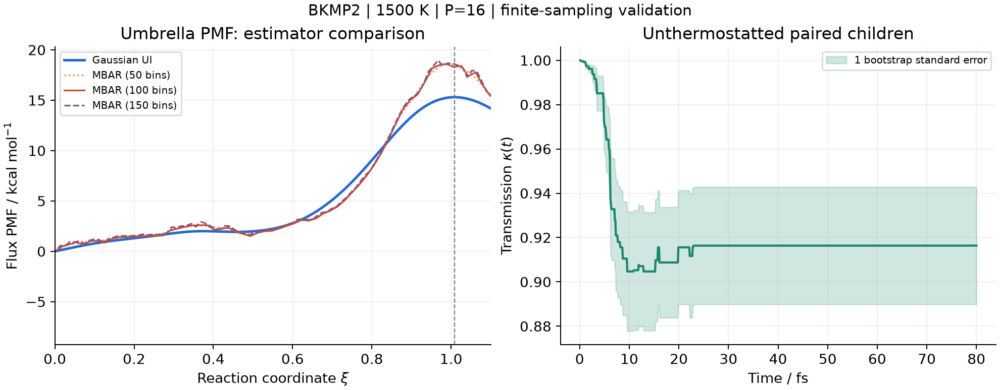

# H + H₂ / BKMP2：GitHub 真实体系测试记录

日期：2026-10-29。四项实际计算均完成：dRPMD、二维 RPMD 自由能面、伞抽样 PMF 和 recrossing。GitHub 工作流实际用时约 18 分 31 秒；各模拟 runner 的计时为 dRPMD 322.35 s、FES 47.42 s、PMF+recrossing及分析 1021.97 s。
**数值与工作流门槛通过；这些有限采样结果没有建立物理速率收敛。** 同一分割面上的 UI/MBAR 对照必须与默认速率一并阅读。

主要未解决项：100-bin MBAR 与 Gaussian UI 的势垒相差 **3.00534 kcal/mol**，配对 95% bootstrap 区间 **[1.9222, 3.4011] kcal/mol**。默认 UI 速率不能据此称为已收敛或独立验证的物理结果。

- 测试代码：[c0bc35529ba595d01e84b931dccdde33f16bd697](https://github.com/chen-yu-hao/Next-RPMD/commit/c0bc35529ba595d01e84b931dccdde33f16bd697)。
- [真实体系 GitHub Actions](https://github.com/chen-yu-hao/Next-RPMD/actions/runs/40911869436)。
- [Python / MPI / Torch 回归 Actions](https://github.com/chen-yu-hao/Next-RPMD/actions/runs/40911869245)。
- [完整数值摘要](github-summary.json)、[执行状态及 artifact 校验记录](github-execution.json)、[完整 PMF 诊断](github-pmf-diagnostics.json)。
- [复现输入与方法说明](../../../benchmarks/h3/README.md)。

## 体系与计算定义

使用发表的 BKMP2 基态 H₃ 势能面，H 核质量 1.00782503223 u，温度 1500 K，16 珠子，传播步长 0.1 fs。远程环境为 Python 3.12.15、NumPy 2.5.4、SciPy 1.18.1、h5py 3.16.0、GNU Fortran 13.3.0。每个化学模拟 job 使用 2 个轨迹/窗口进程，原生 C++ 内核；这次真实体系运行没有使用跨物理节点或 GPU。

H0 + H1H2 的两个交换产物为 H0H1 + H2 和 H0H2 + H1。反应坐标显式包含两个等价面，取 s₁=r₁₂−min(r₀₁,r₀₂)，不再额外乘 2；electronic_weight 与 symmetry_factor 均为 1。入口/初始距离为 10 bohr。

PES 在构建时下载固定的 RPMDrate 源码并核对 SHA256，第三方 Fortran 源码及二进制不按 PyRPMD 的 MIT 许可证重新分发。来源、编译精度与作者参考值见 [SOURCE.md](../../../benchmarks/h3/SOURCE.md)。

## 四项结果

| 计算 | 实际样本或传播规模 | 远程结果 |
| --- | --- | --- |
| dRPMD | 1024 条碰撞；8 条持续母链 | 16 反应，1008 非反应，0 未决，0 失败 |
| 二维 FES | 5×5 窗口 × 2 replicas；30,000 样本 | overlap 连通；373 支持网格；最小 ESS=7.673 |
| 伞抽样 PMF | 23 窗口 × 2 replicas；每窗 1 ps；92,000 样本 | overlap 连通；最小 ESS=5.166；ξ*=1.00925 |
| Recrossing | 2 条约束母链、64 母构型；256 子轨迹；每条 80 fs | κ=0.916360 ± 0.026462（bootstrap 标准误）；尾段平台诊断通过 |

### dRPMD

有限 bmax=3 bohr 的热速率估计为 **8.50551e-12 cm³ molecule⁻¹ s⁻¹**。IID Wilson 95% 区间 [5.2477e-12, 1.3734e-11]，母链 cluster bootstrap 95% 区间 [4.2528e-12, 1.2758e-11]，单位相同。只有 8 条母链，cluster 区间自身仍可能不稳定。

所有碰撞均完成分类，已完成任务再次打开后轨迹账本与母链时钟一致。沿轨迹最大 |ΔHₚ|/(P kBT)=0.088856；对能量误差最大的实际轨迹，从同一保存初态将步长减半，能量误差比为 0.15957。这项数值细化不替换原统计样本。

### 二维 FES

CV 是 centroid 距离 r01、r12。窗口中心各覆盖 1.35–2.35 bohr，采样 100 fs 平衡 + 300 fs 生产；二维密度按 dr01 dr12 定义，未额外扣径向 Jacobian。

25×25 网格中 40.32% 保持 mask。镜像置换 F(r01,r12)=F(r12,r01) 的有限样本偏差 RMS 为 0.2961 kBT，没有用对称平均消除误差。50 条流的最终 HDF5 与 NPZ checkpoint 逐值、等长度一致。

### PMF 估计方法与 recrossing

Gaussian UI 是当前默认 PMF 方法。独立的 histogram-MBAR 分析复用同一批样本，采用同一 flux 测度、W(0)=0 参考和实际 recrossing 的 ξ*；没有移动分割面后沿用旧 κ。40 次块 bootstrap 同次计算 UI 和 MBAR，保留差值协方差；40/40 次均得到收敛、连通并有端点支持的比较。常规 umbrella FES 的初步误差重建另保留了 7/10 次有效结果，不能把它与这 40 次对照混用；原实现没有逐次保存其余 3 次未保留的原因。

默认 UI 势垒 **15.30317 kcal/mol**；默认有限采样速率 **3.26647e-11 cm³ molecule⁻¹ s⁻¹**。下表所有 MBAR 数字保持同一 ξ*：

| MBAR bins | ΔW / kcal mol⁻¹ | ΔW 的 95% bootstrap 区间 | MBAR−UI / kcal mol⁻¹ | 配对差值的 95% 区间 |
| ---: | ---: | --- | ---: | --- |
| 50 | 18.44085 | [16.391, 20.362] | 3.13768 | [2.1863, 3.4575] |
| 100 | 18.30851 | [16.12, 20.507] | 3.00534 | [1.9222, 3.4011] |
| 150 | 18.58202 | [16.383, 20.83] | 3.27884 | [2.1849, 3.6302] |

100-bin MBAR 沿用同一个 κ 的次级速率为 **1.19182e-11 cm³ molecule⁻¹ s⁻¹**，95% 条件区间 **[5.7009e-12, 2.4832e-11]**。该区间固定 κ，**没有包含 κ 的误差**，也没有包含珠子数、有限入口距离或热化系统误差；不能把它作为独立验证或最终综合误差。

已有的 coarse 数据还排除了明显的单位、P 因子、metric、公共归一化和 UI 数值积分错误。Gaussian 近似、相关短链的矩估计和 replica 分组都可能影响方法差异，不能唯一归因于已收敛平衡分布非高斯。详细推导和排错数值见 [方法审查](../../h3-pmf-estimator-audit.md)。

recrossing 的母构型来自两个等价分支；每个构型重新抽取 Maxwell 动量并成对传播 ±p 子轨迹，生产段不加 thermostat。最大子轨迹端点 |ΔHₚ|/(P kBT)=0.029809；此值是端点检查，不能冒充整条子轨迹的最大误差。

## 独立数值验证与本次修正

作者参考点的能量误差低于 3.2×10⁻¹⁰ Eh，Cartesian 力差分检查通过。优化 H₂ 键长约 1.401472 bohr，线性 TS 相邻键长约 1.757000 bohr，势垒 9.6133013 kcal/mol，Hessian 恰有一个负模。

P=1、8、16、32 时原生与 NumPy 从同初态传播一致，最大坐标差约 5.3×10⁻¹⁴ bohr。P=16 的 dt=0.1/0.05/0.025 fs 细化使最大每珠子 NVE 能量误差依次降到约 2.54×10⁻⁵、6.88×10⁻⁶、1.78×10⁻⁶ Eh。不同 P 的该测试是数值实现对照，并非平衡性质的珠子收敛研究。

本次真实体系测试促成四项修正/验收加强：

1. 支持等价过渡面，按 RPMDrate 的 min_bond(max_TS) 定义组合，并给两个 H₃ 出口初始化约束母链。
2. 入口窗口用刚体 fragment COM 分离寻找目标 ξ，保留 H₂ 内部键长，避免初始投影把分子压塌。
3. recrossing 能量验收使用 |ΔHₚ|/(P kBT)，不依赖任意 PES 能量零点。
4. 最终报告要求 HDF5 与 checkpoint 样本完全一致；较短的正确前缀不能冒充完成。

真实 PES job 的专门测试为 13 passed、5 subtests。普通 CPU job 在 Python 3.11 与 3.12 各为 79 passed、4 skipped、74 subtests；跳过的是未安装的可选 Torch 路径及未在该 job 构建的 BKMP2。Torch 独立 job 为 10 passed、1 skipped（未安装 ASE）、3 subtests。真实 BKMP2 另在专门 job 实际编译和测试，因此没有把跳过当作通过。两套 Python 环境都实际执行 4-rank、G=2/B=2 MPI 流程与恢复，以及 sdist/wheel 构建。

## 本地预试验与续跑证据

300 fs/窗口的初次 PMF 最小 ESS≈3.02，未通过预定 ESS≥5 门槛。随后将生产长度延长到 1 ps，未降低门槛。coarse 的 UI/MBAR 诊断保留在 [原始 JSON](local-coarse-pmf-diagnostics.json)，它与上面的远程 1 ps 结果不同。46 条 coarse 轨迹全部为 1 ps 轨迹的前600样本，属于保留种子的嵌套延长采样，不能称为独立重复；[逐流比较证据](local-sampling-length-comparison.json)保留了这一检查。

本地预试验曾出现少数 NPZ 只保存最终 HDF5 的精确前缀；原因未确定。FES 和 1 ps rate 均通过正常 resume 恢复，并验证最终采样/分析数组逐位不变；coarse 的短 checkpoint 在独立副本用原配置重放，恢复样本与原 HDF5 一致。新 GitHub runner 的 fresh 计算独立通过完整性门槛。这些事实不构成对本地异常根因的认定。证据：[FES 正常恢复](local-fes2d-resume-evidence.json)、[rate 正常恢复](local-rate-resume-evidence.json)、[coarse 原配置重放](local-coarse-prefix-verification.json)。

## 数据、复现与边界

Actions 的 `h3-complete-validation` artifact 包含输入、原始采样、碰撞轨迹、checkpoints、PMF、κ(t)、JSON、PNG/PDF 与汇总报告；单阶段 artifact 也保留，保留期 30 天。此目录永久保存数值摘要与三张来自远程 artifact 的图，避免只留下会过期的下载入口。

完整命令见 [基准说明](../../../benchmarks/h3/README.md)。复现需 GNU Fortran、C++17 和 Python 3.11+；从该测试 commit 构建，执行 build_pes、PES/NVE 检查和三个 runner。代码同时支持 `.inp` 和 Python 接口。

这次尚未建立 P 收敛、长时间热化与统计收敛、bmax/R0/R∞ 收敛，或跨物理节点/GPU 性能。少量碰撞反应事件和有限 parent 数不能提供高精度速率；κ(t) 的短时平台也不能替代上述检查。下一步应比较更强/更密的 umbrellas 与独立重复、增加有效样本和 parent 数，再系统改变珠子数及碰撞/入口参数。
