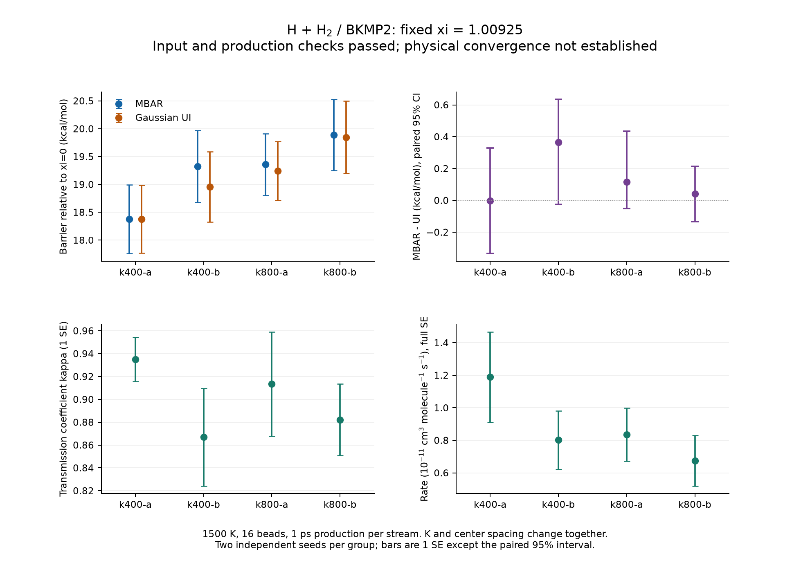

# H₃ / BKMP2：MBAR 速率 PMF 与独立重复研究

本记录对应计算代码提交
[`5642550dad837ebc714a66e2a50d43f0b84bf412`](https://github.com/chen-yu-hao/Next-RPMD/commit/5642550dad837ebc714a66e2a50d43f0b84bf412)。
历史 [第一轮验证](../h3-bkmp2-2026-10-29/README.md) 保持原样。
这轮增加可选 MBAR 主速率后端，并在更强、更密的 umbrella 配置上使用
独立随机种子，重新计算受约束母轨迹和 recrossing。

**三套 GitHub 工作流均成功，四个正式 case 均通过预定门槛。**
共完成 424 条流、848,000 个保存样本、160 次有效 PMF 配对重采样，
以及新生成的 1024 条回穿子轨迹。没有修改预定 seed 或放宽门槛。
四组的 UI/MBAR 配对差值区间都包含零，上轮约 3 kcal/mol 的差异
在新方案中没有复现；这支持方法一致性改善，仍不足以宣称物理收敛。

## 四组实际结果

势垒单位 kcal/mol，`±` 为 1 SE；差值区间是同一次 block-bootstrap
draw 内计算的 MBAR−UI 的 95% percentile 区间。

| Case | MBAR 势垒 ± SE | UI 势垒 ± SE | MBAR−UI | 配对 95% CI |
| --- | ---: | ---: | ---: | --- |
| k400-a | 18.3749 ± 0.6179 | 18.3770 ± 0.6104 | −0.0022 | [−0.3347, 0.3290] |
| k400-b | 19.3233 ± 0.6454 | 18.9587 ± 0.6317 | +0.3646 | [−0.0240, 0.6336] |
| k800-a | 19.3583 ± 0.5547 | 19.2421 ± 0.5281 | +0.1162 | [−0.0519, 0.4345] |
| k800-b | 19.8875 ± 0.6361 | 19.8470 ± 0.6483 | +0.0406 | [−0.1341, 0.2139] |

尤其 `k400-b` 的区间下界仅略低于零，因此不将这些结果解释为“偏差严格消失”。
UI 和 MBAR 共用样本，它们的配对一致性也不是独立物理验证。

下表速率和区间的单位均为 **10⁻¹¹ cm³ molecule⁻¹ s⁻¹**。
联合 SE 包含 PMF 与 κ 的抽样误差，条件于固定分割面和当前模型参数。

| Case | κ ± SE | 速率 ± 联合 SE | 速率 95% 条件区间 |
| --- | ---: | ---: | --- |
| k400-a | 0.9351 ± 0.0194 | 1.1894 ± 0.2778 | [0.8567, 1.8243] |
| k400-b | 0.8669 ± 0.0427 | 0.8022 ± 0.1797 | [0.5216, 1.2743] |
| k800-a | 0.9134 ± 0.0457 | 0.8353 ± 0.1640 | [0.5733, 1.3205] |
| k800-b | 0.8821 ± 0.0313 | 0.6755 ± 0.1558 | [0.4935, 1.0218] |



最小流 ESS 分别为 23.96、21.11、37.32、38.12；最大子轨迹端点能量误差
分别为 0.0356、0.0780、0.0506、0.0391 kBT/珠子，均通过原定 0.1 门槛。
每组 40/40 次 PMF 和 UI 配对 draw 全部有效，所有失败 ledger 均为空。

同配置的两个 seed 仍有波动：k400 的 MBAR 势垒差为
0.9485 ± 0.8935 kcal/mol，k800 为 0.5292 ± 0.8440 kcal/mol，误差是
两个独立估计的合成 1 SE。两套配置的均值势垒差约 0.774 kcal/mol，
约为其传播 SE 的 1.26 倍。这些是描述性比较，不将两个重复合并为
一个推荐物理速率，也不据此宣称遍历性。

85/170/340 bins 的每 case 势垒跨度为 0.0443–0.1793 kcal/mol，
对主速率的最大相对改变量为 5.59%；当前速率的联合相对 SE 为
19.6%–23.4%。分箱变化较小，但这三套分箱复用相同样本，不能给出
严格的分箱偏差上界。全部逐项数据见 [自动完整报告](PMF-CONVERGENCE.md)、
[机器报告](PMF-CONVERGENCE.json) 和 [独立科学审查](independent-scientific-review.json)。

## GitHub 执行记录

| 工作流 | 用途 | 实际执行链接 |
| --- | --- | --- |
| PyRPMD tests | Python 3.11/3.12、4 进程 MPI、续跑、打包和 Torch CPU | [40921070724](https://github.com/chen-yu-hao/Next-RPMD/actions/runs/40921070724) |
| Real H3 BKMP2 validation | 原有 dRPMD、二维 FES、UI PMF/recrossing 回归 | [40921070781](https://github.com/chen-yu-hao/Next-RPMD/actions/runs/40921070781) |
| H3 PMF independent-seed study | 四组预定的 MBAR 主速率、配对 UI 对照和独立 PyMBAR 方程核验 | [40921070882](https://github.com/chen-yu-hao/Next-RPMD/actions/runs/40921070882) |

机器记录见 [CI 摘要](ci-summary.json)、[原有回归差值与完整性](regression-summary.json)
和运行前固定的 [研究计划](study-plan.json)。这些记录区分软件验收、
有限样本统计与物理收敛；物理收敛标记保持为 `false`。

## 原始数据与独立核验

[完整 GitHub artifact](https://github.com/chen-yu-hao/Next-RPMD/actions/runs/40921070882/artifacts/12920282902)
包含四组输入、HDF5、checkpoint、PMF/κ 数据、逐 draw 诊断及单 case 图。
下载 ZIP 共 41,752,516 bytes、1052 个成员；实算 SHA256 与 GitHub 一致：

```text
ce8b54ac9dfc2049a941d41c86e37d9f6f0d1572c597cc705470a456a01ebab3
```

本目录永久保存结果报告、图表、每 case 的 benchmark/solver/audit JSON，
以及 [执行状态和 artifact 标识](execution.json)、[下载校验收据](artifact-receipt.json)。
原始大数组保存在 GitHub artifact；此次工作流设置保留 30 天，需长期保留时
应下载原始 ZIP。报告和核验记录继续保留在 Git 历史中。

独立审计直接读取了全部 424 条流的样本/能量与时钟，检查了 956 个 NPZ
的每个成员，共 596 项检查通过、零失败。它独立重算 PMF draw 的配对
SE/CI、回穿数组的代数关系和可取得的来源 hash，不导入工作流的验证函数。
远程编译的 native/PES 二进制未包含在该 artifact，审计明确记为不可取得，
没有声称从二进制字节独立复核这些 hash。

在匹配的源码 checkout 中可复现只读审计：

```bash
python docs/validation/h3-pmf-refinement-2026-10-29/verify_saved_case.py \
  /path/to/extracted/h3-pmf-k400-a/k400-a/study \
  --source-root . --output audit-k400-a.json
```

该脚本只需要 NumPy/h5py，遇到损坏仍写 JSON 并返回失败。
曾在独立临时副本截断一个 NPZ，确认审计能检出损坏；原始文件没有改动。

四组独立 PyMBAR 4.0.3 对照中，目标权重 L1 差最大为 4.84×10⁻¹²，
gauge 自由能差最大为 1.17×10⁻⁹。对照使用相同 HDF5 的 stride-10 子集，
只检查有限数据上的非线性方程，不将 stride 解释为去相关，也不采用
PyMBAR 渐近误差替代 block bootstrap。

在各自相同 runner、相同子样本的一次计时对照中，新求解器相对保留的
旧算法快约 31.6–69.2 倍。这是 MBAR 求解阶段的计时，未包含 MD 传播。
最终固定点残差验收门槛未放宽。

## 新增的程序行为

默认 Gaussian UI 保持兼容。输入可显式选择 MBAR：

```toml
[rate]
pmf_method = "mbar"
dividing_surface = 1.00925
compare_ui = true

[analysis]
bins = 170
ranges = [[-0.30, 1.40]]
min_count = 5
bootstrap = 40
```

这些坐标和分箱数是本次 H₃ 设置，不是其他反应的通用参数。
MBAR 使用已采样的 rate-flux 测度，仅去掉 umbrella 偏置。
参考点至分割面的连续直方图支撑、overlap 连接和求解残差均需通过，
否则不启动回穿计算。缺失误差为 `None`，不会补成零。
方法和实际分割面进入恢复检查，防止混用另一分割面的 κ。

40 次连续块重采样在每条原始时间流内分别进行。每次同时记录两端自由能、
势垒及 UI 对照，保留端点协方差和两方法之间的配对关系。
不再另做重复的 MBAR 重采样。求解器精确合并相同 Hamiltonian，
采用固定 gauge 的阻尼 Newton，并保留原算法作为 fallback；
最终仍用原始自洽方程的残差验收。
完整接口说明见 [MBAR 速率 PMF](../../mbar-rate-pmf.md)。

## 预定配置与比较范围

所有 case 固定 1500 K、16 珠子、0.1 fs、R∞=10 bohr、ξ*=1.00925。
每条流平衡 300 fs、生产 1000 fs，每 0.5 fs 保存一次；每窗两条 replica。
主直方图范围 [−0.30,1.40]，170 bins；85/340 bins 复用相同样本与 κ，
不另做 bootstrap。每 case 重新生成 64 个约束母构型和 256 条 80 fs
子轨迹，κ 使用 100 次重采样。

| Case | Seed | βK | 窗口数 × replica | 计划保存样本 |
| --- | ---: | ---: | ---: | ---: |
| k400-a | 821071 | 400 | 47 × 2 | 188,000 |
| k400-b | 821072 | 400 | 47 × 2 | 188,000 |
| k800-a | 831071 | 800 | 59 × 2 | 236,000 |
| k800-b | 831072 | 800 | 59 × 2 | 236,000 |

两套配置同时改变刚度、窗口间距和入口端网格边缘，不能把差别归因于
刚度一个参数。不同 seed 是独立计算；UI 与 MBAR 则使用同一数据，
不是独立物理验证。所有 bootstrap 区间均条件于固定分割面和当前样本，
没有包括珠子数、时间步长、R∞、更长回穿时间或隐藏慢自由度的系统误差。

## 原有真实体系回归

原有真实体系工作流的 5 个 job 全部成功，未修改原有门槛。
dRPMD、二维 FES、rate 分别通过 10/10、10/10、14/14 个检查。

| 项目 | 本轮复现结果 |
| --- | --- |
| BKMP2 势能面势垒 | 9.6133013026 kcal/mol |
| 力的有限差分最大误差 | 1.78393×10⁻¹⁰ Eh/bohr |
| dRPMD | 1024 条：16 product、1008 nonreactive、0 failed、0 unresolved |
| 2D FES | 50 条流、30,000 样本、373 个有支撑网格；最小 ESS=7.6733 |
| 默认 UI 势垒 | 15.3031714594 kcal/mol |
| 默认 UI 的 κ | 0.9163598330，与上轮相同 |
| 默认 UI 速率 | 3.2664663545×10⁻¹¹ cm³ molecule⁻¹ s⁻¹ |
| 同面 100-bin MBAR 辅助速率 | 1.1918171413×10⁻¹¹ cm³ molecule⁻¹ s⁻¹ |

UI 速率对上轮的相对变化约 1.23×10⁻¹⁴；辅助 MBAR 的相对变化约
−1.00×10⁻⁸，伴随自洽残差从约 9.95×10⁻¹⁰ 降至 1.78×10⁻¹⁵。
独立读取下载的 ZIP 验证：FES 的 50/50 条流、rate 的 46/46 条流，
HDF5 样本与能量均和 checkpoint 完全一致。

普通 CI 的 Python 3.11/3.12 各有 103 passed、4 skipped、87 个子测试通过。
4 个跳过项是普通作业未构建的 BKMP2 与未安装的 Torch；BKMP2 在真实体系
工作流中检查，Torch CPU 独立 job 有 10 passed、3 个子测试通过。
两版 Python 的 4-rank MPI、精确续跑、sdist/wheel 构建均通过。
这是单机 MPI 和 Torch CPU 验证，不是物理跨节点或 CUDA 硬件测试。
