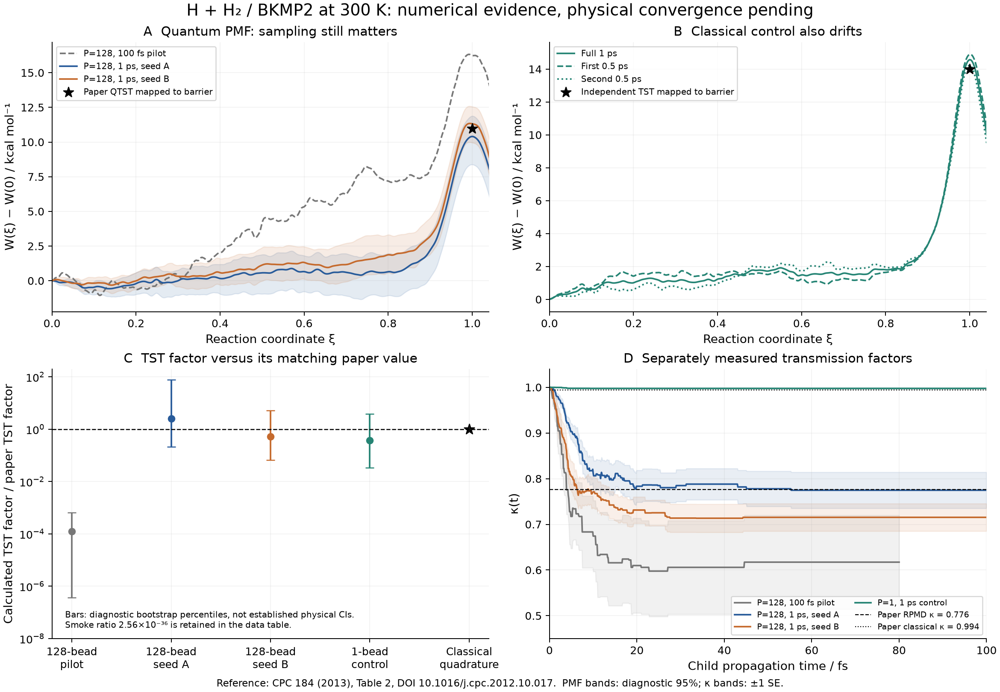

# H + H₂ / BKMP2: numerical and literature audit

Date: 2026-11-01. Baseline: PyRPMD `45763a7ab84100b376e2e5e5df06a8013a82659b`
plus the recorded audit drivers. This is a fresh calculation on the pinned
BKMP2 surface, not a relabelling of the archived state-selected scattering
campaign.

## What is established

An independent **classical TST** quadrature gives
**1.5531187868 × 10⁻¹⁸ cm³ molecule⁻¹ s⁻¹** at 300 K. The corresponding
classical TST entry in Table 2 of Suleimanov, Allen and Green,
*Computer Physics Communications* **184**, 833–840 (2013), is
**1.56 × 10⁻¹⁸**: a difference of **−0.4411%**. This checks the physical
reaction channel, the PES, the configuration-space measure, the two equivalent
product arrangements and the volume/time conversion without using umbrella
sampling or the production reaction-coordinate implementation. It does not
validate quantum sampling or the dynamical transmission coefficient.

The short quantum run reproduces the previously observed very low estimate.
Extending the sampling substantially changes the PMF. Temporal halves of the
extended production data still disagree, including in the one-bead classical
control. A detected transmission plateau and agreement in order of magnitude
are therefore insufficient for a literature-reproduction claim.

The detailed point estimates, diagnostic bootstrap intervals, temporal-half
comparisons, exact sample counts and run states are retained with this audit.
**No thermal RPMD rate is marked converged.**

## Fresh results and independent replay

Every row below comes from this session. The three longer sampling sets each
contain 444,000 production CV observations. Their recrossing stages each
completed 64 parent configurations and 512 child trajectories; κ is measured
from the corresponding longer run, not borrowed from the pilot. Rates are
in cm³ molecule⁻¹ s⁻¹. The last column compares a final RPMD rate with
1.95 × 10⁻¹⁶, or a final classical rate with 1.55 × 10⁻¹⁸.

| Calculation | Beads | Equilibration + production per stream | TST/QTST | κ | Final rate candidate | Rate / matching paper |
|---|---:|---:|---:|---:|---:|---:|
| Smoke | 128 | 5 + 10 fs | 6.427 × 10⁻⁵² | 0.97287 | 6.253 × 10⁻⁵² | 3.206 × 10⁻³⁶ |
| Original pilot | 128 | 50 + 100 fs | 3.123 × 10⁻²⁰ | 0.61722 | 1.928 × 10⁻²⁰ | 9.885 × 10⁻⁵ |
| Extended A, seed 831072 | 128 | 500 + 1000 fs | 6.434 × 10⁻¹⁶ | 0.77467 | 4.985 × 10⁻¹⁶ | 2.556 |
| Extended B, seed 991073 | 128 | 500 + 1000 fs | 1.334 × 10⁻¹⁶ | 0.71531 | 9.543 × 10⁻¹⁷ | 0.4894 |
| Classical control, seed 831072 | 1 | 500 + 1000 fs | 5.875 × 10⁻¹⁹ | 0.99747 | 5.860 × 10⁻¹⁹ | 0.3781 |
| Independent classical quadrature | — | No trajectories | 1.553 × 10⁻¹⁸ | Not calculated | Not calculated | TST / paper TST = 0.99559 |

The full-precision [JSON](compact-results.json) and [CSV](compact-results.csv)
retain all six rows, physical-validation flags and uncertainty scope. The
final-rate bootstrap percentile ranges are:

| Calculation | Diagnostic 2.5–97.5 percentiles, cm³ molecule⁻¹ s⁻¹ |
|---|---:|
| Extended A | [4.402 × 10⁻¹⁷, 5.561 × 10⁻¹⁵] |
| Extended B | [1.619 × 10⁻¹⁷, 8.259 × 10⁻¹⁶] |
| Classical control | [4.196 × 10⁻²⁰, 5.457 × 10⁻¹⁸] |

These broad ranges are labelled **limited-block diagnostics**, not complete
physical confidence intervals. The two quantum rate candidates differ by
5.2234-fold. Their whole-window CV effective-sample medians are of order
70, but cumulative PMF uncertainty remains large. Temporal halves of A give
QTST values 1.682 × 10⁻¹⁶ and 2.420 × 10⁻¹⁵; B gives
2.497 × 10⁻¹⁶ and 7.239 × 10⁻¹⁷. The direction of drift is different in the
two seeds. The classical halves give 3.412 × 10⁻¹⁹ and 1.033 × 10⁻¹⁸.
These observations support further sampling and preparation diagnostics;
they do not identify a unique algorithmic fault.

The potential-free replay of all three longer compressed sample payloads
reproduced their UI barriers **exactly**, with zero absolute difference in
binary64 output. The independent histogram-MBAR path was then rerun on every
original observation:

| Calculation | UI barrier, hartree | MBAR barrier, hartree | MBAR QTST / UI QTST |
|---|---:|---:|---:|
| Extended A | 0.01657705256 | 0.01643915752 | 1.1562 |
| Extended B | 0.01807187366 | 0.01794372732 | 1.1444 |
| Classical control | 0.02322615802 | 0.02310198123 | 1.1396 |

All three MBAR fits converged and had connected overlap and observed endpoint
support. Their 14–16% TST shifts are much smaller than the seed/length effects.
Finite histogram bins and the Gaussian UI approximation remain separate
estimator limitations. See [the exact replay report](extended-pmf-replay.json)
and [the smoke/pilot replay](short-pmf-replay.json).



The [PDF figure](h3-literature-comparison.pdf) and
[rendering script](render_summary.py) are provided for review and reuse.
The stars in the PMF panels are barriers inferred from a TST value with this
workflow's prefactor; they are not digitized paper PMF curves. The shaded PMF
regions are diagnostic bootstrap percentiles, and the κ shading is one
standard error.

## Primary reference and observable

The primary reference is [DOI 10.1016/j.cpc.2012.10.017](https://doi.org/10.1016/j.cpc.2012.10.017).
Its [MIT manuscript record](https://dspace.mit.edu/entities/publication/a4555c62-26a0-4500-8953-5dd1905583cc)
identifies the authors, publication and version; the
[author-uploaded full manuscript](https://www.researchgate.net/publication/279840192_RPMDrate_Bimolecular_chemical_reaction_rates_from_ring_polymer_molecular_dynamics)
provides Tables 1–2 and the example input. Table 2 at 300 K contains:

| Nuclear treatment | TST/QTST, cm³ molecule⁻¹ s⁻¹ | κ | Final thermal rate, cm³ molecule⁻¹ s⁻¹ |
|---|---:|---:|---:|
| Classical, one bead | 1.56 × 10⁻¹⁸ | 0.994 | 1.55 × 10⁻¹⁸ |
| RPMD, 128 beads | 2.51 × 10⁻¹⁶ | 0.776 | 1.95 × 10⁻¹⁶ |

The paper's approximately 5% sampling-precision statement is **not** a supplied
95% confidence interval. Neither the classical TST column nor the exact-QM
rate in another paper is interchangeable with the final RPMD column.

The existing H₃ scattering study in
`benchmarks/h3/reproduction_results/` concerns
state-selected cross sections σ(E, v, j), not thermal k(T). Its archived
cross-section discrepancies remain a separate validation question; these new
thermal calculations do not resolve them.

Primary-table and model-convention checks for H + CH₄, OH + H₂, F + H₂ and
Mu/D + H₂ are documented in [the other-reaction source audit](other-reaction-references.md).

## PES provenance and independent checks

The source was supplied as a separately authorized, bounded download, after
the earlier session's source-fetch block. The source-fetch block is no longer
the limitation of this audit. The Fortran source and compiled shared library
are **not redistributed** with the repository or numerical-data archive.

| Item | Value |
|---|---|
| Model | BKMP2 ground-state H₃ Born–Oppenheimer PES |
| Paper | [Boothroyd et al., JCP 104, 7139–7152 (1996)](https://doi.org/10.1063/1.471430) |
| Upstream source commit | `19ba2602bad5b2145b0d0ba0716d7ba3d90a1003` |
| Source bytes | 61,792 |
| Source SHA-256 | `6fa37803d0d1db4f43e5bc4bfccd5e26585f01116dae9dc4f6d0d28d5d71d237` |
| Compiled library SHA-256 | `c7af84fb8a2caaec3ef56ee4225169fef7048e2fcc365ba6d16c605263049609` |
| Compiler | GNU Fortran 16.2.0, isolated conda-forge compiler installation |
| Energy origin | Three separated H atoms |

`pes-verification.json` records the complete author-oracle, gradient,
symmetry and geometry checks. Representative measured errors are
1.21 × 10⁻¹⁰ hartree at the author saddle point,
3.12 × 10⁻¹⁰ hartree at the author asymptote and
1.78 × 10⁻¹⁰ hartree/bohr for a Cartesian force finite difference. The
optimized H₂ distance is 1.4014719755 bohr; the symmetric saddle distance is
1.7570000251 bohr. The potential-energy barrier is
0.01531977078 hartree (9.61330 kcal/mol). This potential-energy barrier is not
the PMF barrier.

The build uses the repository's documented promotion of legacy real literals
to binary64. The recorded author checks independently test the resulting
numbers; compiler flags alone would not establish the intended precision.

## Independent classical TST oracle

`benchmarks/h3/classical_tst.py` performs Gauss–Legendre quadrature. It does
not call the umbrella estimator, the RPMDrate collective coordinate, the
integrator or the rate-prefactor implementation.

For three equal-mass atoms let x = r_AB, y = r_BC and z = r_AC. After removing
overall translation, the internal Cartesian measure is

\[
  d\Gamma = 8\pi^2 xyz\,dx\,dy\,dz.
\]

On one active exchange surface x = y = r, the other forming distance obeys
r ≤ z ≤ 2r. For s = y − x the inverse-mass metric is

\[
  |\nabla s|_{M^{-1}}^2 = \frac{2+(z/r)^2}{m}.
\]

Write z = rt, with 1 ≤ t ≤ 2. The factor dz = r dt makes the surface measure
r⁴t dr dt. Including both equivalent product surfaces and dividing by the
reactant diatom partition integral gives

\[
k_{\rm TST}=4\pi
\frac{\int dr\int_1^2 dt\;r^4t\exp[-\beta V(r,r,rt)]
       \sqrt{(2+t^2)/(2\pi\beta m)}}
     {\int dr\;r^2\exp[-\beta V_{\rm H_2}(r)]}.
\]

The asymptotic spectator is placed at equal 99-bohr distances from the two
diatom atoms. The same energy origin is subtracted in numerator and
denominator to stabilize exponentials. The mass is the same neutral-¹H
atomic-mass convention as the workflow, 1837.1526474396187 electron masses.
The remaining units are bohr³/atomic-time, converted to cm³ molecule⁻¹ s⁻¹.

The quadrature is tested against a closed-form flat-potential integral,
temperature and mass scaling and Cartesian finite differences of the surface
metric. At the physical BKMP2 potential, refinement from 192 to 256 nodes per
axis changes the result by 1.12 × 10⁻¹² relative. The complete 64/128/192/256
series is in `classical-tst-quadrature.json`; the 64-node result is visibly
unconverged and has not been omitted.

### Explicit physical domain and compact-PES extrapolation

This is a physical-channel integral, not an unrestricted global canonical
integral of every extrapolated geometry in the legacy fit. The central
calculation uses 0.5 ≤ r ≤ 8 bohr. Separately evaluated bounds
[0.4, 8], [0.6, 8], [0.5, 6] and [0.5, 10] bohr change the result by at most
2.11 × 10⁻¹³ relative.

The reason to state the domain explicitly is a real model limitation: the
legacy surface returns approximately −2314 hartree for the exceptionally
compact triangle (0.2, 0.2, 0.3) bohr and −7.17 hartree for
(0.3, 0.3, 0.45) bohr. These are unphysical extrapolations. The lower bound
excludes that disconnected compact region; its stability across 0.4–0.6 bohr
is measured, not assumed. No assertion is made that the production trajectories
visited such configurations, and the sampling results are not adjusted on
that basis.

## Sampling and uncertainty controls

All source-matched quantum pilots use 300 K, 128 beads, R∞ = 30 bohr,
111 windows from −0.05 to 1.05 with spacing 0.01, umbrella stiffness
30 hartree, a 0.1 fs integration step, two equivalent product arrangements,
two independent streams per window and the production `rate_flux` measure.
These match the paper's physical target. The sampling protocol is
**Andersen/Cayley**, whereas Table 1 reports **GLE/Verlet**. The historical
calculation also used 200 trajectories per window, 20 ps equilibration and
100 ps production per trajectory, plus 100,000 child trajectories; the
present budgets are far smaller.

| Profile | Equilibration per stream | Production per stream | Saved interval | Streams | Saved CV values |
|---|---:|---:|---:|---:|---:|
| Smoke | 5 fs | 10 fs | 0.5 fs | 222 | 4,440 |
| Original pilot | 50 fs | 100 fs | 0.5 fs | 222 | 44,400 |
| Extended quantum A/B | 500 fs | 1 ps | 0.5 fs | 222 each | 444,000 each |
| One-bead control | 500 fs | 1 ps | 0.5 fs | 222 | 444,000 |

The same-stream smoke/pilot/extended-A sequence uses seed 831072 and is not
an independent-seed confidence series. Extended B uses seed 991073. Temporal
halves retain their actual time ordering. Window replicas and independent
seeds are reported separately instead of presenting pooled agreement as a
stationarity test.

The Hamiltonian convention remains the existing sum-over-beads Hamiltonian
sampled at β/P. A physical umbrella W(ξ) enters that Hamiltonian as P W(ξ),
so the biased marginal contains exp[−β W(ξ)]. No extra division of the
umbrella force constant, PMF or β by P was made. The detailed prior
normalization derivation is in
`benchmarks/published_rates/umbrella-normalization.md`.

Both Gaussian umbrella integration and histogram MBAR operate on identical
saved production CV samples. Connected overlap alone does not prove that the
entrance channel or internal degrees of freedom equilibrated. Gaussian UI can
also be biased by non-Gaussian window marginals; the independent MBAR check
is therefore reported before interpreting a rate discrepancy.

Reported bootstrap intervals are diagnostics with the dividing surface held
fixed. They do not include uncertainty from choosing the surface. Limited
effective samples, capped blocks, few independent parent chains, drift
between temporal halves and only two full quantum seeds prevent interpreting
them as a complete 95% physical-confidence statement.

## Execution interruption and data integrity

The first extended quantum run and the one-bead control completed every
umbrella trajectory, then each process exited with status 137 during
free-energy analysis. The process-specific cause is recorded as **unknown
SIGKILL**. The [resource snapshot](../software/resources.json) records an
8 GiB cgroup limit, a peak at that limit and cumulative out-of-memory kills;
these observations are consistent with memory pressure. No per-process,
timestamped kill log was available to attribute a particular kill. Every
final checkpoint contained 15,000 completed steps and 2,000 production CV
values. Recovery uses those exact checkpoints and validates their physics
fingerprints. It does not resample, thin or replace the trajectories.

The intermediate FES path initially allocates a 222 × 444,000 binary64
reduced-potential array (approximately 752 MiB), followed by solver and
bootstrap temporaries. The recovery path uses the existing `mbar_rate_pmf`
implementation, which combines exactly identical umbrella Hamiltonians
before constructing the array: 111 × 444,000 (approximately 376 MiB).
Combining identical Hamiltonians does not discard observations or combine
their time series for correlation analysis.

Subsequent large MBAR analyses are scheduled sequentially. The archived
orchestration separates sampling, full-data UI, the deduplicated MBAR fit and
recrossing. The intermediate histogram bootstrap is disabled; the final UI
analysis uses 100 block draws. A QTST-only diagnostic explicitly retains null
κ and final-rate fields until the separate parent/child trajectories have
actually completed. A short pilot's κ is never substituted for missing
extended-run dynamics. These analysis-setting differences and run states are
recorded with the output. The numerical archive contains the production
coordinates, state checkpoints, measured curves, provenance and hashes; it
excludes the downloaded PES source and shared library.

## Reproduction entry points

Use the exact source checksum above and a compatible Fortran compiler:

```bash
python benchmarks/h3/build_pes.py --source /path/to/h3_bkmp2.f \
  --fc /path/to/gfortran --output /path/to/libbkmp2.so
python benchmarks/h3/pes.py --check --library /path/to/libbkmp2.so \
  --output pes-verification.json
python benchmarks/h3/classical_tst.py --library /path/to/libbkmp2.so \
  --output classical-tst-quadrature.json
python benchmarks/published_rates/h3.py --library /path/to/libbkmp2.so \
  --output h3-long-a --profile audit --seed 831072 --workers 3
python benchmarks/h3/sampling_control.py --library /path/to/libbkmp2.so \
  --output h3-classical --beads 1 --timestep-fs .1 \
  --equilibration-fs 500 --production-fs 1000 --seed 831072 --workers 2
```

For staged replay use `benchmarks/h3/audit_stages.py sample`, then
`benchmarks/h3/audit_ui.py` for the small-memory diagnostic and
`benchmarks/h3/audit_recover.py` for the deduplicated full-data MBAR/UI/recrossing
continuation. The historical `analyze` mode in `audit_stages.py` retains the
larger intermediate FES matrix; it was not used for successful recovery.
Original executed scripts and their hashes are retained in the numerical
provenance snapshots under `orchestration-original/` in this repository;
[orchestration provenance](orchestration-provenance.json) records
the portable path discovery, the later reference-selection guard and a
post-execution docstring-only correction to the recovery tool. Exact executed
variants retain their original hashes.

The final guarded UI script rejects non-300-K temperatures, isotope masses
and non-H₃/periodic systems before assigning the ordinary-H Table 2 target.
Seven focused tests cover matched targets and temperature/Mu/D mismatches;
the three complete sampling sets were reanalyzed with this final script.
For a potential-free PMF replay, run
`benchmarks/published_rates/diagnose_pilot_pmf.py --replay FILE.npz --output report.json`.
The compact replay contains exact production samples and umbrella definitions,
with array checksums; it cannot manufacture or independently rerun the
underlying trajectories. New one-bead packs select the classical reference
automatically and reject a quantum reference or mismatched temperature.

The separate raw-data-only archive is described by
[raw-data-index.json](raw-data-index.json). It retains checkpoints, original
input/configuration records, full CV payloads, numerical diagnostics and a
per-file checksum manifest. Source code and report figures remain in the
repository; the data archive references their paths and exact hashes.

## Remaining scientific gates

Before a thermal RPMD rate can be called a reproduction, the entrance channel
must reach stationary production distributions, the UI/MBAR discrepancy must
be resolved, and independent seeds must agree within defensible sampling
uncertainty. The resulting rate must then be checked against bead count,
timestep, R∞ and longer child-trajectory horizons. A one-bead trajectory is a
classical control, not evidence for convergence from 64 to 128 to 256 quantum
beads. Improving a short pilot's numerical proximity to the paper is not a
substitute for these gates.
