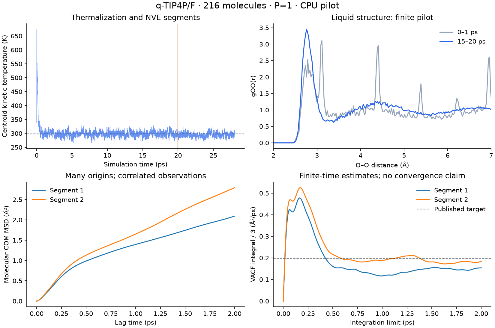

# q-TIP4P/F: source audit and 216-molecule CPU campaign

This audit separates a verified force-field implementation, numerical accuracy,
and statistical reproduction of a published liquid result. The first two have
substantial new evidence. **The published diffusion and PA-CMD spectrum have
not been reproduced.** Every saved report retains `physical_converged=false`
and `literature_reproduced=false`; no validated diffusion value or error bar is
published by the campaign analyzer.

The starting code was revision `45763a7`. OpenMM 8.6.1 offered CPU and Reference
platforms in this environment. There was no available GPU platform. Native
PyRPMD propagates the physical nuclei; OpenMM supplies forces and constructs the
massless virtual sites.

## Primary source and exact protocol

The model is from Habershon, Markland and Manolopoulos, *J. Chem. Phys.* **131**,
024501 (2009), [DOI](https://doi.org/10.1063/1.3167790),
[author manuscript](https://arxiv.org/pdf/1011.1047). The paper's Table I and
Eqs. (1)–(4) define the potential. Sections III.B–D define the dynamics; Tables
III, IV and VI provide the numerical targets. The manuscript checksum, parameter
transcription and source locators are in [source-audit.json](source-audit.json).

| Quantity | Published protocol / target |
| --- | --- |
| System | 216 flexible molecules, cubic periodic box, 298 K |
| H₂O / D₂O density | 0.997 / 1.107 g cm⁻³ |
| Quantum beads | 32; classical comparison uses one |
| Nonbonded range | 9 Å short-range cutoff, Ewald electrostatics |
| Acceleration | Electrostatic contraction with 5 Å cutoff |
| Integration | Exact free normal modes; intermolecular / intramolecular updates at 0.5 / 0.1 fs |
| Preparation | 100 ps with Andersen thermostat |
| Diffusion sampling | 20 batches × 100 NVE trajectories × 4 ps; momentum refresh between trajectories |
| Diffusion estimator | One-third VACF integral, correlation length 2 ps |
| H₂O RPMD D | 0.221 ± 0.001 Ų ps⁻¹ |
| D₂O RPMD D | 0.172 ± 0.001 Ų ps⁻¹ |
| H₂O classical D | 0.199 ± 0.002 Ų ps⁻¹ |
| IR | PA-CMD; internal frequency 7414 cm⁻¹; 300 × 20 ps, correlations to 10 ps |

The printed article does **not** specify the numerical isotope masses or the
Lennard-Jones tail convention. It also does not state the exact translational
velocity weighting in the main text. Our mass convention is explicitly
O-16 = 15.99491461957 Da, H-1 = 1.00782503223 Da and D-2 = 2.01410177812 Da;
the diffusion diagnostic uses molecular center-of-mass velocities. These choices
must be checked against a definitive original input deck before a high-precision
implementation reproduction is claimed.
The selected numbers are the NIST relative atomic masses for
[hydrogen isotopes](https://physics.nist.gov/cgi-bin/Compositions/stand_alone.pl?ele=H)
and [oxygen-16](https://physics.nist.gov/cgi-bin/Compositions/stand_alone.pl?ele=O),
not a claim that the 2009 calculation used those exact numerical masses.
Our NVE segments remove total centroid center-of-mass momentum once after
Maxwell resampling and record classical velocities every 5 fs. The main article
does not specify those two details explicitly. They remain declared choices,
and velocity-recording cadence needs its own convergence check.

The model is flexible. No bond constraints are used. PA-CMD changes the internal
mode masses; ordinary RPMD or TRPMD spectra are a different calculation and are
not treated as a reproduction of the paper's IR spectrum.

## Independent original-author implementation

The audit downloaded and compiled the unmodified
[i-PI qtip4pf.f90 source](https://github.com/i-pi/i-pi/blob/93162d280d15fd954da6dc3580a5ed3503e207ac/drivers/f90/pes/qtip4pf.f90).
Its header credits the three original model authors and dates the file to 23
June 2014. The exact file SHA256 is
`911047fc1133662723e5d07342214af82e2b60f49de17ef2d0f4074519ec5297`.
That third-party source is not redistributed in the data archive.

Two parameterizations are distinguished deliberately:

- The simulation factory follows the **printed Table I** values: for example,
  equilibrium bond length 0.9419 Å and stretch parameter alpha = 2.287 Å⁻¹.
- The author source uses **rounded atomic-unit values**, including
  equilibrium bond length 1.78 bohr, alpha = 1.21 bohr⁻¹, stretch energy
  parameter D = 0.185 hartree, and an angle coefficient of 0.07 hartree.
  The audit constructs an explicit
  source-parameter variant for comparison; production retains Table I.

The independent Fortran intramolecular energy and forces agree with the matched
OpenMM variant to **2.26 × 10⁻¹⁷ hartree** and **2.80 × 10⁻¹⁶ hartree/bohr**
on the saved distorted monomer. This directly checks the quartic stretch and
harmonic bend, including the factor of two in the angle force constant.

On a saved 216-molecule configuration, Table I / tight Ewald versus the
unmodified author code gives a relative RMS force difference of 0.001622.
Matching the atomic-unit parameters reduces this to 0.00007495. The remaining
difference is reported, not forced to zero: the author file explicitly uses a
low-precision `erfc` approximation and its own finite direct Ewald sums.
It is a valuable independent implementation check, not an assertion of exact
numerical identity or a complete archival reconstruction of the 2009 executable.

The source also adds a pressure-tail term to its Lennard-Jones virial, without
an energy or atomic-force tail. Our fixed-volume runs use no tail. The separate
OpenMM tail test changes the energy by −0.0706967 kcal mol⁻¹ per water and changes
the forces by exactly zero. This is consistent with a volume-only energy term;
it does not validate a pressure calculation or NPT water density.

## Electrostatics, platform precision and boundary conditions

The independent NumPy cluster oracle verifies all 18 dimer force coordinates,
including virtual-site force redistribution. The source-size periodic audit
uses direct Ewald on Reference with tolerance 10⁻⁹ as its numerical reference.
All inputs and oracle forces are retained in [numerics](numerics).

| PME tolerance | Reference relative RMS force error | CPU relative RMS force error |
| ---: | ---: | ---: |
| 10⁻⁴ | 1.654 × 10⁻⁴ | 1.654 × 10⁻⁴ |
| 10⁻⁵ | 1.775 × 10⁻⁵ | 1.778 × 10⁻⁵ |
| 10⁻⁶ | 1.868 × 10⁻⁶ | 2.383 × 10⁻⁶ |
| 10⁻⁷ | 1.935 × 10⁻⁷ | 1.582 × 10⁻⁶ |

The CPU / Reference difference at the production tolerance of 10⁻⁵ is
1.904 × 10⁻⁶ in relative RMS force. The CPU backend reaches an observed precision
floor even as PME tolerance tightens. CPU has no selectable CUDA/OpenCL-style
`Precision` property; the test reports actual errors and does not label the CPU
backend as a user-selected double-precision GPU calculation. OpenMM documents
its [PME formulation](https://docs.openmm.org/latest/userguide/theory/02_standard_forces.html)
and [platform properties and determinism limits](https://docs.openmm.org/latest/userguide/library/04_platform_specifics.html).

Moving one **whole molecule** by lattice vectors changes forces by at most
3.78 × 10⁻¹⁵ hartree/bohr. Changing the box by 1% through the existing context
agrees with a new context to 1.56 × 10⁻⁸ hartree/bohr, within the finite PME
accuracy. The two contexts can select different PME grids. This checks cell
handling; it is **not** a cell-size convergence study or an infinite-volume
diffusion extrapolation.

## Timestep checks

From the same source-size snapshot and the same physical initial momenta:

| Beads | Step (fs) | NVE duration (fs) | Maximum energy change / water (kcal mol⁻¹) |
| ---: | ---: | ---: | ---: |
| 1 | 0.5 | 20 | 0.0019453 |
| 1 | 0.25 | 20 | 0.0004164 |
| 1 | 0.125 | 20 | 0.0001581 |
| 32 | 0.25 | 2 | 0.1586520 |
| 32 | 0.125 | 2 | 0.0389285 |

The P32 test starts from collapsed rings with canonical bead momenta, so its
large transient ring energy is not an equilibrium liquid statistic. Halving
the timestep reduces its energy defect by a factor of 4.08. All forward/backward
position defects are below 5 × 10⁻¹⁴ bohr. The classical bulk energy test includes
the unswitched LJ cutoff: finite cutoff crossings can prevent an exact factor
of four in the total energy error. These checks support the selected 0.25 fs
classical and 0.125 fs short quantum pilot steps, while a quantitative diffusion
comparison still requires statistical timestep tests on equilibrated runs.

The conserved-energy diagnostic is the ring Hamiltonian divided by the bead
count, `H_P/P`. It is not a quantum thermodynamic internal-energy estimator.
Likewise, the saved momentum temperature tests thermostat scaling and is not
being interpreted as the quantum kinetic-energy estimator.

## 216-water classical pilot: stable local structure, unresolved diffusion

The completed run contains **20 ps of PILE-L sampling and two consecutive 4 ps
NVE segments**, all at P=1. It uses the source-size 18.642823 Å box, 9 Å cutoff,
PME tolerance 10⁻⁵ and 0.25 fs timestep. There are 112,000 accepted integration
steps and 801 saved frames per NVE segment. Elapsed time was 1639.64 seconds
(27.33 minutes) on the shared CPU environment. This is substantially longer
than the original eight-molecule, 12.8 fs software pilot; it still covers only
20% of the paper's preparation time and two of its 2000 production segments.

During the final 5 ps of sampling, mean momentum temperature is **297.384 K**,
mean O–H is **0.963728 Å**, and mean H–O–H is **104.7998°**. The published
classical monomer means are 0.963(1) Å and 104.8(1)° (Table VI). The late O–O RDF
has its first maximum at 2.7625 Å with height 3.447 for the stated binning and
finite-N normalization. No numerical reference RDF was digitized, so the plot
documents relaxation from the starting grid rather than a quantitative RDF
reproduction test.

| NVE segment | Mean kinetic T (K) | MSD slope D, 1–2 ps (Ų/ps) | VACF integral D at 2 ps (Ų/ps) | Log-MSD slope |
| --- | ---: | ---: | ---: | ---: |
| First 4 ps | 292.891 | 0.117181 | 0.153852 | 0.5944 |
| Second 4 ps | 296.352 | 0.193284 | 0.184710 | 0.7742 |

The first segment fails the finite-time diffusion screen; the second is only a
candidate. More importantly, changing the fitting window changes the result:

| MSD fit window (ps) | Mean raw slope D (Ų/ps) | Conditional two-segment SEM (Ų/ps) |
| --- | ---: | ---: |
| 0.1–0.5 | 0.358495 | 0.026976 |
| 0.5–1.0 | 0.152988 | 0.016447 |
| 1.0–2.0 | 0.155232 | 0.038051 |

These segment SEMs are **descriptive conditional spreads**, not validated
sampling error bars: the segments share a configuration chain, and there are
only two of them. The paper's classical target is 0.199(2) Ų/ps. Selecting the
second segment alone would make agreement look much better; selecting a short
window would make the apparent diffusion almost twice as large. Neither is a
valid reproduction procedure. No z-score, accepted D, or claim of agreement is
assigned. The VACF tails and the disagreement between windows/segments remain
visible in the saved curves.

Maximum absolute energy changes are 0.001090 and 0.001258 kcal mol⁻¹ per water
in the two segments; fitted drifts are 2.79 × 10⁻⁵ and 5.36 × 10⁻⁵ kcal mol⁻¹
per water per ps. Thus the failure to establish diffusion convergence cannot
be replaced by a claim based only on a small integration-energy drift.



Full scalar and estimator results are in
[classical-pilot/report.json](classical-pilot/report.json). The corresponding
[PDF figure](classical-pilot/diagnostics.pdf), model XML, compact arrays and
raw-chunk manifest are retained alongside it.

## Source-size bead response: a short, deliberately limited test

Three additional runs use 216 molecules at the same density and cutoff, with
8, 16 and 32 beads. They start from the same saved 5 ps classical configuration,
copy that geometry onto all beads, sample for 100 fs with PILE-L at 0.125 fs,
and then propagate a 20 fs NVE segment. The final 50 fs of sampling gives:

| Beads | Mean O–H (Å) | Mean H–O–H (degrees) | H ring radius of gyration (Å) | Momentum-temperature diagnostic (K) |
| ---: | ---: | ---: | ---: | ---: |
| 8 | 0.973135 | 104.8425 | 0.156030 | 298.047 |
| 16 | 0.976398 | 104.8218 | 0.160494 | 297.724 |
| 32 | 0.977889 | 104.7387 | 0.162626 | 297.394 |

The published PIMD mean O–H is 0.978(1) Å (Table VI). The new data show the
expected local bond expansion and a diminishing bead-count change, with the
P32 mean close to that printed value. **This is a response check, not a
statistical bead-convergence test:** the liquid starts from one classical
configuration and its slow structure has had only 100 fs to respond. There are
no independent quantum replicas or defensible ensemble error bars here.

The three 20 fs NVE records all fail the diffusion screen as
`ballistic_or_drifting`, with log-MSD slopes 1.984–1.990. Their apparent finite-time
slopes are not reported as liquid diffusion coefficients. The P32 NVE energy
change is at most 0.001168 kcal mol⁻¹ per water over those 20 fs. The detailed
evidence is in [p8-warmup](p8-warmup), [p16-warmup](p16-warmup) and
[p32-warmup](p32-warmup).

### Measured scale of the remaining work

The P8, P16 and P32 960-step runs took 143.98, 238.91 and 520.35 seconds,
respectively, with one OpenMM CPU thread and other jobs sharing the machine.
The P32 average is 0.5420 s per step, or about 0.83 ps per wall hour at 0.125 fs.
At 0.1 fs, an uncontracted 8 ns production calculation at that measured rate
would require about **12,045 wall hours (502 days)**, before substantial
equilibration and convergence replicas. This is a conditional cost calculation,
not a hardware-independent performance claim. The environment exposed nine
logical CPUs with an eight-CPU cgroup quota, and competing jobs affected timings.

The paper uses contraction and multiple time stepping; the present adapter
evaluates the complete potential separately on every bead. Matching those
accelerations or measuring a GPU implementation is necessary for a practical
large campaign. No GPU throughput or numerical agreement was tested here.

## What is archived and how to reproduce it

The compact evidence contains source/model hashes, configuration JSON, scalar
histories, correlation/RDF curves, model XML and endpoint states. Complete raw
coordinate/velocity chunks are supplied separately in the water data archive,
with relative paths and SHA256 checksums; they are not stored as an 80 MB Git
change. Recomputing correlations from those chunks is stronger than replaying
the retained correlations, and both paths are supported.

[summary.csv](summary.csv) gives the nine sampling-window / NVE-segment records
with units in every numeric column, explicit literature targets and convergence
flags. The raw archive is `pyrpmd-water-216-audit-2026-11-01.tar.gz`;
[raw-data-index.json](raw-data-index.json) identifies its size, SHA256 and run
paths, while [raw-file-manifest.json](raw-file-manifest.json) lists the complete
relative file inventory and individual hashes. The data archive includes
configuration files, all raw chunks and checkpoints, the compact evidence,
replay instructions, and source commit/hash references. The driver and analyzer
are maintained in this Git repository and are not duplicated in the archive.

From a checkout containing this audit:

```bash
python -m pip install -e '.[openmm,test,plots]'
OMP_NUM_THREADS=1 OPENBLAS_NUM_THREADS=1 OPENMM_CPU_THREADS=2 \
  python benchmarks/water/campaign.py --output NEW_RUN \
  --config docs/validation/literature-audit-2026-11-01/water/classical-config.json

# Resume a budget-limited or interrupted run from the last committed chunk.
python benchmarks/water/campaign.py --output NEW_RUN --resume

# Recompute observations and correlations from a raw run in the archive.
python benchmarks/water/analyze_campaign.py RAW_RUN --output NEW_ANALYSIS

# Verify compact artifacts and re-integrate VACF/refit MSD curves.
python benchmarks/water/analyze_campaign.py COMPACT_EVIDENCE --replay-compact

# Optional original-author cross-check: supply the exact downloaded source.
python benchmarks/water/numerics.py --output NEW_NUMERICS \
  --snapshot docs/validation/literature-audit-2026-11-01/water/initial-classical-5ps.npz \
  --author-source qtip4pf.f90

python -m pytest -q tests/test_water_campaign.py tests/test_qtip4pf_benchmark.py
```

`--wall-seconds` and `--max-steps` bound a campaign invocation; a complete
checkpoint is committed before it exits. Resume validates configuration,
source files, serialized model and every referenced chunk, and restores both
the physical state and the random generator. A test compares uninterrupted
and mid-NVE resumed Reference trajectories, including a segment boundary.
The fixed-cell endpoint-force cache owns immutable arrays and uses exact
coordinate equality, so it does not reuse forces after a geometry change.

The original full project regression preceded one narrow analysis-label fix:
classical D₂O now has no invented published target, uncertainty or table number.
The actual runs above all use H₂O and their numerical results are unchanged.
The final water-focused rerun passed **24 tests** in 4.46 seconds; its JUnit,
console output and before/after source hashes are retained as `review-fix-*`.
All four compact evidence directories pass checksum verification and independent
VACF integration / MSD refitting; see [compact-replay.json](compact-replay.json).

Use the dependency versions recorded in the manifest for continuation. The
runner records versions but does not reject a version-only environment change.
OpenMM CPU PME does not offer a general cross-platform bitwise reproducibility
guarantee. The saved raw arrays and their checksums are the authoritative
evidence for this run.

This is a benchmark driver, not a general production workflow. It intentionally
does not decide that a liquid is equilibrated, that correlated time origins are
independent samples, or that a straight MSD line constitutes literature
validation.
