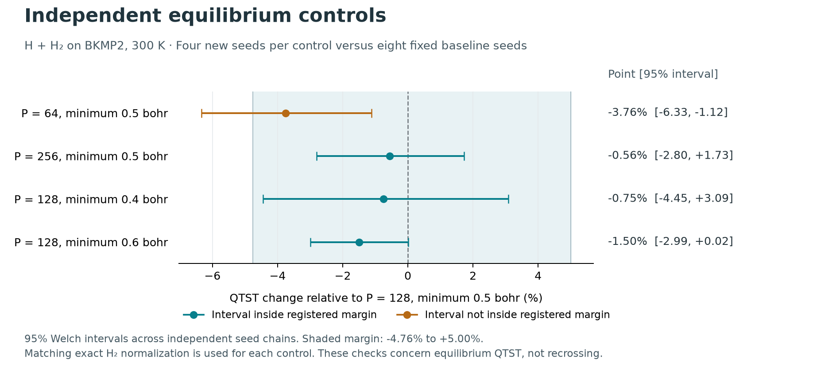
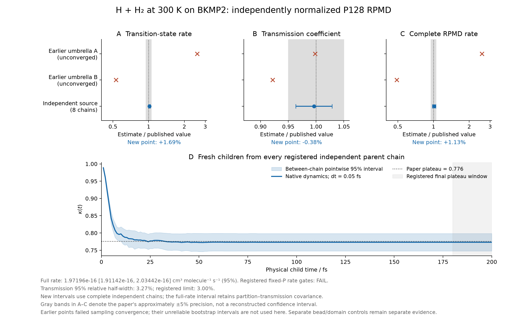

# Literature convergence follow-up: 2026-11-01

**The complete classical and initial P128 quantum H + H₂ reference rates at
300 K agree with the published RPMDrate results within the paper's stated
precision.** The quantum rate's entire nominal 95% interval is inside that
band, but its separate κ precision gate still fails (3.272% half-width
versus a 3.000% limit); the predeclared all-parent momentum extension is
running. Independent umbrella sampling and liquid-water transport remain
separate, ongoing convergence studies.
This record preserves the earlier failed estimates and distinguishes an
independent equilibrium reference from the production MD umbrella workflow.

The preceding [literature audit](../literature-audit-2026-11-01/README.md)
is unchanged. Its large rate discrepancies, short water trajectories and
software-test results remain historical observations, not overwritten runs.

## Results established in this snapshot

| Quantity | New result | Comparison and scope |
| --- | ---: | --- |
| Classical H + H₂ TST | 1.5531187868 × 10⁻¹⁸ cm³ molecule⁻¹ s⁻¹ | Independent deterministic surface integral; paper 1.56 × 10⁻¹⁸ |
| Classical transmission κ | 0.99503424, 95% CI [0.99383298, 0.99623550] | Four independent source ensembles and unchanged native PyRPMD children; paper 0.994 |
| Complete classical H + H₂ rate | 1.54540638 × 10⁻¹⁸, 95% CI [1.54354068, 1.54727207] × 10⁻¹⁸ cm³ molecule⁻¹ s⁻¹ | −0.30% from the paper's rounded 1.55 × 10⁻¹⁸; within its approximately 5% stated sampling precision |
| Separate P=1 umbrella MC, 262,144 sweeps per chain | 1.5721439 × 10⁻¹⁸, 95% CI [1.3966727, 1.7708574] × 10⁻¹⁸ | Point accuracy passes; the predeclared 1% precision criterion still fails |
| H₂ finite-P quantum/classical partition ratio, P=128 | 0.000694194285900783 | Independent radial transfer matrix; radial-grid log change 1.03 × 10⁻¹¹ |
| H₂ continuum quantum/classical ratio | 0.000685451742716482 | Independent radial Schrödinger/DVR calculation; the finite-P difference is retained |
| Stochastic P=128 H₂ normalization control | 0.0006879725, 95% CI [0.0006792694, 0.0006967870] | Four independent chains; exact finite-P value is inside the interval |
| Independent P=128 H + H₂ QTST | 2.55248792 × 10⁻¹⁶, 95% CI [2.51679142, 2.58869070] × 10⁻¹⁶ cm³ molecule⁻¹ s⁻¹ | Eight independent surface-partition chains and matching exact finite-P reactant denominator; +1.69% from paper QTST |
| P=128 quantum transmission κ, initial two-pair cohort | 0.77307729, 95% CI [0.74778066, 0.79837393] | Paper 0.776; 3.272% relative half-width misses the 3.000% registered precision limit |
| Complete initial P=128 quantum rate | 1.97196035 × 10⁻¹⁶, 95% CI [1.91141982, 2.03441839] × 10⁻¹⁶ cm³ molecule⁻¹ s⁻¹ | +1.126% from paper 1.95 × 10⁻¹⁶; whole interval inside its ±5% band; fixed-P aggregate gate still false because of κ precision |
| Separate P=128 umbrella MC, 30,000 production sweeps per ladder | 2.80072503 × 10⁻¹⁶, 95% CI [2.33507586, 3.35923162] × 10⁻¹⁶ | All eight ladders complete; precision and paper-point criteria fail; registered 100,000-sweep continuation selected |

The classical paper point is slightly outside the much narrower new rate
interval. Agreement here means agreement within the paper's approximately
5% precision and rounding, not a claim that the published point is inside
our interval. These intervals measure sampling uncertainty; they do not
include uncertainty in the PES or the physical approximation.

The literature reference is Y. V. Suleimanov, J. W. Allen and W. H. Green,
*RPMDrate: Bimolecular chemical reaction rates from ring polymer molecular
dynamics*, Comput. Phys. Commun. 184, 833–840 (2013),
[doi:10.1016/j.cpc.2012.10.017](https://doi.org/10.1016/j.cpc.2012.10.017),
Table 2. The H + H₂ entry uses the ξ‡=1.000 dividing surface. Its P=128,
300 K targets are QTST=2.51 × 10⁻¹⁶, κ=0.776 and full rate=1.95 × 10⁻¹⁶
cm³ molecule⁻¹ s⁻¹.

## Evidence by question

- [Classical source, quadrature, WHAM and complete rate](h3-classical/README.md).
  This includes all fixed-budget stages, exact prefix replays, independent
  surface moments, native dynamics, timestep checks and the final plateau.
- [Fixed-interval Andersen collision diagnosis and correction](review/README.md).
  The optional geometric clock removes the demonstrated resonant mode
  under-sampling while retaining the exact legacy default and restart state.
- [Quantum equilibrium methods and deterministic H₂ normalization](h3-quantum/README.md).
  Finite-P transfer matrices and the continuum DVR answer different questions;
  the P=128 comparison uses its matching finite-P normalization.
- [Independent finite-P surface partition campaign](surface-partition/README.md).
  Nine λ states connect a known reference to the physical surface distribution.
  BAR, independent-chain uncertainty and parent-source snapshots are explicit.
- [Quantum child protocol](h3-quantum/recrossing-protocol.json) and
  [analysis specification](h3-quantum/recrossing-analysis-prespecification.json).
  These bind all parents, both timesteps, observation windows, precision-only
  continuation and the joint partition/transmission uncertainty.
- [Complete initial quantum child cohort](h3-quantum/recrossing-stage-200-pairs-2/README.md).
  This retains the full rate, all component checks, failed κ precision,
  supplementary parent-time-half failure and the immutable extension decision.
- [Verified raw child archive](h3-quantum/recrossing-stage-200-pairs-2/raw-archive/README.md).
  All 400 base child chunks and 38.4 million native steps are preserved;
  signed flux arrays replay exactly after actual archive extraction.
- [Complete first quantum umbrella stage](h3-quantum/umbrella-stage-30000/README.md).
  All eight 30,000-sweep chains and exact restart states remain available;
  neither their broad interval nor small coordinate Rhat is called convergence.
- [Completed independent bead/domain controls](surface-partition/controls/comparison.json).
  Every registered control is retained, including the coarse-P64 failure.
- [Quantum equilibrium archive and exact-parent reconstruction](surface-partition/raw-archive/README.md).
  The completed local archive contains every equilibrium/control raw file;
  all 1,600 primary parent geometries were extracted and verified exactly.
- [Water reference-engine, recording and checkpoint evidence](water/README.md).
  The fixed classical transport stage is still running; the complete quantum
  job specification is prepared but has not been launched.
- [H + CH₄ model and native workflow](other-reactions/hch4/README.md).
  The paper's PES-2008 is now pinned, built and checked. Its published barrier
  and native/Python force workflow are reproduced; the thermal rate is unrun.
- [Isotope source review](review/isotopologues-source-index/README.md).
  Mu + H₂ and D + HMu are different reactions. Unresolved source versions,
  masses and supplementary protocols remain explicit.
- [Compatibility with integrated main](integration-4698c12/README.md).
  The running experiments retain their frozen runtime; the new main-branch
  native engine is checked in an isolated checkout.

Raw checkpoint arrays are retained in the experiment workspace. Completed
datasets are packaged as separately checksummed local archives; the new
archives have not been uploaded to persistent storage because that delivery
was blocked by automatic approval. Repository indexes are not a claim that
those raw archives are publicly hosted. The repository keeps the executed
benchmark sources, protocols, report tables, test receipts, figures and
raw-data indexes. External PES sources and compiled libraries are fetched
and built under their recorded provenance and are not redistributed as
PyRPMD code.

## Why the previous rate checks failed

Three concrete issues have been isolated without changing a rate prefactor,
temperature, mass or potential to match the paper.

First, a fixed Andersen collision interval can repeatedly refresh momenta
near a free-ring normal-mode recurrence. In the actual P=128 production
umbrella path, a mode initialized collapsed retained only about 10.6% of
its equilibrium variance after 500 fs with the fixed schedule; the geometric
clock produced about 98.5% in the same controlled test. The older real H₃
reactant endpoints also show this mode's variance near 30%, consistent with
the independently derived relaxation timescale. This is evidence of a real
sampling defect; it is not a complete numerical decomposition of the old
reaction-rate error.

Second, Gaussian umbrella integration is not exact for non-Gaussian window
distributions. The independently integrated classical density gives a 2.52%
asymptotic bias for the original strong umbrellas. Uniformly soft umbrellas
near the barrier are bimodal and can have almost no barrier support. The
new mixed-stiffness schedule is derived from exact overlap/support integrals,
and its histogram WHAM estimator passes a separate deterministic oracle.

Third, apparently reasonable individual-window means and small coordinate
Rhat values do not guarantee a precise integrated barrier. The original
classical ladder reaches a point estimate only 0.78% above the paper after
262,144 sweeps per chain, yet its independent-seed interval is still much
wider than its declared precision target. That failed gate remains visible.

## Quantum real-time campaign

All eight fixed-budget surface-partition chains are complete. Their
[quantum transition-state factor](h3-quantum/independent-qtst-comparison.json)
is 1.69% above the paper. The paper QTST point lies slightly below our new
95% interval, while the difference remains within the paper's approximately
5% reported precision. A quantum transition-state factor is not a complete
RPMD rate. Its own complete initial native child cohort now supplies
κ=0.77307729 and the full rate 1.97196035 × 10⁻¹⁶, 1.126% above the paper.
The nominal 95% rate interval contains the paper and lies wholly inside
its approximate ±5% band. The 3.272% κ interval half-width nevertheless
fails its separate 3.000% precision target, so all parents receive the
predeclared extra momentum pairs. The first-stage failure is preserved.
The registered independent equilibrium bead/domain controls have completed, with four
new independent seeds for each variant:

| Variant relative to P=128 / minimum pair 0.5 bohr | QTST change | 95% interval | Registered equivalence |
| --- | ---: | ---: | --- |
| P=64 | −3.760% | [−6.331%, −1.118%] | Fail |
| P=256 | −0.563% | [−2.802%, +1.728%] | Pass |
| Minimum pair 0.4 bohr, P=128 | −0.751% | [−4.446%, +3.087%] | Pass |
| Minimum pair 0.6 bohr, P=128 | −1.497% | [−2.989%, +0.017%] | Pass |

The comparison uses complete independent-chain Welch intervals in log rate
and the preregistered margin ±log(1.05), equivalent to relative bounds
−4.762% and +5.000%. The **aggregate over all four controls remains false**
because P64 fails; the P128-to-P256 refinement and both domain checks pass
individually. Matching finite-P/domain reactant denominators are used in
every comparison. These are equilibrium QTST checks, not full-rate
bead-convergence tests. All 1,600 primary parent geometries and their
original reports remain unchanged.

The registered finite-P surface sampler supplies eight independent chains
with 200 equilibrium parent geometries each. All 1,600 parents are retained.
Each starts two ordinary Maxwell momentum pairs, p and −p, with separate
keyed random streams. Identical parent configurations and momenta are used
at 0.1 fs and 0.05 fs; the latter is the primary step. The initial real-time
horizon is 200 fs. A failed plateau comparison triggers the predeclared
all-child 400-fs extension, and inadequate κ precision can trigger the
separately retained second momentum-pair batch for every parent.

The source already includes the configuration flux metric, fs(q), so each
signed child contribution divides by fs. The centroid velocity uses physical
masses with no extra factor of P. Unit and analytical tests check this
normalization. Every physical step checks the full ring Hamiltonian; the
minimum bead-pair distance is recorded at 1-fs observation boundaries.
No child leaving a diagnostic domain is silently removed.

An excluded calibration on the real P=128 BKMP2 system verifies that a
continuous 400-fs trajectory and a 200-fs checkpoint followed by another
200 fs, with recreated native and PES contexts, give bitwise-equal q, p,
surface/energy observations and clocks at both step sizes. This validates
the continuation mechanism; it does not establish a transmission plateau.

For the complete rate, the same independent chain supplies both its BAR
partition estimate and its child parents. The analysis therefore combines
log QTST and log κ within each chain before constructing the eight-chain
Student-t interval. It does not count individual children as independent
replicas or add the two uncertainties under a false independence assumption.
QTST, κ and their product are each compared with the paper, so compensating
component errors cannot produce an unqualified pass.

Both registered late-time windows have identical observed κ on every chain.
That sampled equality is not a bound on arbitrarily rare later recrossing.
The supplementary parent-time-half κ equivalence check fails and remains
visible. The paired timestep comparison and primary-step energy screen
pass. This fixed-P result does not establish dynamic bead convergence or
validate production MD umbrella sampling. The separate MC umbrella stage
still fails precision after all eight 30,000-sweep ladders; its continuation
retains every chain and the original thresholds.

## Water and other requested systems

The independently integrated OpenMM water reference retains 216 flexible
q-TIP4P/F molecules, 298 K, the declared density and full PME. Eight fixed
independent seeds are scheduled
for 100 ps preparation plus 25 × 4 ps NVE segments each. No converged new
diffusion coefficient is claimed in this snapshot. CPU checkpoint restoration
and momentum conventions are audited separately from physical equilibration.
Short native MTS/RPC checks establish mathematical map/force agreement only;
they do not establish equivalent long-time diffusion.

The [four-worker handoff](water/scheduling-v2/README.md) retains the original
random streams, configurations, physical integrator and complete committed
prefixes. The initial preparation audit of seed 1102 fails its predefined
potential-energy stationarity threshold; this failure remains part of the
fixed cohort. Completing the OpenMM reference would still require a separate
long-time comparison of PyRPMD's own production transport workflow.

The separate [preparation-only continuation tools](water/preparation-continuation-gate/README.md)
pass exact phase/RNG and Reference/CPU checkpoint tests. The proposed
additional 400 ps of canonical preparation has not yet been adopted or
launched for the cohort. The original potential-energy, temperature and
intramolecular-geometry thresholds remain fixed. An analytic toy audit
shows why a new maximum-over-many-RDF-bins rule needs an explicit
uncertainty design; the proposal retains those structural diagnostics
without declaring the uncalibrated hard RDF threshold a validation gate.

The predetermined 4 ps velocity-recording control has completed. At 5 fs
recording, its 2 ps VACF integral differs from the dense 0.25 fs record by
−6.45709 × 10⁻⁵ Ų/ps, within the registered 0.001 Ų/ps numerical margin.
It is a numerical recording check on one predetermined segment, not a new
independent diffusion sample. All tested recording intervals are reported
in the [cadence evidence](water/velocity-cadence/report.json).

A [full-PME OpenMM quantum-water reference specification](water/quantum-template/README.md)
now defines twenty fixed P32 chains, 100 ps preparation per chain and 8 ns
total NVE production, with an explicitly checkpointed geometric Andersen
clock during preparation. Small Reference/CPU map and restart tests pass.
The long quantum experiment and the explicit CUDA example have not been
run; no GPU performance or quantum diffusion agreement is claimed.

The water reference is S. Habershon, T. E. Markland and D. E. Manolopoulos,
J. Chem. Phys. 131, 024501 (2009),
[doi:10.1063/1.3167790](https://doi.org/10.1063/1.3167790),
[author manuscript](https://arxiv.org/abs/1011.1047). Its diffusion comparison
uses RPMD; its infrared comparison uses PA-CMD. Rigid constraints or a
different spectroscopy method would define a different calculation.

For H + CH₄, the exact RPMDrate-distributed PES-2008 source is now pinned and
built. Its computed barrier is 15.0142843 kcal/mol versus the PES paper's
rounded 15.01 kcal/mol. Rigid transformations, equivalent-H permutations,
batch/scalar evaluation and finite-difference gradients have independent
checks. The original low-precision conversion coefficients are retained,
including their measured 2.062 ppm gradient/energy inconsistency.

The H + CH₄ native/Python trajectory comparison and actual three-step
umbrella/checkpoint probes also pass. A separate 20 fs, nonequilibrium P128
NVE probe **fails** its predeclared energy-span gate at 0.1 fs; 0.05 fs passes
that absolute gate and the observed 0.1/0.05/0.025 fs errors scale approximately
quadratically. This short diagnostic does not establish rate convergence or
justify silently changing the paper's 0.1 fs production timestep. All
outcomes, upstream unit conventions and the 111-versus-110 window discrepancy
are retained in the [methane record](other-reactions/hch4/README.md). The
300 K thermal rate has not been run.

The OH, F, isotope, Pd and Ni targets remain separately identified in the
[benchmark inventory](../../../benchmarks/literature/README.md). The isotope
review distinguishes Mu + H₂ → MuH + H from the deep-tunnelling muonium
exchange D + HMu → DMu + H; it does not promote proof/OCR values with unresolved
source discrepancies into accepted targets. The completed H₃ reference and
provider force checks do not validate these unrun reaction or materials
campaigns.

## Reproducibility and interpretation

Executed source hashes, exact model bytes, fixed seeds, statistical units and
protocol timing are recorded beside each result. Excluded calibrations and
failed gates remain available. Where an early script was not saved byte for
byte, the record says so and distinguishes a later numerical replay from
an exact historical source replay.

Software-test passes demonstrate the tested numerical contracts. They do
not replace physical convergence, and previous full-suite results are not
silently reassigned to newer source revisions. PR #62 was merged externally
while these experiments were running. Follow-up changes are reviewable in
draft [PR #68](https://github.com/chen-yu-hao/PyRPMD/pull/68), based on the
integrated main branch; the old experimental source identities are retained.
