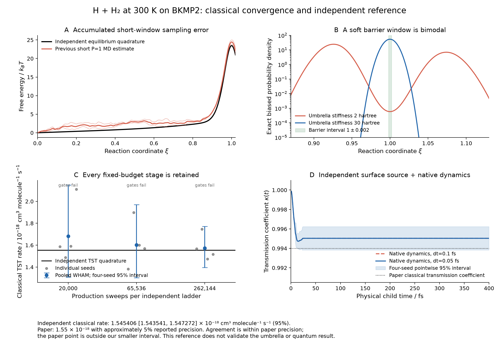

# Classical H + H2 convergence campaign

This campaign follows the failed stationarity checks in the earlier
literature audit. That audit remains unchanged. The new work separates
equilibrium sampling, free-energy estimation and dynamical recrossing; it
does not change a prefactor or potential to match a published rate.



The [PDF figure](figures/classical-convergence.pdf) is generated from the
retained tables and per-seed curves. Its [provenance](figures/figure-provenance.json)
records every plotted input hash.

## Criteria declared before production sampling

The physical target is ordinary H + H2 on the pinned BKMP2 surface at 300 K,
with both equivalent product channels and the repository's neutral-1H mass.
The independent classical TST reference is the direct two-surface integral,
not a fitted value from a previous trajectory.

- Conditional rate-flux quadrature must reproduce the independently derived
  surface-integral TST within 1e-5 relative error. Radial/angular/grid
  refinements must also satisfy that tolerance before use as an oracle.
- Statistical estimates must retain all independent seeds and all failed
  stages. Monte Carlo seed IDs are 2026110101, 2026110102, 2026110103 and
  2026110104. Planned sample refinements are powers of two; a longer result
  cannot silently replace an earlier failed result.
- A converged equilibrium TST estimate must have a relative 95% interval
  half-width at most 1%, agree with independent quadrature within its
  stated uncertainty and 2%, and pass independent-seed and temporal-half
  comparisons at three combined standard errors. An interval covering the
  reference alone is insufficient.
- A final classical rate additionally requires its own transmission
  coefficient. The initial horizon is 100 fs, with 200/400 fs extensions;
  0.1 fs and 0.05 fs timesteps must agree within 1% and their combined
  uncertainty. The final rate should agree with the paper's classical
  value within its approximately 5% reported sampling precision, while
  the new uncertainty remains explicit.
- Production PyRPMD umbrella sampling and an independent benchmark sampler
  are reported separately. Success of an independent sampler does not
  validate the production sampler, the quantum bead limit, or unrelated
  reactions.

## Diagnostic method

`benchmarks/h3/classical_sampling.py` integrates the exact classical
rate-flux density at a fixed RPMDrate coordinate in Jacobi coordinates.
For an H atom at distance R from the H2 center of mass, H2 bond length r,
and u = abs(cos(theta)), the Cartesian internal measure is
16 pi² R² r² dR dr du. The coordinate is inverted using all physical roots;
the unsquared relation removes roots introduced by squaring. The density
includes the exact coordinate Jacobian and Cartesian inverse-mass flux
metric. This produces equilibrium umbrella means/variances and the
infinite-sampling limit of the Gaussian UI estimator.

The physical-channel bounds are declared explicitly, because the legacy
PES has unphysical extrapolation for exceptionally compact triangles.
No sampled molecular geometry is relabelled as an independent trajectory.
Numerical reference integrals, importance samples and production trajectories
will retain their actual method labels and provenance.

## Established diagnostic results

The refined conditional integral uses 384 radial and 192 angular nodes,
with a 0.0005 coordinate grid. It gives the fixed-R∞=30-bohr TST value
**1.5531113254e-18 cm³ molecule⁻¹ s⁻¹**. The earlier, independently derived
surface integral normalized to a 99-bohr spectator gives 1.5531187868e-18.
Their transition-surface numerators agree to 4.4e-14 relative error; the
remaining 4.804e-6 relative rate difference is the finite reactant-separation
normalization. This is not a fitted correction.

The 256→384 node refinement changes the conditional density on ξ∈[0,1.02]
by at most 4.1e-13 relative error. The original 111 strong-umbrella means
change by at most 5.9e-11 and variances by 7.1e-8 relative error. Remote
product-side root coalescences near ξ≈1.21 are not pointwise converged on this
rectangular quadrature grid; those remote points must not be used as a
pointwise oracle. The actual ladder-center region, its weighted moments,
and the reference/transition-state densities satisfy the stated tolerance.

The initial 128/64 trial missed the 1e-5 numerical accuracy gate and is
retained. Its original arrays, result and source hash survive, but its full
script snapshot was not archived before adding the later grid-tail and
stiffness diagnostics. A [portable endpoint replay](reference-128/portable-point-replay.json)
reproduces its defining rate to 5.33e-15 relative difference. This is not
labelled a byte-for-byte replay of that initial complete script. The final
256/384 reference calculations have exact executed source snapshots.

The old P=1 trajectory has only about 71 effective samples per stream at
the median. Its individual coordinate means are not clearly inconsistent
with the exact equilibrium means: the largest discrepancy is 2.49 estimated
standard errors, and the median absolute discrepancy is 0.59. The much larger
rate error accumulates through integration of many small window errors.
For example, the ξ=0→0.25 segment contributes +1.61 kBT to the barrier error,
while ξ=0.5→0.75 contributes −1.40 kBT. Endpoint geometries show an entrance
mean H2 bond of 1.40187 bohr and mean |cos θ|=0.543 across 22 endpoints.
These endpoints do not demonstrate a persisting collinear or stretched
classical initialization, and they are not substitutes for time series.
See [the full window diagnosis](window-diagnosis.json).

### Why the estimator and umbrella schedule changed

Gaussian umbrella integration is an approximation even with unlimited data.
On this exact classical density, the source-like 30-hartree umbrellas give a
TST estimate about 2.52% high. Making every umbrella very soft is much worse:
at 2 hartree the equilibrium distributions near the barrier are bimodal,
and Gaussian UI produces an incorrect rate larger by approximately 5,841
at 0.02 window spacing. With 262,144 observations per soft window, the entire
soft ladder would yield only about **0.75 observations** in ξ=1±0.002.
This is both an estimator and a barrier-support problem.

The [fixed 48-window schedule](umbrella-schedule.json) therefore uses broad
entrance windows and 30-hartree barrier windows. It was chosen from the exact
overlap/support distributions before sampling, without a paper rate or a
sampled candidate rate as input. The schedule generator bisects adjacent
pairs until their Bhattacharyya overlap exceeds 0.60; its minimum is 0.6068.
It predicts about 9,345 observations in ξ=1±0.002 per 20,000-sweep ladder.

The final estimator is histogram WHAM. A fractional-weight deterministic
oracle verifies the WHAM equations to 4.64e-13 in log density after removing
the arbitrary constant. These fractional weights are numerical integrals,
not independent observations. Integrating the physical probability within
each histogram bin, then applying the actual estimator and local quadratic
fit, gives rate biases of −0.0484%, −0.0173% and −0.0093% for bin widths
0.001, 0.0005 and 0.00025 respectively. No bias correction is applied.
See [the independent estimator check](wham-oracle.json).

The method references are Kumar et al.,
[J. Comput. Chem. 13, 1011–1021 (1992)](https://doi.org/10.1002/jcc.540130812),
and Shirts and Chodera,
[J. Chem. Phys. 129, 124105 (2008)](https://pmc.ncbi.nlm.nih.gov/articles/PMC2671659/).
Exchange-coupled windows are not treated as independent uncertainty units;
the reported interval uses the four independently seeded full ladders.

## Fixed-ladder convergence history

These are equilibrium Monte Carlo sweeps, not femtoseconds of physical
dynamics. All samples and seeds are retained. Later stages continue the
same RNG/state and verify the exact byte hashes of every earlier CV prefix.
The source sampler is distinct from the production MD umbrella workflow.

| Production sweeps per independent ladder | Pooled TST, cm³ molecule⁻¹ s⁻¹ | Difference from exact finite-R∞ integral | Independent-seed 95% interval | Declared precision/accuracy gates |
| --- | ---: | ---: | --- | --- |
| 20,000 | 1.6812130e-18 | +8.25% | [1.3086127e-18, 2.1500204e-18] | Fail |
| 65,536 | 1.6014891e-18 | +3.11% | [1.3025076e-18, 1.9710616e-18] | Fail |
| 262,144 | 1.5721439e-18 | +1.23% | [1.3966727e-18, 1.7708574e-18] | Precision fails; other gates pass |

At 65,536 sweeps all coordinate split-Rhat values are below 1.00047, and
the paired temporal-half comparison passes. The independent-seed interval
is still too wide, and the 2% oracle-accuracy criterion is not met. Numerical
proximity to the paper's classical TST value of 1.56e-18 is therefore not
declared a converged reproduction. The paper's Table 2 source and conventions
are documented in the preceding [H3 audit](../../literature-audit-2026-11-01/h3/README.md).

At 262,144 sweeps the accuracy criterion passes, and the point estimate is
only 0.78% above the paper's classical TST. However, the independent-seed
interval still has an approximately 12.6% relative upper half-width, well
above the registered 1% precision criterion. The maximum split-Rhat is
1.00016 and the paired temporal-half comparison passes. These diagnostics
do not override the failed rate precision criterion. This original kernel
therefore stops at its retained 262,144-sweep stage; no 1,048,576-sweep result
is claimed. A simple inverse-square precision extrapolation would require
about 37 million sweeps per seed, and is only a rough cost forecast from
four seeds.

The original 20,000-sweep result was recovered from the later checkpoint
and fully reanalyzed. Every numerical field of the comparison agrees exactly
with its original result, with zero new simulation. The
[replay record](stage-20000/exact-prefix-replay.json) separately identifies
the source change that made checkpoint hashing atomic.

An orchestration JSON-serialization error occurred after all four initial
samplers completed. The saved numerical data were intact; stage metadata
were regenerated with zero new sampling. The event and exact original
script are retained in [orchestration-events.json](orchestration-events.json).

## Independent transmission-coefficient campaign

The separately registered [transmission protocol](transmission-protocol.json)
samples the exact classical surface-flux distribution in r and t=r_far/r.
It then launches ordinary unconstrained Maxwell momenta and paired p/−p
children through the unchanged native PyRPMD dynamics. Four independent
seeds each supply 2,048 parents. The protocol compares 0.1/0.05 fs timesteps
and 100/200/400 fs horizons. These results distinguish a converged classical
reference rate from a still imprecise umbrella free-energy estimate; they
do not validate quantum RPMD or constrained-parent equilibration.

The fixed proposal distributions include their exact Metropolis density
ratio. The target contains r⁴ t sqrt((2+t²)/m) exp(−βV), including the
surface Jacobian and inverse-mass flux metric. Overall translations and
rotations are analytically integrated. Both equivalent reaction channels
are represented, without applying an extra symmetry multiplier to κ.

### Completed classical reference comparison

All four registered seeds completed both timesteps and all three observation
horizons. The final estimate uses the 380–400 fs plateau at 0.05 fs. The
uncertainty unit is an independently seeded complete surface ensemble; the
two timesteps share initial states and momenta and are paired comparisons.

| Observable | This calculation | New 95% interval | CPC 2013 Table 2 |
| --- | ---: | --- | ---: |
| Classical TST, cm³ molecule⁻¹ s⁻¹ | 1.5531187868e-18 | Deterministic quadrature; refinements above | 1.56e-18 |
| Transmission coefficient κ | 0.99503424 | [0.99383298, 0.99623550] | 0.994 |
| Classical rate, cm³ molecule⁻¹ s⁻¹ | 1.54540638e-18 | [1.54354068e-18, 1.54727207e-18] | 1.55e-18 |

The rate is **0.30% below the published rounded value**, within the paper's
approximately 5% stated sampling precision. The published point is slightly
above our new interval; this is agreement within the paper's precision,
not a claim that two separately constructed modern intervals overlap.
The new interval includes stochastic transmission uncertainty, while the
small quadrature refinement error is assessed separately. It is not a total
uncertainty estimate for the PES or physical model.

The 8,192 parents produce 32,768 antithetic child trajectories across the two
timesteps, totaling **196,608,000 native physical integration steps**, with
zero Python fallback. All three plateau windows give the same observed
coefficient at both timesteps. Halving the timestep reduces the maximum
energy error from 0.02485 to 0.006210 kBT, approximately a factor of four.
The paired trajectories have two different early-time product classifications
and no classification differences after 80 fs. Their continuous surface
values do differ, demonstrating that the shorter timestep was separately
propagated. Zero observed late-time differences in this finite ensemble
do not prove exactly zero integration bias.

The source ensemble's five registered moments agree with independent surface
quadrature within 1.18 pooled standard errors. A supplementary diagnostic
using all 128 independent parent-chain blocks gives κ=0.9950400 and a 95%
interval [0.9941550, 0.9959250]. The predeclared four-seed interval remains
the main result. An independent reconstruction from analytic bond velocities
and the surface metric reproduces every saved flux numerator and denominator
to 3.56e-15 absolute error.

All registered classical-reference criteria pass. This establishes an
independently sampled classical reference with the native PyRPMD child
dynamics. The separate umbrella campaign remains subject to its own
precision criteria, and the result does not establish quantum RPMD
convergence or validate constrained-parent equilibration.

See the [complete comparison](transmission/transmission-comparison.json),
[independent replay](transmission/transmission-replay.json), and individual
seed records under `transmission/`. The executed
`classical_sampling_surface.py` has SHA256
`891a14a32b6394933179510d59aab02297af91e2f37b1bb6ec2101e9fecab9a1`.

## Separate proposal prototype

`classical_sampling_xi_proposal.py` tests an additional incoming-channel
independence move. It draws ξ from the known Gaussian umbrella, inverts the
unique physical R(ξ), and retains the radial Cartesian volume factor
J=R² |dR/dξ|. The Metropolis log ratio is

$$
\log a = b(q_\mathrm{old})-b(q_\mathrm{new})
         +\log J_\mathrm{new}-\log J_\mathrm{old},
\qquad b=\beta\overline V-\log f_s.
$$

The umbrella terms cancel against the proposal-density ratio. All
zero-centroid ring deviations remain unchanged, so the spring action
cancels as well. Independent tests verify the inverse coordinate, finite
difference volume Jacobian, spring invariance and full Metropolis ratio.
This prototype has not been spliced into the frozen ladder campaign.

### Separately registered kernel calibration

The [v2 calibration protocol](v2-calibration-protocol.json) compares zero,
one and three additional Gaussian-ξ moves per sweep. Each setting has four
new, explicitly listed seeds, 2,000 warmup sweeps and 20,000 retained sweeps.
Every calibration observation is excluded from any later primary estimate.
The original campaign and its 262,144-sweep checkpoints remain untouched.

The zero-additional-move control reproduces the original sampler's
coordinates, CVs, RNG state, exchange history and diagnostics exactly on an
independent real-PES test. The new sampler uses the existing integrity-aware
atomic checkpoint container, a fingerprint of every setting, explicit
shape/type checks and a source-identity guard before saving. Exact restart
and deliberate corruption tests accompany the inverse-coordinate and
Metropolis-ratio mathematics tests.

Selection uses the larger of the full-seed and block estimates of asymptotic
log-rate variance, multiplied by process CPU seconds per sweep. Wall times
are retained but shared-machine load does not determine the selection
metric. Neither the published rate nor closeness to an exact oracle enters
selection. Oracle window moments remain an independent correctness check.
The protocol requires a measured efficiency gain of at least 1.25 before
starting a separately registered primary campaign. Calibration is not
reported as a converged new rate.

All 12 registered calibration runs completed, with verified checkpoint
integrity, unchanged source identities and connected WHAM overlap graphs.
The [full calibration comparison](v2-calibration-comparison.json) retains
every seed and temporal block, including the less efficient candidates.

| Additional ξ moves per sweep | Median coordinate statistical inefficiency | CPU milliseconds per sweep | Conservative variance × CPU cost |
| --- | ---: | ---: | ---: |
| 0, exact original-kernel control | 11.64 | 1.711 | 2.06917 |
| 1 | 2.32 | 2.366 | 0.71567 |
| 3 | 2.02 | 3.994 | 1.34490 |

One additional move provides the best measured efficiency, **2.89 times**
the control under the predeclared metric. The largest absolute diagnostic
window-mean discrepancy is 3.06 estimated standard errors across its 192
seed/window comparisons. Three moves lower coordinate correlation slightly
more but cost enough CPU time to lose overall efficiency.

These are calibration findings. Using its conservative variance estimate,
even the best kernel would need approximately 16 independent seeds with
1,048,576 production sweeps each to target the registered 1% rate precision:
about **11 process CPU hours**, before allowing for uncertainty in a forecast
based on four calibration seeds. A long primary campaign has not been run
or claimed here. The converged independent classical reference above and
the original umbrella precision failure keep their separate status.

## Reproduction and source identity

Run the commands from the repository root after building the pinned BKMP2
provider using the existing [H3 build instructions](../../../../benchmarks/h3/README.md).
The PES source and compiled library are not redistributed with these data.
Set `BKMP2_LIBRARY` to the local compiled library path. The following
commands retain the declared seeds, physical parameters and estimators:

```bash
export OMP_NUM_THREADS=1 OPENBLAS_NUM_THREADS=1 MKL_NUM_THREADS=1
python benchmarks/h3/classical_sampling_campaign.py \
  --library "$BKMP2_LIBRARY" \
  --schedule docs/validation/literature-convergence-2026-11-01/h3-classical/umbrella-schedule.json \
  --output classical-campaign --production-stage 20000 --workers 2
python benchmarks/h3/classical_sampling_surface.py \
  --library "$BKMP2_LIBRARY" --output classical-transmission --workers 2
python benchmarks/h3/classical_sampling_surface_diagnose.py \
  --data classical-transmission --output classical-transmission-replay
```

Continue the same campaign with `--production-stage 65536`, then `262144`,
and, if needed, `1048576`. Each stage checks every earlier retained CV prefix
against its original SHA256. To analyze a stage after a later continuation,
materialize its registered prefix without running any new dynamics:

```bash
python benchmarks/h3/classical_sampling_replay.py \
  --campaign classical-campaign --stage 20000 --output classical-stage-20000
python benchmarks/h3/classical_sampling_analyze.py campaign \
  --campaign classical-stage-20000 --stage 20000 \
  --reference docs/validation/literature-convergence-2026-11-01/h3-classical/reference-384/conditional-reference.npz \
  --schedule docs/validation/literature-convergence-2026-11-01/h3-classical/umbrella-schedule.json \
  --output classical-stage-20000-analysis
```

The derived zip container has a new identity; the original observations,
RNG/geometry snapshot and registered prefix hash remain explicit. The
original checkpoint identity is never relabelled as the derived one.

The oracle and schedule scripts initially used `numpy.trapezoid`, which
requires NumPy 2 while the project also supports NumPy 1.26. Their portable
versions now use `scipy.integrate.trapezoid`. Exact original source copies
are retained under `executed-source/`, and the
[compatibility record](numpy-compatibility.json) preserves both hashes.
The actual 48-window means/variances and the regenerated overlap schedule
are numerically identical, with maximum absolute difference zero. No
trajectory, potential, frozen schedule or existing numerical report was
changed for this compatibility correction.

Raw arrays and checkpoints are provided separately from the repository.
The [raw-data index](raw-data-index.json) records archive sizes and SHA256
hashes, and each archive contains a per-member manifest verified after
compression. The equilibrium archive stores the final complete CV arrays
and the original prefix hashes/state snapshots, without duplicating earlier
CV arrays. The transmission archive contains all parents, momenta, child
surface observations and energy extrema. Neither archive contains the PES
source, a compiled library or duplicated repository code. Exact code hashes
and archival source pointers are collected in
[source-reference.json](source-reference.json).
