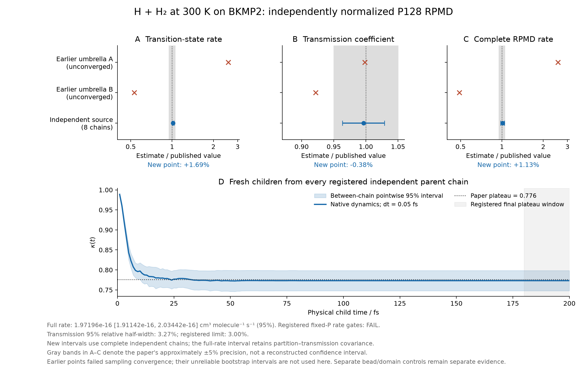

# Complete initial quantum H₃ child cohort: 200 fs, two momentum pairs

The complete, independently normalized P128 H + H₂ rate at 300 K is
**1.97196035 × 10⁻¹⁶ cm³ molecule⁻¹ s⁻¹**, with a nominal independent-chain
95% interval **[1.91141982, 2.03441839] × 10⁻¹⁶**. The point is 1.126% above
the published 1.95 × 10⁻¹⁶. The published point lies inside this interval,
and the entire interval lies inside the paper's approximate ±5% band.
**The registered fixed-P validation gate nevertheless fails:** the relative
95% half-width of κ is 3.272%, above its unchanged 3.000% limit.

The comparison is with Table 2 of Suleimanov, Allen and Green,
*Computer Physics Communications* 184 (2013),
[DOI 10.1016/j.cpc.2012.10.017](https://doi.org/10.1016/j.cpc.2012.10.017).
The paper's approximate 5% sampling precision is a comparison band, not
a reconstructed 95% confidence interval.

## Complete cohort and estimators

All eight registered parent chains (721301, 721303, 721307, 721309, 721313,
721317, 721321, 721323) contribute all 200 saved equilibrium configurations.
Each parent starts two keyed Maxwell momentum pairs, with both p and −p
propagated for 200 fs. The identical configurations and momenta are used at
0.1 and 0.05 fs; 0.05 fs is primary. This gives 6,400 children per timestep
and 38.4 million native integration steps across both timesteps. No parent,
child, chain or late-time observation was selected according to agreement.

The source distribution includes the configuration flux metric. Signed
child weights divide by this metric. The same independent parent chain
supplies its BAR surface-partition estimate and its child trajectories, so
the full-rate uncertainty retains their covariance. Individual children
are not counted as independent parent chains. The central full rate is the
registered geometric mean of the eight chain estimates; multiplying the
separately displayed arithmetic κ by QTST does not give precisely that
central estimator. The intervals use Student-t with seven degrees of freedom.

| Quantity | Estimate | Nominal 95% interval | Published value |
| --- | ---: | --- | ---: |
| QTST, cm³ molecule⁻¹ s⁻¹ | 2.55248792 × 10⁻¹⁶ | [2.51679142, 2.58869070] × 10⁻¹⁶ | 2.51 × 10⁻¹⁶ |
| κ, arithmetic mean | 0.77307729 | [0.74778066, 0.79837393] | 0.776 |
| Full rate, cm³ molecule⁻¹ s⁻¹ | 1.97196035 × 10⁻¹⁶ | [1.91141982, 2.03441839] × 10⁻¹⁶ | 1.95 × 10⁻¹⁶ |

The full-rate 95% log half-width is 0.0311818, below log(1.05). The
same-chain covariance of the mean log partition and log κ is −2.52488 × 10⁻⁵.
Their joint log-rate variance is 0.000173892; incorrectly treating them as
independent would give 0.000224389. Neither finite-chain ratio bias nor
log-transformation bias is separately corrected.

The figure preserves earlier unconverged estimates as historical points.
Their intervals are not used as validated uncertainty. Its lower panel
shows pointwise between-chain intervals, not a simultaneous confidence band.

## Numerical and sampling checks

| Registered check | Observation | Status |
| --- | --- | --- |
| Complete registered cohort | All eight chains, all parents, both timesteps | Pass |
| Parent BAR overlap, energy ESS and partition time-half checks | Every original parent-source flag passes | Pass |
| κ statistical precision | Relative 95% half-width 3.272%; limit 3.000% | **Fail** |
| Plateau, 80–100 versus 180–200 fs | Every observed chain difference is zero | Pass on the registered sampled windows |
| Paired timestep κ difference | 0.000810868; 95% interval [−0.000836682, 0.002458419], inside ±0.01 | Pass |
| Primary-step maximum full-H error × β/P | 0.0722057; limit 0.1 | Pass |
| Static-domain observations at 1 fs boundaries | Zero crossings; minimum observed pair distance 0.558850 bohr | Pass at those observation times |
| Full-rate interval precision and all three paper point comparisons | All pass their separately registered thresholds | Pass |

Zero observed late-window differences produce a degenerate [0, 0] sample
interval. This means no difference was detected on these trajectories; it
does not bound arbitrarily rare later recrossing. Minimum pair distances
are recorded at 1 fs boundaries, whereas full-H extrema and the native PES
hard guard are evaluated at every integration step. The 0.1 fs energy
errors are retained in the report; the registered energy screen applies
to the primary 0.05 fs calculation. Energy stability is not a bound on rate bias.

The supplementary first/second parent-time-half κ difference is 0.0221071,
with a 95% interval [−0.0205559, 0.0647701]. Its ±0.03 equivalence diagnostic
**fails**. This was designated supplementary before rate inspection; it
has not been silently promoted to a pass or removed. The analytic mean
flux-denominator target of 2 lies inside the observed interval
[1.9503524, 2.0739489] around 2.0121506.

## Precision continuation

The immutable [decision](precision-extension-decision.json) was written
after the complete first-cohort analysis and before launching the separate
extra-pair batch. It cites the failed κ precision gate, retains all eight
seeds and all 1,600 parent configurations, and adds pair indices 2 and 3
at both timesteps. The horizon remains 200 fs because the registered
plateau test passed. The [launch receipt](precision-extension-launch-receipt.json)
distinguishes its later recording time from the clock-observed launch-time
upper bound; no exact process-start timestamp was captured.

This page preserves the initial two-pair result regardless of the outcome
of the continuation. The nominal t intervals are not sequentially adjusted
coverage guarantees. The new batch must finish the whole cohort before
its primary comparison is assessed.

## Scope and reproducibility

This is a fixed-P independent equilibrium reference coupled to actual
unthermostatted PyRPMD native dynamics. It does not validate the production
MD umbrella sampler, dynamic bead-number convergence, other reactions,
or uncertainty in the PES. The separate P128-to-P256 and cutoff controls
test the equilibrium QTST factor; their coarse-P64 failure remains visible.

- [Complete numerical report](quantum-rate-comparison.json)
- [All-time κ curve](kappa-curve.csv)
- [Execution and exact analysis-source receipt](execution.json)
- [Frozen scientific protocol](protocol.json)
- [Figure inputs and provenance](figures/figure-provenance.json)
- [Analysis specification and timing](../recrossing-analysis-prespecification.json)

Per-seed directories retain both timestep settings, reports and κ curves.
The numerical report indexes the checksums of every raw child chunk. Raw
arrays are stored separately and are not embedded in Git.

The [independent raw-data review](../../review/pr68-software-review/complete-200fs-review/README.md)
reconstructs every keyed Maxwell draw, signed numerator and denominator,
and the chain statistics without calling the producing analyzer or dynamics.
All 400 child chunks and 483 bound input files pass integrity checks.
Its supplementary fine-step endpoints all have outward spectator radial
velocity, with spectator separations of 19.716–48.722 bohr; these support
the observed outgoing ensemble without turning the sampled plateau into
a bound on arbitrarily rare future recrossing.
