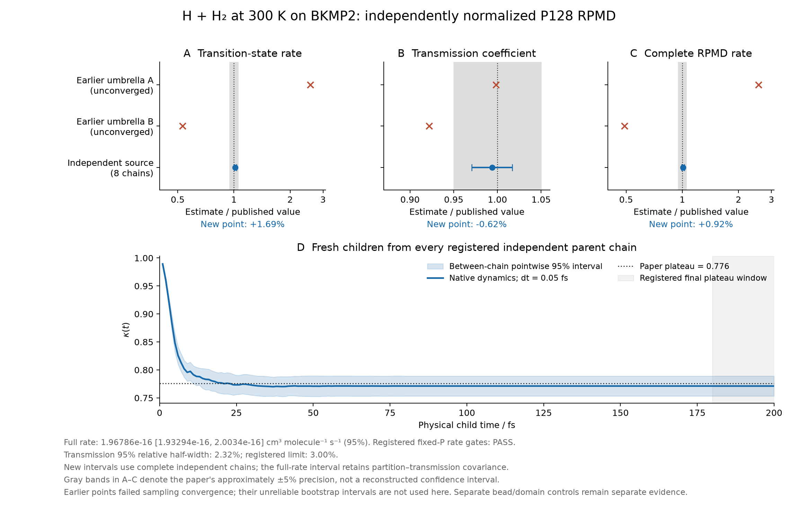

# Complete quantum H₃ cohort: 200 fs, four momentum pairs

All eleven predeclared **fixed-P primary criteria pass** after the complete
precision extension. At 300 K and P128 the independently normalized native
PyRPMD rate is **1.96785637 × 10⁻¹⁶ cm³ molecule⁻¹ s⁻¹**, with nominal
independent-chain 95% interval **[1.93293861, 2.00340490] × 10⁻¹⁶**. The
point is **0.9157%** above the published 1.95 × 10⁻¹⁶. The paper point lies
inside this interval, and the whole interval is inside the paper's
approximate ±5% sampling-precision band.

The supplementary parent-time-half equivalence diagnostic still **fails**.
Dynamic bead convergence and production MD umbrella validation are not
established by this fixed-P result. These limits remain part of the
conclusion even though the registered primary gate passes.

The reference is Table 2 of Suleimanov, Allen and Green,
[CPC 184 (2013), DOI 10.1016/j.cpc.2012.10.017](https://doi.org/10.1016/j.cpc.2012.10.017).
Its approximate 5% sampling precision is a comparison band, not a supplied
95% confidence interval or a statement of PES accuracy.

## Complete estimator and numerical comparison

All eight original independent parent chains contribute all 200 saved
equilibrium configurations. Every one of these 1,600 parents now supplies
momentum pair indices 0, 1, 2 and 3, each propagated with p and −p at both
0.1 and 0.05 fs. The primary timestep remains 0.05 fs. There are 12,800
children per timestep, 25,600 across both timesteps, and **76.8 million
native integration steps** in the combined two batches. The extension
does not create additional independent parent chains.

| Quantity | Estimate | Nominal 95% interval | Paper |
| --- | ---: | --- | ---: |
| QTST, cm³ molecule⁻¹ s⁻¹ | 2.55248792 × 10⁻¹⁶ | [2.51679142, 2.58869070] × 10⁻¹⁶ | 2.51 × 10⁻¹⁶ |
| κ, arithmetic mean | 0.77121022 | [0.75333936, 0.78908108] | 0.776 |
| Full rate, cm³ molecule⁻¹ s⁻¹ | 1.96785637 × 10⁻¹⁶ | [1.93293861, 2.00340490] × 10⁻¹⁶ | 1.95 × 10⁻¹⁶ |

Each chain supplies both its surface-partition BAR estimate and its child
trajectories. Their covariance is retained by constructing the log full
rate within each chain before taking the eight-chain Student-t interval
(seven degrees of freedom). The central full rate is the geometric mean
of chain rates. The separately displayed arithmetic κ is not substituted
into that estimator.

The covariance of mean log partition and log κ is −3.56742 × 10⁻⁵. Their
joint log-rate variance is 5.73252 × 10⁻⁵; a false independence assumption
would instead give 1.28674 × 10⁻⁴. Finite-chain ratio/log biases are not
separately corrected. These nominal intervals are not sequentially
adjusted coverage guarantees.

Earlier unconverged umbrella points remain visible in the figure. Their
intervals are not presented as validated uncertainty. The κ curve uses
pointwise between-chain intervals, not a simultaneous confidence band.

## Registered primary checks

| Check | Complete-cohort observation | Status |
| --- | --- | --- |
| Registered cohort | All eight chains, all 1,600 parents, both batches and timesteps | Pass |
| Parent BAR overlap, energy ESS and partition half checks | Every original parent-source flag passes | Pass |
| κ precision | Relative 95% half-width 2.317%; unchanged limit 3.000% | Pass |
| Late-time plateau | All chain differences between 80–100 and 180–200 fs are zero | Pass on the observed windows |
| Paired timestep κ difference | 0.00005931; 95% interval [−0.00113434, 0.00125295], inside ±0.01 | Pass |
| Primary maximum full-H error × β/P | 0.07621794; limit 0.1 | Pass |
| Sampled static-domain crossing | Zero at 1 fs boundaries; minimum pair 0.55885037 bohr | Pass at the recorded boundaries |
| Full-rate interval precision | 95% log half-width 0.01790337, below log(1.05) | Pass |
| Three separate paper point checks | QTST +1.6927%; κ −0.6172%; full rate +0.9157%, each within ±5% | Pass |

Observed zero late-window differences give a degenerate [0, 0] sample
interval; they do not bound arbitrarily rare later recrossing. Minimum
pair distance is recorded at 1 fs boundaries. The native PES guard and
Hamiltonian extrema are checked at every physical integration step. The
coarse-step maximum scaled energy error, 0.27119108, remains in the report;
the predeclared energy screen applies to the primary 0.05 fs calculation.
It is a stability screen, not a direct upper bound on rate bias.

## Supplementary diagnostic and preserved initial failure

The second-minus-first parent-time-half κ difference is **0.00657731**,
with 95% interval **[−0.02310073, 0.03625536]**. This interval is not wholly
inside ±0.03, so the supplementary equivalence diagnostic remains failed.
Its reduced point difference alone does not demonstrate stationarity.
The observed mean flux denominator is 2.01606472, with interval
[1.98469440, 2.04743503], containing the analytic target 2.

The [initial two-pair result](../recrossing-stage-200-pairs-2/README.md)
retains its failed 3.272% κ precision check. The
[extension decision](../recrossing-stage-200-pairs-2/precision-extension-decision.json)
was made after that full-cohort result and before the new batch. It adds
the same two momentum pairs to every parent at both timesteps. No seed,
parent, sign, horizon, statistical margin, PES, mass or rate prefactor was
changed according to agreement with the paper.

## Reproducibility and remaining work

- [Full numerical report and every raw-child hash](quantum-rate-comparison.json).
- [All-time curve](kappa-curve.csv) and [figure provenance](figures/figure-provenance.json).
- [Analysis execution receipt](execution.json), [curation receipt](curation.json),
  and the unchanged [scientific protocol](protocol.json).
- [Complete extra-batch schedule](schedule-200-pairs-1-completed.json),
  written only after the worker pool drained.
- [Preregistered incremental archive and combined-replay plan](archive-plan/README.md).
- [Separate eight-chain P256 dynamic-control design](../p256-fixed-eight-chain-design/README.md).

This directory adds the extra-batch settings, reports and curves without
duplicating the immutable base-batch evidence. Raw child arrays are
checksummed separately and are not embedded in Git. Independent archive
replay is separate evidence; the presence of this numerical comparison
does not claim that a raw archive has been publicly uploaded.

The complete P128 reference combines an independent equilibrium estimator
with unthermostatted PyRPMD native dynamics. The separate MC umbrella
campaign, production MD umbrella implementation, dynamic bead refinement,
other reactions, and physical model uncertainty require their own evidence.
