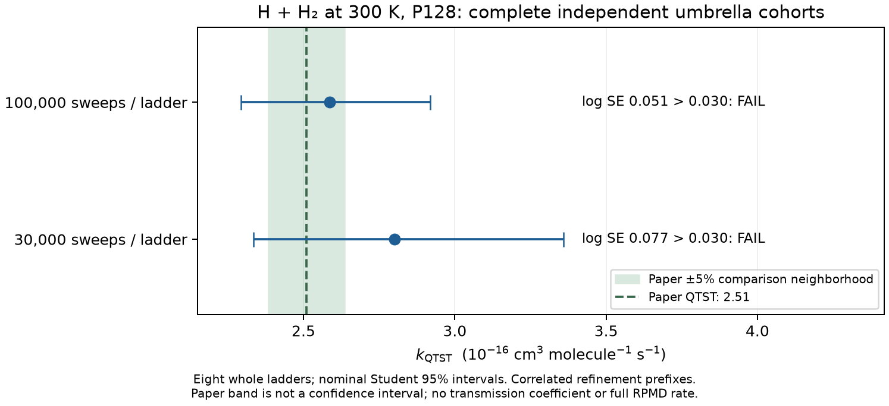

# H + H₂: complete 100,000-sweep umbrella stage

All eight registered P128 exchange ladders completed the fixed 100,000-sweep
production prefix after 5,000 warmup sweeps. These are Monte Carlo sweeps,
not femtoseconds or molecular-dynamics steps. The unchanged complete-cohort
analyzer ran once after the actual sampling process had returned normally.

The pooled 300 K QTST estimate is **2.5873968042 ×10⁻¹⁶ cm³ molecule⁻¹ s⁻¹**,
with nominal whole-ladder Student 95% interval **[2.2941329563,2.9181491874]
×10⁻¹⁶**. The paper's 2.51 ×10⁻¹⁶ value lies inside that interval; the point
estimate is 3.083538% higher. The registered log standard-error limit still
**fails: 0.05087375 > 0.030**. Complete-cohort, overlap/residual, bin width,
local-fit width, temporal-half, seed-consistency and paper-point predicates
pass. This is **not** a passing overall equilibrium validation.

The initial 30,000-sweep stage remains unchanged: its point estimate was
2.8007250269 ×10⁻¹⁶ and log SE 0.07689760. The refinement reduced uncertainty;
point agreement never triggers or stops continuation. The plotted prefixes
share samples and are not independent replications. No transmission
coefficient was calculated here, and this report establishes no full RPMD
rate, bead convergence or physical-domain convergence.

The analyzed eight-ladder execution used 35.924906 CPU seconds and 36.004667
wall seconds. Actual root tool observations are preserved for sampling
session 57942 and analysis session 1094. Source, model and original prefixes
remain unchanged. The complete reports and exact command/log identities
are retained; this compact bundle contains no raw trajectory or PES asset.

## Retained lease anomaly

The original scheduler lease remained after a normal exit even though the
frozen source's normal cleanup should remove it. Independent review proved
the exact eight submissions/completions, drained worker pool and original
owner identity. Root performed one explicitly adopted no-overwrite rename
of the exact completed lease into quarantine. Immediate absence released
the already authorized analyzer; no second analyzer was launched. A new
directory/owner inode subsequently appeared at the original path with the
same historical owner bytes. The original quarantined inodes remain intact.

This anomaly's cause is **unexplained**. The first action's immediate success
is retained separately from the failed durable-absence postcondition.
No repeated cleanup, new sampler or 300,000-sweep stage has been admitted.
Raw archive admission requires a new explicit read-only review binding the
anomaly, both actual normal exits, unchanged complete data and absence of
any admitted writer. Scientific precision failure remains visible while
that operational preservation step is handled.

The numerical paper reference is Table 2 of Suleimanov, Allen and Green,
*Computer Physics Communications* 184 (2013), 833–840,
[doi:10.1016/j.cpc.2012.10.017](https://doi.org/10.1016/j.cpc.2012.10.017).
The approximate 5% paper comparison neighborhood is not a reported 95%
confidence interval. Our intervals are nominal estimates over eight whole
ladders; registered repeated-prefix diagnostics do not create additional
independent samples.
