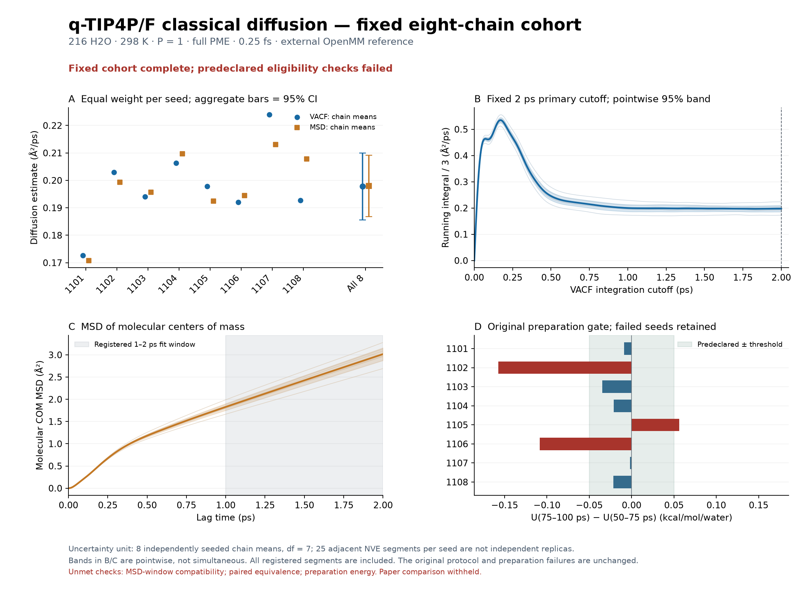

# Complete original eight-chain classical water campaign

**The fixed campaign is complete, but its predeclared eligibility checks do not
all pass.** The primary diffusion estimate is **0.197808916 Ų/ps**, with a
nominal 95% confidence interval of **0.185611415–0.210006417 Ų/ps** across the
eight seed-chain means. All eight seeds and all 200 production segments remain
included. The analysis retains `physical_converged=false`,
`literature_reproduced=false`, and `literature_comparison=null`.

The two substantive unresolved issues are the original preparation-energy
stationarity screen and the prespecified short 0.5–1 ps MSD window. The latter
sets both the MSD-window compatibility and aggregate paired-equivalence flags
to false. It does **not** mean the primary VACF and 1–2 ps MSD estimates disagree:
their paired equivalence check passes.

## Experiment and uncertainty

| Item | Fixed setting or completed amount |
|---|---|
| System | 216 flexible H₂O molecules; classical `P=1` |
| State | 298 K; density 0.997 g/cm³; fixed cubic cell |
| Potential | q-TIP4P/F printed Table I parameters; no bond constraints |
| Electrostatics | Full, uncontracted PME; tolerance `1e-5`; 9 Å short-range cutoff |
| Integrator | OpenMM CPU `VerletIntegrator`, 0.25 fs; synchronized canonical momenta |
| Preparation | 100 ps per seed; frozen periodic global Maxwell refresh every 100 fs |
| Production | 25 consecutive 4 ps NVE segments per seed; one COM-projected Maxwell draw at each segment boundary |
| Recording | 5 fs within each production segment, including its initial frame; 801 frames per segment |
| Checkpoints | Every 1 ps; float64 canonical/native state and external RNG |
| Total | 800 ps preparation plus 800 ps production; 1,600 committed original chunks |
| Uncertainty unit | Eight independently randomized seed-chain means, conditional on their common initial geometry and preparations |

The 25 neighboring segments of one chain, its molecules, and overlapping time
origins are not independent uncertainty units. The reported interval is
`mean ± t.ppf(0.975, 7) * sample_std(chain_means) / sqrt(8)`. The independently
seeded paths share the same earlier 28 ps starting geometry; the confidence
interval does not quantify a common preparation bias. Scalar stationarity
passes would also be insufficient to prove equilibration.

This is an **external OpenMM reference**, with the model and observable
conventions audited against PyRPMD helpers. It is not a PyRPMD production
trajectory. It provides no validated water IR spectrum, no PA-CMD result, and
no quantum `P=32` transport result. The prior
[force-field/source audit](../../../literature-audit-2026-11-01/water/source-audit.json)
distinguishes printed parameters from the more precise converted author-code
parameters; those models are not described as exactly identical.

## Complete-cohort diffusion results

| Estimator | Mean (Ų/ps) | Standard error | Nominal 95% interval |
|---|---:|---:|---:|
| Primary: molecular-COM VACF integral to 2 ps | 0.197808916 | 0.005158325 | [0.185611415, 0.210006417] |
| Secondary: molecular-COM MSD slope over 1–2 ps | 0.197921588 | 0.004728492 | [0.186740481, 0.209102694] |

The primary 95% half-width is 0.012197501 Ų/ps, below the originally registered
0.02 Ų/ps precision screen. This screen is coarser than the literature's
reported uncertainty. The paper reports classical `D=0.199(2)` Ų/ps for 216
molecules in Table IV; parentheses denote a standard error. Its Section III.B
uses twenty batches of 100 four-picosecond trajectories, for 8,000 ps of NVE
sampling, compared with the present 800 ps. The source is Habershon, Markland
and Manolopoulos, *J. Chem. Phys.* **131**, 024501 (2009),
[DOI 10.1063/1.3167790](https://doi.org/10.1063/1.3167790),
[primary manuscript](https://arxiv.org/abs/1011.1047).

The formal difference/combined-uncertainty comparison remains withheld under
the [original protocol](../protocol.json), because eligibility failed. The
reference value did not determine stopping, seed selection, or any change to
the protocol. The original numerical values and every failed flag remain in
[the full report](analysis/report.json).

| Seed | VACF D | MSD D | Preparation ΔU (kcal/mol/water) | Original U screen |
|---:|---:|---:|---:|---|
| 1101 | 0.172601073 | 0.170799025 | −0.009007497 | Pass |
| 1102 | 0.202967247 | 0.199283702 | −0.157442220 | **Fail** |
| 1103 | 0.194017738 | 0.195737968 | −0.034635914 | Pass |
| 1104 | 0.206374320 | 0.209726299 | −0.020865984 | Pass |
| 1105 | 0.197813561 | 0.192395212 | +0.056427217 | **Fail** |
| 1106 | 0.192087473 | 0.194509203 | −0.108599902 | **Fail** |
| 1107 | 0.223912878 | 0.213090689 | −0.001725887 | Pass |
| 1108 | 0.192697039 | 0.207830606 | −0.021319450 | Pass |

Here ΔU is the 75–100 ps preparation mean minus the 50–75 ps mean. All D values
are in Ų/ps. [summary.csv](summary.csv) retains full precision and the other
preparation scalar differences.



## What passes and what remains unresolved

**Energy conservation passes the original numerical limits for all 200
segments.** The largest sampled absolute energy change is
0.001954935 kcal/mol/water, at seed 1104, segment 5, below the 0.01 limit. The
largest absolute fitted energy drift is 0.000128186 kcal/mol/water/ps, at seed
1108, segment 12, below the 0.001 limit. These are observations at the fixed
5 fs recording cadence; they do not replace an independent timestep study.

**The preparation-energy screen fails for seeds 1102, 1105 and 1106.** Its
unchanged absolute tolerance is 0.05 kcal/mol/water. All eight temperature,
O–H-length and H–O–H-angle screens pass. Their largest absolute split-window
differences are 1.531589 K, 0.000516200 Å and 0.0859194 degrees, versus limits
of 5 K, 0.001 Å and 0.1 degrees. The equal-chain late-window means are
297.823813 K, 0.963562659 Å and 104.794187 degrees. A failed point screen does
not by itself distinguish slow relaxation from correlated finite-sample
fluctuation; the declared requirement is simply not demonstrated.

**The short MSD window fails, while later windows and the primary estimators
agree within the registered margin.** The 0.5–1 ps MSD estimate minus the
primary 1–2 ps estimate is 0.017118202 Ų/ps, with paired 95% interval
[0.011972855, 0.022263548]. That interval lies beyond the declared +0.01 margin.
The primary VACF-minus-MSD difference is −0.000112672, with interval
[−0.006528648, 0.006303305], entirely within ±0.01. The 1–1.5 ps and 1.5–2 ps
MSD comparisons and the 1 ps and 1.5 ps VACF-cutoff comparisons also pass their
equivalence screens. The frozen diffusion analyzer labels 118 individual
segments as a diffusive-regime candidate and 82 as a non-diffusive window;
none was excluded from any primary mean. These heuristic labels are retained
as diagnostics, not reinterpreted as an independent transport certification.

The [complete scalar preparation figure](figures/preparation-scalars.png) and
[all-eight oxygen RDF figure](figures/preparation-rdf.png) retain every seed.
The RDF comparison uses fixed 50–75 and 75–100 ps windows. Its pointwise
Student-t bands are descriptive, not simultaneous bounds, a new hard RDF
criterion, or an equilibrium proof. Every radial bin and per-seed curve is in
[preparation-rdf.csv](figures/preparation-rdf.csv).

## Supplemental production-stability diagnostic

The [additional split definition](../production-stability-preregistration.json)
was sealed before inspection of complete-cohort D results. It compares each
chain's mean over segments 13–24 with its mean over segments 0–11. Segment 12
is omitted only from this balanced contrast and remains in every primary mean
and in the full 25-segment display.

| Endpoint | Late minus early (Ų/ps) | Nominal paired-chain 95% interval |
|---|---:|---:|
| VACF | +0.013215781 | [−0.009282838, +0.035714399] |
| MSD | +0.017122547 | [−0.004945728, +0.039190823] |

The intervals are broad. Including zero is not evidence of equivalence or
stationarity. No hard gate was added by this supplement. The
[full production plot](figures/production-stability.png),
[all segment estimates](figures/production-segment-means.csv), and
[paired summaries](figures/production-stability.json) remain available.
Longer preparation cannot be assumed to remove physical preasymptotic MSD
curvature; a future longer-lag study would require its own fixed protocol and
new data, preserving this original failed short-window check.

## Completion, provenance and raw data

The final drained-pool event was recorded at **2026-11-01 20:41:12.926357 UTC**,
and the coordinator process returned exit code 0. All four fixed queues completed. All eleven original writer leases were then
acquired together and released, with unchanged final journal and manifests.
The [normal-exit receipt](original-normal-exit.json) binds those observations.
The full streaming analysis verified every original raw chunk and model
artifact in 21.64 seconds, using 21.42 CPU seconds and 195,452 KiB peak RSS;
its [execution record](analysis-execution.json) binds unchanged sources.
The three frozen plotting commands also passed their before/after source and
input checks, and all four final figures were visually inspected.

The raw-data-only archive is:

```text
pyrpmd-water-classical-eight-chain-2026-11-01-raw.tar.gz
bytes: 1476697324
SHA256: b3dc0faf5ddb84d06182ebf788edc73dfa1a0ec674069f01e61eaa62918d21af
```

Its 1,685 members include all 1,600 original chunks, four separately labeled
dense-cadence chunks, XML models/integrators, configurations, actual execution
logs, checkpoint/restart history and checksums. Every member was streamed and
verified against its recorded SHA-256. No Git-backed source code or third-party
source/binary downloads are duplicated in the archive. It has not been uploaded
by this task. The [raw-data index](raw-data-index.json),
[complete payload manifest](raw-file-manifest.json), and
[per-file code references](source-provenance.json) bind the artifact.

Source references are exact per file. The scientific native water sources match
published commit `c2c5ae2dce253f1407e7de25ec343ef5e1844a73`. The actual frozen
`diffusion.py` analysis dependency matches
`3d096d5cfc5709f14a1ad5e3d184b108eef9f20e`; the c2c5 version changes only integer
input validation, with unchanged diffusion calculations. The raw dataset retains
its original runtime revision labels. CPU force-cache restoration is explicitly
bounded; this record does not promise bitwise-identical future CPU trajectories.

For analysis replay, use all eight extracted run directories and the exact
Git-backed frozen protocol and companion source patch. The data-only archive's
input copies document the experiment; they do not duplicate that source patch.
The original executed command is in [analysis-execution.json](analysis-execution.json).
A separate actual-extraction replay is an additional usability check beyond
this frozen assessment and per-member archive verification.

## Prepared next control

The already registered paired 0.25/0.125 fs control is prepared for review in
the [pending adoption package](../timestep-paired-control/original-cohort-adoption-draft/README.md).
It binds every exact original 100 ps pre-NVE checkpoint and the unchanged
all-eight paired criteria. No live registration, control directory, Context,
PES evaluation or RNG draw was created by preparing that package. A numerical
control pass cannot repair the retained preparation failures. The proposed
additional 400 ps preparation remains a separate, unlaunched decision and
cannot overlap the control's original-cohort leases.
