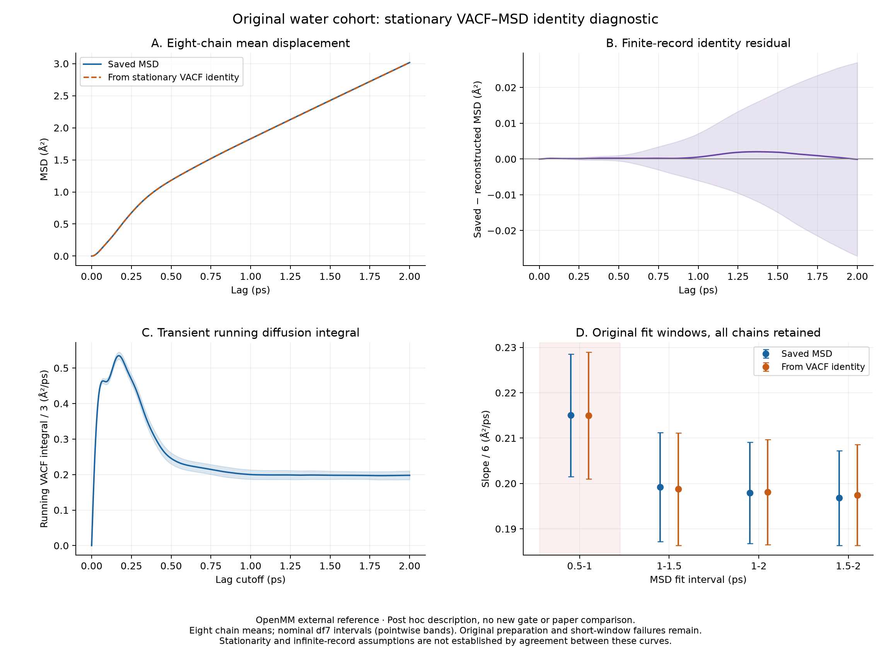

# Why the original short MSD fit window failed

The saved velocity correlation explains the original cohort's larger diffusion
estimate over 0.5–1 ps. Its running integral is still decreasing across that
interval. Reconstructing the MSD from the velocity correlation gives nearly the
same short-window shift as the saved displacement curve. This is a descriptive
diagnosis of the existing failure; it does not change the eligibility rule,
establish equilibrium, or provide a new literature-comparison result.

## Result from all eight chains

The original analysis uses 25 consecutive 4 ps NVE segments per chain and eight
independent seed chains. Every one of these 200 segments is retained here. The
uncertainty unit remains a complete chain mean. Intervals below are nominal
Student-t 95% intervals with seven degrees of freedom; they are descriptive
small-sample intervals, not simultaneous confidence bands or new pass criteria.

| Quantity | Saved MSD | MSD reconstructed from the saved VACF |
|---|---:|---:|
| Slope over 0.5–1 ps, divided by six (Ų/ps) | 0.215040 | 0.214983 |
| Slope over 1–1.5 ps, divided by six (Ų/ps) | 0.199235 | 0.198745 |
| Slope over 1–2 ps, divided by six (Ų/ps) | 0.197922 | 0.198112 |
| Slope over 1.5–2 ps, divided by six (Ų/ps) | 0.196782 | 0.197436 |
| Short-minus-late contrast: 0.5–1 minus 1–2 ps (Ų/ps) | +0.017118 | +0.016871 |
| 95% interval for that contrast (Ų/ps) | [0.011973, 0.022264] | [0.013839, 0.019903] |

For each chain, subtracting the reconstructed short-minus-late contrast from the
observed one gives a mean difference of **+0.000247 Ų/ps**, with interval
**[−0.002888, +0.003382] Ų/ps**. The shared observations are paired before the
uncertainty calculation. The interval is not being tested against a newly chosen
equivalence margin.

The mean running VACF diffusion integral is **0.245604 Ų/ps at 0.5 ps**,
**0.199993 at 1 ps**, **0.198046 at 1.5 ps**, and **0.197809 at 2 ps**. Thus the
short fit interval still includes the decay from an earlier transient. An MSD
slope over that interval averages the changing running integral; it need not
equal its later value. The complete numbers and paired intervals are in
[analysis/report.json](analysis/report.json), and the exact lag curves are in
[analysis/chain-curves.csv](analysis/chain-curves.csv).

## The identity and the normalization

Let `Cvv(t) = <v(0) dot v(t)>` denote the three-dimensional molecular velocity
autocorrelation, in Ų/ps². For a stationary process, integrating the velocity to
obtain displacement gives

$$
\begin{aligned}
\mathrm{MSD}(t)
&= \int_0^t\!ds\int_0^t\!ds'\,
   \langle\mathbf v(s)\cdot\mathbf v(s')\rangle \\
&= 2\int_0^t (t-\tau) C_{vv}(\tau)\,d\tau, \\
\frac{1}{6}\frac{d\,\mathrm{MSD}}{dt}
&= \frac{1}{3}\int_0^t C_{vv}(\tau)\,d\tau.
\end{aligned}
$$

The factor two comes from the two halves of the double time integral. The
factor three comes from three-dimensional diffusion. The saved VACF is a
velocity **dot product**, so it has not already been divided by three.

The numerical reconstruction uses the saved VACF's piecewise linear interpolant.
Its first integral is the trapezoidal integral; its second integral is evaluated
analytically within every interval. If a segment has width `h`, left cumulative
integral `I_left`, and endpoint correlations `C_left` and `C_right`, the increment
in the integral of `I` is
`h*I_left + h*h*(2*C_left + C_right)/6`. Multiplying its cumulative sum by two
gives the reconstructed MSD. This convention is exact for constant and linear
correlations, including a nonuniform lag grid.

As a fixed numerical check, the implementation also evaluates two successive
trapezoidal integrals. The largest segment-level difference between that result
and the piecewise linear reconstruction is **0.00019770 Ų**. This number is a
quadrature diagnostic, not an uncertainty estimate or a claim that the 5 fs
samples resolve every high-frequency feature. The previously completed dense
[cadence control](../velocity-cadence/report.json) remains separate evidence.

## What this does and does not explain

The agreement supports a consistent explanation of the original short-window
failure: transient velocity correlations leave curvature in the MSD over
0.5–1 ps. It does not require a disagreement between the long-lag MSD and VACF
estimators. Their original 1–2 ps / 2 ps comparison already passed its fixed
paired-equivalence screen.

The identity is exact for stationary ensemble expectations. In these finite
4 ps records, the MSD at lag `m` uses `N-m` displacement origins, while each
empirical VACF lag uses its own origin set. Substituting these separately
estimated correlations into the ensemble identity therefore need not reproduce
the finite-sample MSD exactly. Panel B retains that residual and its pointwise
eight-chain intervals. It is not forced to zero or used to exclude any record.

The original potential-energy preparation test still fails for seeds 1102,
1105 and 1106. Those failures remain in the output, as do the original
short-window compatibility and paired-equivalence failures. The original formal
literature-comparison field remains null. Closeness of the reconstructed and
saved curves does not establish an equilibrium position distribution or prove
that the long-time diffusion limit has been reached.

If an eventual long-time MSD has the form `6*D*t + B` with positive `B`, its
logarithmic slope is `6*D*t/(6*D*t+B)`, which is below one even when its ordinary
linear slope is already close to `6*D`. Consequently, a finite-window log-slope
label alone cannot establish anomalous diffusion. This observation does not
alter the retained original heuristic labels or fit windows. A constant positive
intercept alone does not change an ordinary fitted linear slope: transient
curvature and finite-record estimation effects, rather than that constant
intercept by itself, produce the lag-window dependence of fitted diffusion.

Longer preparation may address the potential-energy stationarity failure, but
it cannot be assumed to eliminate physical preasymptotic MSD curvature. A later
study of longer correlation/production times would require a separate fixed
protocol and new data. The present failed criterion and all its original data
must remain visible.

## Execution, tests and evidence

This post hoc diagnostic was requested after the complete cohort had been
assessed. It was not preregistered as an eligibility test and adds no hard gate.
It reads only the sealed compact analysis, original protocol, recorded
production supplement and normal-exit proof. The existing complete-cohort
loader checks all eight chain identities, all 25 retained segments, saved
curve hashes, original uncertainty and the observed released-lease proof.
The independent [method review](independent-method-review.json) checked the
integration factors, chain-level statistics and finite-origin interpretation
without running dynamics or reading raw trajectories, and found no blocker.

The source and tests are
[vacf_msd_identity.py](../../../../../benchmarks/water/vacf_msd_identity.py) and
[test_water_vacf_msd_identity.py](../../../../../tests/test_water_vacf_msd_identity.py).
Seven analytical tests passed: ballistic normalization, exact signed linear
correlation integration on a nonuniform grid, invalid/nonfinite inputs,
positive-intercept slope behavior, and uncertainty from exactly eight paired
chain means. The test log and JUnit record are under
[synthetic-gate](synthetic-gate/pytest.log). They used excluded analytical inputs
and made no PES calls.

The actual compact-curve execution took **2.914 CPU seconds**, **3.425 wall
seconds**, and **149,712 KiB** peak RSS on one CPU at nice level 10. It was bounded
by 60 CPU seconds and 120 wall seconds. The tool observed exit code 0. Sources
and inputs were checked before and after the calculation; no frozen source,
checkpoint, trajectory or original analysis artifact changed.
[run-diagnostic.py](run-diagnostic.py), [execution.json](execution.json), and
[execution.log](execution.log) preserve the invocation and measured result.

The supplementary CSV retains one row for every original segment in
[segment-identity.csv](analysis/segment-identity.csv). Figures and tables label
the calculation as an OpenMM external reference and do not present a PyRPMD
production trajectory or a reproduced paper result.
