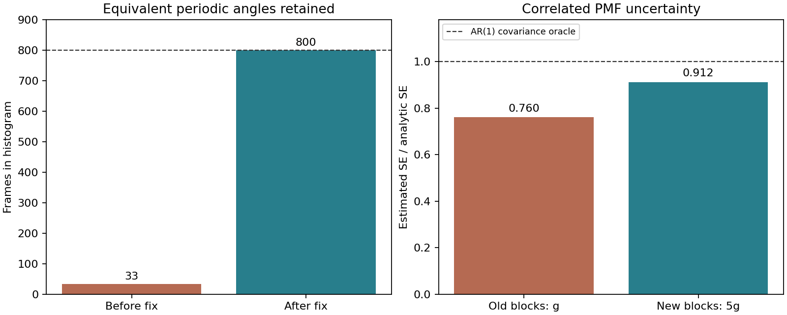
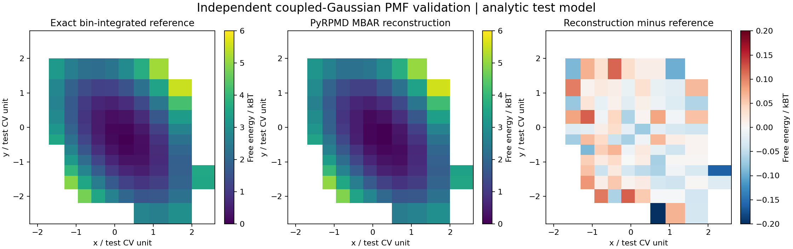
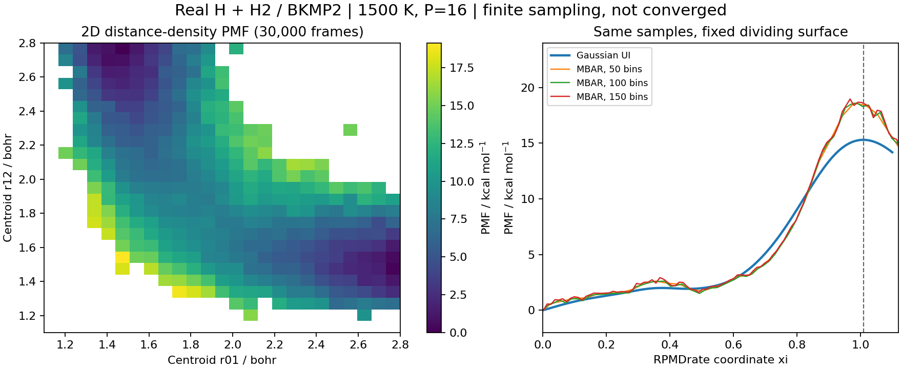

# 一维 / 二维 PMF 数值审查与 H + HO₂ 扫描准备

日期：2026-10-30。审查基线：`af90f20d05368fc910c493977cf29856300b5864`。

**结论：解析分布、独立求解器、真实采样器和真实 H + H₂/BKMP2 回归共同支持本次修复后的数值实现；它们不构成任意分子体系的采样收敛证明。H + HO₂ 的真实二维扫描尚未完成，因为本次未取得适用且可验证的全维反应 PES。**

完成了周期坐标、无效输入、支持 mask、Gaussian UI 尺度不变性和相关样本误差报告的修复。
新增 H + HO₂ 的外部模型接入、二维伞形采样、断点恢复、通道标签和投影连接程序。
真实 H + H₂ 短轨迹的 UI / MBAR 势垒仍相差约 3 kcal/mol；这个未收敛现象被保留并报告。
本目录中没有 H + HO₂ 化学数据或声称真实通道已相连的图。

## 1. 验证范围与结果

最终完整测试：**839 passed、12 skipped、153 subtests passed，0 failed，99.88 s**。结果见 [test-summary.json](evidence/test-summary.json) 和 [pytest-final.txt](evidence/pytest-final.txt)。
可选 ASE、PyTorch 和额外 EAM 势相关测试缺少运行依赖而跳过；跳过不计作通过。
第一次基线测试有两个本地 socket 测试被执行环境禁止创建 socket，允许本地测试通信后两项均通过。
这两项是环境限制，不是 PMF 缺陷。

| 层次 | 实际检查 | 能支持的结论 |
| --- | --- | --- |
| 独立解析 / 数值积分 | 一维谐振子、四次双阱、二维耦合高斯、非均匀及非方形网格 | 指定目标分布下的自由能、归一化、bin 体积和坐标轴顺序一致 |
| 独立实现 | PyMBAR 4.0.3；合成二维样本和 92,000 个真实 H₃ 样本 | 同一有限数据的 MBAR 非线性方程及权重一致 |
| 动力学平衡分布 | NumPy、native kernels、完整 C ABI；P=1/4/16；三种积分器 | 质心偏置的温度 / 珠子数因子、离散平衡协方差和步长误差正确 |
| 真实分子回归 | 源码锁定的 BKMP2；一维和二维 RPMD 轨迹 | PES 接口、实际采样、checkpoint、分析链路运行正确；短样本尚未收敛 |
| H + HO₂ 程序链路 | 带来源校验的明确 synthetic 模型；中断 / 恢复和分类测试 | 扫描程序可运行、数据身份可检查；不验证真实 H + HO₂ 化学 |

核心新增测试：

- [一维 PMF](../../../tests/test_pmf_1d_accuracy.py)：谐振子 UI、双阱 MBAR、相关 bootstrap、径向密度和非线性通量度量。
- [二维 PMF](../../../tests/test_pmf_2d_accuracy.py)：交叉刚度、非均匀网格、周期绕行、缺口、无效输入、独立 PyMBAR 和真实窗口采样。
- [采样器不变分布](../../../tests/test_pmf_sampling_accuracy.py)：离散 Lyapunov 方程与真实传播映射的确定性对照。
- [H + HO₂ 几何 / 路径](../../../tests/test_hho2_channels.py) 和 [扫描完整链路](../../../tests/test_hho2_scan.py)。
- 扩充现有 [H₃ 离线诊断](../../../tests/test_h3_pmf_diagnostics.py) 与 [速率误差汇总](../../../tests/test_surface_uncertainty.py) 回归。

## 2. 确认并修复的问题

| 问题 | 修复前的具体影响 | 修复及证据 |
| --- | --- | --- |
| 周期 CV 在偏置中用了最小镜像，直方图中未统一回绕 | 800 个物理等价角度样本只计入 33 个，总概率质量约 0.04125 | 在直方图原点回绕，默认完整周期，拒绝超过一个周期的范围；修复后计入 800 个，质量约 1；相关性采用 sin/cos |
| 非有限网格 / 科学输入 | NaN / Inf bin 边界能产生 `mask=False` 而自由能为 NaN | 严格检查边界、中心、刚度、周期、beta 和 UI 输入；异常密度进入 mask |
| bootstrap 给原本不受支持的 bin 输出误差 | 只有 4 个样本而 `min_count=5` 的格子仍出现有限 SE | 固定原始支持 mask；该格子 SE=NaN、有效 draw 数=0 |
| 相关 bootstrap 的块偏短，极短流可被整流循环重抽 | 特定 AR(1) 检查低估误差；整条轨迹作为单块可能产生虚假零误差 | 目标块长 `ceil(5g)`，上限 `floor(N/2)`；保存请求值、实际值、cap、块数和状态 |
| 不足以估计误差的数据仍能留下区间 | PMF 状态不可用时，下游速率或离线比较可能保留有限 CI | 统一不可用条件，抑制相应 SE / CI；`limited_blocks` 明示为有限样本诊断 |
| UI 使用有量纲的绝对方差阈值 | 单纯把 CV 单位缩小即可改变合法计算结果 | 移除 `1e-20` 绝对截断；测试 x→10⁻¹²x 的不变性，允许统一标量刚度 |



对于 N<4 或估计 g≥N 的流，误差状态为 `unavailable`；目标块长被截断或不足 20 块时，状态为
`limited_blocks`。后者可保留诊断数值，但不是经过覆盖率验证的置信区间。其余状态
`finite_block_estimate` 也不意味着隐藏自由度已混合，元数据明确记录 `mixing_established=false`。
`5g` 是保守的启发式选择，不能从一次 AR(1) 测试推广为所有体系的覆盖率保证。[1,2]

### 相关误差的定量对照

AR(1) 的 ρ=0.95，N=50,000，500 次 bootstrap；对照值由已知有限 N 协方差和 Gaussian delta method 得到：

| 估计 | 块长 | SE | 相对解析 SE |
| --- | ---: | ---: | ---: |
| 解析对照 | — | 0.0789783 | 1.000 |
| 原方案 | 38 | 0.0600458 | 0.760 |
| 修复方案 | 190 | 0.0720061 | 0.912 |

这个案例中低估从约 24% 降至约 9%；没有声称修复后误差精确无偏。
详细随机种子、g、块计划和适用限制见 [一维证据](evidence/1d-accuracy.json)。

## 3. 一维与二维准确性证据

| 检查 | 数据 / 对照 | 实际结果 |
| --- | --- | --- |
| 一维 Gaussian UI | 精确谐振子窗口均值方差，β=0.3/1.7/7 | 曲线与梯度通过 2×10⁻¹³ Hartree 绝对容差 |
| UI 坐标尺度 | x→10⁻¹²x 并相应变换偏置 | 自由能差通过 3×10⁻¹⁴ Hartree 容差 |
| 一维非谐双阱 MBAR | 62,000 个由独立数值积分构造的分位数样本；8 个不等长 / 不等刚度窗口；独立分区积分 | RMS 0.001875 kBT；最大误差 0.007466 kBT |
| 二维交叉耦合势 | 59,418 个独立高斯样本；12 个不等长窗口；非对角刚度；11×11 非均匀 bins | 84 个支持格子的 RMS 0.05167 kBT |
| 二维非方形网格 | 同一分布，11×13 bins；独立逐格积分 | 97 个支持格子的 RMS 0.05688 kBT，验证 `F[x_bin,y_bin]` 方向 |
| 二维边缘化到一维 | 积分 exp(−βF)，使用正确 bin 宽 | 边缘自由能 RMS 0.01614 kBT |
| 独立 PyMBAR 对照 | 同一二维样本；固定自由能规范 | 窗口自由能最大差 3.55×10⁻¹⁵；目标权重最大差 1.73×10⁻¹⁸ |



这里检验的直方图量是 **bin 平均概率密度**，即 bin 概率除以 bin 的体积；随后计算 −kBT ln p 加任意常数。
不能拿 bin 中心的点势能作为有限 bin 宽下的精确答案。例如双阱点势垒为 1.3 Hartree，而相同 bins
的积分对照为 1.28796755 Hartree，PyRPMD 为 1.28791184 Hartree，差为 5.57×10⁻⁵ Hartree。
这些是数值测试模型的单位和参数，不是某个分子的化学势垒。

三维径向测试验证一般 PMF 保留 r² 测度；非线性 s=x² 通量测试验证反应速率度量中的梯度质量因子及
P=1/3/16 的珠子数缩放。一般二维 PMF 与反应速率专用 flux PMF 的定义不同，不能混用 Jacobian 修正。
数据见 [一维证据](evidence/1d-accuracy.json) 和 [二维证据](evidence/2d-accuracy.json)。

### 实际采样器检查

使用同一个带质心偏置的谐振子，检查 Cayley、normal-mode 和 velocity-Verlet 三种传播器，
覆盖 NumPy、native kernels 和完整 C ABI 的 P=1/4/16。
从实际单步传播矩阵构建离散 Lyapunov 方程，其平衡协方差与预期离散解相对误差小于 2×10⁻¹¹；
相对连续分布的方差偏差小于 4×10⁻⁴，步长减半后按二阶误差缩小。
这 30 项确定性检查避免把偶然的随机轨迹波动当作通过标准。

另用实际 `run_fes → _sample_window → native C ABI` 运行 P=1/4/16 的二维偏置窗口，
每个体系热化 1,200 步、生产 60,000 步、保存 2,000 个质心样本。
质心均值和交叉协方差与解析分布一致到这批有限样本的测试容差。
没有把谐振子检查当作反应体系 bead convergence。

## 4. 真实 H + H₂ / BKMP2 回归

这是实际运行的补充物理回归，**不是 H + HO₂ 的替代反应**。
BKMP2 源码取自锁定提交，SHA256 为 `6fa37803d0d1db4f43e5bc4bfccd5e26585f01116dae9dc4f6d0d28d5d71d237`。
原作者测试点能量误差不超过 3.13×10⁻¹⁰ Hartree；梯度、有限差分力、平移旋转和置换不变性检查通过。
完整来源、编译参数和验证见 [PES 检查](evidence/bkmp2-pes-check.json) 及原论文。[3]

共同参数是 1500 K、P=16、Δt=0.1 fs，Cayley / Andersen。

| 计算 | 轨迹和支持 | 结果与限制 |
| --- | --- | --- |
| 二维 `r01,r12` PMF | 25 个中心×2 重复；30,000 样本；373/625 bins 支持 | overlap 连通，50 条流与 checkpoint 完全一致；镜面对称差 RMS 0.296 kBT |
| 一维反应坐标 PMF | 23 个中心×2 重复；92,000 样本 | overlap 连通，46 条流与 checkpoint 完全一致；最差流只有约 5.17 个估计独立样本 |
| 全样本独立求解 | 46 条流、92,000 样本，不抽稀 | PyMBAR 自由能差 2.11×10⁻¹⁵，目标权重差 5.20×10⁻¹⁸ |



同一批样本、同一固定分界面 ξ*=1.00925，势垒为：

| 估计器 | 势垒 / kcal mol⁻¹ |
| --- | ---: |
| Gaussian UI | 15.3032 |
| MBAR，50 bins | 18.4408 |
| MBAR，100 bins | 18.3085 |
| MBAR，150 bins | 18.5820 |

MBAR 方程求解已经与独立实现对齐到浮点精度；因此约 3.0–3.3 kcal/mol 的 UI / MBAR 差异不能归因于
这批数据上的 MBAR 数值求解误差。Gaussian UI 的窗口正态近似、短轨迹、非高斯窗口和隐藏混合仍需进一步区分。
这既不证明 UI 的化学结果准确，也不证明这次有限样本的 MBAR 就是真实收敛 PMF。
两条真实回归均明确输出 `converged=false`；bootstrap 为 `limited_blocks`。

为验证现有完整工作流还实际运行了 64 个 parent configurations、128 对 child trajectories，
但短时间 κ 和速率不是本次可用于文献比较的收敛成果。报告不把它们提升为化学结论。

证据：[二维真实回归](evidence/h3-fes2d-benchmark.json)、[一维 / UI–MBAR 诊断](evidence/h3-rate-summary.json)、
[全样本 PyMBAR 检查](evidence/h3-solver-check.json)。归档中的运行时间属于相应调用，恢复后的分析调用不能当作从头采样性能。

## 5. H + HO₂：已实现什么，还缺什么

实现及完整命令见 [H + HO₂ README](../../../benchmarks/hho2/README.md)。
本次核对了项目仓库、ChemPotPy / POTLIB 的 H₂O₂ 条目、CQPES Model-Zoo、PIPPy 示例及相关论文入口，
**未取得本次可使用的适用全局反应 PES 代码与参数**。部分出版商附件访问返回 403。
这不等于断言模型在任何地方都不可获得。现成的 H₂O₂ 局部振转势不能因为原子组成相同就替代多通道反应势。
已核对的相关全维反应研究见 [4–6]。

### 扫描和投影定义

- 原子顺序固定 HHOO；明确 singlet / triplet 电子态，模型入口和参数文件校验 SHA256。
- CV 是原子质心距离 `(r_HH, r_OO)`，目标是相对于 `dr_HH dr_OO` 的密度 PMF。
- 仅这两个内部距离无法限制 H₂ 与 O₂ 片段间距。所有窗口共用、每个珠子施加六对原子的平底距离墙，默认 6 Å、20 kcal mol⁻¹ Å⁻²；墙保留在目标 Hamiltonian 中。
- 从反应物、H 身份交换、H₂+O₂、OH+OH、H₂O+O 五种几何族分别启动；保存完整质心几何、裸 PES 能、墙能和 ring spread。
- 全部六个键长用于通道标签；灰区保留为 ambiguous。重建使用 overlap、原始计数和权重 ESS 支持检查；缺口不插值。
- 路径层将两种 H 身份入口合并为 `H+HO2`，产物各自保留；基于受支持且通道比例 ≥80% 的格子选盆地，用四邻接 minimax 路径比较投影连接。

H 标签互换后 `(r_HH,r_OO)` 严格不变。在置换对称且充分混合的体系中，两种身份入口在每个 bin 的概率相等，
单独要求各自 ≥80% 会系统性漏掉入口，所以只在盆地 / 路径层合并；原始标签比例仍保留。
二维图无法解析 H 交换路径；合并入口到产物的投影路径也不证明高维反应路径相通。
某通道没有足够纯的盆地格子不能解释为该通道不存在；较大的权重 ESS 或 CV 有效样本数也不能排除正交慢模。

完整链路使用明确标为非反应 synthetic 的临时模型测试：P=2，4 步热化+16 步生产，保存 8 个样本。
第 11 步故障后从第 10 步 checkpoint 恢复，q/p、RNG、时间、CV、质心、两类能量和 ring spread 与不中断运行逐位相同。
这类测试只验证机械和数据完整性。证据见 [扫描程序审查](evidence/hho2-scan-audit.json)。

### 规模与运行前置条件

默认 pilot 是经典 P=1、1500 K、110 中心×5 起始族=550 条流，预计 1,100,000 个保存样本。
当前实现单个稠密 reduced-potential 矩阵的下界约 **4.84 GB**，峰值更高；extended 的相同下界约 **233.93 GB**。
这些来自计划维度，不是实际 H + HO₂ 运行的内存测量。[计划证据](evidence/hho2-pilot-plan.json)

下一步需要提供实际全维反应 PES 的源码 / 编译库及完整参数或权重，注明论文、版本、原子顺序和电子态。
取得后先验证原作者参考值、梯度和产物渐近区，再做小规模扫描，随后根据实际 overlap / 隐变量滞后调整窗口和资源。
物理结论还需要 P、步长、墙半径、采样时间、独立起始族和标签阈值的收敛检查。
单一 triplet PMF 不自动包含 singlet 动力学；平衡盆地占比也不能直接给出碰撞产物分支比。[4–6]

## 6. 复现

本次环境：Python 3.12.14、NumPy 2.3.5、SciPy 1.17.0、PyMBAR 4.0.3、pytest 9.2.0；
native C++ / OpenMP 与 GNU Fortran 13.3。测试需能使用本地 socket；optional ASE / PyTorch / EAM 不在本次安装范围。

```bash
python -m venv --system-site-packages .venv
.venv/bin/pip install -e . pytest==9.2.0 pymbar==4.0.3 h5py

# 下载锁定版本的真实 H3 PES 并编译；网络和 Fortran 编译器需可用。
.venv/bin/python benchmarks/h3/build_pes.py
.venv/bin/python benchmarks/h3/pes.py --check --output runs/pmf-recheck-pes.json

# 完整测试；-ra 显示被跳过的可选依赖。
OPENBLAS_NUM_THREADS=1 OMP_NUM_THREADS=1 \
  .venv/bin/python -m pytest -q -ra --junitxml=runs/pmf-recheck-tests.xml

# 真实 H3 回归；仍属于短轨迹配置。
OPENBLAS_NUM_THREADS=1 OMP_NUM_THREADS=1 \
  .venv/bin/python benchmarks/h3/rpmd.py --stage fes2d --workers 2 --output runs/pmf-h3-fes2d
OPENBLAS_NUM_THREADS=1 OMP_NUM_THREADS=1 \
  .venv/bin/python benchmarks/h3/rpmd.py --stage rate --workers 2 --output runs/pmf-h3-rate
OPENBLAS_NUM_THREADS=1 OMP_NUM_THREADS=1 \
  .venv/bin/python benchmarks/h3/solver_check.py --run runs/pmf-h3-rate/run \
  --stride 1 --reference-pymbar --output runs/pmf-h3-solver.json

# 从本目录归档的实际数值重绘三张图，无须重跑轨迹。
.venv/bin/python benchmarks/pmf_accuracy/render_validation.py \
  --data docs/validation/pmf-accuracy-2026-10-30/evidence \
  --output runs/pmf-validation-figures

# 无 PES 时只产生计划；run 必须额外提供真实模型清单。
.venv/bin/python benchmarks/hho2/scan.py plan --profile pilot --output runs/hho2-new-plan
```

`evidence/plot-data.json` 保存实际绘图数值，其他 JSON 保存对应指标和来源；原始大型轨迹没有纳入 Git。
H₃ 源码按现有项目机制在 build 时下载，本次没有重新分发第三方 PES。
随机测试固定种子；跨编译器和平台允许浮点差异，测试容差和物理误差应分别解释。

## 参考文献

1. Shirts, M. R.; Chodera, J. D. “Statistically optimal analysis of samples from multiple equilibrium states.”
   *J. Chem. Phys.* **2008**, 129, 124105. [DOI](https://doi.org/10.1063/1.2978177)；[作者原稿](https://arxiv.org/abs/0801.1426)。
2. Zhu, F.; Hummer, G. “Convergence and error estimation in free energy calculations using the weighted histogram analysis method.”
   *J. Comput. Chem.* **2012**, 33(4), 453–465. [DOI](https://doi.org/10.1002/jcc.21989)。
3. Boothroyd, A. I.; Keogh, W. J.; Martin, P. G.; Peterson, M. R. “A refined H₃ potential energy surface.”
   *J. Chem. Phys.* **1996**, 104, 7139–7152. [DOI](https://doi.org/10.1063/1.471430)。
4. Li, Jia; Li, Jun. “A Full-Dimensional Potential Energy Surface and Dynamics of the Multichannel Reaction between H and HO₂.”
   *J. Phys. Chem. A* **2021**, 125(7), 1540–1552. [DOI](https://doi.org/10.1021/acs.jpca.0c11213)。
5. Li, J.; Dawes, R.; Guo, H. “An accurate multi-channel multi-reference full-dimensional global potential energy surface for the lowest triplet state of H₂O₂.”
   *Phys. Chem. Chem. Phys.* **2016**, 18(43), 29825–29835. [DOI](https://doi.org/10.1039/C6CP06232F)。
6. Jasper, A. W.; Moberg, D. R.; Tao, Y.; Klippenstein, S. J.; Sivaramakrishnan, R.
   “Inefficient intramolecular vibrational energy redistribution for the H + HO₂ reaction and negative internal energy dependence for its rate constant.”
   *Front. Phys.* **2022**, 10, 1003010. [DOI](https://doi.org/10.3389/fphy.2022.1003010)。
