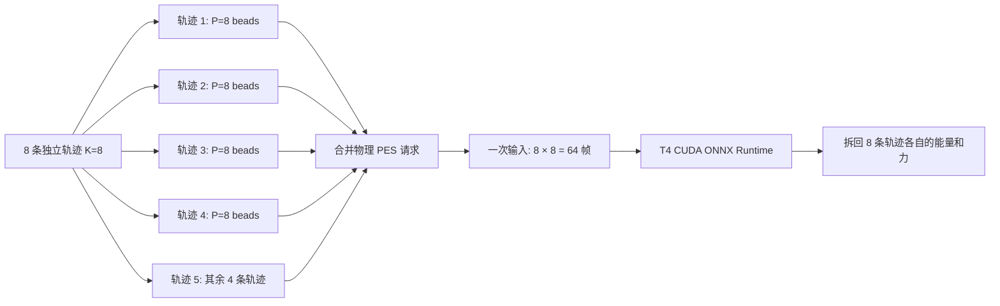
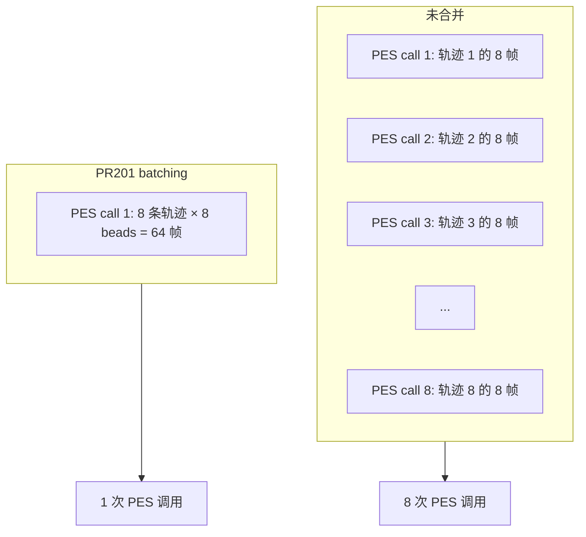
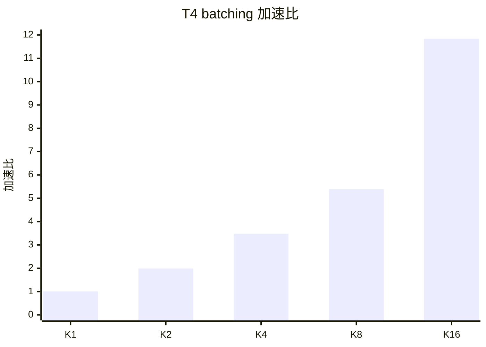

# PR201 Colab T4 可视化报告

## K=8、P=8 是什么

- `K`：同时推进的独立轨迹数量。这里 `K=8` 表示 8 条独立轨迹。
- `P`：每条轨迹的 ring-polymer beads 数量。这里 `P=8` 表示每条轨迹有 8 个 beads。
- 每条轨迹的物理势能输入形状是 `[P,N,3]`。
- 跨轨迹 batching 后，8 条轨迹会合并成一个 `[K*P,N,3] = [64,N,3]` 请求。
- `N=3` 是本次测试模型的原子数，最后一个维度 `3` 是笛卡尔坐标 `x,y,z`。

## batching 前后

每条轨迹的积分器状态、随机数、时钟和 checkpoint 仍然独立；PR201 只合并物理势能请求的帧维度，不会把不同轨迹的 beads 连接成一条更大的 ring polymer。

## T4 测得的效率

测试模型为 3 原子 float64 ONNX harmonic contract model，使用 `cuda:0` 和 `allow_cpu_fallback=false`。

| 独立轨迹 K | beads P | 未合并 PES 调用 | 合并 PES 调用 | 未合并耗时 | 合并耗时 | 加速 |
|---:|---:|---:|---:|---:|---:|---:|
| 1 | 8 | 1 | 1 | 0.199 ms | 0.196 ms | 1.01x |
| 2 | 8 | 2 | 1 | 0.402 ms | 0.202 ms | 1.99x |
| 4 | 8 | 4 | 1 | 0.757 ms | 0.217 ms | 3.48x |
| 8 | 8 | 8 | 1 | 1.644 ms | 0.305 ms | 5.39x |
| 16 | 8 | 16 | 1 | 3.280 ms | 0.277 ms | 11.84x |

## 正确性结果

| 检查项 | 结果 |
|---|---|
| GPU 与 CPU 能量最大误差 | `2.17e-19 hartree` |
| GPU 与 CPU 力最大误差 | `0` |
| GPU 与解析力最大误差 | `4.34e-19 hartree/bohr` |
| 跨轨迹 `K=8,P=8` | 64 帧合并为 1 次调用，通过 |
| 失败帧 | 0 |
| PyRPMD ONNX/native 回归测试 | 60 passed, 1 skipped |

## 真实 JaxPIP 模型的限制

真实 JaxPIP linear 和 neural-network 导出模型在 CPU 原生 C ABI 路径通过了 batch、有限差分和 native/python propagation 对比。但在当前 Colab T4 与 ONNX Runtime 1.24.1 环境中，GPU 执行遇到 float64 `ScatterND` provider kernel 不支持：

- `allow_cpu_fallback=false`：初始化阶段显式拒绝未完全分配到 CUDA 的图。
- `allow_cpu_fallback=true`：执行时仍因 `ScatterND element_type 11 not implemented` 失败。

因此上面的加速数字用于验证 PR201 的 GPU batching 调度和调用效率；它们不代表当前真实 JaxPIP 化学模型已经可以在 T4 上生产运行。

详细原始数据见 [`gpu-harmonic-report.json`](gpu-harmonic-report.json) 和 [`jaxpip-cpu-report.json`](jaxpip-cpu-report.json)。
