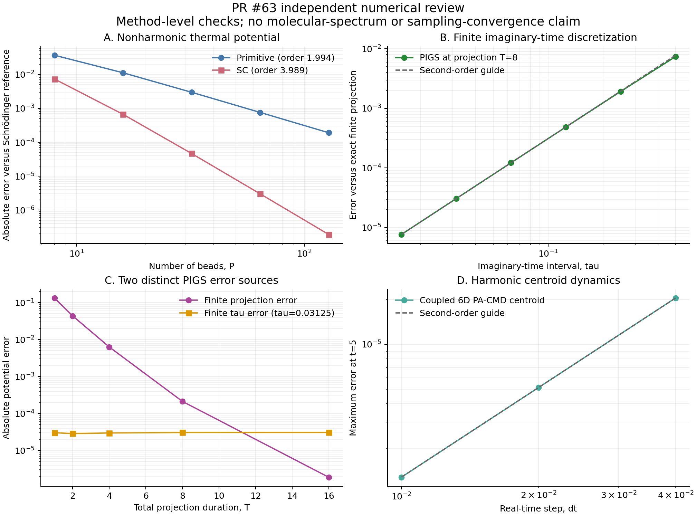

# PR #63 独立审阅、修复与论文对照实验

审阅日期：2026-11-01。仓库：`chen-yu-hao/PyRPMD`。
固定审阅提交：`3faac3aa42b5424b2711367608e0138c82f62e0a`；
原 PR：[Extend Tier 2 methods](https://github.com/chen-yu-hao/PyRPMD/pull/63)。

**结论：原提交存在需要修正的结果身份、原始数据保存和组合势契约问题。
本次补丁修复这些问题，并增加独立数值对照；这些证据支持限定实现，
不支持把本 PR 验收为完整的 i-PI / DL_POLY Quantum 方法覆盖或真实体系精度保证。**

这里的实验是本次审阅实际执行的新计算。原 PR 的
`tier2-literature-2026-11-01`、4,608 条 Tully 轨迹、Müller 长轨迹及
既有全量测试记录没有改名为本次复现。完整参数、随机种子、运行版本、
源码哈希和原始输出保留在下列分项报告及 JSON/CSV/NPZ 中。

## 1. 审阅发现与修复

### P1：光谱重新分析可以把旧轨迹解释成另一温度、方法或体系

原 `reanalyze_spectroscopy` 只检查采样时间间隔、数组形状和有限值。
调用者改变 beta、珠数、质量、PA-CMD 内模频率，或者将 PA-CMD 改为
TRPMD，只要保持相同帧数和时间间隔，就能用旧数据生成新标签。
公共 `analyze_run(..., recompute=True)` 从保存的 `resolved.json` 读取配置，
同样没有阻止这种不一致。

实际反例：对同一谐振子轨迹将 beta 从 3.1 改为 6.2，旧实现接受更改，
`unnormalized_relative_ir` 的每个非零频点恰好放大 **2 倍**。
这里比较的是输出的 IR 强度，而不是未乘 beta 的原始功率谱。
这不是升温/降温后的新采样，也不是合法的温度重加权。

修复使用 `PyRPMD.spectroscopy-traces.v2`：轨迹文件保存真实运行的物理参数、
系统、原模型配置和源文件哈希；重新分析核对温度、方法、珠数、质量、
时间步、热化与生产预算等身份。窗函数、归一化、极化分量和待分析的谱种类
可以调整，PES/性质模型可以不再安装；结果仍明确保留原始模型来源。

旧 v1 轨迹没有温度/系统身份，不能凭数组形状补认证。可在原模型文件和
原配置不变时从身份匹配的完成 checkpoints 恢复，重建 v2 轨迹；完成的
副本不重新调用势能或传播。该路径已独立验证。

### P1：选择只重新分析 IR 会删除原始极化率

旧分析函数重写 `spectroscopy-traces.npz`，仅写入本次选中的性质。
先保存 dipole 和 polarizability，再只做 IR 分析，会使极化率消失，
无法随后用同一文件重新计算 Raman/SFG。

修复后，离线重新分析只更新派生光谱，原始轨迹文件保持**逐字节不变**，
包括本次未使用的性质。失败的身份校验也不会改写任何结果。

原始/修复后反例：
[`spectroscopy-identity-before.json`](spectroscopy-identity-before.json)、
[`spectroscopy-identity-after.json`](spectroscopy-identity-after.json)。
驱动：[`spectroscopy_identity.py`](spectroscopy_identity.py)。

### P1：committee / delta / RPC 组合可隐藏动态 Hamiltonian

构造组合势的 `_component` 原来没有完整检查对象属性、metadata、capabilities
中的 `time_dependent`、`history_dependent` 和 `stateful` 标记。
外层重新生成 metadata 后，带历史依赖的子势会表现为静态势，破坏同一几何
的缓存含义，并绕过 replica exchange 的固定目标分布要求。

修复包含两道检查：构造组合势时拒绝已声明的动态成员；交换时递归检查
已知的 committee、delta、difference、split、Python 和 bias 包装器，
包括构造后改变状态标记的借用成员，并检测循环组合。
检查同时覆盖 step-cache；先检测组合循环再读取转发属性，并在第一步 MD
前检查所有副本，避免提供者的外部历史已被改变后才拒绝交换。
这些检查在计算接受概率前执行，避免以不属于同一个静态 Hamiltonian
的四次能量计算构造 Metropolis 比值。

它们验证的是用户提供的契约声明，不能证明未声明状态依赖的任意 Python
回调真正确定。详见[非绝热/ML 报告](nonadiabatic_ml_report.md)与
[增强采样报告](sampling_review.md)。

### P2：非绝热速率输入静默丢弃 NumPy 复数的虚部

`nonadiabatic_rate._positive` 原先把 NumPy 复数归入 `np.number`，随后
`float(np.complex128(2+3j))` 产生警告并得到 2.0。Python mapping 和可信
`build()` 输入均可触发，影响 beta、时间步、proposal 和速率阈值。

修复在转换和构造 provider 前拒绝复数，包括虚部为零的复数标量。
这与复数电子波函数/NAC 的合法支持是不同输入层，后者保留。

## 2. 新执行的数值与文献对照

| 对象 | 独立参考与实际执行 | 结果 | 能支持的结论 |
| --- | --- | --- | --- |
| 非谐 Suzuki–Chin | Cao–Voth 1994 式 (5.1) 势；80/160 态 Schrödinger 基组和独立坐标网格；实际生产 SC 作用量构造转移矩阵 | P=128 势能误差 1.8923e−7，收敛阶 3.9890；primitive 误差 1.9120e−4，阶数 1.9941 | 非谐作用量恢复四阶收敛 |
| SC 耦合力 | 两原子、不同质量、六维非对角 Hessian；alpha=0、0.37、1 | 最大力误差 4.29e−12 | 力与文献修正项一致 |
| 玻色交换 | 独立显式弹簧和原始三次复杂度递推；36 组 P/N/beta | 最大相对力误差 3.69e−13 | 二次递推与原算法数值一致；未重新认证大 N 耗时标度 |
| 非谐 PIGS | 独立有限投影波函数及开链转移矩阵；分别扫描投影时长与时间片 | 时间片收敛阶 1.999764，作用量误差 1.43e−14 | primitive 二阶误差与投影误差可区分 |
| PA-CMD | 六维耦合谐振体系、不同质量，解析质心轨迹 | dt=.04/.02/.01，误差 2.0469e−5 / 5.1164e−6 / 1.2790e−6，阶数 2.00006 | 耦合谐振极限中的质心传播正确 |
| Raman / SFG | 全局张量旋转、精确余弦关联的因果 Fourier 积分、界面翻转 | Raman 相对误差 1.75e−16；SFG 复响应相对 L2 误差 1.55e−4 | 张量和因果响应约定得到检查 |
| CV | 16 组完整 ring Jacobian、四阶中心有限差分及平移/旋转检查 | 最大导数误差 1.263e−10 | 新 CV 的导数链正确 |
| OPES metad/explore | 四种固定/自适应组合；独立周期 Gaussian KDE、归一化和权重计算 | 最大能量/梯度误差 1.665e−15 / 1.443e−15 | 实现符合其声明的 KDE/Welford 参考规则 |
| 温度/Hamiltonian 交换 | P=1/2/8/32 的 8 组有限珠谐振约化势、详细平衡与动量缩放的代数对照 | log 接受率误差至多 1.705e−13 | 交换使用目标温度的 ring 弹簧作用量；不是独立平衡采样实验 |
| 共享 MetaD | 4 个 walkers、2 个同步批次 | hills 高度差 0 | 同批次 walkers 使用同一更新前历史 |
| 偏置时钟/删失速率 | 独立分段精确积分；40,000 个预先指定种子的删失指数样本 | 已知速率 .7，估计 .705083，渐近 95% 半宽 .008659 | 时钟与删失似然成立；不是分子动力学速率复现 |
| 三态 QD | P=1/4，12 组实/复相位变化，与同一物理映射变量的固定 diabatic 表示比较 | 映射变量最大误差 2.23e−14 | 完整保留电子空间的表示/相位协变性 |
| 电子传播 | 独立 DOP853 参考和五级时间步 | 误差阶 2.00004–2.00261 | 光滑指定核路径上的电子二阶传播 |
| MASH 单跃迁 | 恒定绝热能量、恒定 NAC、解析事件时刻；六级时间步 | 轨迹坐标误差阶 **1.0000**；能量误差同时为 0 | 当前 endpoint 处理只有一阶跃迁时间误差 |
| delta/RPC | 九组非线性 P/Pc，整个 contracted 能量的独立差分 | 力误差至多 2.02e−10 | contracted 力是其 Hamiltonian 的导数，不等于 Pc<P 已物理收敛 |
| 真实 TorchScript 生命周期 | 新训练 4 个网络，每个 600 步；序列化、50 步传播、监控、候选收集 | 轨迹逐位不变，10 个未标注候选；学习到的 RPC 力差分误差 5.35e−11 | 实际运行接口和数据语义正确；没有执行参考标注与再训练闭环 |

分项报告包含完整表格、公式来源、误差定义、参数与复现命令：

- [路径积分与光谱](pi_spectroscopy_report.md)
- [增强采样、交换与 RETIS](sampling_review.md)
- [非绝热、MASH 与 ML 生命周期](nonadiabatic_ml_report.md)



## 3. 必须保留的负面与未收敛结果

**文献数值不一致没有通过调参数抹去。** Cao–Voth 1994 式 (5.1) 明示
`V=x²/2+0.10x³+0.01x⁴, m=hbar=1, beta=10`。独立基组解给出
基频 0.959315581557904，坐标网格 Richardson 外推给出
0.959315581535468，均对应约 4.06844% 红移；原文相邻文字写 6%。
保留该差异，未宣称复现其动量关联图。

**PIGS 的两个误差可以抵消。** 固定 tau=.03125，T=16 时投影误差约
+1.88e−6，时间片误差仍约 −3.06e−5。仅比较最终数值与基态的距离
会遗漏这种误差结构。

**MASH 能量守恒不足以认证跃迁精度。** 本次解析反例中
`|x_endpoint−x_event|=(1−sqrt(.4))*dt/2`，严格是一阶。
这与当前文档声明的 endpoint 实现相符；没有把它描述成文献中已有的
事件定位、时间可逆积分器。

**ML disagreement 不是误差上界。** 两个同样错误的 committee 成员
可以给出零分歧，同时真实力误差为 .96 hartree/bohr。
新训练网络在训练区内的力 RMSE 为 .0480，区外达到 1.5535 hartree/bohr。
接口通过不代表模型外推可靠。

**RETIS 仅验证正界面系综。** 最终实验预先固定为 4 个种子、两个时间步
dt=.04/.02，各 300 个 burn-in + 1,200 个生产 sweeps；每 sweep 三次 shooting。
原始每 sweep crossing 指示量、路径长度和 replica 标签保留，未保存每次
proposal 的全部 Cartesian 帧。600-sweep pilot 与最终预算分开保存。
独立连续一维模型的正系综 crossing-product 参考为 .3225426188515；
两个时间步的乘积分别为 **.33101779 ± .06280297**、**.32720264 ± .03995400**
（四种子的点态 95% Student-t 半宽），都覆盖连续参考。
但 dt=.02 的最后一个条件概率为 **.91479167 ± .00921082**，参考值
**.90310180** 位于区间下方。配对时间步乘积差为 **−.00381515 ± .07090343**，
仍不能认证时间步收敛。这项偏差保留，未通过增加预算或选择种子使其消失。
统计区间和有限路径上限见分项报告。
没有计算通量或绝对速率，也没有认证路径上限收敛。

## 4. Tier 2 覆盖验收

| 用户目标 | 当前已具备 | 仍不能按完成验收的部分 |
| --- | --- | --- |
| PA-CMD、f-CMD、QCMD/h-CMD | PA-CMD；温度标记的二次 Cartesian centroid PMF；通用 IBI helper | 完整 QCMD/h-CMD/f-QCMD、分子重构与约束传播缺失；二次拟合不是一般分子 f-CMD 生产模型 |
| Raman、SFG、ML 性质接口 | 相对谱、因果复 SFG、Python/TorchScript 属性 | 缺实际液体/界面光谱复现、绝对光学/Fresnel 因子与体系收敛 |
| SC、bosons、PIGS 进入主引擎 | 力、主工作流和限定观测量 | 缺完整总能/压力估计器、玻色周期 winding、PIGS/exchange 组合与相互作用体系复现 |
| CV、PLUMED、shared MetaD、OPES | 额外 CV、输入 PLUMED、串行同步 walkers、参考 adaptive/explore | Welford 宽度不等于 PLUMED diffusion-window；未建立一般分布式共享历史工作流 |
| Replica exchange、偏置动力学、RETIS | Python 交换 API、经过审计的时钟分析、正 RETIS 系综 | 无完整交换持久化/并行入口、原生 flooding 排除区生成器、RETIS minus 通量系综 |
| On-the-fly RPSH/NRPMD、MASH、速率 CLI | 直接绝热数据及相位传输、两态 endpoint MASH、独立 diabatic 热速率 CLI | 缺真实量化程序端到端对照、波函数可移植恢复、完整 P>1 验证、事件定位/多态 MASH、on-the-fly 热 QD 速率 |
| ML 生命周期与 delta/RPC | 实际 committee 监控、未标注数据收集、additive delta/RPC | 无参考标注与重训闭环；不确定度未校准；Pc<P 需要独立收敛 |

上述缺口多数在原 PR 中已诚实声明，不能把它们列成新的隐蔽实现错误；
但它们仍然是用户给定完整 Tier 2 目标的验收缺口。
例如 DL_POLY Quantum 2.1 原文明确包含 f-QCMD/h-CMD 的实际水、冰及电解液
光谱应用；PyRPMD 的二次 Cartesian 拟合与单个 IBI helper 不等价。

## 5. 软件验证与可复现性

| 检查 | 结果与执行范围 |
| --- | --- |
| 完整仓库套件，首批修复且冻结源码 | **4,822 passed、110 skipped、357 subtests passed；0 failures/errors**，801.64 秒 |
| 源码一致性 | 365 个生产/测试/native 源文件运行前后 SHA-256 相同 |
| 运行环境 | Python 3.12.14、NumPy 2.3.5、SciPy 1.17.0、CPU Torch 2.15.0+cpu、ASE 3.29.0、h5py 3.16.0、mpi4py 4.1.2；native C++/OpenMP 实际可用 |
| 最终新增回归 | **136 passed**，零失败、零跳过；覆盖全部最终守卫修改 |
| 最终定向批次 | **346 passed、3 subtests passed**；唯一失败为沙箱禁止创建 socket；该单项在允许本地通信的环境中单独复验 **1 passed** |
| 真实 MPI OPES | **4 ranks，2 个轨迹组 × 2 个 bead ranks**；39 个数组与串行逐项精确一致，完成 checkpoint 恢复和离线分析通过；没有声称自由能收敛 |
| 文档 | 英文/中文 Sphinx `-W --keep-going` 均成功；首次英文构建的报告交叉链接警告已修正，初始日志保留 |
| 分发 | wheel/sdist 构建及独立安装验证见 `package-verification.json` 与 `package-build.log`；具体结果由该实际执行记录给出 |

完整套件在最后的缓存包装器/MD 前置检查补充之前执行；末轮改动另有最终源码
定向回归记录，不把前一次完整运行改标成另一份源码的结果。110 项跳过包括
真实 PLUMED、PySCF/tblite、来源固定但未构建的 BrHCl/BKMP2/Caracal、JaxPIP
及其他可选参考；跳过项不是通过。20 条警告保留在日志中。
本次没有重新运行原 PR 的真实 PLUMED 对照，也不把仓库中旧 PLUMED 报告算入
本轮实验。GitHub Actions 状态与这些本地结果分别记录。

新回归在原始提交和修复提交上使用同一解释器执行。
初始 123 个新参数化测试在原始代码上有 **107 failed、16 passed**；
其中通过项是既有拒绝行为和静态模型的对照，并不将所有新测试都算成新缺陷。
最后新增 13 项边界回归后，三个互不重叠的新测试文件合计 **136 项**：
原始提交分别为 9 failed、52 failed/15 passed、59 failed/1 passed，
合计 **120 failed、16 passed**；最终修复版本 **136 passed**。
分组数、最后定向测试和完整套件有重叠，不能相加为独立测试总数。

`full-suite-source-manifest.json` 记录测试开始时的生产/测试/native 源文件，
`full-suite-result.json` 核对运行前后哈希，并记录命令、版本和返回码；
完整日志和 JUnit 未只保留最后一行。原始反例失败日志是预期证据，
不与修复后测试结果混淆。
`final-focused-sandbox.log` 保留末轮定向测试的原始权限失败，
`final-socket.log` 保留该项复验；没有把两次执行合写为一次全通过。

最小复现命令：

```bash
python -m pip install -e '.[test,ase,mpi]'
python -m pip install torch --index-url https://download.pytorch.org/whl/cpu
OPENBLAS_NUM_THREADS=1 OMP_NUM_THREADS=1 PYTHONPATH=src \
  python -m pytest -q tests/test_spectroscopy_trace_identity.py \
  tests/test_replica_exchange_composition_review.py tests/test_tier2_nonadiabatic_ml_review.py
OPENBLAS_NUM_THREADS=1 PYTHONPATH=src \
  python docs/validation/pr63-independent-review/pi_spectroscopy.py
OPENBLAS_NUM_THREADS=1 PYTHONPATH=src \
  python docs/validation/pr63-independent-review/nonadiabatic_ml_experiments.py
OPENBLAS_NUM_THREADS=1 PYTHONPATH=src \
  python docs/validation/pr63-independent-review/nonadiabatic_ml_torch.py
python docs/validation/pr63-independent-review/run_full_suite.py
```

采样驱动的最终两个固定预算命令见 `sampling_review.md`。重新执行会写对应
结果文件；先保留本次原始结果，或在独立工作副本执行，以区分新旧执行身份。

## 6. 主要一手文献

- Kapil, Behler, Ceriotti, *High Order Path Integrals Made Easy*,
  [10.1063/1.4971438](https://doi.org/10.1063/1.4971438)。
- Feldman, Hirshberg, *Quadratic Scaling Bosonic Path Integral Molecular Dynamics*,
  [10.1063/5.0173749](https://doi.org/10.1063/5.0173749)。
- Cao, Voth, JCP 101, 6157 (1994),
  [原文](https://web.mit.edu/jianshucaogroup/pdfdir/JCP101-6157-1994.pdf)。
- Sarsa, Schmidt, Magro, PIGS,
  [10.1063/1.481926](https://doi.org/10.1063/1.481926)。
- Mandal, Yamijala, Huo, QD propagation,
  [10.1021/acs.jctc.7b01178](https://doi.org/10.1021/acs.jctc.7b01178)。
- Mannouch, Richardson, MASH,
  [10.1063/5.0139734](https://doi.org/10.1063/5.0139734)；Geuther 等的可逆积分实现，
  [10.1021/acs.jctc.4c01684](https://doi.org/10.1021/acs.jctc.4c01684)。
- PLUMED 2.9 的 [OPES_METAD 文档](https://www.plumed.org/doc-v2.9/user-doc/html/_o_p_e_s__m_e_t_a_d.html)，
  区分 adaptive diffusion window、EXCLUDED_REGION 和当前参考实现。
- PyRETIS 作者的 [TIS/RETIS 推导](https://pyretis.org/dev/user/intro.html)，
  区分 crossing probability 与 plus/minus 系综通量。
- i-PI 3.0，[10.1063/5.0215869](https://doi.org/10.1063/5.0215869)；
  DL_POLY Quantum 2.1，[10.1021/acs.jpca.4c08644](https://doi.org/10.1021/acs.jpca.4c08644)。

各分项报告包含更细的方程对应、参数选择及文献与本实现的差异。
