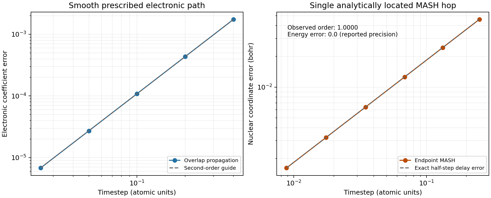

# Independent nonadiabatic and ML lifecycle review

Reviewed PR #63 at commit `3faac3aa42b5424b2711367608e0138c82f62e0a`.
This report records **new experiments executed during the independent review**.
It does not relabel the PR's earlier Tully scattering study or its earlier
trained-model results as newly reproduced evidence.

## Findings and corrections

### P1: composition could hide a declared dynamic Hamiltonian

The new committee and delta providers use `potentials.contraction._component`
to require independent, deterministic physical configurations. Before this
review, that helper checked only the `stateful` key in metadata/capabilities.
It missed `time_dependent`, `history_dependent`, and object attributes. The
resulting wrapper published fresh metadata without those declarations.

This is consequential for both scientific sampling and cached predictions.
A provider whose energy increments on each evaluation, explicitly marked
`time_dependent=True`, was accepted inside a committee. At the same geometry,
`evaluate` returned energy 1, `uncertainty_at` returned the cached energy 1,
and the next actual `evaluate` returned energy 2. The direct provider was
recognizable as dynamic to replica exchange; the committee wrapper was not.
A delta wrapper likewise produced successive energies 2, 4 and 6 while
passing the static-Hamiltonian check. Four replica-exchange energy evaluations
cannot define the required fixed target distributions in this situation.

The correction rejects all three declarations in attributes, metadata and
capabilities at composition time, before evaluating a member. It also checks
the underlying object of `PythonPotential`, including plain callable
callbacks. Static callbacks remain accepted. A companion sampling review
adds recursive runtime checks for known wrappers, so changing a borrowed
member's declaration after construction cannot evade exchange validation.

This guard recognizes declarations; it cannot establish that arbitrary
unannotated user code is physically deterministic.

### P2: trusted-Python thermal-rate controls silently lost imaginary parts

`workflows.nonadiabatic_rate._positive` accepted NumPy complex scalars because
they are `np.number`. Converting `np.complex128(2+3j)` or
`np.complex64(2+3j)` to a float produced `2.0` with a `ComplexWarning`.
The CLI accepts trusted Python `build()` inputs, and the workflow also accepts
Python mappings, so this is an accessible input route rather than an invalid
JSON-only case. It affected beta, timestep, proposal scales and positive rate
controls.

Complex values now raise `ValueError` before conversion or provider creation,
including complex values with zero imaginary part. Six input positions,
NumPy complex64/complex128 and Python complex values are covered explicitly.

### Regressions distinguish failure from existing coverage

The 67 new parameterized tests were run against the unmodified PR commit and
against the corrections with the same interpreter:

| Source | Result |
| --- | --- |
| Original PR source | **52 failed, 15 passed**, 18 expected complex-cast warnings |
| Corrected source | **67 passed**, zero skips |
| Corrected source plus existing ML, direct-adiabatic, MASH and rate-workflow tests | **128 passed** |

The 15 baseline passes cover conditions the old code already rejected and
the static-callback control. Test counts overlap and must not be added.
Logs and JUnit receipts are in `nonadiabatic_ml/baseline-regressions.*` and
`nonadiabatic_ml/fixed-regressions.*`. Full-repository results belong to the
parent review's separate receipt.

## Primary literature and the contracts tested

| Source | Scientific contract relevant here |
| --- | --- |
| Mandal, Yamijala and Huo, JCTC **14**, 1828–1840 (2018), [10.1021/acs.jctc.7b01178](https://doi.org/10.1021/acs.jctc.7b01178) | Local adiabatic states can provide a changing quasi-diabatic basis; electronic basis transport must preserve the physical trajectory. |
| Mannouch and Richardson, JCP **158**, 104111 (2023), [10.1063/5.0139734](https://doi.org/10.1063/5.0139734), [author preprint](https://arxiv.org/abs/2212.11773) | Two-state MASH uses spin hemispheres, deterministic transitions, NAC-directed rescaling and reflection for frustrated hops. |
| Geuther, Asnaashari and Richardson, JCTC **21**, 2179–2188 (2025), [10.1021/acs.jctc.4c01684](https://doi.org/10.1021/acs.jctc.4c01684) | Event handling and reversibility of the MASH integrator require separate attention; an endpoint implementation is a distinct numerical algorithm. |
| Markland and Manolopoulos, JCP **129**, 024105 (2008), [10.1063/1.2953308](https://doi.org/10.1063/1.2953308) | Contracted slow forces must be lifted with the derivative of the contraction map and its bead factor. |
| Marsalek and Markland, JCP **144**, 054112 (2016), [10.1063/1.4941093](https://doi.org/10.1063/1.4941093), [author preprint](https://arxiv.org/abs/1512.00473) | A reference/correction split connects contraction and multiple timesteps; convergence of the contraction remains a physical question. |
| Zhang et al., CPC **253**, 107206 (2020), [10.1016/j.cpc.2020.107206](https://doi.org/10.1016/j.cpc.2020.107206) | Concurrent learning includes exploration, reference labeling and retraining. Candidate collection alone does not implement the entire cycle. |

The model cases below test equations, representation contracts and numerical
orders motivated by those papers. They are not reproductions of molecular
data or individual figures from those publications.

## Experiment 1: three-state QD transport with complex gauges

The test uses a three-state Hermitian matrix with complex off-diagonal
couplings, two nuclear atoms of masses 1.7 and 2.3, and analytic matrix
gradients. A callback diagonalizes it and returns energies, positive
gradients, derivative couplings, and exact old-to-new overlaps. An additional
case changes each eigenvector's complex phase at every call. The full model
and derivatives are specified in `nonadiabatic_ml_experiments.py`.

The comparison starts from identical physical mapping variables. The local
QD variables are transformed back to the fixed basis after every step, then
compared with the existing global-diabatic MInt integrator. The 12 cases cover
P=1 and 4, fixed/changing complex gauges, dt=0.04, 0.02 and 0.01, beta=3,
and final time 0.8 atomic units; the seed is 624918.

| Maximum difference across every recorded step | Value |
| --- | ---: |
| Nuclear coordinates | 1.28e-15 bohr |
| Nuclear momenta | 4.67e-15 atomic units |
| Complex mapping vector in the fixed basis | 2.23e-14 |
| Propagation Hamiltonian | 1.96e-14 hartree |

The result supports basis and phase covariance for this complete retained
electronic space. Both paths share MInt, so it is a **representation
equivalence test**, not independent proof that approximate NRPMD gives exact
quantum dynamics. It does not validate retained-subspace truncation, actual
quantum-chemistry wavefunctions, or a thermal QD ensemble.

## Experiment 2: independent electronic ODE and a resolved MASH event

### Smooth prescribed nuclear path

For two states with energies 0.1 and 0.8 hartree, let the real electronic
basis rotate by theta(t)=0.15t+0.05t^2. The exact electronic equation on
this prescribed path is integrated separately with SciPy DOP853. Tightening
the reference tolerances changes the final coefficient vector by 2.85e-14.
PyRPMD uses its actual overlap-based `_electronic_step` and four electronic
substeps. It is compared at every recorded time up to t=4.

| dt | Final coefficient-vector error | Observed refinement order |
| ---: | ---: | ---: |
| 0.4 | 1.74498e-3 | — |
| 0.2 | 4.35455e-4 | 2.00261 |
| 0.1 | 1.08815e-4 | 2.00065 |
| 0.05 | 2.72006e-5 | 2.00016 |
| 0.025 | 6.79995e-6 | 2.00004 |

This establishes second-order electronic convergence for this smooth
prescribed path. It does not include nuclear feedback or hopping events.

### A MASH hop with an analytic event time

The adiabatic energies are constant, E0=0 and E1=0.3 hartree, and the NAC
has magnitude 0.7 per bohr. The initial nuclear mass and momentum are one
in atomic units and the initial electronic vector is (1,0). Between hops,
the electronic propagator is a constant 2x2 matrix exponential, so the
first hemisphere crossing and both trajectory segments can be solved
analytically. The up-hop changes momentum to sqrt(0.4). The final time is
twice the exact first-crossing time.

Six timesteps place the true event midway through a numerical step. The
endpoint implementation delays the hop by dt/2. The resulting coordinate
error is therefore exactly

\[
  |x_{\rm endpoint}-x_{\rm event}|=(1-\sqrt{0.4})\,\Delta t/2.
\]

| dt | Coordinate error, bohr | Energy error, hartree |
| ---: | ---: | ---: |
| 0.250928 | 0.0461135 | 0.0 |
| 0.132844 | 0.0244130 | 0.0 |
| 0.0684348 | 0.0125764 | 0.0 |
| 0.0347438 | 0.00638495 | 0.0 |
| 0.0175066 | 0.00321722 | 0.0 |
| 0.00878734 | 0.00161487 | 0.0 |

The fitted coordinate order is **1.0000000000**. Every case has exactly one
accepted hop, and its energy is conserved to the reported precision. This
confirms the documented limitation of endpoint switching; it does not
indicate an incorrect momentum-rescaling formula. It also demonstrates why
energy conservation cannot certify population/crossing accuracy. The pure
spin is a deterministic test input, not a sampled population ensemble.



## Experiment 3: nonlinear delta/RPC force derivatives

The reference is quadratic and the additive correction includes a quartic
term. For P=4,7,8 and Pc=1,3,P, every Cartesian force component is compared
with a central finite difference of the **total contracted energy**, using
a 2e-6-bohr perturbation and two atoms per bead. All nine cases have maximum
force error at most **2.02e-10 hartree/bohr**. Pc=P returns the identical
uncontracted force, without a numerical projection error.

For Pc<P, differences from the full uncontracted force reach 0.4193
hartree/bohr in this deliberately nonlinear case. They are retained in
`rpc.csv`: the contracted force can be an accurate derivative of a different
Hamiltonian while still differing substantially from the uncontracted
physical force. These comparisons do not certify a production contraction
level for a molecule.

An additional explicit counterexample uses two identically misspecified
quadratic committee members for a quartic target at x=2 bohr. Committee
force disagreement is **zero** while the absolute force error is **0.96
hartree/bohr**. A disagreement threshold is not a guaranteed error bound.

## Experiment 4: fresh trained TorchScript models in the real provider path

Four double-precision two-hidden-layer tanh models were trained on 48
synthetic exact labels for the quartic correction 0.05x^4 in [-1,1] bohr.
Each model uses a bootstrap sample, one of four recorded seeds, and 600
Adam iterations. Models were serialized with TorchScript and reloaded
through the actual `TorchPotential` adapter. No model weights or results
from the earlier PR evidence were reused.

| Check | Executed result |
| --- | --- |
| Framework | CPU Torch 2.15.0+cpu |
| Independent committee std versus member forces | Maximum difference 3.47e-18 |
| Real 4-bead propagation with/without monitoring | All coordinates and final momenta bitwise equal after 50 steps |
| Collection | Ten candidates, ten observation records; all candidates explicitly unlabeled |
| Learned delta at Pc=1, P=4 | Total-energy finite-difference force error 5.35e-11 hartree/bohr |
| Force RMSE inside training interval | 0.0480 hartree/bohr |
| Force RMSE outside training interval, out to ±2.5 bohr | 1.5535 hartree/bohr |

The finite-training networks are imperfect; especially the extrapolation
error is substantial and is not hidden by a provider-level pass. The purpose
is to exercise training, serialization, autograd, committee aggregation,
monitoring and delta contraction with actual learned models. No reference
labeling/retraining loop or molecular accuracy claim is made. Unique training
data, held-out predictions, model weights, the monitored trajectory, candidate
records and model SHA256 values are retained in `nonadiabatic_ml/torch/`.

## Reproduction and provenance

From the repository root, using NumPy, SciPy, Matplotlib and CPU Torch:

```bash
OPENBLAS_NUM_THREADS=1 PYTHONPATH=src python \
  docs/validation/pr63-independent-review/nonadiabatic_ml_experiments.py
OPENBLAS_NUM_THREADS=1 PYTHONPATH=src python \
  docs/validation/pr63-independent-review/nonadiabatic_ml_torch.py
OPENBLAS_NUM_THREADS=1 PYTHONPATH=src python -m pytest -q \
  tests/test_tier2_nonadiabatic_ml_review.py
```

The numerical run used Python 3.12.14, NumPy 2.3.5 and SciPy 1.17.0.
`nonadiabatic_ml/results.json` records the exact seed, source hashes,
case-level results and explicit limits. CSV files contain the full tables;
`qd_trajectories.npz` contains the actual propagated states. Figure PNG and
PDF are generated by the same script. The Torch run logs upstream
TorchScript deprecation warnings and a CPU-information diagnostic; both
numerical scripts completed successfully.

The scripts regenerate their own evidence. The Torch script replaces its
own generated candidate subdirectory to ensure its frame cap is exercised
afresh. Preserved model files allow analysis without retraining. The review
does not claim all of Tier 2 is complete: genuine molecular QC integrations,
portable wavefunction restart, multistate MASH, a thermal QD rate preparation,
P>1 MASH validation and a complete active-learning cycle remain separate work.
