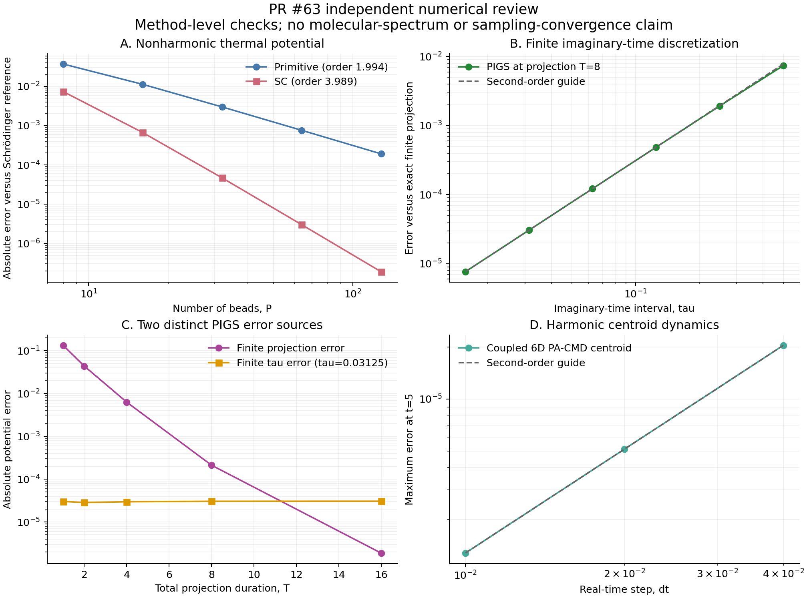

# PR #63：路径积分与光谱核心的独立复核

本记录针对 `3faac3aa42b5424b2711367608e0138c82f62e0a` 的生产代码，
实际执行日期为 2026-11-01。它是本次审阅中新执行的实验，区别于 PR 中已有的
`tier2-literature-2026-11-01` 数据。结果、源文件 SHA-256、版本和种子在
[`pi_spectroscopy_results.json`](pi_spectroscopy_results.json) 中；完整驱动为
[`pi_spectroscopy.py`](pi_spectroscopy.py)。

**结论：本组检查没有发现 SC、玻色交换递推、PIGS、PA-CMD 核心数值公式的新错误。**
这支持这些限定实现的正确性；不意味着完整 Tier 2 方法覆盖、分子光谱准确性或随机采样收敛。



图可用 [`pi_spectroscopy_plot.py`](pi_spectroscopy_plot.py) 从结果 JSON 重建；
另附 [`PDF`](pi_spectroscopy_convergence.pdf)。图中所有误差来自实际计算。

## 1. 对照来源和独立性

| 对象 | 一手依据 | 本次独立参考 |
|---|---|---|
| Suzuki–Chin (SC) | Kapil, Behler, Ceriotti, JCP **145**, 234103 (2016), [DOI](https://doi.org/10.1063/1.4971438), [作者稿](https://arxiv.org/pdf/1606.00920)，式 (4)–(10) | 生产代码实际返回的 SC 能量构造积分转移矩阵；与独立 Schrödinger 谐振子基组对角化比较 |
| 非谐测试势 | Cao, Voth, JCP **101**, 6157 (1994), [DOI](https://doi.org/10.1063/1.468503), [作者提供全文](https://web.mit.edu/jianshucaogroup/pdfdir/JCP101-6157-1994.pdf)，式 (5.1) | 同一明确写出的势与参数；不读取 PR 已有参考数值 |
| 玻色交换 | Feldman, Hirshberg, JCP **159**, 154107 (2023), [DOI](https://doi.org/10.1063/5.0173749), [作者稿](https://arxiv.org/pdf/2305.18025)，式 (3) 的代表置换递推 | 显式建立每个周期中的弹簧，独立执行原始三次复杂度能量/力递推 |
| PIGS | Sarsa, Schmidt, Magro, JCP **113**, 1366 (2000), [DOI](https://doi.org/10.1063/1.481926), [作者机构记录](https://asu.elsevierpure.com/en/publications/path-integral-ground-state-method/) | 独立开链 primitive 转移矩阵，与精确有限投影波函数比较，并分离投影误差和时间片误差 |
| PA-CMD | Hone, Rossky, Voth, JCP **124**, 154103 (2006), [DOI](https://doi.org/10.1063/1.2186636) | 不同原子质量、六维耦合谐振体系的解析质心动力学 |
| Raman / SFG | 生产接口公开的非共振张量不变量与因果响应约定 | Raman 全局旋转不变性；可解析积分的正弦响应；界面反转的复振幅符号 |

本组 SC/PIGS 测试检验文献算法在非谐模型上的离散收敛，不是 Kapil 等人的水/冰体系、
Sarsa 等人的多体体系，也不是 Cao–Voth 论文的动量关联图复现。谐振子基组与坐标网格
Schrödinger 解均独立于 PyRPMD 的势能修正及路径积分估计器。

复现命令：

```bash
OPENBLAS_NUM_THREADS=1 PYTHONPATH=src python \
  docs/validation/pr63-independent-review/pi_spectroscopy.py
```

仅需要 NumPy、SciPy 和生产源码。脚本含有明确精度和收敛阶断言；失败会退出非零状态。
输出是确定性积分与给定种子的数值对照，不将网格点、时间帧或相位平均成员当作独立实验样本。

## 2. 非谐 Schrödinger 参考与文献数值歧义

模型采用论文式 (5.1) 明示的参数：

\[
V(x)=\tfrac12 x^2+0.10x^3+0.01x^4,\qquad m=\hbar=1,\quad\beta=10.
\]

80 态与 160 态谐振子基组结果在下列有效位数一致：

| 量 | 参考结果 |
|---|---:|
| 基态能量 | 0.494221842508574 |
| 基频能隙 | 0.959315581557904 |
| 热平均势能 | 0.249774744440989 |
| 热平均位置 | −0.150148246815160 |
| 热平均位置平方 | 0.538813241015315 |
| 基态势能期望 | 0.249740826131322 |

这里特意保留一项文献不一致：论文相邻文字描述基频相对谐振基频红移约 6%，而按上述
明示参数求解得到 **4.06844%**。另外使用坐标空间三对角有限差分 Schrödinger 方程，
将网格步长从 0.008 减小到 0.004、0.002，再做二阶 Richardson 外推，独立检查该能隙；
结果见 JSON。不调整参数来迎合 6%，也不把该句文字当作已经复现的数值目标。

## 3. SC：非谐作用量与四阶收敛

对实际 `SuzukiChinPotential.evaluate` 返回的奇偶珠能量，构造离散自由粒子传播核和
SC 两步传播核，求其幂的对角线，计算偶数珠的势能平均。积分区间为 [−10,10]，
主网格间距为 0.05。原始二阶 primitive 分解使用同一自由核、积分区间与观测量。

| 珠数 P | SC 势能误差 | SC 相邻收敛阶 | Primitive 势能误差 | Primitive 相邻收敛阶 |
|---:|---:|---:|---:|---:|
| 8 | 7.398365e−3 | — | 3.725316e−2 | — |
| 16 | 6.705885e−4 | 3.4637 | 1.130138e−2 | 1.7209 |
| 32 | 4.668559e−5 | 3.8444 | 2.998610e−3 | 1.9141 |
| 64 | 3.004748e−6 | 3.9577 | 7.616963e−4 | 1.9770 |
| 128 | 1.892313e−7 | **3.9890** | 1.911990e−4 | **1.9941** |

收敛阶定义为 `log2(error(P)/error(2P))`。P=128 时将积分网格间距减半，SC 和
primitive 势能变化分别约 1.67e−16 和 5.00e−16，远小于路径离散误差。
这将之前主要依赖谐振高斯积分的检查扩展到了含三次、四次非谐项的体系。

另在两原子、六维耦合四次势上检查真实 SC 力。包含非对角 Hessian、不同质量，
`alpha=0,0.37,1`；独立解析 Hessian 给出式 (9) 的力。
有限差分位移从 1e−2 减到 1e−3、1e−4、1e−5，误差按二阶减小，
最终三个 alpha 的最大力误差均不超过 **4.29e−12**。

限制：本实验直接积分有限珠作用量，没有由此证明长时间随机 MD 采样的混合或精度；
也没有新增压力、动能或完整总能估计器。

## 4. 玻色交换：独立递推，不混淆点值置换和积分等价

比较 36 组配置，覆盖 P=1、2、7，N=1、2、5、9，以及 beta=0.2、3、20。
参考实现从每一个周期显式列出节点与弹簧，并传播整个力数组，未复用生产代码的
前缀、后缀及连接概率算法。

| 检查 | 最大误差 |
|---|---:|
| 相对能量误差（分母至少为 1） | 3.55e−16 |
| 相对最大力误差（分母至少为 1） | 3.69e−13 |
| 连接概率行和相对 1 的绝对偏差 | 2.28e−13 |
| 连接概率列和相对 1 的绝对偏差 | 2.28e−13 |

Feldman–Hirshberg 代表置换势在单个几何点上不等于所有 N! 置换的对数和；
正确性是对于交换对称势能和观测量的配分函数积分等价。因此，这里与原始递推比较，
不将一个错误的点值 N! 对照用作参考。此实验验证递推数值一致性，没有重新量测
大 N 复杂度，没有实现周期 winding 扇区，也没有重现液氦超流性质。

## 5. PIGS：区分投影误差、时间片误差

使用正试探波函数 `exp(-0.25*x^2/2)`。总投影长度记作 T，两端各投影 T/2；
路径含 L 个连接、L+1 个珠，`tau=T/L`。纯观测量取中点。

在固定 T=8 时，独立精确有限投影的势能为 0.249953008952062，
而基态势能为 0.249740826131322；两者本来就相差约 2.12e−4。

| tau | 有限时间片结果与精确有限投影之差的绝对值 | 相邻收敛阶 |
|---:|---:|---:|
| 0.5 | 7.417672e−3 | — |
| 0.25 | 1.928859e−3 | 1.9432 |
| 0.125 | 4.872088e−4 | 1.9851 |
| 0.0625 | 1.221202e−4 | 1.9962 |
| 0.03125 | 3.055003e−5 | 1.9991 |
| 0.015625 | 7.638757e−6 | **1.9998** |

另固定 tau=0.03125，T 从 1 加长到 16，精确有限投影相对基态的势能误差由
0.133878 降至 1.88165e−6；此时有限 tau 误差仍约为 −3.06e−5，成为主误差。
如果只看最终值接近基态就宣布收敛，会被这两个方向相反的误差误导。
生产 `PIGSPotential.action` 与独立开链作用量在 3、9、33 珠上的最大绝对差为
1.43e−14，覆盖端点半权重、试探波函数梯度对应的作用量和闭合弹簧扣除。

限制：这里没有验证费米符号、与玻色交换组合的 PIGS 或真实多体基态能量。

## 6. PA-CMD 与 Raman/SFG

PA-CMD 使用两个不同原子质量的六维耦合谐振势、8 珠、beta=3、内部目标频率 8，
生产中仅给内部模式加温控。将数值质心与完整耦合谐振体系解析解比较，演化时间为 5。

| dt | 最大质心误差 | 相邻阶数 |
|---:|---:|---:|
| 0.04 | 2.046899e−5 | — |
| 0.02 | 5.116377e−6 | 2.00025 |
| 0.01 | 1.279040e−6 | 2.00006 |

这验证了质量和质心动力学约定，没有将谐振极限的精确性推广到非谐 CMD 频率。

Raman 检查对整个张量轨迹施加相同三维旋转，旋转不变的相对光谱误差为
1.75e−16。SFG 使用 32 个等间距初始相位构造精确平稳余弦交叉关联，独立解析积分
`-beta*dC/dt` 乘余弦截断窗的因果 Fourier 响应。在 omega<=6 范围，复响应相对
L2 误差为 **1.55496e−4**，与有限差分导数和梯形积分误差相容；关联本身最大误差
2.64e−15。反转偶极方向后，复 susceptibility 精确变号、强度保持不变。

没有测试真实分子偶极/极化率模型的准确性、光学 Fresnel 因子、绝对实验强度或真实
界面采样。完整 QCMD/h-CMD 仍然不由这些结果提供。

## 7. 审阅判断

本次核心复核支持四类有限范围结论：SC 在非谐势上恢复四阶离散收敛；PIGS 的 primitive
时间片误差为二阶；二次玻色递推与独立较慢递推一致；光谱张量及因果符号约定通过解析
检验。现有方法边界应继续保留。集成层的恢复、来源身份与输入验证问题由同目录的主审阅
报告单独记录；不能因为这些核心算法通过，就绕过那些集成层门槛。
