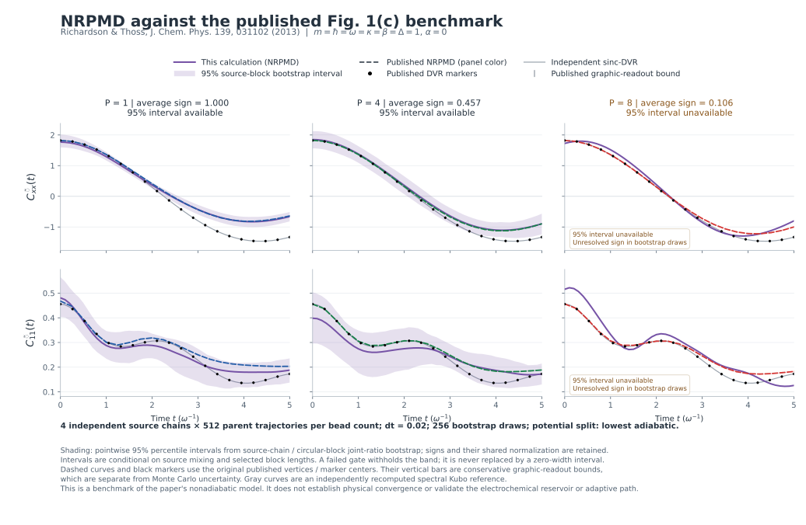

# NRPMD comparison with Richardson and Thoss (2013)

This calculation compares PyRPMD with **Fig. 1(c) of a published NRPMD paper**, using the paper's model, thermal preparation, observables and potential partition. It also computes an independent quantum reference. The nuclear correlation agrees closely with the published NRPMD curves at one and four beads: the respective root mean square differences are **0.04254 and 0.02580** over the 21 published curve vertices. The eight-bead calculation encounters a more severe sign problem and does not pass the criteria for reporting a bootstrap confidence interval. These are results of the recorded finite calculation, not a claim of the original paper's statistical precision. [Numerical report](summary.json)

**Publication:** J. O. Richardson and M. Thoss, “Communication: Nonadiabatic ring-polymer molecular dynamics,” *The Journal of Chemical Physics* **139**, 031102 (2013). [Peer-reviewed article and DOI: 10.1063/1.4816124](https://doi.org/10.1063/1.4816124). The benchmark uses Eqs. 7–15 and Fig. 1(c).



The columns use 1, 4 and 8 beads; the rows show nuclear position and electronic population correlations. Purple lines are this calculation. Purple shading is the pointwise 95% bootstrap interval where its diagnostics permit reporting one. Dashed colored curves and black markers are extracted from the published NRPMD lines and DVR markers. Their vertical bars describe graphic readout, not the authors' simulation uncertainty. Gray curves are the independently recomputed quantum reference. The [PNG version](figures/published_nrpmd_comparison.png) and [plot manifest](figures/plot_manifest.json) are also available.

## Model and estimators

The one-dimensional two-state Hamiltonian is the paper's Eq. 15:

$$
\hat H=\frac{\hat p^2}{2m}+\frac{m\omega^2\hat x^2}{2}
+\begin{pmatrix}
\alpha+\kappa\hat x & \Delta\\
\Delta & -\alpha-\kappa\hat x
\end{pmatrix}.
$$

For Fig. 1(c), $m=\hbar=\omega=\kappa=\beta=\Delta=1$ and $\alpha=0$. Time is expressed in $\omega^{-1}$; the other quantities use the paper's reduced units. The Cartesian implementation adds independent harmonic spectator coordinates $y,z$. They keep the Cartesian thermal distribution normalizable, cancel from normalized $x$ and electronic observables, and exert no force on the coupled $x$/electronic subsystem. [Model and implementation](../../../examples/nonadiabatic/published_nrpmd_benchmark.py)

The saved nuclear correlation is Eq. 12(a):

$$
\widetilde C_{xx}(t)=
\frac{\langle \operatorname{sgn}(W)\,\bar x(0)\bar x(t)\rangle_{|W|}}
{\langle\operatorname{sgn}(W)\rangle_{|W|}}.
$$

The electronic correlation is Eq. 12(b):

$$
\widetilde C_{11}(t)=
\frac{\langle\operatorname{sgn}(W)\,\bar A_1(0)\bar B_1(t)\rangle_{|W|}}
{\langle\operatorname{sgn}(W)\rangle_{|W|}},
$$

where $\bar A_1$ is the SEO projector insertion of Eq. 10:

$$
\bar A_1=\frac1P\sum_{b=1}^{P}
\frac{Y_{b-1,1}(M_bX_b)_1}{Y_{b-1}^{T}M_bX_b},
\qquad M_b=e^{-\beta V_{\rm map}(x_b)/(2P)}.
$$

The final MMST factor is

$$
\bar B_1(t)=\frac1P\sum_{b=1}^{P}
\frac{X_{b1}(t)^2+Y_{b1}(t)^2-1}{2}.
$$

Here $X,Y$ denote the electronic mapping position and momentum, with cyclic bead indices. The shorthand absolute-weight average includes the nuclear spring, scalar potential and Gaussian momentum/mapping factors of the paper's Eq. 7. Its signed mapping factor is $W=\prod_b(Y_{b-1}^{T}M_bX_b)(X_b^{T}M_bY_b)$. Nuclear momenta are independent Gaussian draws of variance $mP/\beta$.

The code uses zero-based index 0 for the paper's electronic state 1. It retains the initial thermal sign along each trajectory. The initial electronic factor is the SEO insertion, while the final factor is the MMST population. Nuclear positions are bead centroids. Neither estimator is clipped, and the time-zero nuclear quantity is not replaced by the bead-averaged $x^2$ observable. [Implementation](../../../examples/nonadiabatic/published_nrpmd_benchmark.py), [thermal API conventions](../../thermal-nrpmd.md)

### Potential partition and propagation

The paper specifies a partition in which the lowest eigenvalue of the electronic mapping matrix is zero. With

$$
r(x)=\sqrt{(\alpha+\kappa x)^2+\Delta^2},
$$

the benchmark uses

$$
V_0(x)=\frac{x^2}{2}-r(x),\qquad
V_{\rm map}(x)=
\begin{pmatrix}\alpha+\kappa x&\Delta\\\Delta&-\alpha-\kappa x\end{pmatrix}
+r(x)I.
$$

The separable spectator potentials are included in $V_0$. The example's `Paper2013Dynamics` reuses the existing PyRPMD MInt flow and restores the $-\operatorname{Tr}V_{\rm map}/2$ term in the energy, consistently with the force already implemented by MInt. Stock `ThermalNRPMDDynamics` uses the smooth trace partition; the benchmark selects the paper partition explicitly. The equilibrium SEO target and its projector ratios are invariant under this scalar redistribution, so the existing thermal sampler supplies the appropriate parents. [Paper, Eqs. 3–11](https://doi.org/10.1063/1.4816124), [adapter implementation](../../../examples/nonadiabatic/published_nrpmd_benchmark.py)

There is a numerical integrator difference: the paper describes analytical free-ring normal-mode updates, whereas this run uses PyRPMD's existing Cayley free-ring step between the exact MInt substeps. The calculation therefore matches the physical model, estimators and potential partition, and checks its own timestep error; it is not an execution of the authors' original code. The paired timestep results are reported below.

## Recorded calculation

The [plan](plan.json) records the complete configuration and SHA256 hashes of the benchmark and relevant implementation files.

| Quantity | Recorded value |
|---|---|
| Bead counts | 1, 4, 8 |
| Independent source chains | 4 per bead count |
| Parents per chain | 512 |
| Burn-in | 1024 Monte Carlo sweeps per chain |
| Sampling stride | 4 Monte Carlo sweeps |
| Production trajectories | 6144 total |
| Production dynamics steps | 1,536,000 total |
| Timestep and duration | $dt=0.02$, $0\le t\le5$ |
| Saved observation interval | 0.1 |
| Timestep refinement | First 8 complete parents per chain, rerun at $dt=0.01$ to the same final time |
| Bootstrap | 256 hierarchical source-chain/circular-block draws |
| Sign threshold | 0.05 |
| Seed | 20261102 |

Monte Carlo sweep counts have no physical time interpretation. Each independent chain has its own deterministic seed sequence. Raw files `P{beads}_chain{index}.npz` retain every parent's initial nuclear positions and momenta, mapping positions and momenta, thermal sign, SEO populations, sweep index, and the full saved per-parent correlation time series. They also retain the final states and the exact source indices used for timestep refinement. Adjacent JSON files record sampler diagnostics, numerical errors and hashes. [Chain and artifact records](summary.json)

## Three distinct comparisons

### 1. This NRPMD calculation against the published NRPMD curves

Each RMSE below is an unweighted comparison at the **21 original published vertices** for that observable and bead count. The current calculation is linearly interpolated from its saved 0.1 observation grid to each extracted vertex time. Graphic readout bounds and current-run Monte Carlo uncertainty remain separate; the paper's own Monte Carlo error bars are not available from this figure. [Extracted data](../../../examples/nonadiabatic/data/richardson_thoss_2013_fig1c.csv), [comparison records](summary.json)

| Beads | Mean sign | Valid bootstrap draws | Current-run 95% interval | $C_{xx}$ RMSE vs paper NRPMD | $C_{11}$ RMSE vs paper NRPMD |
|---|---:|---:|---|---:|---:|
| 1 | 1.000000 | 256 / 256 | Available, subject to the conditions below | 0.04254 | 0.02470 |
| 4 | 0.457031 | 256 / 256 | Available, subject to the conditions below | 0.02580 | 0.02752 |
| 8 | 0.106445 | 249 / 256 | **Unavailable: signed-normalization failures** | 0.11500 | 0.03660 |

The $P=1,4$ nuclear curves provide the clearest agreement with the published calculation. Electronic correlations have visibly larger sampling uncertainty: for example, the $P=4$ time-zero difference from the published curve is 0.05690, while this run's time-zero bootstrap standard error is 0.05486. This evidence supports a finite-precision comparison of the implementation; it does not establish that all electronic amplitudes are statistically resolved. The $P=8$ RMSEs describe the retained point estimate only.

### 2. Independently recomputed DVR against the published DVR markers

The reference solves the coupled one-dimensional Hamiltonian on a sinc-DVR grid and evaluates the spectral Kubo transform. For eigenstates $a,b$, the thermal factor is

$$
w_{ab}=\frac{e^{-\beta E_a}-e^{-\beta E_b}}
{\beta(E_b-E_a)Z},
$$

with its continuous limit for degenerate energies. The autocorrelation is the sum of $w_{ab}|A_{ab}|^2\cos[(E_b-E_a)t]$. The production reference uses 161 points on $[-9,9]$. It is evaluated **directly at all original published DVR marker times** for this comparison, avoiding interpolation of the quantum reference. [Reference implementation](../../../examples/nonadiabatic/published_nrpmd_benchmark.py), [numerical results](summary.json)

| Observable | Published markers | RMSE vs published DVR | Maximum absolute difference |
|---|---:|---:|---:|
| $C_{xx}$ | 20 | $3.5192\times10^{-5}$ | $6.5470\times10^{-5}$ |
| $C_{11}$ | 20 | $7.4009\times10^{-6}$ | $1.4408\times10^{-5}$ |

Repeating the reference with 129 points on $[-9,9]$, and with 181 points on $[-10,10]$, changes the saved curves by at most $8.7\times10^{-12}$ for $C_{xx}$ and $7.4\times10^{-13}$ for $C_{11}$. These numerical changes are far below the conservative graphic-readout bounds. The near agreement of two independently obtained references checks the model, parameter conventions and Kubo observable definitions; it does not remove NRPMD's dynamical approximation.

### 3. This NRPMD calculation against the independently recomputed quantum curves

These RMSEs use the 51 saved times $0,0.1,\ldots,5$, so their sampling grid differs from the published-vertex comparison above. They combine finite sampling, finite beads, finite timestep and the approximate real-time method. [Comparison to recomputed exact quantum reference](summary.json)

| Beads | $C_{xx}$ RMSE vs recomputed DVR | $C_{11}$ RMSE vs recomputed DVR |
|---|---:|---:|
| 1 | 0.38440 | 0.02320 |
| 4 | 0.21300 | 0.03396 |
| 8 | 0.18564 | 0.03858 |

The close match to the published nuclear NRPMD curves and the larger difference from the quantum curve are compatible: reproducing a published approximation does not make it exact. The point estimates show a reduction in nuclear error from one to four beads. The finite sampling budget, especially the unresolved eight-bead interval, does not support a general statistical claim of monotonic convergence with bead count.

## Uncertainty and timestep evidence

The bootstrap first resamples independent source chains, then circular contiguous blocks within each selected chain. It applies the signs to the numerator and recomputes their shared normalization within every draw. The block length is twice the estimated slowest statistical inefficiency among the nonconstant sign and signed correlation contributions, rounded upward. Recorded lengths, in saved-parent units, are:

- $P=1$: 11, 14, 14, 8.
- $P=4$: 5, 8, 14, 10.
- $P=8$: 8, 5, 5, 4.

Intervals require at least two independent chains, 32 bootstrap draws, eight complete blocks per chain, a resolved source sign, and **every** draw to meet the signed-normalization threshold. Seven of the 256 $P=8$ draws fail the last condition. The code withholds the entire confidence interval, while preserving the point estimate and failure records. It does not construct an interval by discarding the failed draws. [Bootstrap diagnostics](summary.json)

These intervals are **pointwise, conditional empirical intervals**, not simultaneous confidence bands for the entire curve. Their interpretation depends on equilibration, source mixing and the selected finite block lengths. The electronic SEO insertion contains ratios that can become large near a mapping-weight node; a finite collection of chains and bootstrap draws cannot establish convergence of rare nodal contributions. Autocorrelation and sign diagnostics do not prove coverage of all slow modes. The plotted intervals therefore do not certify physical convergence or original-paper precision.

The timestep comparison uses the same complete initial nuclear and mapping states, with exactly the same final time. The first eight parents of every chain were selected by index before evaluating the refinements. Across these 32 fixed parents per bead count, the maximum change in the signed mean curve at saved times is:

| Beads | Refinement-subset mean sign | Maximum $\lvert\Delta\widetilde C_{xx}\rvert$ | Maximum $\lvert\Delta\widetilde C_{11}\rvert$ |
|---|---:|---:|---:|
| 1 | 1.000 | $7.80\times10^{-5}$ | $2.75\times10^{-5}$ |
| 4 | 0.375 | 0.002056 | 0.000180 |
| 8 | −0.125 | Not normalized | Not normalized |

The eight-bead refinement subset has a negative mean sign, so it cannot support a normalized ensemble refinement curve under the declared guard. Its raw per-parent comparisons remain well defined. The table below records the maximum per-parent correlation changes and maximum sampled-frame drift of the sum-bead propagation Hamiltonian; these are numerical diagnostics rather than sampling error bars. [Per-chain refinement records and raw arrays](summary.json)

| Beads | Maximum per-parent $\lvert\Delta C_{xx}\rvert$ | Maximum per-parent $\lvert\Delta C_{11}\rvert$ | Maximum sampled-frame Hamiltonian drift at $dt=0.02$ |
|---|---:|---:|---:|
| 1 | 0.000783 | 0.000384 | 0.004704 |
| 4 | 0.025370 | 0.002941 | 0.011872 |
| 8 | 0.001608 | 0.000715 | 0.022973 |

The paired numerical differences for $P=1,4$ are small relative to the present sampling uncertainty. The fixed subset does not establish a bound on timestep error for every sampled or unsampled trajectory.

## Published-data provenance

The source is the published PDF deposited at Friedrich-Alexander-Universität Erlangen-Nürnberg: [repository record](https://open.fau.de/handle/openfau/3580), [PDF](https://open.fau.de/bitstreams/c56516c7-4f8a-456b-95ee-7a55a144cfd0/download). The vector extraction reads colored polyline vertices and filled circular marker centers from Fig. 1(c), printed page 031102-4, PDF page 5. Axis calibration uses printed ticks and their vector positions; no calculated reference values enter that calibration. [Full extraction provenance](../../../examples/nonadiabatic/data/richardson_thoss_2013_fig1c.provenance.json)

The CSV contains **166 original points**: 20 DVR markers and three sets of 21 NRPMD vertices for each of the two observables. It preserves their extracted times. Conservative ordinate readout bounds are approximately 0.04784 for nuclear DVR markers, 0.02741 for nuclear NRPMD vertices, 0.005472 for electronic DVR markers, and 0.003137 for electronic NRPMD vertices. These bounds reflect line width or marker radius, coordinate precision and tick-calibration residuals. They are separate from Monte Carlo uncertainty, and interpolation uncertainty between original graphic vertices is not quantified.

- [Published CSV](../../../examples/nonadiabatic/data/richardson_thoss_2013_fig1c.csv), SHA256: `ba7b1983ec2823e54afcd62e96c22194396d528bf5a075edfe35586e9dd73f97`.
- [Provenance JSON](../../../examples/nonadiabatic/data/richardson_thoss_2013_fig1c.provenance.json), SHA256: `ec447bf1b2ee5b7ea2908b8f7d2cdf94097bd111137429df9d421df825318b69`.
- Original PDF, 413607 bytes, SHA256: `20bc0e0f1424aae7beb97b2718bce7a3dae0b6947e23ce8e9f6ead2004086dce`.
- [Extraction script](../../../examples/nonadiabatic/extract_published_nrpmd_figure.py); its hash and parser version are recorded in the provenance JSON.

The repository includes the extracted numerical data and newly plotted comparisons. The original PDF and figure image are not redistributed in this evidence directory.

## Reproduction and review commands

Run from the repository root in an environment with PyRPMD installed. The `plots` extra supplies Matplotlib; the `test` extra supplies pytest. The simulation uses the Python implementation (`native=False`). A fresh calculation with the recorded numerical settings can be run into a new directory:

```bash
OPENBLAS_NUM_THREADS=1 OMP_NUM_THREADS=1 \
python examples/nonadiabatic/published_nrpmd_benchmark.py \
  --output runs/published-nrpmd-2013 \
  --beads 1 4 8 --chains 4 --samples 512 --burn-in 1024 --stride 4 \
  --dt 0.02 --duration 5 --output-interval 0.1 \
  --bootstrap-replicates 256 --refinement-parents 8 \
  --seed 20261102 --potential-split lowest_adiabatic --workers 3 \
  --published-data examples/nonadiabatic/data/richardson_thoss_2013_fig1c.csv
```

Append `--plan` to inspect the configuration and work count without sampling. For the committed evidence, the following command verifies the matching source/configuration fingerprints and every saved chain-array hash, reuses completed chains, and regenerates the summary with the published CSV:

```bash
OPENBLAS_NUM_THREADS=1 OMP_NUM_THREADS=1 \
python examples/nonadiabatic/published_nrpmd_benchmark.py \
  --output docs/validation/published-nrpmd-2013-2026-11-01 \
  --workers 1 --resume \
  --published-data examples/nonadiabatic/data/richardson_thoss_2013_fig1c.csv
```

The omitted numerical options in this resume command are the recorded defaults listed above. A different configuration, changed relevant source, missing array file or modified array file causes a refusal to reuse the chain. Use a new output directory for a different calculation.

Regenerate the plot from the completed numerical report and extracted data:

```bash
python examples/nonadiabatic/plot_published_nrpmd_benchmark.py \
  docs/validation/published-nrpmd-2013-2026-11-01/summary.json \
  --published-data examples/nonadiabatic/data/richardson_thoss_2013_fig1c.csv
```

To repeat the graphic extraction, obtain the source PDF from the cited repository and provide its local path. This optional operation requires PyMuPDF; the checked-in provenance records version 1.26.6. The extractor checks the documented PDF SHA256 before processing:

```bash
python examples/nonadiabatic/extract_published_nrpmd_figure.py \
  /path/to/richardson_thoss_2013.pdf \
  --output runs/published-nrpmd-extraction
```

The focused physics and provenance tests are:

```bash
python -m pytest -q tests/test_published_nrpmd_benchmark.py
```

All **21** tests passed for this recorded calculation. They check the model gradient, paper potential partition, mapping trace energy correction, Hamiltonian forces, analytic separable Kubo limits including degeneracy, DVR convergence and time reversal, correct initial estimators, preservation of complete parents, source-chain uncertainty and its failure gates, content-checked resume, and consistency with the extracted published markers. [Tests](../../../tests/test_published_nrpmd_benchmark.py)

## Scope of the evidence

This is a published-model benchmark of the nonadiabatic nuclear-quantum component. It has no electron reservoir and no adaptive umbrella bias. Validation of the new constant-potential and adaptive-path example is reported in the [separate electrochemistry study](../adaptive-nrpmd-study-2026-11-01/README.md). The present finite-time correlations are not rate constants; the benchmark summary records `physical_converged=False` and `rate_constant=null`.
