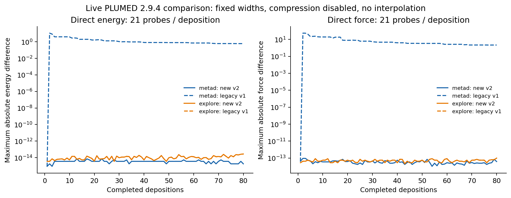
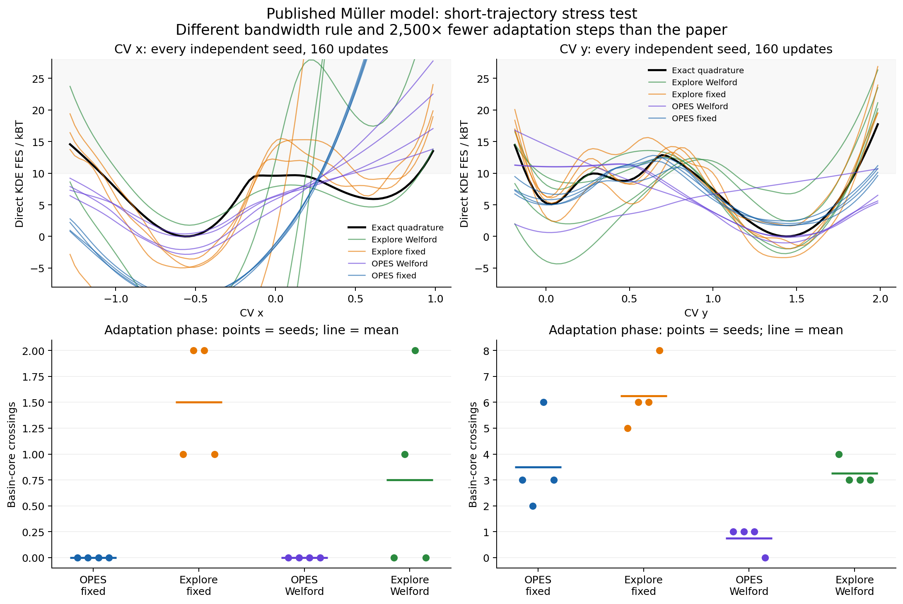
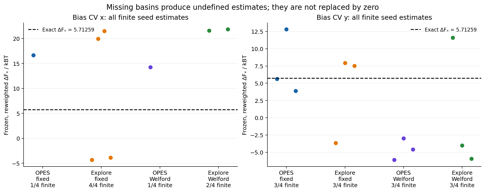
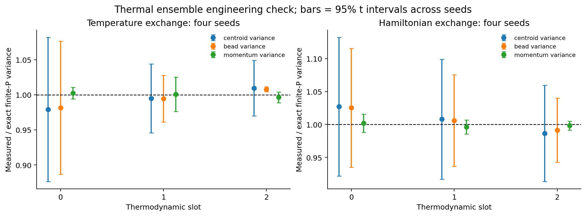
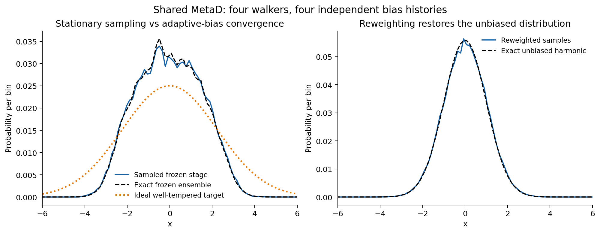
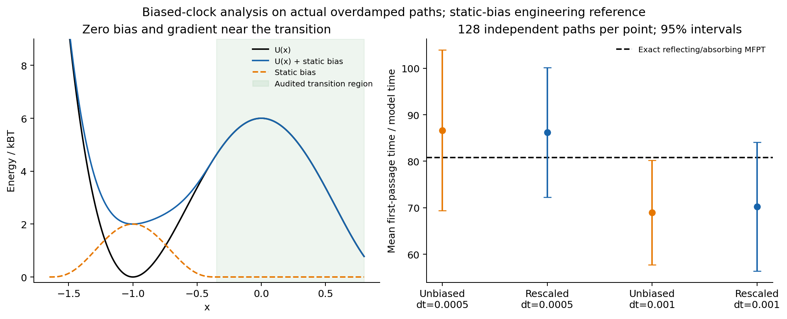
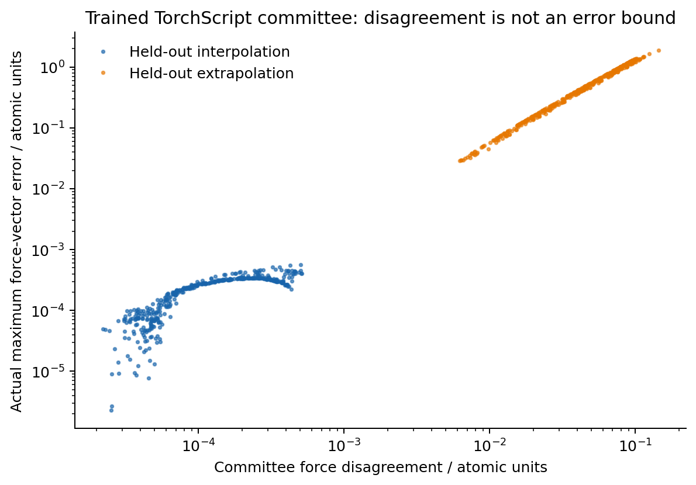

# Sampling validation: saved numerical results

Generated from saved raw trajectories and per-run metrics by `report_sampling.py`. See [README](README.md) for method/reference scope and the [source map](source_map.json) for primary sources. Intervals below are 95% Student-t intervals across the stated independent samples; they do not establish physical convergence.

## Published numerical reference

| Basin definition | Published printed value / kBT | Computed quadrature / kBT |
| --- | --- | --- |
| x<0 versus x>0 | 5.712(6) | 5.712591741223 |
| y>x+1.3 versus y<x+1.3 | 5.690(5) | 5.690516784396 |

The printed parentheses are retained literally; no statistical uncertainty interpretation is imposed. These reference values are integrations of the authors' potential, not measurements from the biased trajectories.

## Live PLUMED fixed-width comparison

| Mode | Probes | Maximum \|ΔV\| | Maximum \|Δforce\| | Legacy maximum \|ΔV\| |
| --- | --- | --- | --- | --- |
| metad | 1680 | 7.11e-15 | 9.24e-14 | 11.2 |
| explore | 1680 | 2.75e-14 | 9.95e-14 | 2.75e-14 |

Both new initial biases equal PLUMED's −20. Direct E/F calls use identical centers, literal physical sigma 0.1, no compression, and no interpolation. This is implementation equivalence for the stated restricted settings.

## Müller trajectory campaign

**32/32 primary trajectories completed.** Every trajectory contains 80,000 adaptation steps and 40,000 frozen steps at dt 0.005, with 160 updates. The primary campaign uses four independent seeds per CV/variant. Each frozen estimate uses 3,200 retained frames before conditioning on the published rectangle.

| CV | Variant | Seeds | Adaptation crossings, per seed | Direct FES RMSE / kBT | Reweighted JS | JS vs exact frozen ensemble | Weight-only ESS range |
| --- | --- | --- | --- | --- | --- | --- | --- |
| x | metad fixed | 4 | 0, 0, 0, 0 | 17.9 ± 0.671 | 0.002393 ± 0.000551 | 0.6931 ± 5.1e-07 | 2532–2907 |
| x | explore fixed | 4 | 1, 1, 2, 2 | 9.301 ± 18.8 | 0.3425 ± 0.624 | 0.3642 ± 0.574 | 407–1542 |
| x | metad Welford | 4 | 0, 0, 0, 0 | 4.584 ± 2.85 | 0.002623 ± 0.000638 | 0.6788 ± 0.0354 | 2312–2724 |
| x | explore Welford | 4 | 0, 0, 1, 2 | 37.71 ± 57.3 | 0.1749 ± 0.538 | 0.3537 ± 0.624 | 933–2060 |
| y | metad fixed | 4 | 3, 3, 2, 6 | 1.514 ± 0.141 | 0.00348 ± 0.00198 | 0.08682 ± 0.0893 | 1613–2824 |
| y | explore fixed | 4 | 8, 5, 6, 6 | 1.942 ± 1.4 | 0.1743 ± 0.539 | 0.1254 ± 0.256 | 397–1784 |
| y | metad Welford | 4 | 0, 1, 1, 1 | 3.996 ± 2.12 | 0.5122 ± 0.54 | 0.3511 ± 0.627 | 2592–3195 |
| y | explore Welford | 4 | 3, 4, 3, 3 | 3.907 ± 4.31 | 0.34 ± 0.621 | 0.1017 ± 0.177 | 330–2706 |

RMSE is evaluated where the exact F−Fmin≤10 kBT, with an optimized additive constant. JS uses natural logarithms and is bounded by log2≈0.693. Small global JS can conceal a missed rare basin; ESS measures weights only and ignores autocorrelation.

| CV | Variant | ΔFₓ per seed / kBT | Oblique ΔF per seed / kBT | Finite ΔFₓ | All-seed ΔFₓ interval |
| --- | --- | --- | --- | --- | --- |
| x | metad fixed | undefined; undefined; 16.673; undefined | undefined; undefined; undefined; undefined | 1/4 | not estimable across all seeds |
| x | explore fixed | -3.8942; -4.3431; 19.941; 21.504 | undefined; undefined; undefined; undefined | 4/4 | 8.302 ± 22.8 |
| x | metad Welford | undefined; undefined; 14.271; undefined | undefined; undefined; undefined; undefined | 1/4 | not estimable across all seeds |
| x | explore Welford | 21.845; 21.608; undefined; undefined | undefined; undefined; undefined; undefined | 2/4 | not estimable across all seeds |
| y | metad fixed | 3.8901; 5.6263; 12.806; undefined | 3.8534; 5.6099; 11.863; undefined | 3/4 | not estimable across all seeds |
| y | explore fixed | undefined; -3.6593; 7.9267; 7.5169 | undefined; undefined; 7.8886; 7.4941 | 3/4 | not estimable across all seeds |
| y | metad Welford | undefined; -6.1207; -2.981; -4.5954 | undefined; undefined; undefined; undefined | 3/4 | not estimable across all seeds |
| y | explore Welford | -5.9384; 11.586; undefined; -4.0074 | -6.0244; 10.838; undefined; undefined | 3/4 | not estimable across all seeds |

Seed order in both tables is 57859, 28661, 38795, 53730. Undefined means one required basin had zero retained weighted population. Finite values from only a subset are not substituted for the missing runs. The large variation, undefined basin estimates and finite-bias mixing errors rule out a convergence claim at this budget.

Across the primary trajectories the largest audited spline energy error is 6.72e-09 kBT and force error is 3.65e-06 model units. These are sampled grid-midpoint audits, not a uniform mathematical bound.

## Timestep and bandwidth sensitivity

Two seeds were declared before running this check. Adaptation time 400, frozen time 200, update interval 2.5, saved-frame interval 0.05 and discarded frozen time 40 are held fixed. Half-timestep trajectories therefore use twice as many MD steps. The separate postanalysis harmonizes the physical relaxation window.

| Seed | dt | σ | Crossings | Direct FES RMSE / kBT | Harmonized ΔFₓ | Reweighted JS |
| --- | --- | --- | --- | --- | --- | --- |
| 57859 | 0.005 | 0.1 | 3 | 1.392 | 3.8901 | 0.005114 |
| 28661 | 0.005 | 0.1 | 3 | 1.548 | 5.6263 | 0.003779 |
| 57859 | 0.0025 | 0.1 | 2 | 2.963 | undefined | 0.001993 |
| 28661 | 0.0025 | 0.1 | 1 | 3.925 | -3.5205 | 0.6819 |
| 57859 | 0.005 | 0.05 | 5 | 0.4617 | 6.0047 | 0.003902 |
| 28661 | 0.005 | 0.05 | 4 | 1.22 | 4.4781 | 0.03405 |

This test exposes finite-trajectory/width sensitivity; two stochastic runs do not demonstrate timestep convergence. No favorable parameter choice is selected as the primary result after viewing these outcomes.

## Replica-exchange thermal ensembles

Four seeds, three thermodynamic slots, P=4, dt 0.02, 24000 MD steps per slot, with 20% discarded. Reference values are exact Gaussian moments of the finite-P harmonic Hamiltonian, not continuum quantum limits.

| Exchange | Slot | Observable | Exact | Four-seed mean ±95% interval | Relative error | Reference in interval |
| --- | --- | --- | --- | --- | --- | --- |
| temperature | 0 | centroid_variance | 1 | 0.9792 ± 0.103 | -2.08% | yes |
| temperature | 0 | bead_variance | 1.076 | 1.0562 ± 0.102 | -1.84% | yes |
| temperature | 0 | momentum_variance | 4 | 4.0091 ± 0.0332 | +0.23% | yes |
| temperature | 1 | centroid_variance | 0.5 | 0.49748 ± 0.0245 | -0.50% | yes |
| temperature | 1 | bead_variance | 0.64052 | 0.63704 ± 0.0212 | -0.54% | yes |
| temperature | 1 | momentum_variance | 2 | 2.0013 ± 0.049 | +0.06% | yes |
| temperature | 2 | centroid_variance | 0.25 | 0.25236 ± 0.00987 | +0.94% | yes |
| temperature | 2 | bead_variance | 0.46667 | 0.47039 ± 0.00168 | +0.80% | no |
| temperature | 2 | momentum_variance | 1 | 0.99641 ± 0.00756 | -0.36% | yes |
| hamiltonian | 0 | centroid_variance | 1 | 1.027 ± 0.105 | +2.70% | yes |
| hamiltonian | 0 | bead_variance | 1.148 | 1.1769 ± 0.104 | +2.52% | yes |
| hamiltonian | 0 | momentum_variance | 2 | 2.0041 ± 0.0275 | +0.21% | yes |
| hamiltonian | 1 | centroid_variance | 0.5 | 0.50396 ± 0.0455 | +0.79% | yes |
| hamiltonian | 1 | bead_variance | 0.64052 | 0.64428 ± 0.0445 | +0.59% | yes |
| hamiltonian | 1 | momentum_variance | 2 | 1.9922 ± 0.0213 | -0.39% | yes |
| hamiltonian | 2 | centroid_variance | 0.25 | 0.2466 ± 0.0183 | -1.36% | yes |
| hamiltonian | 2 | bead_variance | 0.37778 | 0.37448 ± 0.0184 | -0.87% | yes |
| hamiltonian | 2 | momentum_variance | 2 | 1.9965 ± 0.0135 | -0.18% | yes |

17/18 references lie within their individual 95% intervals. The remaining discrepancy is reported rather than treated as a passing convergence test. Intervals are not corrected for 18 simultaneous comparisons, and finite timestep/error can remain.

## Shared well-tempered MetaD

Four independent seeds, four simultaneous walkers, 20000 adaptive + 30,000 frozen steps per walker; 800 total hills per history. The stationary comparison uses only the frozen stage.

| Quantity | Four-seed mean ±95% interval |
| --- | --- |
| JS_reweighted_to_unbiased | 0.00103161 ± 0.000478 |
| JS_sample_to_WT | 0.0483352 ± 0.00368 |
| JS_sample_to_exact_frozen | 0.00165846 ± 0.00063 |
| reweighted_variance | 1.02103 ± 0.0471 |

The exact unbiased variance is 1. Simultaneous pre-update hill-height error is at most 0; permuting walkers changes the final bias by at most 4.44e-16. The frozen distribution agrees much more closely with its own exact equilibrium than with the ideal WT law: this separates correct stationary sampling from incomplete bias convergence. No detailed-balance claim is made while hills are added.

## Audited biased first-passage clock

Independent overdamped trajectories use a static smooth flooding-shaped bias with zero bias/gradient in the entire transition region. The exact reflecting/absorbing mean first-passage time is computed by quadrature. These are 128 independent events per row; none were silently dropped or censored.

| dt | Bias | Exact MFPT | Rescaled MFPT ±95% interval | Raw mean time | Mean boost | Refitted KS bootstrap p |
| --- | --- | --- | --- | --- | --- | --- |
| 0.0005 | none | 80.7744 | 86.655 ± 17.3 | 86.655 | 1 | 0.264 |
| 0.0005 | static | 80.7744 | 86.186 ± 14 | 17.614 | 4.801 | 0.628 |
| 0.001 | none | 80.7744 | 69.007 ± 11.2 | 69.007 | 1 | 0.186 |
| 0.001 | static | 80.7744 | 70.22 ± 13.9 | 14.365 | 4.735 | 0.384 |

All units here are numerical model units. Every simulated integration interval is included in the boost integral. The transition-region maximum bias and gradient are both zero, and there are no deposition events. Finite-sample uncertainty and Euler–Maruyama timestep error remain. This validates an analysis workflow on an audited model, not native infrequent-MetaD or OPES-flooding deposition kinetics.

## Actual trained TorchScript lifecycle

Four bootstrap supervised polynomial models are fitted to 512 noisy energy labels of a known smooth function and exported as TorchScript. Each held-out region contains 400 geometries. The acquisition threshold is the 95th percentile of the interpolation-set disagreement; this is not a calibrated error threshold.

| Region | Energy RMSE | Force RMSE | Mean force disagreement | Above acquisition threshold |
| --- | --- | --- | --- | --- |
| interpolation | 2.2733e-05 | 0.00014897 | 0.00015024 | 5.0% |
| extrapolation | 0.18398 | 0.40595 | 0.049643 | 100.0% |

The monitored 400-step PIMD run performs 80 inspections and collects 32 unlabeled geometries, reaching its configured cap. The maximum difference from the unmonitored positions, velocities and observables is 0.0. Full Δ-learning versus the full learned model has maximum force difference 1.11e-16; the contracted Hamiltonian force agrees with a finite-difference derivative to 1.08e-10. Contracting 4 beads to 1 changes this sampled total energy by -0.212662, which demonstrates the approximation rather than claiming exact target energies. All energy/force units are atomic units.

The extrapolation force error substantially exceeds the committee spread despite their high correlation. No quantum-chemistry labeling or model retraining is automated by the collector.

## Provenance and reproducibility

[campaign_code_provenance.json](campaign_code_provenance.json) records driver archives, stable function hashes, launch commands and postlaunch restore-validation changes. The originals before the initialization fix are retained separately. The final test/CI evidence belongs to the overall validation report; trajectory data are not stamped as if they were generated by later reporting or compatibility-only edits.
