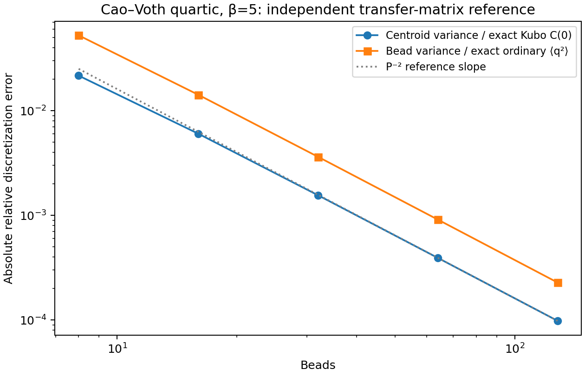
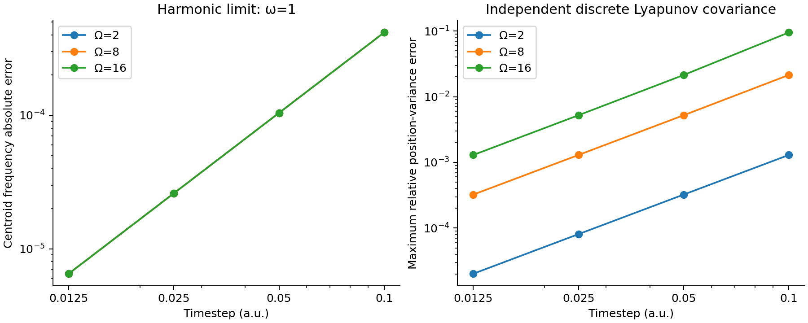
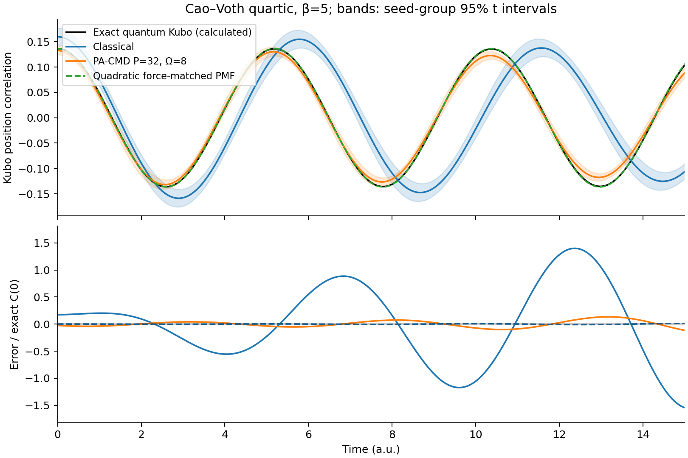
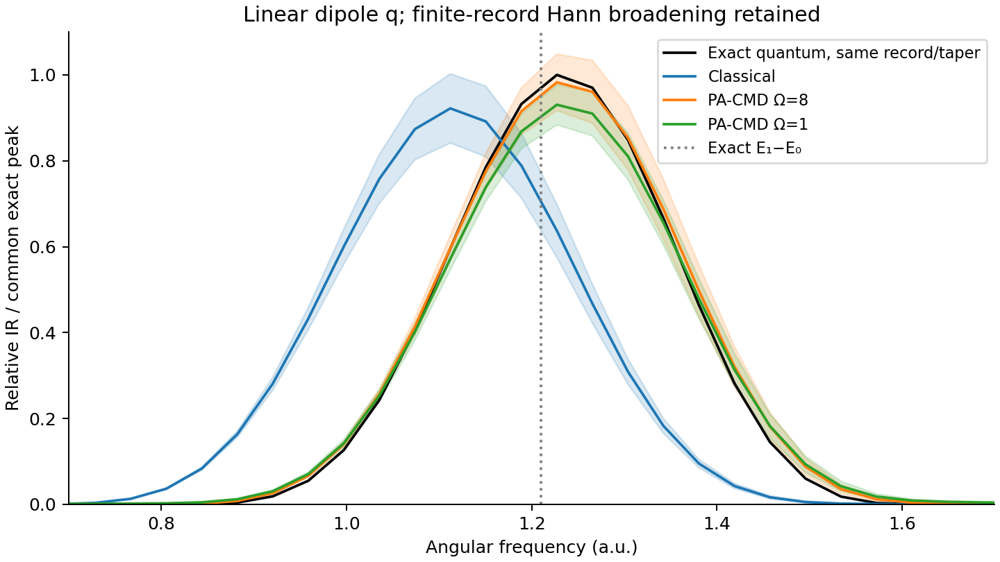
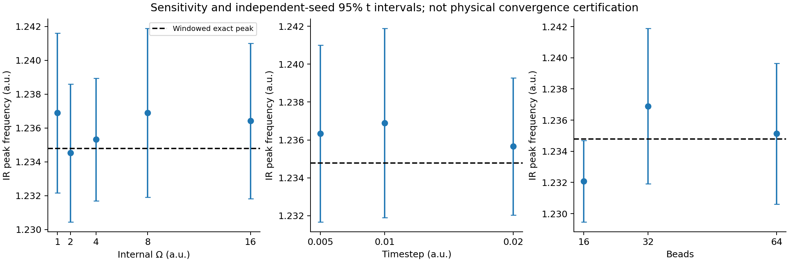
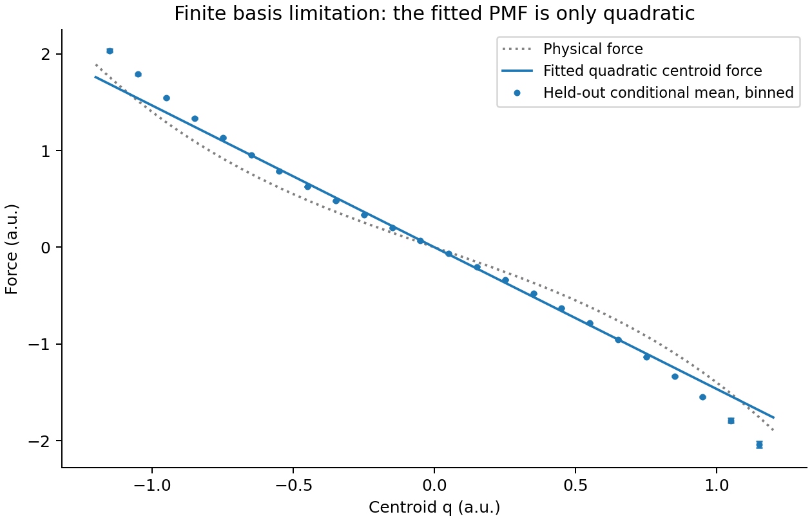

# Spectroscopy literature benchmark

The new PA-CMD engine recovers the harmonic centroid limit and substantially
improves the anharmonic model's correlation and spectrum over classical
dynamics. The anharmonic calculation does **not** establish exact quantum
dynamics: the baseline ensemble correlation retains a 5.93% normalized RMSE
over the stated time interval. Increasing adiabatic separation or reducing the
timestep does not resolve all of this residual within the available sampling.

The benchmark uses the fully specified quartic model in Cao and Voth,
*J. Chem. Phys.* **99**, 10070 (1993),
[DOI 10.1063/1.465512](https://doi.org/10.1063/1.465512), Eq. (18):

\[
V(q)=\frac12q^2+\frac{2.4}{24}q^4,
\qquad m=\hbar=1,\quad \beta=5.
\]

The author-hosted full text and equation were checked. The directly reported
numerical comparison is the paper's **rounded 12% increase in ground-state
energy**. Our principal reference is an independently calculated exact
**Kubo-transformed** correlation for the same Hamiltonian. The paper's Fig. 1
instead plots the real quantum correlation; no figure was digitized or claimed
to be numerically reproduced. [SOURCE.md](SOURCE.md) gives the source trace,
reference equations, sampling contract, method references and reproduction
commands. All numerical values below use the model's internal units;
frequencies are angular frequencies.

## Quantum reference and finite-bead convergence

| Quantity | Calculated result | Interpretation |
| --- | ---: | --- |
| Ground-state energy | 0.559146327183520 | Oscillator-basis diagonalization |
| Increase over harmonic ground energy 0.5 | 11.8292654% | Agrees with the paper's rounded 12% statement |
| Fundamental transition, E1−E0 | 1.210356316765679 | Unbroadened quantum transition |
| Equal-time Kubo correlation | 0.136134658760558 | Centroid-coordinate static target as P→∞ |
| Ordinary quantum position variance | 0.414238627916340 | A different observable from the Kubo variance |
| Fundamental change, basis 100→160 | 3.74×10⁻¹³ | Basis convergence |
| Kubo C(0) change, basis 100→160 | 4.17×10⁻¹⁴ | Basis convergence |

The reference also satisfies `-C_K''(0)=1/(beta*m)=0.2`. A separate real-space
Hamiltonian with two grids and Richardson extrapolation agrees with the first
four basis eigenvalues to the test tolerance of 2×10⁻⁸. This protects against
using the same matrix construction as both implementation and oracle.

An independent transfer-matrix calculation evaluates the **actual primitive
finite-P canonical distribution**. It uses neither the dynamics stepper nor
the force-matching code:

| Beads | Centroid-variance relative error | Ordinary bead-variance relative error |
| ---: | ---: | ---: |
| 8 | +2.16556% | −5.25613% |
| 16 | +0.602726% | −1.41982% |
| 32 | +0.155526% | −0.362494% |
| 64 | +0.0392070% | −0.0911123% |
| 128 | +0.00982191% | −0.0228089% |

The fitted centroid-error exponent from P=16 through 128 is −1.98060,
consistent with second-order primitive-action convergence. Changing the grid
from 301 to 501 points changes the centroid variance by at most 5.64×10⁻¹⁰;
the last external-field Richardson refinement changes it by at most
6.49×10⁻¹⁰. These deterministic bead errors are much smaller than the variance
sampling errors in the production trajectories at P≥32.

## Harmonic limit and finite-step error

Actual `PACMDDynamics` trajectories with `V=q²/2` were propagated at internal
frequencies Ω=2, 8 and 16, using four timesteps from 0.1 to 0.0125. Their
centroid frequencies follow the velocity-Verlet value
`2*asin(dt/2)/dt`, independently of the internal frequency. The largest
difference from that discrete-map frequency is 4.85×10⁻⁹. The physical
frequency error decreases from 4.1713×10⁻⁴ at dt=0.1 to 6.5059×10⁻⁶ at
dt=0.0125, showing the expected second-order timestep behavior.

The normal-mode sampling covariance was calculated independently from the
linear Langevin map by a discrete Lyapunov solve. Common-noise subtraction of
actual engine steps recovers that map with maximum absolute difference
6.04×10⁻¹⁴. This covariance check uses the equilibration `sample_step` with
centroid friction 0.7; the harmonic production-frequency check above leaves
the centroid unthermostatted. The invariant covariance is **not exact at finite timestep**:
at Ω=8 the largest relative configurational-variance error falls from 2.1392%
at dt=0.1 to 0.0323900% at dt=0.0125. At Ω=16 and dt=0.1 it is 9.4864%.
Increasing adiabatic separation therefore still requires a suitable timestep,
despite exact integration of the free-ring part.

## Anharmonic dynamics: actual errors and uncertainties

Each case contains eight independent seed groups, with 96 independent scalar
copies per group. Starting coordinates are exact, independent rejection
samples from the appropriate finite-P canonical measure; initial momenta come
from the public engine. The production duration is 32, recorded every 0.02.
Internal friction is `gamma=Omega`; the centroid is unthermostatted.

Reported `±` values below are **one standard error over the eight seed-group
means**. Figures use 95% Student-t intervals, with factor 2.3646. The correlation
RMSE is calculated for the average correlation over `0≤t≤15`, divided by exact
`C_K(0)`. It includes sampling error and method error, and is a point estimate,
not an estimate of pure systematic bias.

| Case | P | Ω | dt | Windowed IR peak ± SE | Error in peak | Ensemble correlation RMSE / C_K(0) |
| --- | ---: | ---: | ---: | ---: | ---: | ---: |
| Classical control | 1 | — | 0.01 | 1.116282 ± 0.001358 | −0.118501 | 71.44% |
| PA-CMD baseline | 32 | 8 | 0.01 | 1.236896 ± 0.002110 | +0.002113 | 5.93% |
| Low separation | 32 | 1 | 0.01 | 1.236890 ± 0.001993 | +0.002107 | 9.38% |
| Separation check | 32 | 2 | 0.01 | 1.234524 ± 0.001727 | −0.000260 | 6.89% |
| Separation check | 32 | 4 | 0.01 | 1.235320 ± 0.001536 | +0.000537 | 6.04% |
| Separation check | 32 | 16 | 0.01 | 1.236418 ± 0.001945 | +0.001635 | 6.01% |
| Coarser timestep | 32 | 8 | 0.02 | 1.235659 ± 0.001531 | +0.000876 | 6.39% |
| Finer timestep | 32 | 8 | 0.005 | 1.236331 ± 0.001973 | +0.001548 | 6.20% |
| Fewer beads | 16 | 8 | 0.01 | 1.232080 ± 0.001110 | −0.002704 | 4.85% |
| More beads | 64 | 8 | 0.01 | 1.235132 ± 0.001913 | +0.000349 | 6.94% |

The peak comparator is **1.234783504**, the expected exact quantum periodogram
with the same finite record, Hann taper, demeaning and `beta*omega²` factor.
The bare quantum transition is 1.210356317. The difference between those two
reference numbers is a finite-record and frequency-weighting effect; it must
not be charged to the MD method. The baseline peak differs from its matched
reference by +0.1711%, with a 0.1709% standard error. Its descriptive early-time
phase-fit frequency is 1.209992 ± 0.002071, but that fit is not a quantum-line
estimator for a general multitransition correlation.

Peak agreement alone does not establish correlation or line-shape agreement.
The Ω=1 case has a similar peak while its correlation error is larger. The
baseline mean of the **per-seed** normalized correlation RMSEs is
9.226% ± 1.138% SE; averaging the correlations first reduces their RMSE to
5.934%. Its per-seed, area-normalized spectral-shape L2 error is
5.134% ± 0.648% SE. These error definitions are saved separately in the CSVs.

The baseline initial centroid variance is 0.132705 ± 0.003844, compared with
the deterministic finite-P32 target 0.136346383. Its production time-averaged
variance is 0.139173 ± 0.004005; its centroid velocity variance is
0.205059 ± 0.006392, compared with the canonical target 0.2. These sampling
intervals explain why the trajectory bead series cannot resolve the much
smaller deterministic finite-P errors or be ranked by its raw RMSE alone.

The sensitivity comparisons use the same seed groups and retain paired
differences. In peak frequency, Ω=16 minus Ω=8 is
−0.000478 ± 0.000422 SE; dt=0.005 minus dt=0.01 is
−0.000565 ± 0.000903 SE; dt=0.02 minus dt=0.01 is
−0.001237 ± 0.001204 SE. Each corresponding 95% interval includes zero.
Ω=4 minus Ω=8 is −0.001576 ± 0.000635 SE, marginally outside its individual
95% interval; these exploratory comparisons have no multiple-comparison
correction. There is no claim that all separation settings have converged.

The roughly 6% correlation-error plateau for Ω≥4 and the nonmonotonic bead and
timestep results are retained. This finite ensemble does not separate every
contribution from sampling, finite separation, finite step and the underlying
CMD approximation. Increasing Ω does not make anharmonic CMD exact quantum
dynamics. The output deliberately retains `physical_converged=false`.

## Restricted f-CMD force-matching check

For each of eight seeds, the shipped quadratic conservative fitter receives
16,384 independent P32 training configurations and an equally sized,
independently sampled hold-out set. Each configuration has three independent
Cartesian copies of the model. The fitted quadratic's connected correlation
is then evaluated analytically, isolating force-basis and training errors
from an additional numerical dynamics error.

| Quantity | Mean ± SE across eight fits |
| --- | ---: |
| Mean fitted normal-mode frequency | 1.211071 ± 0.000276 |
| Connected C(0) | 0.1363619 ± 0.0000622 |
| Hold-out instantaneous-force RMSE | 0.075318 ± 0.000249 |
| Normalized correlation RMSE over t≤15 | 0.5813% ± 0.0995% |

The fitted frequency is about 0.0590% above the exact fundamental. This small
error for the present weak quartic does not validate a general anharmonic
fitter. The hold-out binned conditional means visibly depart from the fitted
linear force in the tails, exposing the quadratic-basis limitation. The
instantaneous-force RMSE also includes fluctuations at a fixed centroid and
cannot be interpreted as pure conditional-mean-force error. No fitted quantum
answer or exact spectrum was supplied as a training target.

## Validation coverage and remaining boundaries

The focused check ran **64 tests successfully**: seven new independent
literature-reference tests plus the existing PA-CMD, property, spectra and
workflow suites. It exercised actual CPU TorchScript loading; the installed
PyTorch emitted two deprecation warnings for its scripting/loading API.
The command and source hashes are recorded in [checks.json](checks.json).

No production-code defect was identified by these comparisons. Finite-step
harmonic covariance bias, finite-P discretization, statistical spread and
anharmonic CMD approximation error are reported as separate numerical or
physical limitations. The real-space reference test uses Richardson
extrapolation so finite-grid error is not confused with an eigensolver defect.

| Feature | Evidence here and in focused tests | Boundary |
| --- | --- | --- |
| PA-CMD | Actual harmonic and published-model trajectories; independent covariance, static and quantum references; timestep/Ω/P studies and seed errors | One separable 1D model; no liquid water, H₂/D₂, condensed-phase or experimental-spectrum reproduction |
| f-CMD | Conservative quadratic force matching; harmonic recovery; independent anharmonic hold-out samples | Cartesian local quadratic PMF only; no general nonlinear or molecular force-matching model |
| Raman | Rotational invariance, isotropic/anisotropic tensor limits and relative polarization factors | Analytic tensor checks, not a molecular Raman benchmark or absolute optical intensity |
| SFG | Analytic causal harmonic response, sign convention, inversion cancellation | Analytic response checks; no interface selection, Fresnel factors or molecular interface benchmark |
| Property models | Actual TorchScript and Python contracts, units, symmetry, batching, bead nonlinearity, content-sensitive restart | No trained production dipole/polarizability model or material-level accuracy claim |
| QCMD/h-CMD | Explicit rejection and documented scope | No constrained quasi-centroid dynamics or complete h-CMD workflow; IBI helper alone is not either method |

Nonlinear property observables additionally require the appropriate
conditional centroid/quasi-centroid property construction; agreement for the
linear dipole `mu=q` does not validate that more general approximation.

## Retained evidence and reproducibility

The two drivers are
[spectroscopy.py](../../../../benchmarks/tier2_literature/spectroscopy.py) and
[spectroscopy_static.py](../../../../benchmarks/tier2_literature/spectroscopy_static.py).
They regenerate all numerical CSV/JSON and figures in this directory with the
commands in [SOURCE.md](SOURCE.md). The main run takes about six minutes on one
CPU worker with BLAS threads limited to one; the transfer-matrix calculation
takes about 1.5 seconds in this environment. Exact measured runtimes are in
`summary.json` and `finite-bead-static-reference.json`.

Retained evidence comprises parameter/source manifests; exact transition and
basis-convergence tables; finite-P and harmonic tables; all case and per-seed
scalar metrics; full averaged time correlations with standard errors;
spectra through angular frequency 6 with errors and exact comparator;
paired sensitivity; f-CMD per-seed and hold-out binned forces; and six figures.
`case-*.npz` and `fcmd-fit.npz` are optional, rebuildable working caches and are
not required in the source distribution. Per-seed scalar CSVs suffice to
recalculate their reported scalar means and paired errors. Full per-seed
time-series reanalysis requires regenerating the caches; mean/SE CSVs do not
pretend to preserve that missing covariance information.

The main manifest records the driver's own SHA256 and the three used core
source hashes, alongside seeds, versions and Git HEAD. The static report
records its own script hash. Git HEAD alone is not presented as the identity
of then-uncommitted benchmark code. Removing caches forces deterministic
regeneration; a cached run also invalidates its cache if numerical settings or
any recorded code hash changes. `--quick` is explicitly marked as smoke data
and was not used for these conclusions.
