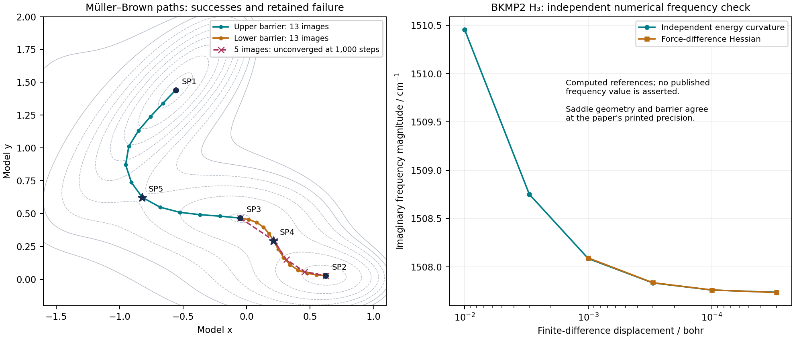
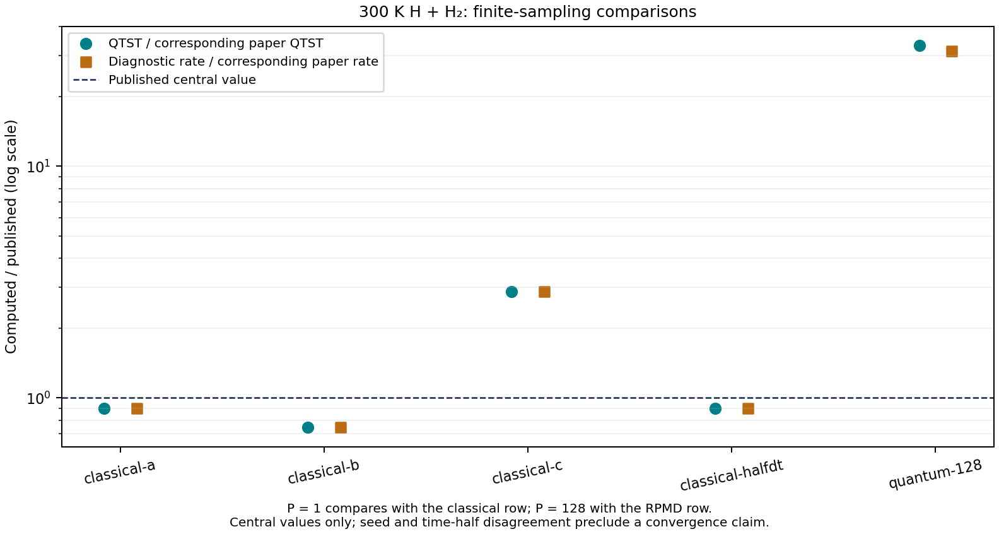

# Transition-state search: numerical and literature validation

This study exercises PR #59 from reactant/product structures, through CI-NEB,
P-RFO refinement, saddle and entrance-channel validation, and into actual BKMP2
H + H2 rate sampling. The deterministic saddle checks agree with published
reference values at their printed precision. The rate calculations are a
separate finite-sampling study: their central values and uncertainty diagnostics
must not be interpreted as a converged reproduction of the published RPMD rate.

The implementation under test is commit
`99bfc5b01be359032156616133eaa7767848aee6`. Documentation inclusion and MPI runner
configuration were subsequently fixed in
`98cf85368fa618ee6f275c18c88c2d5d34b3924d`. Benchmark files and evidence were added
afterward; each numerical report records the relevant source hashes. No
production optimizer or rate-estimator parameter was tuned to make a paper
comparison pass during this study.

## Evidence and acceptance criteria

| Evidence | What it establishes |
| --- | --- |
| [software.json](software.json), [full pytest log](pytest-native.log), [new literature/reporting tests](pytest-search-validation.log) | Executed software checks, environment, skipped dependencies and counts |
| [mpi-results.json](mpi-results.json) and the linked per-scenario logs | Actual four- and five-rank execution, separately from ordinary pytest |
| [analytic.json](analytic.json) | Published analytic stationary points, independent analytical derivatives and numerical roots, local-search and path-resolution sensitivity |
| [analytic-neb-failure-trajectories.npz](analytic-neb-failure-trajectories.npz) | Every evaluated band, energy and physical force for the four unsuccessful five-image paths |
| [h3.json](h3.json) | Real BKMP2 electronic saddle, endpoint variations, approximate TS guesses, and geometry handoff into rate preparation |
| [h3-rate-sanity.json](h3-rate-sanity.json) | Independent classical harmonic TST scale, units, channels and equivalence to a supplied-TS rate input |
| [covalent-radii.json](covalent-radii.json) | All 96 tabulated radii checked against ASE, isotope aliases and explicit heavy-element overrides |
| [rates.json](rates.json) | Fresh finite-sampling rate experiments, published comparators, decomposition and convergence diagnostics |
| [h3-recrossing-halfdt.json](h3-recrossing-halfdt.json) | Matched quantum-child replay, per-pair energy errors and initial-state provenance |

Published coordinates and energies printed to three decimal places are compared
with a half-unit in the last decimal place. Higher-precision reference values
in the JSON are our independent calculations, not extra digits attributed to a
paper. Analytical model energies are compared in the original model units.

A successful search needs a small physical force and exactly one resolved
negative Hessian eigenvalue. The full molecular preparation additionally checks
the entrance channel. Neither a small projected NEB force by itself, a minimum
of squared gradient, nor agreement of one rate central value is an acceptance
criterion for a physical rate calculation.

## Software and integration checks

The full native build passed **4,465 tests**, with **95 explicitly skipped** and
**486 subtests passed**. The new literature test file was not part of that
initial collection; the final targeted run passed **47 tests** (40 literature
checks and 7 reporting regressions). This gives **4,512 distinct tests passed** plus the 486 subtests,
with 95 skipped and no failures.
The logs preserve the exact pytest summaries, and `software.json` records the
JUnit counts separately because the JUnit total also includes subtests.

The local environment was Python 3.12.14, NumPy 2.3.5, SciPy 1.17.0, h5py 3.16.0,
ASE 3.29.0, pymbar 4.0.3 and mpi4py 4.1.2. The C++/OpenMP native backend was
compiled and available. BKMP2 was compiled with GNU Fortran 13.3 from the
checksum-pinned author source, and passed its independent author-reference
energy and force checks. Build/source/library hashes are in the H3 evidence.

The 95 skips are recorded individually. Most require separately built BrHCl
surfaces, PySCF/tblite, PyTorch, JaxPIP, the original Caracal optimizer, a real
PLUMED wrapper, or an explicitly selected Ni–H EAM potential. They are not
reported as executed local tests. Separate existing GitHub workflows exercise
several of those optional integrations; their outcomes must be read at the
associated commit, not substituted for this local test count.

All eight MPI scenarios passed: integration, dynamic scheduling, workflow
handoff, adaptive sampling, OPES, materials, surfaces and surface extensions.
Dynamic scheduling used five ranks; the other scenarios used four.

All four documentation builds passed with warnings treated as errors:
English/Chinese HTML and English/Chinese single HTML. This process found and
fixed two CI integration problems:

- The new guide appeared in the toctree but was omitted from Sphinx's explicit
  `include_patterns`, making the strict documentation build fail.
- The CI runner could reject four/five ranks because its available slots were
  smaller. The commands now explicitly pass `mpiexec --oversubscribe`; the
  actual multi-rank scenarios were then executed successfully locally.

The real-H3 CI workflow now also executes the analytic, BKMP2 search, classical
scale/handoff and full-radius benchmarks. These deterministic checks fail the
job on a core regression, while preserving intentionally difficult unsuccessful
searches as diagnostics. Long finite-sampling rate experiments are not turned
into a misleading green physical-convergence gate.

## Analytic surfaces: published saddles and independent checks

The Cerjan–Miller function is Eq. (21) in the Applications section of
[Banerjee et al. (1985)](https://doi.org/10.1021/j100247a015). With the stated
unit parameters its minimum is `(0,0)` and its saddles are `(-1,0)` and `(1,0)`.
All three coordinates and indices agree. The saddle energy `exp(-1)` is derived
from the formula and is not treated as a separately published energy.

For Müller–Brown, the parameters and reference stationary points are Eqs. (1)–(2)
and Table I of [Doye and Wales (2002)](https://doi.org/10.1063/1.1436470),
[primary preprint, page 3](https://arxiv.org/pdf/cond-mat/0108310).
All three minima and both saddles agree at the printed precision. Representative
13-image searches give:

| Saddle | Published `(x,y)` | PyRPMD CI-NEB → P-RFO `(x,y)` | Published energy | Computed energy |
| --- | --- | --- | ---: | ---: |
| SP4, lower barrier | `(0.212, 0.293)` | `(0.212486582001, 0.292988325107)` | -72.249 | -72.248940112325 |
| SP5, upper barrier | `(-0.822, 0.624)` | `(-0.822001558671, 0.624312802870)` | -40.665 | -40.664843508657 |

An independent SciPy root solver uses analytical gradients and Hessians. The
derivatives themselves are checked against energy/gradient finite differences.
PyRPMD estimates its own Hessian from forces. This gives an independent check
of both stationarity and Hessian index, instead of merely trusting the
optimizer's status flag. The supplemental Adams function is tested against
independent derivatives and roots only: inconsistent retrieved coordinate text
is not corrected or promoted into paper reference data.

The artificial one-atom `[x,y,z]` embedding adds a stable harmonic `z` direction;
the exact positive energy scaling is recorded in JSON. No molecular rate is
inferred from these dimensionless model surfaces.

| Matrix | Observed outcome |
| --- | --- |
| Published stationary points | 8/8 agree at printed precision |
| Six saddles × three local guesses × three force tolerances | 54/54 reach the intended saddle |
| Hessian displacement sweep, `1e-3`, `1e-4`, `1e-5` | 6/6 reach the intended saddle |
| Exact minima and a maximum offered as TS inputs | 6/6 rejected |
| CI-NEB → P-RFO path/image/tolerance matrix | 32/36 reach the intended saddle |
| Accepted refinements with a wrong independently computed index | 0 |
| Remote local-search starts | 4/7 reach a valid saddle; two reach a different saddle, three exhaust their budget |

At a local force tolerance of `1e-8`, the maximum coordinate error is
`2.094e-8` and the maximum energy error is `1.421e-14` in original model units.
Across successful NEB → P-RFO cases, those maxima are `1.549e-9` and `2.842e-14`.
These numerical errors measure agreement on the same analytic model, not
electronic-structure accuracy or the precision of the published values.

### Retained failures and independent implementation

All four unsuccessful CI-NEB cases are the lower barrier with five images,
both directions, and both requested force tolerances. The searches exhaust
1,000 total iterations. Every tested seven-, thirteen- and twenty-one-image
path succeeds, including reversed, bowed and two-barrier model paths. Testing
a model path across two barriers does not add support for treating a multistep
molecular mechanism as one gas-phase rate input.

ASE's independent improved-tangent/FIRE implementation also fails its lower
barrier five-image case within its budget, whereas seven images converge in
131 climbing updates. ASE uses a maximum force-vector norm; PyRPMD uses a maximum
absolute component. ASE's additional 20 warmup steps are outside its reported
climbing budget, so iteration counts and residuals are not identical criteria.
The result supports checking path resolution, not a universal claim that seven
images always suffice or that both failures have a uniquely proven cause.

The four failed PyRPMD paths retain 1,001 evaluated bands each in a compressed,
pickle-free NPZ: coordinates, original-model energies and physical forces. Its
hash, array shapes and mapping to individual cases are in `analytic.json`.



## Real BKMP2 H3: electronic saddle and handoff

Section IV D of [Boothroyd et al. (1996)](https://doi.org/10.1063/1.471430),
[author preprint, printed page 12](https://www.cita.utoronto.ca/~boothroy/papers/bkmp2pre.pdf),
reports the collinear saddle distance and classical electronic barrier. An
independent bracketed radial-gradient solve finds the H2 minimum and symmetric
H3 saddle. The barrier is relative to optimized isolated H2 + H, evaluated at
the 99-bohr asymptote; it is not measured from the finite-separation NEB endpoint.
No zero-point correction is included.

| Quantity | Paper | Independent BKMP2 reference | Representative endpoint search |
| --- | ---: | ---: | ---: |
| Neighbor distance / bohr | 1.757 | 1.756999999486 | 1.756999999466, 1.756999999428 |
| Barrier / millihartree | 15.32 | 15.319770776 | 15.319770776 |
| Barrier / kcal mol^-1 | 9.613 | 9.613301303 | 9.613301303 |
| Resolved negative mass-weighted modes | First-order saddle | 1 | 1 |

The paper's rounded values agree within half the last printed digit. The extra
computed digits establish numerical reproducibility on BKMP2; they are not a
claim of that many digits of physical accuracy.

All **14 endpoint variants** and **9 perturbed TS guesses** pass force, index and
entrance-channel checks. The matrix includes 3/5/7/8/9/11 images, endpoint
separations of 4/6/8 bohr, three NEB tolerances, three spring constants, endpoint
reversal, a common rotation/translation, a bent initial path, and maximum
initial TS displacements of 0.02/0.05/0.10 bohr.

Across the 23 cases, the maximum neighbor-distance error against the independent
root is `6.155e-5` bohr and the maximum electronic-energy error is `6.10e-10`
hartree. Across the 22 cases using the tighter TS tolerance `1e-7`, these reduce
to `1.737e-6` bohr and `8.70e-14` hartree. NEB requires 55–184 updates; P-RFO
uses up to 86 updates for the tested approximate guesses.

Frequency accuracy is a separate diagnostic. With the default `1e-5` force
tolerance, the imaginary-frequency magnitude differs by approximately
`0.552 cm^-1` from an independent energy-curvature calculation, missing an
additional `0.2 cm^-1` accuracy target. The 22 tighter-force cases differ by at
most `0.0279 cm^-1`. The default remains a valid converged saddle under its
documented force criterion; it is not a spectroscopy-level criterion.
The force-difference steps `1e-4` and `3e-5` bohr give `1507.75876` and
`1507.73221 cm^-1`; the independent energy-curvature estimate at `3e-5` bohr is
`1507.73454 cm^-1`. No imaginary frequency is attributed to the paper.

The public `prepare`, the preparation stage actually called by `run_rate`, and
the saved `preparation.json` give identical optimized geometries. The optimized
TS is different from the starting endpoint and has rate-coordinate value
`xi = 1`. A further 133-geometry comparison against the historical explicit-TS
input finds maximum differences of `2.30e-12` in xi, `3.70e-13` in its gradient,
`1.74e-13` in its Hessian and `7.11e-17` in its mass metric. Masses, channel
definitions and entrance prefactors agree. Both equivalent saddle arrangements
give xi = 1 and the reactant reference at Rinf = 30 bohr gives xi = 0.

## Independent classical rate-scale check

For a labeled linear rotor and classical harmonic vibrations, the script
`h3_rate_sanity.py` independently evaluates

```text
k_HTST = 2/(2*pi*beta) * (2*pi*beta/mu)**(3/2)
         * (I_TS/I_H2) * omega_H2/(beta**2 * product(omega_TS_stable))
         * exp(-beta*Delta_V)
```

This atomic-unit formula counts two labeled saddle neighborhoods once. It
excludes the unstable stretch and five rigid modes, and includes the stable
symmetric stretch and both components of the degenerate bend. Rotational
symmetry numbers are one in these labeled partitions. The sampled workflow
already includes both product arrangements through `equivalent_paths`, so its
`symmetry_factor` remains one; it must not receive an extra factor of two.

At 300 K the result is `1.64225637e-18 cm^3 molecule^-1 s^-1`, **5.27% above**
the classical TST value `1.56e-18` in
[Suleimanov, Allen and Green (2013), Table 2](https://doi.org/10.1016/j.cpc.2012.10.017).
The entrance prefactor independently evaluated in SI agrees with the atomic-unit
expression to `1.95e-13` relative error.

This is a useful rate-scale and units/channel check using a different method.
It excludes tunneling, zero-point energy, anharmonicity and recrossing. Its 5.27%
difference is neither an RPMD reproduction nor an uncertainty estimate. Along
with the coordinate comparison, it argues against a simple new handoff, units
or missing-channel error; it does not prove that every rate discrepancy is
caused by sampling.

## Fresh 300 K endpoint-to-rate study

<!-- RATE_STUDY_START -->
All five planned cases completed from reactant/product inputs: three independent
classical seeds, a same-seed classical time-step refinement, and one 128-bead
quantum experiment. This comprises **1,110 umbrella trajectory streams** and
**2,560 recrossing children**, with 4,506.6 ps of umbrella production and 910.2 ps
of equilibration. The additional matched quantum-child replay is counted below,
separately from these totals. All five retain `converged=false`.

### Matched physical conventions and different sampling budgets

The comparator is Table 2 of the [RPMDrate paper](https://doi.org/10.1016/j.cpc.2012.10.017).
At 300 K its classical row is QTST `1.56e-18`, kappa `0.994`, total rate
`1.55e-18`; its 128-bead row is QTST `2.51e-16`, kappa `0.776`, total rate
`1.95e-16`. Rate units throughout this section are `cm^3 molecule^-1 s^-1`.
P=1 is compared only with the classical row and P=128 only with the RPMD row.

All new runs use BKMP2, hydrogen-1 masses, 300 K, Rinf=30 bohr, 111 windows
from -0.05 to 1.05, a 30-hartree umbrella coefficient, and both equivalent
product arrangements without an extra symmetry factor. Every TS is obtained
from endpoints; no saddle geometry is supplied to this driver.

| Protocol | Classical experiments | Quantum experiment | Paper Table 1 |
| --- | --- | --- | --- |
| Beads | 1 | 128 | 1 / 128 |
| Time step | 0.1 fs; paired sensitivity at 0.05 fs | 0.1 fs | 0.1 fs |
| Trajectories per umbrella window | 2 | 2 | 200 |
| Equilibration per trajectory | 1 ps | 0.1 ps | 20 ps |
| Production per trajectory | 5 ps | 0.3 ps | 100 ps |
| Constrained-parent chains / saved configurations | 4 / 128 | 4 / 128 | Different parent protocol |
| Recrossing children / physical duration | 512 / 100 fs | 512 / 100 fs | 100,000 / 50 fs |
| Recorded umbrella interval | 10 fs | 0.5 fs | Every integration step in the listed sample count |

This study uses an Andersen thermostat and the Cayley propagator. Table 1 lists
GLE for H + H2; an identical propagator is not claimed. The numerical PMF uses
1,001 quadrature points rather than the listed 5,000. These are much shorter
experiments than the paper protocol, with deliberately explicit limits.

### Measured rate decomposition

| Case | P | dt / fs | QTST | kappa (bootstrap SE) | Diagnostic total rate | Rate / matching paper row |
| --- | ---: | ---: | ---: | ---: | ---: | ---: |
| classical-a | 1 | 0.1 | 1.404992e-18 | 0.992575 (0.003937) | 1.394559e-18 | 0.8997 |
| classical-b | 1 | 0.1 | 1.161151e-18 | 0.995973 (0.001533) | 1.156475e-18 | 0.7461 |
| classical-c | 1 | 0.1 | 4.484765e-18 | 0.995691 (0.001778) | 4.465439e-18 | 2.8809 |
| classical-halfdt | 1 | 0.05 | 1.403328e-18 | 0.992576 (0.003937) | 1.392909e-18 | 0.8987 |
| quantum-128 | 128 | 0.1 | 8.349418e-15 | 0.735084 (0.032847) | 6.137527e-15 | 31.4745 |

The three independent classical seeds have mean `2.338824e-18`
and between-seed standard error `1.065526e-18`.
The mean/paper ratio is `1.5089`, and that standard error is
`45.6%` of the mean. Three seeds do not establish confidence coverage or the
paper's approximately 5% statistical convergence. The half-dt case and the
dense recording replay are excluded from the independent-seed statistics.

Halving the classical time step at the same seed changes the rate by only
`0.118286%`, while its maximum child endpoint energy error decreases from
`0.01420164` to `0.00356437 kBT` per bead.
That controlled result is much smaller than the observed seed/replica scatter.
It supports treating sampling as the dominant observed classical limitation
in this study, without proving absence of every systematic error.

The quantum candidate is **31.47 times** the paper rate, and QTST alone is
**33.26 times** its comparator. The original quantum run fails the child-energy
gate, so its primary `rate_cm3_s` is explicitly **null** and its status is
`pilot_requires_convergence`. The diagnostic number in the table is preserved
for investigation and is not a validated physical rate.



### Sampling and estimator diagnostics

| Case | Replica barrier difference / kBT | First/second-half difference / kBT | Median effective samples per stream | MBAR minus UI barrier / kBT |
| --- | ---: | ---: | ---: | ---: |
| classical-a | 1.7305 | 0.3325 | 322.4 | 0.0983 |
| classical-b | 1.5707 | 0.2180 | 339.2 | 0.0847 |
| classical-c | 1.8902 | 0.6866 | 333.3 | 0.0681 |
| classical-halfdt | 1.7289 | 0.3341 | 322.4 | 0.1004 |
| quantum-128 | 2.6916 | 7.8399 | 25.5 | 0.0969 |

The quantum first and second halves give QTST `1.74874e-16` and
`4.44163e-13`, a factor of approximately **2,540** apart. Their barrier
difference is **7.840 kBT**. The two umbrella replicas differ by **2.692 kBT**;
59 of 222 streams have fewer than 20 effective samples, with a minimum of 6.58.
These are direct signs that this short trajectory set is not stationary/mixed
enough for a rate comparison. All portions and the pooled result are retained.

The same-sample MBAR/UI differences are about 0.07–0.10 kBT, much smaller than
the replica and temporal spreads. Switching these estimators does not remove
the observed discrepancy. Their agreement on shared observations does not
exclude shared systematic errors. Because rate depends exponentially on the
barrier, a 5% rate contribution from PMF uncertainty alone would require a
barrier uncertainty of roughly `ln(1.05) = 0.0488 kBT`; the measured spreads
are substantially larger. Transmission and other systematic uncertainties
must also be assessed separately.

The PMF bootstrap uses only 12 draws and limited correlation blocks. Its saved
percentile intervals are low-draw diagnostics, not established confidence
coverage. The recrossing bootstrap uses 200 draws from the saved parent blocks;
that uncertainty remains conditional on adequate parent mixing. No interval
is used to upgrade these results to physical convergence.

### Controlled quantum child time-step replay

The original 0.1-fs quantum run has a maximum child endpoint energy error of
`0.135221935 kBT` per bead, exceeding the existing code threshold of 0.1.
The [separate replay evidence](h3-recrossing-halfdt.json) uses exactly the same
four parent chains, 128 saved configurations and 256 opposite-momentum pairs,
with 512 new children of the same 100-fs duration. Only the child time step
changes; the PMF and parent ensemble are reused.

| Quantity | Original 0.1 fs | Matched replay 0.05 fs |
| --- | ---: | ---: |
| Maximum endpoint energy error / kBT per bead | 0.135221935 | 0.045541131 |
| Child pairs exceeding 0.1 kBT per bead | 7 / 256 | 0 / 256 |
| Kappa on the original time grid | 0.735084429 | 0.735084429 |
| Kappa parent-bootstrap SE | 0.032847 | 0.032847 |

Original full child momenta were not stored: the helper reconstructs them
from the recorded streams with the original NumPy version, reproduces every
saved flux denominator exactly, and checks the actual replay momentum draw
bitwise. Saved positions, all 256 original checkpoint fingerprints and original
file hashes also match. Full q/p matching and pairwise energy errors are
recorded; the original checkpoints remain unchanged.

The maximum transient kappa-curve difference at matched times is 0.00478221.
The selected tail is identical for this finite set, giving zero paired
bootstrap difference. This does not imply zero time-step error for arbitrary
additional trajectories. The replay resolves the observed child endpoint-energy
gate at half dt; it does not resolve PMF nonstationarity, parent-timestep
convergence, bead convergence or the physical rate discrepancy. The original
quantum failure is retained, and no replacement converged rate is declared.

### Operational failures and provenance retained

The initial dense classical run completed all 222 trajectories, then exited
with code 137 during intermediate generic MBAR analysis. Its potential matrix
alone was about 4 GB; the exit is consistent with memory exhaustion, without
a kernel OOM log establishing that cause. The final protocol records classical
observations every 10 fs and uses 12 PMF bootstrap draws to bound analysis cost.
A subsequent incompatible-checkpoint attempt was rejected by the existing
physics fingerprint. Both unsuccessful attempts remain in the JSON and are
excluded from accepted-run statistics.

For seed A, all 222 streams match bitwise at common recording times, as do
their final positions and momenta. Nevertheless, using every dense observation
gives QTST `1.99016e-18`, whereas the 10-fs observations give `1.40499e-18`.
Changing the retained observations changes the finite-sample estimator; it
must not be presented as an unchanged numerical estimate or another independent
seed. The [executed harness snapshot](rates-executed-harness.txt) is retained
as source text for audit. The final benchmark adds reporting-only guards and
metadata corrections; all six hashed production files remain identical across
the five completed cases. Resolved settings, runtime and artifact hashes are
the authoritative record of each run.

Two reporting defects found in review were fixed and covered by seven focused
tests: operational errors now produce a nonzero CLI exit after saving evidence,
and duplicate case labels/seeds cannot masquerade as independent replicates.
An executed but physically unconverged experiment remains clearly distinct
from an operational error.
<!-- RATE_STUDY_END -->

## Covalent radii

All **96 H–Cm values** match ASE 3.29.0's Cordero dataset exactly, including the
documented carbon and low-spin choices. This is an independent software-table
cross-check, not a new fit or independent digitization of the original
[Cordero et al. paper](https://doi.org/10.1039/B801115J).

Four isotope/override cases pass. All 22 elements beyond Cm require and accept
an explicit radius, rather than silently using ASE's placeholder entries.
Unknown symbols remain errors even when an override is supplied, and a bohr
override converts correctly to angstrom. ASE is needed only for this validation
script and does not become a core runtime dependency.

## Reproduction

From a checkout containing this PR, install the native/test and validation
dependencies, build the pinned BKMP2 surface, and keep one BLAS/OpenMP thread per
trajectory worker:

```bash
python -m pip install -e '.[test,ase,mpi,analysis,docs]'
python benchmarks/h3/build_pes.py
export OMP_NUM_THREADS=1 OPENBLAS_NUM_THREADS=1 MKL_NUM_THREADS=1
python -m pytest -q

python benchmarks/transition_state_search/analytic.py --output validation/analytic.json
python benchmarks/transition_state_search/h3.py --output validation/h3.json
python benchmarks/transition_state_search/h3_rate_sanity.py --output validation/h3-rate-sanity.json
python benchmarks/transition_state_search/covalent_radii.py --output validation/covalent-radii.json

python benchmarks/transition_state_search/rates.py \
  --cases classical-a classical-b classical-c classical-halfdt quantum-128 \
  --workers 4 --output runs/ts-rate-study --evidence validation/rates.json
python benchmarks/transition_state_search/recrossing_timestep.py \
  --source runs/ts-rate-study/quantum-128 --output runs/ts-child-halfdt \
  --evidence validation/h3-recrossing-halfdt.json --workers 4
python benchmarks/transition_state_search/render.py validation
```

A Fortran compiler is needed for BKMP2, a C++ compiler for the native backend,
and an MPI installation for the actual multi-rank scenarios. Use a fresh rate
output directory; changing the recording interval, dynamics or other checkpoint
physics must not silently reuse incompatible checkpoints. The rate driver saves
resolved inputs and raw checkpoints under its output directory. The checked-in
JSON contains compact results, source/artifact hashes and the original local
run locations, not the full trajectory archive.

The paper comparison is limited to the tested surfaces, isotope, temperature and
channel conventions. Multistep molecular kinetics, alternative atom mappings,
other PESs, bead convergence, Rinf convergence and production statistical
convergence require their own evidence.
